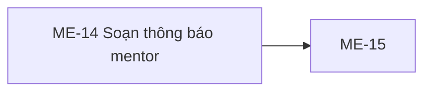

# ME-14 — Navigation

> **Current source (2026-11-21):** ME-14 submits through #63 and routes the accepted operation UUID to SH-07. It does not route directly to ME-15 in this implementation; #64 remains a separate notification-ID API. Browser/runtime is unverified.

## 1. Route definition
- Current route in inventory: `/mentor/notifications/new`
- Status: registered in `apps/study-client/src/app/features/mentor/mentor.route.ts`; browser/runtime remains unverified.
- Route params/types: Không có route param được biểu diễn trong inventory string; route runtime vẫn chưa xác minh.
- Query params/defaults: preserve the inventory route string; detailed parsing rules only from source DD.
- Route guards: see source DD/API contract; do not create role policy.

## 2. Điểm vào
| From screen/route | Trigger | Params | Guard / fallback |
|---|---|---|---|
| [ME-13](../ME-13-ChonNguoiNhanThongBao/00-overview.md) | Router navigation with course/recipients state | `courseId`, unique Student IDs and display names | ME14 validates positive int64-safe IDs; missing/invalid handoff shows return link |

## 3. Điểm ra
| Destination | Trigger | Params | Điều kiện |
|---|---|---|---|
| [ME-15](../ME-15-TheoDoiGuiThongBao/00-overview.md) | Source event/inventory navigation | Theo source DD | Expected links; runtime chưa verify |

## 4. Back / refresh / deep link
- Back behavior: xem source DD; không mặc định browser history.
- Preserve filters/scroll/form state: chỉ nếu source có nêu, nếu không `CẦN_XÁC_NHẬN`.
- Refresh/direct URL: route exists; a direct entry without handoff state shows a return-to-ME-13 gate. Draft title/body are local only and will be lost on refresh/navigation.
- Invalid/missing ID: theo source DD/backend contract; không tự tạo validation.
- Not authenticated/authorized: theo source role guard; xem [Business Rules](05-business-rules.md).

## 5. Diagram

## Source navigation and flow detail

### Trích từ DD nguồn: E. Điều hướng và state giữa màn hình

Current source uses Angular router `history.state` for the ME-13 handoff, validates the course and recipient IDs, rejects duplicate IDs, then removes recipient/course fields from the current history entry. Draft/title/body/send/result are not persisted; accepted state is held only until routing to SH-07. An ambiguous send blocks another attempt in the current component. Approval of broader carrier expiry/restore behavior remains open.

| Handoff | Dữ liệu cần giữ | Current evidence | Quyết định cần có |
|---|---|---|---|
| ME-13 → ME-14 | Course identity và danh sách unique Student IDs; có thể có draft text khi quay lại. | Current Angular source passes router state; ME-14 validates it and consumes the payload from the current history entry. | In-memory handoff is implemented; draft persistence and cross-session restore remain out of scope. |
| ME-14 → accepted send | Title, text content, recipients, channels. | Current #63 client submits trimmed text; no attachment; ambiguous response blocks blind resend in the current page. | No idempotency key or exact course binding exists; provider delivery remains unverified. |
| Accepted → SH-07 | Operation UUID từ #63; notification int64 IDs vẫn là metadata riêng cho #64. | Current ME-14 routes the UUID to SH-07, whose #18 read is notification-only and owner-bound. | Focused UI/API tests pass; provider/runtime delivery remains unverified. |

### Ma trận state

| State | Nguồn | Đặc tả |
|---|---|---|
| `draft` | `list_screen.md` expected state | Không được lưu/khôi phục trong source hiện tại. |
| `validating` | `list_screen.md` expected state | Handoff and response projections are validated by the current page/service. |
| `sending` | `list_screen.md` expected state | The explicit submit button is disabled while #63 is in flight. |
| `accepted` | `list_screen.md` và API #63 | Theo local API source, chỉ sau transaction commit; 202 nghĩa queued, không phải delivered. |
| `error` | Current Study Client and #63 error set | Known HTTP errors are presented; ambiguous outcomes block blind submit in the current component. |
| `QUEUED`/`SENT`/`FAILED` | #64 local projection | Trạng thái dispatch API theo từng notification; mapping từ delivery counts là `DERIVED`, worker chưa wired. |

### Trích từ DD nguồn: B. Luồng hoạt động tổng thể

### Luồng hiện tại của artifact

1. Mở `code.html` tĩnh. Không có router/auth guard hoặc gọi dữ liệu.
2. DOM khởi tạo với title/body trống, In-app checked, Email disabled, selection chưa xác thực, send disabled và preview placeholder.
3. Khi title đổi, script hiển thị raw character count `value.length`; preview dùng `trim()` để chọn placeholder hoặc nội dung. Preview được gán bằng `textContent`.
4. Khi body đổi, script đếm các từ sau `trim().split(/\s+/)`; preview được cập nhật bằng `textContent`. Không có markdown/rich text parsing.
5. Toolbar, kênh, đính kèm, lưu nháp, gửi, breadcrumb, navigation, help và footer không có handler/router/API. Anchor dùng `href="#"`; `data-path` là nhãn tĩnh.
6. Không có state persistence. Refresh sẽ trở về giá trị ban đầu của HTML.

### Luồng dự kiến theo AC-25 và giới hạn nguồn hiện tại

1. ME-13 chọn course và Student từ roster #62. ME-13 handoff IDs/course sang ME-14 đang mở; phải thống nhất carrier, ID type và course binding trước khi code.
2. ME-14 nhận title, content, recipients và channels; hiện HTML không có state nhận từ ME-13, validation audience hoặc quy tắc sản phẩm đã được nối.
3. Khi có contract đã duyệt, client cần tạo request #63 theo schema chính xác. Hiện chưa thể ánh xạ `body text → content:int64`, `In-app → PUSH`, hoặc attachment vì source không định nghĩa mapping.
4. #63 strict-validates request model; malformed/missing/type/extra-field input có thể bị framework trả 422 trước khi handler chạy. Với body parse thành công, Mentor auth chạy trước CSV parsing/DB. Sau đó source kiểm tra recipient scope, thực hiện transaction và chỉ trả 202 sau khi tất cả notification/outbox rows commit.
5. Response #63 có một Operation UUID trong `data.id`, cùng các notification int64 IDs trong `meta.notification_ids`. Đây là hai định danh khác mục đích.
6. API #64 đọc status cho từng notification ID. Source tổng hợp `QUEUED` nếu còn delivery queued; nếu không và có failed thì `FAILED`; nếu tất cả sent thì `SENT`. Đây là mapping local `DERIVED`; worker/provider chưa wired nên không đảm bảo chuyển khỏi `QUEUED`.
7. API #18 không có Study route và AC-25 không kết nối endpoint này vào luồng. Không gọi #18 theo `operation_id` ở ME-14.

### Trạng thái giao diện và lỗi

| Trạng thái | Hiện có trong prototype | Hành vi/ghi chú |
|---|---|---|
| Initial/empty | Có | Selection/title/body rỗng; preview dùng placeholder. |
| Recipient blocked | Có | Badge chưa xác thực; Send disabled. |
| Editing title/body | Có | DOM preview/counter được cập nhật. |
| Channel selected/disabled | Có | In-app checked; Email disabled. Không có onChange handler. |
| Uploading/saving/sending/loading | Không | Không có async handler hoặc spinner. |
| Validation error | Không | Dấu `*` là copy; input không có `required`, form hoặc validator. |
| API success/error | Không | Không có fetch/client error mapping. HTTP/API outcomes chỉ mô tả ở E09 để phục vụ tích hợp sau khi blockers được giải quyết. |
| Session expired/unauthorized | Không | Chưa có auth/runtime; nếu tích hợp #63, 401 theo API contract cần xử lý ở app shell. |
