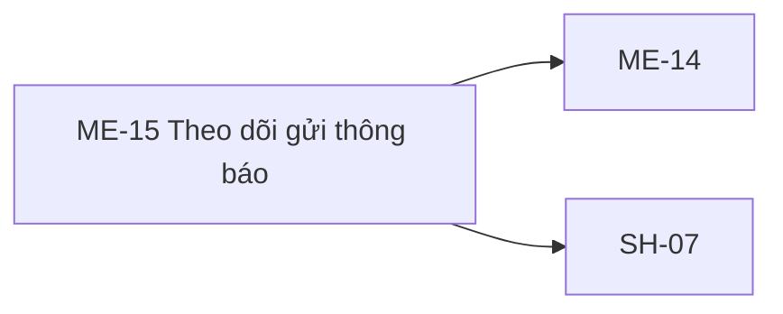

# ME-15 — Navigation

## 1. Route definition
- Current route in inventory: `/mentor/notifications/:notificationId/status`
- Status: candidate/design route; Study Web `UNWIRED` unless source code proves otherwise.
- Route params/types: `notificationId` (type/validation: see source DD; CẦN_XÁC_NHẬN if absent)
- Query params/defaults: preserve the inventory route string; detailed parsing rules only from source DD.
- Route guards: see source DD/API contract; do not create role policy.

## 2. Điểm vào
| From screen/route | Trigger | Params | Guard / fallback |
|---|---|---|---|
| [SH-07](../SH-07-TheoDoiTacVuBatDongBo/00-overview.md), [ME-14](../ME-14-SoanThongBaoMentor/00-overview.md) | Theo DD nguồn/inventory | Theo source; không suy diễn | Xem source DD; route chưa xác nhận runtime |

## 3. Điểm ra
| Destination | Trigger | Params | Điều kiện |
|---|---|---|---|
| [ME-14](../ME-14-SoanThongBaoMentor/00-overview.md), [SH-07](../SH-07-TheoDoiTacVuBatDongBo/00-overview.md) | Source event/inventory navigation | Theo source DD | Expected links; runtime chưa verify |

## 4. Back / refresh / deep link
- Back behavior: xem source DD; không mặc định browser history.
- Preserve filters/scroll/form state: chỉ nếu source có nêu, nếu không `CẦN_XÁC_NHẬN`.
- Refresh/direct URL: route trong inventory không chứng minh runtime.
- Invalid/missing ID: theo source DD/backend contract; không tự tạo validation.
- Not authenticated/authorized: theo source role guard; xem [Business Rules](05-business-rules.md).

## 5. Diagram

## Source navigation and flow detail

### Trích từ DD nguồn: E. Ma trận trạng thái và điều hướng

### Trạng thái

| State | Nguồn/điều kiện | Nội dung có thể khẳng định | Chuyển tiếp / giới hạn |
|---|---|---|---|
| `PROTOTYPE_INITIAL` | HTML mới tải | Literal ID placeholder, status chip, steps, channels và empty report. | Không chứng minh queue/server state. |
| `MOCK_REFRESH_LOADING` | EV-02 click, trong 0–800 ms | Icon quay; button disabled. | Timer bật button lại; không có request. |
| `MOCK_REFRESH_TOAST` | EV-02 sau 800 ms | Toast success text hiển thị; button đã enabled. | Timer 3000 ms ẩn toast; data không đổi. |
| `API64_QUEUED` | Nếu #64 200, `data.status=QUEUED` | Local outbox của một notification còn ít nhất một row queued. | Không xác định provider/recipient totals hoặc batch status. |
| `API64_FAILED` | Nếu #64 200, `data.status=FAILED` | Theo DERIVED aggregation, có row failed và không còn row queued. | Mixed success được gộp thành FAILED; counts không trả về. UI mapping cần quyết định. |
| `API64_SENT` | Nếu #64 200, `data.status=SENT` | Theo DERIVED aggregation, tất cả row của notification được đánh SENT ở local outbox. | Không tự map sang inventory `complete`; provider receipt semantics chưa xác nhận. |
| `API64_ERROR_401` | #64 trả 401 | Request không được xác thực. | Session refresh/login redirect/copy không có UX contract. |
| `API64_ERROR_403` | #64 trả 403 | Role/sender access bị từ chối. | Không lộ dữ liệu; xử lý/điều hướng chưa xác định. |
| `API64_ERROR_404` | #64 trả 404 | Notification/status resource không tồn tại theo API. | Empty-vs-not-found presentation chưa xác định. |
| `API64_ERROR_500` | #64 trả 500 | Server không đọc/ánh xạ được status. | Retry/backoff/copy chưa xác định. |
| `ID_HANDOFF_BLOCKED` | #63 trả nhiều `meta.notification_ids` cho một Operation UUID nhưng caller route cần một ID | Có nhiều ID riêng biệt, không có selection rule. | Không gửi #64 đến khi caller/contract chọn resource; không poll #18. |

`sending` và `complete` trong tracker không được map từ #64 vì hiện source không trả hai enum này. Ba progress step, channel state/ACK, report detail, real-time status và version string không phải state machine được backend xác nhận.

### Điều hướng và session

| Từ | Hành động hiện có | Destination/data | Trạng thái |
|---|---|---|---|
| ME-14 → ME-15 | Producer #63 trả `data.id:uuid` và `meta.notification_ids:int64[]`. | ME-15 route chỉ có một `:notificationId`; chưa biết chọn phần tử nào hoặc cách đại diện batch. | BLOCKER |
| ME-15 back/breadcrumb/nav | Anchor hiện `href="#"`. | Không có route/destination và không truyền ID. | Prototype only |
| ME-15 → SH-07 | Không có action/API #18 nối trong AC-25. | Generic operation UUID/lifecycle chưa thống nhất; #64 vẫn notification-specific. | Không điều hướng tự động |
| Technical support/footer | Anchor `href="#"`. | URL/ticket/email destination chưa có. | Prototype only |
| Session invalid/expired | Không có Study Web auth guard. API #64 yêu cầu Bearer. | 401 code có thể được trả khi gọi server; client recovery policy chưa chốt. | BLOCKER |

### Trích từ DD nguồn: B. Luồng hoạt động tổng thể

### B.1. Current flow trong prototype

1. Browser tải `code.html`; logo, profile, breadcrumb, thông tin queue, channel, steps, report, nguyên tắc hiển thị và version được dựng bằng HTML tĩnh.
2. Không có URL parser, route guard, token/session read, API client, cache, fetch/XHR, WebSocket, SSE hoặc polling timer.
3. “Đang đồng bộ…” là literal placeholder, không phải system ID. “Đã tiếp nhận vào hàng đợi xử lý”, “Máy chủ đang lắng nghe”, ba bước, channel statuses và empty report đều không bind vào server data.
4. Click “Tải lại trạng thái” chỉ chạy EV-02 bên dưới. Các anchor có `href="#"`; chúng không chỉ tới route khác.
5. Người dùng có thể rời trang chỉ bằng browser controls; không có xử lý phiên hết hạn hoặc recovery UI trong prototype.

### B.2. Flow mục tiêu — chỉ sau khi quyết định các blocker

1. Caller sau #63 phải cung cấp một `notification_id:int64` cụ thể. API #63 hiện trả `data.id:uuid` và `meta.notification_ids:int64[]`; frontend không tự lấy `data.id`, không tự chọn phần tử đầu tiên và không tổng hợp batch nếu chưa có quyết định.
2. Khi route/ID contract được thống nhất, frontend gọi #64 bằng Bearer token Mentor: `GET /api/v1/mentor/notifications/{notification_id}/status`. Không có query hoặc body.
3. Server xác thực token/role trước khi parse path, sau đó đọc đúng một notification và các delivery rows của nó, kiểm tra sender ownership, rồi trả một Operation-shaped envelope. #64 không thực hiện provider call hoặc mutation.
4. Frontend chỉ có thể map trường `data` có bằng chứng: `id` UUID, `kind`, `status`, `owner_id`, `submitted_at`, `updated_at`. Response không có `notification_id`, channel detail, counts, recipient details hoặc completion result.
5. `data.status` theo local source là `QUEUED`, `FAILED` hoặc `SENT`. Mọi mapping sang inventory `queued/sending/complete/failed`, tiến độ ba bước, ACK hoặc per-channel status cần product/API decision; không suy đoán.
6. Lỗi API có HTTP/business code được nêu ở EV-04. UI copy, retry, polling cadence, terminal state, cache invalidation và điều hướng recovery chưa có contract; không tự thêm.

### B.3. Thứ tự phụ thuộc

`ME-14 / API #63 → chọn notification ID cụ thể → route ME-15 → GET #64 → per-notification Operation-shaped status`.  
Generic `SH-07 / API #18` là luồng khác. AC-25 không nối #18 vào flow ME-15; #18 hiện không có runtime endpoint.
