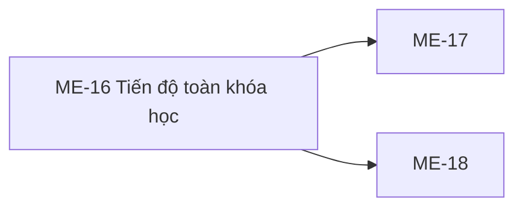

# ME-16 — Navigation

## 1. Route definition
- Current route in inventory: `/mentor/courses/:courseId/progress`
- Status: candidate/design route; Study Web `UNWIRED` unless source code proves otherwise.
- Route params/types: `courseId` (type/validation: see source DD; CẦN_XÁC_NHẬN if absent)
- Query params/defaults: preserve the inventory route string; detailed parsing rules only from source DD.
- Route guards: see source DD/API contract; do not create role policy.

## 2. Điểm vào
| From screen/route | Trigger | Params | Guard / fallback |
|---|---|---|---|
| [ME-02](../ME-02-CacKhoaHocPhuTrach/00-overview.md), [ME-03](../ME-03-WorkspaceKhoaHocCuaMentor/00-overview.md), [ME-17](../ME-17-TienDoTungHocVien/00-overview.md), [ME-18](../ME-18-AnalyticsKhoaHoc/00-overview.md) | Theo DD nguồn/inventory | Theo source; không suy diễn | Xem source DD; route chưa xác nhận runtime |

## 3. Điểm ra
| Destination | Trigger | Params | Điều kiện |
|---|---|---|---|
| [ME-17](../ME-17-TienDoTungHocVien/00-overview.md), [ME-18](../ME-18-AnalyticsKhoaHoc/00-overview.md) | Source event/inventory navigation | Theo source DD | Expected links; runtime chưa verify |

## 4. Back / refresh / deep link
- Back behavior: xem source DD; không mặc định browser history.
- Preserve filters/scroll/form state: chỉ nếu source có nêu, nếu không `CẦN_XÁC_NHẬN`.
- Refresh/direct URL: route trong inventory không chứng minh runtime.
- Invalid/missing ID: theo source DD/backend contract; không tự tạo validation.
- Not authenticated/authorized: theo source role guard; xem [Business Rules](05-business-rules.md).

## 5. Diagram

## Source navigation and flow detail

### Trích từ DD nguồn: E. Ma trận trạng thái và điều hướng

### E1. Trạng thái

| State | Điều kiện | UI/source behavior | Status |
|---|---|---|---|
| `UNWIRED` | Study Web router/client absent | Không có runtime route để vào màn hình | Current |
| `loading` | Route load/refetch đang chờ #65 | Inventory expects it; prototype has no load state; skeleton/spinner design unspecified | Expected, UI not implemented |
| `ready` | Accepted response has one or more roster items | Local #65 can return items, but table columns/actions and approved response mapping are not established | Expected, blocked |
| `empty` | No eligible roster items, or approved filtering yields no rows | Prototype shows static empty illustration/copy; local #65 returns `items=[]`; reasons are not distinguished | Expected + static prototype |
| `denied` | API returns 401/403 | Local error business codes exist; Study Web session redirect/403 display is absent | Expected, UI behavior pending |
| `not_found` | Invalid/unmapped path or course absent; local API responds 404 | UI response/navigation is not wired | Current API response, UI pending |
| `error` | Local API returns safe 500 or transport fails | No error panel/retry behavior in HTML; network handling not defined | UI pending |
| `refreshing` | Refresh action in progress | Prototype only disables button/spins for 1000 ms without request | Cosmetic prototype state |
| `filtering/searching` | Filter/search applied | No state/handler/API contract | Not implemented |

### E2. Điều hướng / dữ liệu cần truyền

| From | Destination | Required data | Current evidence/state |
|---|---|---|---|
| Mentor course context | ME-16 route | `courseId` resolvable to API `course_id:int64`; authenticated Mentor | Route exists only in screen inventory; no Study Web router or slug mapping |
| ME-16 student row | ME-17 / #67 | `course_id:int64`, selected `student_id:int64` | Inventory expects it; no rows/action shown by prototype |
| ME-16 analytics CTA | ME-18 / #66 | `course_id:int64` | Placeholder link; AC-26 places #66 earlier than inventory's ME-18 link |
| Header/breadcrumb/help/footer links | Destinations unspecified | Destination-specific IDs/session as later specified | Every link is `href="#"`; no route contract |
| Back navigation | Previous course context | Prior route/state unspecified | No implementation evidence; preserve browser behavior only after app routing is defined |

### E3. Access and privacy

Local #65 requires Mentor role and checks direct course ownership. The screen inventory phrase “course được phân công” and prototype “từng học viên được phân công” may imply assigned mentors, but the local source only checks `courses.mentor_id`. Do not expand access or decide 403/404 privacy ordering beyond local API behavior. Active enrollment, soft-deleted users, live role claims, session expiry UX and live database schema remain open in API #65 questions.

### Trích từ DD nguồn: B. Luồng hoạt động tổng thể

### B1. Expected flow theo danh mục

1. Mentor mở route `/mentor/courses/:courseId/progress` từ course context. Kiểm tra session/role và có numeric `courseId` hợp lệ trước khi yêu cầu dữ liệu.
2. Khởi tạo trạng thái `loading` (inventory state); prototype hiện không có loading khi vào trang.
3. Gọi API #65 `GET /api/v1/mentor/courses/{course_id}/progress` với `Authorization: Bearer …`. Request không có query hoặc body theo local route và API catalog.
4. Khi response hợp lệ, hiển thị roster và progress fields đã được owner xác nhận. Hiện chưa có column schema/row action trong prototype, và API catalog/local model đang lệch nhau; không triển khai mapping cho tới khi discrepancy được giải quyết.
5. Với không có roster, inventory mong đợi `empty`; local #65 trả `items: []`, pagination zeroes và message “No students found.” Prototype có static empty state không phân biệt course chưa có enrollment với progress chưa tổng hợp.
6. Chọn student phải truyền cùng `course_id` và `student_id` sang ME-17/#67. Chọn analytics phải mở ME-18/#66 theo route được duyệt. AC-26 đang xếp #66 trước student selection, nên thứ tự này cần owner xác nhận.
7. Khi lỗi 401/403/404/500 hoặc lỗi mạng, UI cần state/điều hướng được duyệt. Local API error code hiện biết; Study Web không có UX xử lý tương ứng. Không giả định retry, cache, auto-refresh hoặc polling.

### B2. Current source flow của #65

1. Route lấy raw `course_id` từ path và `Authorization` header; module dùng shared Bearer guard yêu cầu role `MENTOR` trước khi truy cập DB.
2. Parse path theo signed int64. Giá trị malformed/out-of-range trả 404 `DESIGN_RESOURCE_NOT_FOUND`.
3. Đọc course theo ID. Không tồn tại trả 404; khác direct owner trả 403 `DESIGN_ACCESS_DENIED`. Owner predicate được lặp lại trong aggregate query.
4. Query lấy distinct user thuộc `ACTIVE` enrollment và `role='STUDENT'`; lessons chỉ lấy `PUBLISHED`.
5. Với duplicate `(user_id, lesson_id)`, giữ progress row có `last_accessed_at DESC NULLS LAST`, tie-break `id DESC`. Đếm `COMPLETED`; tính `progress_percent = floor(sum(COALESCE(progress_percent,0)) / total_published_lessons)`, và bằng 0 nếu không có published lesson. Progress status/percent projection sai làm trả lỗi an toàn 500.
6. Local response trả `success`, `businessCode`, `message`, `data`, `meta`, `traceId`. Success code `DESIGN_RESOURCE_RETRIEVED`; message “Course progress retrieved.” hoặc “No students found.” Data có `items[]` và pagination. Không có mutation/commit.
7. Một response local rỗng cho biết không có active Student rows; nó không chứng minh “đang tổng hợp”, và không phân biệt nguyên nhân empty. Local formula/eligibility là behavior của code hiện tại, chưa phải quyết định nghiệp vụ đã duyệt.

### B3. Current prototype flow

`screen.png` chỉ thể hiện empty state. `code.html` không có data table, API call hoặc route implementation. Course select, filter, search và anchors không có handler. Nút refresh chỉ bật spinner/disabled trong 1000 ms rồi khôi phục; “Mỗi 15 phút” không có timer. Không mô tả các yếu tố này thành chức năng đã triển khai.
