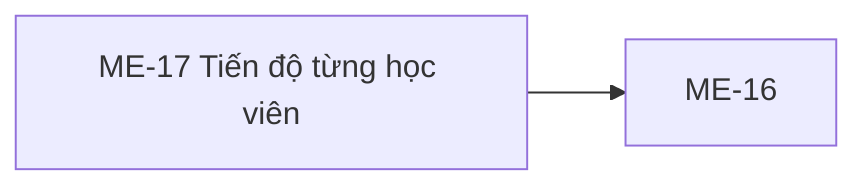

# ME-17 — Navigation

## 1. Route definition
- Current route in inventory: `/mentor/courses/:courseId/students/:studentId/progress`
- Status: candidate/design route; Study Web `UNWIRED` unless source code proves otherwise.
- Route params/types: `courseId` (type/validation: see source DD; CẦN_XÁC_NHẬN if absent), `studentId` (type/validation: see source DD; CẦN_XÁC_NHẬN if absent)
- Query params/defaults: preserve the inventory route string; detailed parsing rules only from source DD.
- Route guards: see source DD/API contract; do not create role policy.

## 2. Điểm vào
| From screen/route | Trigger | Params | Guard / fallback |
|---|---|---|---|
| [ME-16](../ME-16-TienDoToanKhoaHoc/00-overview.md) | Theo DD nguồn/inventory | Theo source; không suy diễn | Xem source DD; route chưa xác nhận runtime |

## 3. Điểm ra
| Destination | Trigger | Params | Điều kiện |
|---|---|---|---|
| [ME-16](../ME-16-TienDoToanKhoaHoc/00-overview.md) | Source event/inventory navigation | Theo source DD | Expected links; runtime chưa verify |

## 4. Back / refresh / deep link
- Back behavior: xem source DD; không mặc định browser history.
- Preserve filters/scroll/form state: chỉ nếu source có nêu, nếu không `CẦN_XÁC_NHẬN`.
- Refresh/direct URL: route trong inventory không chứng minh runtime.
- Invalid/missing ID: theo source DD/backend contract; không tự tạo validation.
- Not authenticated/authorized: theo source role guard; xem [Business Rules](05-business-rules.md).

## 5. Diagram

## Source navigation and flow detail

### Trích từ DD nguồn: E. Ma trận trạng thái và điều hướng

### E1. Trạng thái

| State | Điều kiện / evidence | Nội dung và chuyển tiếp |
|---|---|---|
| Prototype static-empty | Trạng thái đang thể hiện trong screenshot; HTML literal, không có data binding | Hiển thị card profile/tile/empty timeline như asset. Không chứng minh API loading hay runtime. |
| Loading (expected candidate) | Inventory nêu loading; có thể khởi tạo sau khi route/auth/IDs được duyệt | Chưa có client implementation. Không dùng literal “Đang đồng bộ hồ sơ…” làm API loading indicator nếu chưa được duyệt. |
| Ready (candidate) | Chỉ sau 200 với success shape và loaded presentation được chốt | Local API có summary/lesson snapshot; mapping tới page và timeline rows chưa được phê duyệt. |
| Empty curriculum (source condition) | Local response thành công nhưng lessons rỗng khi không có PUBLISHED lesson | Summary progress percent là 0; không đồng nghĩa lịch sử chưa sync hoặc học viên chưa làm hoạt động. UX cần xác nhận. |
| Denied (candidate) | Inventory state; local 401 authentication hoặc 403 direct owner mismatch | UX, re-auth và privacy copy chưa được định nghĩa. |
| Not found (candidate) | Inventory state; local 404 malformed ID, course không tồn tại hoặc Student không eligible | Giữ source error code; không phân biệt nguyên nhân trên UI nếu policy chưa duyệt. |
| System/network error (candidate) | Local 500 hoặc transport failure | Inventory chưa mô tả đầy đủ UX; copy/retry/timeout chưa có contract. |
| Refresh animation | EV-02 handler đang chạy | Nút disabled, icon quay; tối đa 600 ms; không có API/data transition. |

### E2. Điều hướng và dữ liệu handoff

| From / action | Destination | Dữ liệu cần truyền | Hiện trạng |
|---|---|---|---|
| ME-16 student row | ME-17 | Numeric course_id + student_id | Inventory dependency; ME-16 carrier/source mapping chưa được wire hoặc phê duyệt. |
| ME-17 back button | ME-16 | Cùng course_id, giữ auth session theo policy | Anchor href="#"; destination chưa hoạt động. |
| Header/breadcrumb/footer links | Không xác định | Không có | Placeholder href="#"; không giả định route. |
| ME-17 analytics | Không mở từ screen này theo source asset | ME-18/#66 thuộc flow riêng trong inventory | AC-26 diagram sequencing khác inventory; cần flow owner quyết định. |
| Lesson/assignment/quiz detail | Không xác định | #67 lesson_id có trong local source nhưng không có row action/design | Không có click target; không tạo route. |

### E3. Authorization, privacy, session

- Server local #67 authenticates Bearer/JWT và requires MENTOR trước DB. Điều này không xác nhận Study Web session guard.
- Local course access là direct-owner check; assigned Mentor semantics chưa được chứng minh. ACTIVE enrollment + STUDENT role là eligibility của current code, chưa được duyệt thành business rule.
- Source phân biệt 403 course owner mismatch và 404 missing/ineligible; client display/masking policy chưa có.
- 401 behavior sau expiry, login redirect, return URL, logout, denied screen và back navigation chưa được wire hoặc đặc tả.
- IDs phải được giữ theo contract int64; không đưa names, avatar, email hoặc course data vào URL.

### Trích từ DD nguồn: B. Luồng hoạt động tổng thể

### B1. Expected flow theo inventory

1. Mentor mở ME-17 từ một student row của ME-16. Cần mang theo course_id và student_id dạng int64. Route hiển thị trong inventory mới là đề xuất.
2. Xác thực session/role phía ứng dụng rồi khởi tạo loading. Client route/auth hiện không tồn tại để xác minh; chỉ server API #67 có Bearer/JWT guard với role MENTOR.
3. Sau khi ID carrier và response contract được duyệt, gọi GET #67 đúng một lần cho hai path ID. Không có query hoặc request body trong catalog/local route.
4. Với approved response, ánh xạ trường có contract lên trang. Hiện chưa thể xác định loaded timeline row, trạng thái “bài còn thiếu”, course name, assignment/quiz metrics hay các thẻ mô tả.
5. Nếu approved response có lessons rỗng, phân biệt empty curriculum với lỗi tải dữ liệu; không tự gắn nghĩa “chưa đồng bộ lịch sử” cho trường hợp đó.
6. Mentor có thể dùng nút refresh và quay lại ME-16 theo thiết kế. HTML hiện không điều hướng về màn hình thật và refresh không tải dữ liệu.
7. Khi không xác thực, không có quyền, không tìm thấy course/student, lỗi server hoặc mất mạng, cần UX/error policy được duyệt. Chưa có client mapping, retry hay session-expiry behavior.

### B2. Current API #67 source flow

1. GET route nhận raw course_id, student_id và Authorization header. OpenAPI khai báo hai path parameter bắt buộc signed int64; không có query/body/page-size.
2. Shared Bearer/JWT guard yêu cầu role MENTOR trước DB.
3. Validator parse cả hai ID thành signed int64. Giá trị malformed hoặc ngoài range trả 404 DESIGN_RESOURCE_NOT_FOUND.
4. Query kiểm course trước. Course không tồn tại trả 404; course không thuộc direct owner trả 403 DESIGN_ACCESS_DENIED.
5. Student phải có users.role=STUDENT và ACTIVE enrollment trong course; nếu không thì 404 DESIGN_RESOURCE_NOT_FOUND.
6. Query lấy lesson PUBLISHED theo sort_order ASC, id ASC. Khi có duplicate progress rows cho cùng user/lesson, giữ row có last_accessed_at DESC NULLS LAST, tie-break id DESC.
7. Lesson không có row progress được chiếu thành NOT_STARTED, percent 0, timestamps null. Model/view chấp nhận progress_status NOT_STARTED, IN_PROGRESS hoặc COMPLETED. Summary gồm completed_lesson count, số PUBLISHED lessons và floor(sum(progress_percent)/total lessons); mẫu số 0 cho percent 0.
8. Success source trả ApiEnvelope<StudentCourseProgress> với course_id; student{id,full_name,avatar_url}; summary{completed_lessons,total_lessons,progress_percent}; lessons[]{lesson_id,title,order,progress_status,progress_percent,last_accessed_at,completed_at}. Không có pagination hoặc DB write.
9. Local errors: 401 DESIGN_AUTHENTICATION_REQUIRED, 403 DESIGN_ACCESS_DENIED, 404 DESIGN_RESOURCE_NOT_FOUND, 500 DESIGN_INTERNAL_ERROR. Error body dùng envelope an toàn/data null theo local source.
10. Đọc test source cho thấy fake DB cases cho auth, IDs, owner/roster, empty curriculum, projection/error/OpenAPI/trace; test chưa chạy. Đây không phải bằng chứng live DB/deployment.

### B3. Current prototype flow

- screen.png/HTML hiển thị một empty timeline và các giá trị tĩnh. HTML có 12 anchor dùng href="#", một nút refresh và không có form, table, lesson row, route binding, API request, fetch, polling hay cache.
- Nút refresh chỉ thêm hiệu ứng quay icon, disable nút, chờ 600 ms rồi khôi phục. Không có network request hoặc data update.
- “Đang đồng bộ hồ sơ…” là literal heading của prototype; không phản ánh API loading state được nối.
- Header/footer, breadcrumb/back anchors không có destination runtime. Phần profile và ba tile là static content, không có click handler.
