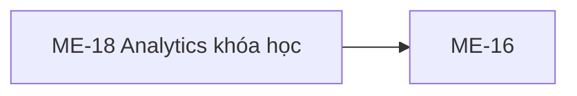

# ME-18 — Navigation

## 1. Route definition
- Current route in inventory: `/mentor/courses/:courseId/analytics`
- Status: candidate/design route; Study Web `UNWIRED` unless source code proves otherwise.
- Route params/types: `courseId` (type/validation: see source DD; CẦN_XÁC_NHẬN if absent)
- Query params/defaults: preserve the inventory route string; detailed parsing rules only from source DD.
- Route guards: see source DD/API contract; do not create role policy.

## 2. Điểm vào
| From screen/route | Trigger | Params | Guard / fallback |
|---|---|---|---|
| [ME-16](../ME-16-TienDoToanKhoaHoc/00-overview.md) | Theo DD nguồn/inventory | Theo source; không suy diễn | Xem source DD; route chưa xác nhận runtime |

## 3. Điểm ra
| Destination | Trigger | Params | Điều kiện |
|---|---|---|---|
| [ME-16](../ME-16-TienDoToanKhoaHoc/00-overview.md) | Source event/inventory navigation | Theo source DD | Expected links; runtime chưa verify |

## 4. Back / refresh / deep link
- Back behavior: xem source DD; không mặc định browser history.
- Preserve filters/scroll/form state: chỉ nếu source có nêu, nếu không `CẦN_XÁC_NHẬN`.
- Refresh/direct URL: route trong inventory không chứng minh runtime.
- Invalid/missing ID: theo source DD/backend contract; không tự tạo validation.
- Not authenticated/authorized: theo source role guard; xem [Business Rules](05-business-rules.md).

## 5. Diagram

## Source navigation and flow detail

### Trích từ DD nguồn: E. Ma trận trạng thái và điều hướng

### E1. Trạng thái

| State | Điều kiện / evidence | Nội dung và chuyển tiếp |
|---|---|---|
| Prototype static empty | Trạng thái trong screenshot/HTML; không có data binding | Ba KPI rỗng, timeframe/export disabled, inactive empty state và static badges. |
| Loading (inventory candidate) | Sau khi route/auth/course ID được wire | Chưa có client implementation hoặc loading asset; không diễn giải “Chờ đồng bộ dữ liệu” thành API loading. |
| Ready (candidate) | Sau success envelope và approved response/UI mapping | Local summary không khớp catalog và không có chart template; chưa thể kết luận dashboard ready UI. |
| No proxy rows (source condition) | #66 trả 0/0/null | Không phân biệt course chưa có activity, chưa có enrollment, ETL inactive hay event store unavailable. |
| Denied | Local 401 auth hoặc 403 role/owner | Inventory state error chung; login/denied UX và privacy copy chưa chốt. |
| Not found | Local 404 malformed/out-of-range course_id hoặc course không tồn tại | Không có client mapping; status/business code có source. |
| System/network error | Local 500 hoặc transport failure | Safe 500 response có source; retry, timeout và user copy chưa có contract. |
| Sync button cosmetic state | EV-04 timers đang chạy | “Đang gửi lệnh...” → “Đã ghi nhận yêu cầu” → original text; không phản ánh server state. |
| Disabled controls | Timeframe select và export button | Không có transition/event hiện hành. |

### E2. Điều hướng và dữ liệu handoff

| From/action | Destination | Dữ liệu cần truyền | Hiện trạng |
|---|---|---|---|
| ME-16 analytics CTA | ME-18 | Numeric course_id:int64 và Mentor session | ME-16 anchor href="#"; carrier chưa wire. |
| ME-18 back button | ME-16 | Cùng course_id/course context | href="#"; expected relation, route chưa hoạt động. |
| ME-16/#65 and ME-17/#67 | Separate analytics/student branches per inventory | #65 has course ID; #67 has course + selected student ID | AC-26 instead orders #66 before Student selection/#67; flow owner decision required. |
| Header/breadcrumb/footer links | Không xác định | Không có | Placeholder href="#". |
| KPI/chart drill-down | Không xác định | No target identity | Screenshot has no chart/row drill-down; no route/action. |

### E3. Security, privacy and session

- API #66 dùng shared Bearer/JWT guard và yêu cầu MENTOR trước database. Điều này không chứng minh Study Web guard.
- Local authorization yêu cầu direct courses.mentor_id ownership. Assigned Mentor access không có trong current source đã rà soát.
- Local query lọc users.role=STUDENT nhưng không cần ACTIVE enrollment. Vì vậy students_with_activity không phải active-roster count.
- Local error order là auth/role trước database, malformed path → 404, missing course → 404, wrong owner → 403 trước aggregate. Client masking/re-auth policy còn mở.
- Không đưa student IDs/raw activity vào route. Course identity phải theo numeric int64 path contract hiện tại.

### Trích từ DD nguồn: B. Luồng hoạt động tổng thể

### B1. Expected flow theo inventory

1. Mentor tới ME-18 từ course context tại ME-16. Truyền course_id dạng int64 theo một carrier được duyệt; ME-16 hiện chỉ có placeholder anchor và prototype slug-to-ID mapping chưa có.
2. Kiểm tra Mentor session/authorization rồi hiển thị loading. Server #66 hiện xác thực Bearer/JWT và role MENTOR trước DB; Study Web không có guard/route để chứng minh client behavior.
3. Sau khi numeric ID, API response, KPI mapping và time-window semantics được duyệt, gọi GET #66. Direct request không có query/body. Không gọi #65/#67 từ màn hình analytics.
4. Parse success envelope/businessCode; không map response cho tới khi direct ApiEnvelope<Page<Course>> và local summary discrepancy được giải quyết.
5. Nếu summary object được duyệt, chỉ hiển thị field đã có design mapping. Screenshot không có vùng/chart cho ba local fields và không có field mapping cho ba KPI đang vẽ.
6. Timeframe selector và CSV button đang disabled. Không xử lý Change/Export hiện tại.
7. Back về ME-16 là intended navigation theo nhãn; href hiện là #, route và ID handoff chưa có.
8. Xử lý auth/owner/not-found/server/network theo contract/UX được duyệt. Không tự retry, polling, cache, freshness SLA hoặc thay trạng thái ETL.

### B2. Current API #66 source flow

1. FastAPI route đọc raw course_id và Authorization header; OpenAPI khai báo required signed-int64 path và header. Không query/body/page-size.
2. Shared access-JWT guard yêu cầu role MENTOR trước truy cập DB.
3. parse_course_id nhận signed int64 trong range; malformed/out-of-range trả 404 DESIGN_RESOURCE_NOT_FOUND. Source không áp dụng client-positive-ID rule riêng.
4. FIND_MENTOR_COURSE lấy id/mentor_id. Không có course → 404; khác JWT sub → 403, trước aggregate. Query lỗi được rollback và trả 500 safe.
5. Aggregate lặp lại owner predicate, chỉ lấy lesson PUBLISHED, user role STUDENT và last_accessed_at khác null; group theo user_id, lesson_id và MAX timestamp trong cặp. Không có ACTIVE enrollment predicate.
6. Trả tracked_lesson_accesses=count distinct pairs, students_with_activity=count distinct Student IDs, last_activity_at=max timestamp. Empty aggregate → 0, 0, null.
7. View kiểm tra count không âm, students_with_activity không lớn hơn tracked pairs, timestamp đúng datetime/null và int64 range. Projection lỗi hoặc SQL lỗi → rollback + 500 DESIGN_INTERNAL_ERROR; không lộ SQL.
8. Success: HTTP 200, DESIGN_RESOURCE_RETRIEVED, ApiEnvelope<MentorCourseActivityAnalytics>; meta rỗng và traceId được giữ. Local response fields không khớp direct catalog Page<Course>.
9. API read-only; không có external service, ETL trigger, export, event ledger, #65/#67 call hoặc DB write.
10. Focused test source dùng fake DB; test không chạy trong phiên này và không xác nhận PostgreSQL/live schema/deployment.

### B3. Current prototype behavior

- Screenshot/HTML là trạng thái tĩnh: ba KPI rỗng, timeframe select disabled, export disabled, empty state và hai nút/link liên quan.
- 13 anchors dùng href="#"; header data-path là metadata mẫu, không có router.
- “Kiểm tra đồng bộ lại” là inline JS: thay button HTML trong 1.2 giây thành “Đang gửi lệnh...”, sau đó 3 giây thành “Đã ghi nhận yêu cầu”, rồi phục hồi HTML ban đầu. Không request, persistence, ETL/job status. Nút không bị disable bởi handler; nhiều click có thể tạo timer chồng nhau, không có rule chống trùng.
- Không có fetch/Axios/XHR, API client, chart, loaded state, CSV download, input form, cache hoặc time-window processing.
