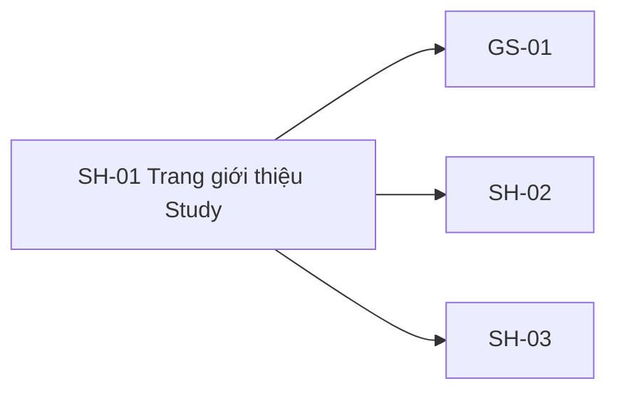

# SH-01 — Navigation

## 1. Route definition
- Current route in inventory: `/`
- Status: candidate/design route; Study Web `UNWIRED` unless source code proves otherwise.
- Route params/types: Không có route param được biểu diễn trong inventory string; route runtime vẫn chưa xác minh.
- Query params/defaults: preserve the inventory route string; detailed parsing rules only from source DD.
- Route guards: see source DD/API contract; do not create role policy.

## 2. Điểm vào
| From screen/route | Trigger | Params | Guard / fallback |
|---|---|---|---|
| [SH-06](../SH-06-TrangKhongTonTaiTaiNguyenKhongCon/00-overview.md) | Theo DD nguồn/inventory | Theo source; không suy diễn | Xem source DD; route chưa xác nhận runtime |

## 3. Điểm ra
| Destination | Trigger | Params | Điều kiện |
|---|---|---|---|
| [GS-01](../GS-01-DanhSachKhoaHoc/00-overview.md), [SH-02](../SH-02-DangNhap/00-overview.md), [SH-03](../SH-03-DangKyHocVien/00-overview.md) | Source event/inventory navigation | Theo source DD | Expected links; runtime chưa verify |

## 4. Back / refresh / deep link
- Back behavior: xem source DD; không mặc định browser history.
- Preserve filters/scroll/form state: chỉ nếu source có nêu, nếu không `CẦN_XÁC_NHẬN`.
- Refresh/direct URL: route trong inventory không chứng minh runtime.
- Invalid/missing ID: theo source DD/backend contract; không tự tạo validation.
- Not authenticated/authorized: theo source role guard; xem [Business Rules](05-business-rules.md).

## 5. Diagram

## Source navigation and flow detail

### Trích từ DD nguồn: 2. Màn hình liên kết và luồng tổng quát

~~~mermaid
flowchart TD
    Entry[Trình duyệt mở route / đề xuất] --> Landing[Khung tĩnh SH-01]
    Landing -->|đọc công khai song song| Cats[GET #05 danh mục]
    Landing -->|đọc công khai song song| Courses[GET #06 khóa học đã xuất bản]
    Landing -->|tìm kiếm bằng q đã loại khoảng trắng| Search[GS-02 đề xuất /courses/search?q=]
    Landing -->|xem toàn bộ| Catalog[GS-01 đề xuất /courses]
    Landing -->|đăng nhập| Login[SH-02 đề xuất /login]
    Landing -->|đăng ký| Register[SH-03 đề xuất /register]
    Courses -->|chọn course_id trả về; chỉ là đích| Detail[GS-03 đề xuất; current #08 source, catalog D]
~~~

Yêu cầu #05 và #06 độc lập: phản hồi danh mục không lọc hoặc quyết định yêu cầu khóa học. Khung trang cùng nội dung biên tập đã duyệt có thể hiển thị trước khi hai phản hồi hoàn tất. Mỗi khu vực dữ liệu quản lý riêng trạng thái đang tải/rỗng/lỗi.

| Liên kết | Đích | Thao tác | Trạng thái hiện tại |
|---|---|---|---|
| Trang chủ/logo | SH-01 / | Liên kết trang chủ ở đầu/chân trang | Route đề xuất; chưa có router Study Web |
| Danh mục/xem tất cả khóa học | GS-01 /courses | Menu đầu trang hoặc nút “Xem tất cả” | Route đề xuất; có mã nguồn máy chủ #05/#06, chưa có màn hình client |
| Tìm kiếm | GS-02 /courses/search?q=<q đã mã hóa> | Gửi tìm kiếm không rỗng | Route đề xuất; GS-02 sở hữu API #07; SH-01 không gọi #07 |
| Đăng nhập | SH-02 /login | Menu hoặc nút kêu gọi hành động | Route đề xuất |
| Đăng ký | SH-03 /register | Menu hoặc nút kêu gọi hành động | Route đề xuất |
| Chi tiết thẻ khóa học | GS-03 /courses/:courseId | Chọn khóa học do #06 trả về | F02 chỉ định GS-03/#08; dòng SH-01 next-screen không liệt kê GS-03. Current #08 route/module source tồn tại dù catalog gắn D; chặn chờ quyết định điều hướng/client |
| Bộ lọc danh mục | Chưa có | Bấm thẻ trông giống danh mục | Tắt/chỉ để xem; #06 trả 422 với category cho tới khi G-05 được giải quyết |
| Thu thập email quan tâm | Chưa có | Nhập/bấm nút gửi trong ảnh | Không có endpoint được hỗ trợ; bỏ/tắt, không thu thập/gửi email |
| Nghề nghiệp/diễn đàn/pháp lý | Chưa xác minh đích trong task này | Liên kết đầu/chân trang | Chỉ dùng route/URL đã duyệt; href="#..." trong HTML gốc chỉ là neo, không chứng minh route thật |

### Trích từ DD nguồn: 2. Màn hình liên kết và luồng tổng quát

~~~mermaid
flowchart TD
    Entry[Trình duyệt mở route / đề xuất] --> Landing[Khung tĩnh SH-01]
    Landing -->|đọc công khai song song| Cats[GET #05 danh mục]
    Landing -->|đọc công khai song song| Courses[GET #06 khóa học đã xuất bản]
    Landing -->|tìm kiếm bằng q đã loại khoảng trắng| Search[GS-02 đề xuất /courses/search?q=]
    Landing -->|xem toàn bộ| Catalog[GS-01 đề xuất /courses]
    Landing -->|đăng nhập| Login[SH-02 đề xuất /login]
    Landing -->|đăng ký| Register[SH-03 đề xuất /register]
    Courses -->|chọn course_id trả về; chỉ là đích| Detail[GS-03 đề xuất; current #08 source, catalog D]
~~~

Yêu cầu #05 và #06 độc lập: phản hồi danh mục không lọc hoặc quyết định yêu cầu khóa học. Khung trang cùng nội dung biên tập đã duyệt có thể hiển thị trước khi hai phản hồi hoàn tất. Mỗi khu vực dữ liệu quản lý riêng trạng thái đang tải/rỗng/lỗi.

| Liên kết | Đích | Thao tác | Trạng thái hiện tại |
|---|---|---|---|
| Trang chủ/logo | SH-01 / | Liên kết trang chủ ở đầu/chân trang | Route đề xuất; chưa có router Study Web |
| Danh mục/xem tất cả khóa học | GS-01 /courses | Menu đầu trang hoặc nút “Xem tất cả” | Route đề xuất; có mã nguồn máy chủ #05/#06, chưa có màn hình client |
| Tìm kiếm | GS-02 /courses/search?q=<q đã mã hóa> | Gửi tìm kiếm không rỗng | Route đề xuất; GS-02 sở hữu API #07; SH-01 không gọi #07 |
| Đăng nhập | SH-02 /login | Menu hoặc nút kêu gọi hành động | Route đề xuất |
| Đăng ký | SH-03 /register | Menu hoặc nút kêu gọi hành động | Route đề xuất |
| Chi tiết thẻ khóa học | GS-03 /courses/:courseId | Chọn khóa học do #06 trả về | F02 chỉ định GS-03/#08; dòng SH-01 next-screen không liệt kê GS-03. Current #08 route/module source tồn tại dù catalog gắn D; chặn chờ quyết định điều hướng/client |
| Bộ lọc danh mục | Chưa có | Bấm thẻ trông giống danh mục | Tắt/chỉ để xem; #06 trả 422 với category cho tới khi G-05 được giải quyết |
| Thu thập email quan tâm | Chưa có | Nhập/bấm nút gửi trong ảnh | Không có endpoint được hỗ trợ; bỏ/tắt, không thu thập/gửi email |
| Nghề nghiệp/diễn đàn/pháp lý | Chưa xác minh đích trong task này | Liên kết đầu/chân trang | Chỉ dùng route/URL đã duyệt; href="#..." trong HTML gốc chỉ là neo, không chứng minh route thật |
