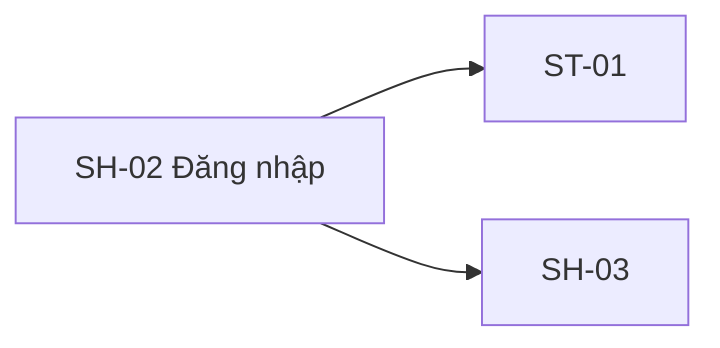

# SH-02 — Navigation

## 1. Route definition
- Current route in inventory: `/login`
- Status: candidate/design route; Study Web `UNWIRED` unless source code proves otherwise.
- Route params/types: Không có route param được biểu diễn trong inventory string; route runtime vẫn chưa xác minh.
- Query params/defaults: preserve the inventory route string; detailed parsing rules only from source DD.
- Route guards: see source DD/API contract; do not create role policy.

## 2. Điểm vào
| From screen/route | Trigger | Params | Guard / fallback |
|---|---|---|---|
| [SH-01](../SH-01-TrangGioiThieuStudyVariant1/00-overview.md), [SH-03](../SH-03-DangKyHocVien/00-overview.md), [SH-04](../SH-04-HandoffXacThucEmail/00-overview.md), [SH-05](../SH-05-KhongDuQuyenSessionHetHan/00-overview.md) | Theo DD nguồn/inventory | Theo source; không suy diễn | Xem source DD; route chưa xác nhận runtime |

## 3. Điểm ra
| Destination | Trigger | Params | Điều kiện |
|---|---|---|---|
| [ST-01](../ST-01-TongQuanHocVien/00-overview.md), [SH-03](../SH-03-DangKyHocVien/00-overview.md) | Source event/inventory navigation | Theo source DD | Expected links; runtime chưa verify |

## 4. Back / refresh / deep link
- Back behavior: xem source DD; không mặc định browser history.
- Preserve filters/scroll/form state: chỉ nếu source có nêu, nếu không `CẦN_XÁC_NHẬN`.
- Refresh/direct URL: route trong inventory không chứng minh runtime.
- Invalid/missing ID: theo source DD/backend contract; không tự tạo validation.
- Not authenticated/authorized: theo source role guard; xem [Business Rules](05-business-rules.md).

## 5. Diagram

## Source navigation and flow detail

### Trích từ DD nguồn: 2. Màn hình liên kết và luồng tổng quát

~~~mermaid
flowchart TD
    Entry[SH-01 hoặc route cần bảo vệ] --> Login[SH-02 /login]
    Login -->|gửi hợp lệ| Post03[POST #03 /auth/login]
    Post03 -->|401 / 403 / 422 / 500| Error[Trạng thái lỗi đã ánh xạ trên SH-02]
    Post03 -->|200 theo nguồn hiện tại| Vai trò{data.role}
    Vai trò -->|STUDENT và chính sách phiên được duyệt| Me[GET #04 /users/me]
    Vai trò -->|MENTOR hoặc ADMIN| G02[G-02 bị chặn: không có khởi tạo hồ sơ tương thích]
    Me -->|200 và hồ sơ học viên| Dest[returnTo an toàn hoặc /student đề xuất]
    Me -->|401 một lần| Refresh[Thử R-X01 một lần rồi thử lại #04 một lần]
    Refresh -->|vẫn 401| LoginAgain[SH-02 với returnTo an toàn]
    Me -->|403| Vai tròBlocked[Bị chặn quyền/vai trò hồ sơ; không lặp refresh]
    Login -->|liên kết đăng ký| Register[SH-03 /register]
~~~

HTML hiện chỉ có liên kết đăng ký trong các đích màn hình được hiển thị. Điểm vào từ route cần bảo vệ và xử lý returnTo an toàn đến từ hợp đồng danh mục/luồng trạng thái; ở đây không có mã router để xác minh.

| Liên kết / chuyển tiếp | Đích | Nguồn quy định đích | Trạng thái hiện tại |
|---|---|---|---|
| Liên kết đăng ký | SH-03 /register | href hiện tại trong HTML và danh mục | Route client đề xuất; chưa có router Study Web |
| Đăng nhập học viên thành công | returnTo an toàn; nếu không có thì /student đề xuất | §2.1 và §6.2 trong danh mục | Guard/đích mặc định chưa triển khai hoặc duyệt |
| Đăng nhập người hướng dẫn/quản trị viên thành công | Chưa xác định | Điều kiện chặn vai trò G-02 | Dừng trước #04; không đoán vỏ giao diện theo vai trò |
| Quên mật khẩu | Chưa có | Không có endpoint/màn hình trong danh mục hiện tại | Không tự thêm |
| Xác minh email / OTP | Không thuộc đăng nhập | SH-04 có luồng bàn giao riêng ở trạng thái giả lập; chưa có endpoint hoàn tất xác minh | Không thêm vào SH-02 |

### Trích từ DD nguồn: 2. Màn hình liên kết và luồng tổng quát

~~~mermaid
flowchart TD
    Entry[SH-01 hoặc route cần bảo vệ] --> Login[SH-02 /login]
    Login -->|gửi hợp lệ| Post03[POST #03 /auth/login]
    Post03 -->|401 / 403 / 422 / 500| Error[Trạng thái lỗi đã ánh xạ trên SH-02]
    Post03 -->|200 theo nguồn hiện tại| Vai trò{data.role}
    Vai trò -->|STUDENT và chính sách phiên được duyệt| Me[GET #04 /users/me]
    Vai trò -->|MENTOR hoặc ADMIN| G02[G-02 bị chặn: không có khởi tạo hồ sơ tương thích]
    Me -->|200 và hồ sơ học viên| Dest[returnTo an toàn hoặc /student đề xuất]
    Me -->|401 một lần| Refresh[Thử R-X01 một lần rồi thử lại #04 một lần]
    Refresh -->|vẫn 401| LoginAgain[SH-02 với returnTo an toàn]
    Me -->|403| Vai tròBlocked[Bị chặn quyền/vai trò hồ sơ; không lặp refresh]
    Login -->|liên kết đăng ký| Register[SH-03 /register]
~~~

HTML hiện chỉ có liên kết đăng ký trong các đích màn hình được hiển thị. Điểm vào từ route cần bảo vệ và xử lý returnTo an toàn đến từ hợp đồng danh mục/luồng trạng thái; ở đây không có mã router để xác minh.

| Liên kết / chuyển tiếp | Đích | Nguồn quy định đích | Trạng thái hiện tại |
|---|---|---|---|
| Liên kết đăng ký | SH-03 /register | href hiện tại trong HTML và danh mục | Route client đề xuất; chưa có router Study Web |
| Đăng nhập học viên thành công | returnTo an toàn; nếu không có thì /student đề xuất | §2.1 và §6.2 trong danh mục | Guard/đích mặc định chưa triển khai hoặc duyệt |
| Đăng nhập người hướng dẫn/quản trị viên thành công | Chưa xác định | Điều kiện chặn vai trò G-02 | Dừng trước #04; không đoán vỏ giao diện theo vai trò |
| Quên mật khẩu | Chưa có | Không có endpoint/màn hình trong danh mục hiện tại | Không tự thêm |
| Xác minh email / OTP | Không thuộc đăng nhập | SH-04 có luồng bàn giao riêng ở trạng thái giả lập; chưa có endpoint hoàn tất xác minh | Không thêm vào SH-02 |
