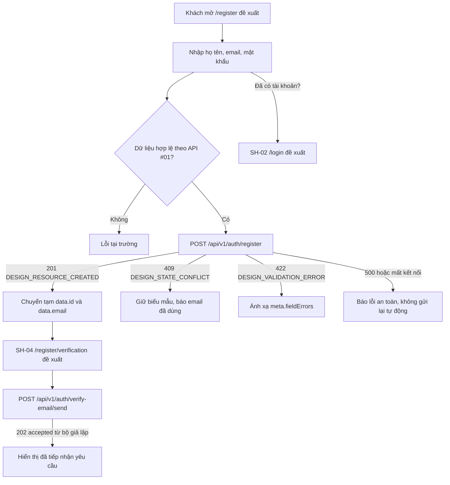

# SH-03 — Data Flow & State

## 1. Nguồn dữ liệu
| Field / object | Type | Source | Destination | Cập nhật khi |
|---|---|---|---|---|
| Chỉ liệt kê theo bằng chứng trong excerpt bên dưới | Theo DD/API source | API/inventory/design; status phải giữ nguyên | UI/state nêu ở DD nguồn | Theo event source |

## 2. State model

> Không tạo DTO/ViewModel mới khi chưa có contract. State, DTO và mapping được trích nguyên ngữ cảnh từ DD nguồn bên dưới.

## 3. API DTO → ViewModel mapping

### Trích từ DD nguồn: 2. Sơ đồ luồng màn hình



Đường nối từ SH-03 sang SH-04 là luồng đích trong danh mục, không phải hành vi đã được nối ở phía giao diện. API #02 thuộc SH-04; không gọi API này trực tiếp từ SH-03 và không coi `accepted` là email đã gửi hoặc đã xác minh.

### Trích từ DD nguồn: 3. Truy vết API và dữ liệu

### 3.1. API #01 — Tạo tài khoản

| Thuộc tính | Giá trị theo mã nguồn hiện tại |
|---|---|
| Phương thức và đường dẫn | `POST /api/v1/auth/register` |
| Xác thực | Công khai; không cần `Authorization` |
| JSON bắt buộc | `email: string`, `password: string`, `full_name: string` |
| Phản hồi tạo thành công | HTTP `201`, `businessCode="DESIGN_RESOURCE_CREATED"` |
| Nhánh lỗi đã có nguồn | `409 DESIGN_STATE_CONFLICT`, `422 DESIGN_VALIDATION_ERROR`, `500 DESIGN_INTERNAL_ERROR` |
| Tác động dữ liệu | Tìm email trùng, băm mật khẩu Argon2id, chèn tài khoản vai trò `STUDENT`, rồi gọi `commit`. Giao dịch do lớp điều phối API #01 sở hữu. |
| Gửi email | Không gọi API #02; view chỉ ghi log rằng bước gửi xác minh bị trì hoãn. |

Dữ liệu JSON gửi đi chỉ có ba trường. `fullname` từ điều khiển HTML phải được đổi tên thành `full_name` khi dựng JSON:

```json
{
  "email": "<email người dùng>",
  "password": "<mật khẩu người dùng>",
  "full_name": "<họ và tên người dùng>"
}
```

Quy tắc theo bộ kiểm tra hiện tại:

- `email`: cắt khoảng trắng hai đầu, kiểm tra định dạng và giới hạn độ dài chuẩn hóa tối đa 255 ký tự. Không áp quy tắc miền email riêng hoặc tự đổi chữ hoa/thường.
- `full_name`: cắt khoảng trắng hai đầu; sau cắt phải dài 1–150 ký tự.
- `password`: chuỗi chỉ gồm khoảng trắng bị từ chối; khi hợp lệ, mật khẩu gốc được đưa đi băm Argon2id. API không đặt giới hạn tối thiểu 8 ký tự như thông báo ẩn trong HTML.
- Các trường thiếu hoặc sai kiểu được FastAPI ánh xạ thành HTTP 422 `DESIGN_VALIDATION_ERROR`; validator nghiệp vụ cũng trả HTTP 422 với `meta.fieldErrors`.

### 3.2. Phản hồi API #01

Khung phản hồi thành công theo `success_response` có `success`, `businessCode`, `message`, `data`, `meta` và `traceId`. `data` được trả từ hàng `RETURNING` của câu chèn và có các trường công khai sau:

```text
id, full_name, email, role, avatar_url, phone, status, created_at, updated_at
```

Mật khẩu và `password_hash` không được đưa vào phản hồi. API không trả access token hoặc refresh token. SQL hiện gán `role='STUDENT'`, nhưng bỏ cột `status`; giá trị `status` phụ thuộc lược đồ thực tế. `DB.sql` có giá trị mặc định `ACTIVE`, song tệp này không xác nhận lược đồ cơ sở dữ liệu đang chạy.

Để mở SH-04, luồng đích cần ánh xạ `data.id` thành `user_id` và dùng `data.email`. Danh mục yêu cầu hai giá trị này nhưng chưa khóa cơ chế truyền phía giao diện. Đây là hợp đồng dữ liệu bàn giao, chưa phải quyết định transport; không đưa email/ID vào query string hoặc lưu trữ bền vững khi chưa có policy. Mã giao diện/router vắng mặt nên không có pattern Vue được xác minh.

### 3.3. Lỗi API #01 và xử lý trên SH-03

| HTTP | Mã nghiệp vụ | Phản hồi/ý nghĩa theo mã nguồn | Cách xử lý đích |
|---:|---|---|---|
| 201 | `DESIGN_RESOURCE_CREATED` | Tài khoản đã được chèn và giao dịch đã gọi `commit`; `data` chứa hồ sơ công khai. | Chuyển sang SH-04 với `data.id` và `data.email`; không hiển thị trạng thái xác minh email. |
| 409 | `DESIGN_STATE_CONFLICT` | Email đã tồn tại; trường hợp vi phạm ràng buộc duy nhất trong lúc chèn cũng được ánh xạ thành mã này. | Giữ nội dung biểu mẫu, đánh dấu trường email và cung cấp liên kết SH-02. Thông báo hiện tại trong mã nguồn: “Email đã tồn tại.” |
| 422 | `DESIGN_VALIDATION_ERROR` | JSON/trường không hợp lệ; lỗi trường được đưa vào `meta.fieldErrors`. | Giữ dữ liệu, gắn lỗi với trường theo `field`; không hiện lời khuyên 8 ký tự nếu máy chủ chưa có quy tắc đó. |
| 500 | `DESIGN_INTERNAL_ERROR` | Lỗi cơ sở dữ liệu hoặc lỗi nội bộ; chi tiết nhạy cảm không được trả về phía giao diện. | Hiển thị thông báo chung, giữ dữ liệu và không đưa chi tiết lỗi máy chủ lên giao diện. |
| Không có phản hồi | Không có mã HTTP | Không biết yêu cầu đã tạo tài khoản hay chưa. API không khai báo khóa chống gửi lặp. | Thông báo kết quả chưa xác định; không tự gửi lại POST. Cho người dùng chọn bước tiếp theo có kiểm soát. |

Khung lỗi gồm `success=false`, `businessCode`, `message`, `data=null`, `meta` và `traceId`; lớp trung gian gắn `X-Trace-Id`. Không hiển thị thông tin cơ sở dữ liệu, dấu vết ngăn xếp hoặc nội dung mật khẩu.

### 3.4. API #02 — Ranh giới tại SH-04

SH-03 không gọi API này. Theo luồng F01, SH-04 mới gửi:

```http
POST /api/v1/auth/verify-email/send
Content-Type: application/json

{"user_id": <data.id>, "email": "<data.email>"}
```

API #02 hiện công khai, không phụ thuộc cơ sở dữ liệu và không kiểm tra sự tồn tại/sở hữu cặp `user_id`/`email`. Bộ gửi thư mặc định là `StubVerificationEmailProvider`, trả HTTP `202` với `businessCode="DESIGN_OPERATION_ACCEPTED"` và `data={"status":"accepted"}`; response từ provider khác có thể kèm `reason` tùy chọn. Điều này chỉ xác nhận bộ giả lập đã nhận yêu cầu; không có email thật, mã/liên kết xác minh, thời hạn, lần thử lại, thay đổi `users.status` hay đường dẫn hoàn tất xác minh. Nếu bộ gửi thư lỗi, API trả HTTP `500 DESIGN_INTERNAL_ERROR` an toàn.

### 3.5. Liên kết truy vết nguồn

| Chủ đề | Nguồn được đối chiếu |
|---|---|
| Screen ID, F01 và route đề xuất | [Danh mục màn hình](../../list_screen.md) |
| Luồng nghiệp vụ AC-01 | [Sơ đồ AC-01 Guest Account](../../../../study-server/docs/diagrams/AC_UNICA/AC_01_GUEST_ACCOUNT.drawio) |
| API catalog và schema `UserProfile` | [Danh mục API](../../../../../docs/lists/list_api.md) |
| Đăng ký: route/request/response | [Router API v1](../../../../study-server/app/api/v1.py), [models](../../../../study-server/app/modules/guest/api_01_auth_register/models.py), [validator](../../../../study-server/app/modules/guest/api_01_auth_register/validate.py), [view](../../../../study-server/app/modules/guest/api_01_auth_register/view.py), [SQL query](../../../../study-server/app/modules/guest/api_01_auth_register/query.py) |
| Gửi email xác minh tại SH-04 | [API #02 validator](../../../../study-server/app/modules/guest/api_02_auth_verify_email_send/validate.py), [API #02 view](../../../../study-server/app/modules/guest/api_02_auth_verify_email_send/view.py), [provider mặc định](../../../../study-server/app/service/email/provider.py) |
| Kiểm thử nguồn (đã đọc, không chạy trong phiên này) | [API #01 tests](../../../../study-server/tests/modules/guest/api_01_auth_register/test_register.py), [API #02 tests](../../../../study-server/tests/modules/guest/api_02_auth_verify_email_send/test_verify_email_send.py) |
| Hợp đồng và câu hỏi chưa chốt | [API #01 open questions](../../../../study-server/docs/dd/01_auth_register/OPEN_QUESTIONS.md), [API #02 open questions](../../../../study-server/docs/dd/02_auth_verify_email_send/OPEN_QUESTIONS.md) |
| Khai báo DB trong repository; không phải live schema evidence | [Study Server DB.sql](../../../../../infra/postgres/study-server/DB.sql) |
| Quy tắc giao diện Study đích | [Study Web design guide](../../../../../.agents/web-study/design.md) |

### Trích từ DD nguồn: 5. Sự kiện và xử lý dữ liệu

### `SH03-EV-01` — Mở trang đăng ký

- **Element / loại:** route trang công khai, các phần tử `SH03-EL-01..07` · Load/navigation.
- **Điều kiện tiên quyết:** Khách mở `/register` theo luồng được duyệt; route là đề xuất và chưa có Study Web router trong bản làm việc.
- **Đầu vào:** đường dẫn và nguồn điều hướng (nếu có); không có token, query dữ liệu biểu mẫu hoặc dữ liệu API ban đầu.
- **Xử lý:** hiển thị trang và biểu mẫu rỗng theo thiết kế; không phát request.
- **Đầu ra:** trạng thái ban đầu/idle. Không thể xác minh runtime hiện tại.

1. Khách mở đường dẫn đề xuất `/register` từ SH-01, SH-02 hoặc liên kết được duyệt.
2. Giao diện hiển thị các phần tử #1–#7 ở trạng thái ban đầu; không yêu cầu token và không nạp dữ liệu ban đầu.
3. Đây là hành vi thiết kế. Hiện không có bộ định tuyến hoặc thành phần Study Web để xác nhận trang mở được.

**Kết quả / ngoại lệ:** Kết quả: hiển thị form rỗng, không gọi API. Ngoại lệ: route `/register` chưa được đăng ký trong app source, nên hiện chỉ là luồng thiết kế.

### `SH03-EV-02` — Nhập họ tên, email và mật khẩu

- **Element / loại:** `SH03-EL-03`, `SH03-EL-04`, `SH03-EL-05` · Input/change.
- **Điều kiện tiên quyết:** biểu mẫu đang idle và các trường được bật.
- **Đầu vào:** `fullname`, `email`, `password` dạng chuỗi do Khách nhập; mật khẩu là dữ liệu nhạy cảm.
- **Xử lý:** giữ nháp trong state cục bộ; có thể kiểm tra sớm theo quy tắc đã nêu, nhưng API #01 vẫn là nguồn quyết định cuối. Không gửi request khi nhập.
- **Đầu ra:** giá trị biểu mẫu cục bộ và lỗi sớm nếu có; không ghi log, URL hoặc analytics.

1. Nhập liệu được giữ trong trạng thái cục bộ của biểu mẫu cho tới khi gửi.
2. Kiểm tra phía giao diện để báo sớm trường trống/sai định dạng email và giới hạn họ tên theo mã nguồn API. API vẫn là thẩm quyền cuối cùng.
3. Không áp quy tắc email theo miền, mật khẩu 8 ký tự, CAPTCHA, OTP hoặc điều khoản khi chưa có hợp đồng.
4. Không ghi các giá trị vào log, URL, sự kiện phân tích hoặc thông báo lỗi. Đặc biệt không lưu mật khẩu vào trạng thái điều hướng sang SH-04.

**Kết quả / ngoại lệ:** Kết quả: các giá trị chỉ ở state biểu mẫu cục bộ; không phát sinh request khi nhập. Ngoại lệ: rule sớm của client không được vượt quá contract; kiểm tra cuối do API #01 quyết định.

### `SH03-EV-03` — Gửi yêu cầu tạo tài khoản

- **Element / loại:** `SH03-EL-06` hoặc submit bằng bàn phím · Submit/API.
- **Điều kiện tiên quyết:** chưa có request đang chờ; đủ ba trường theo request; route công khai. API không yêu cầu `Authorization`.
- **Đầu vào:** `fullname`, `email`, `password`; JSON chỉ gồm `email`, `password`, `full_name`.
- **Xử lý:** khóa submit lặp, ánh xạ `fullname` → `full_name`, gửi `POST /api/v1/auth/register`; API validator trim/kiểm tra, truy vấn trùng, băm Argon2id, insert và commit. Không thêm Bearer, role, status hoặc trường chưa có hợp đồng.
- **Đầu ra:** HTTP 201/409/422/500 hoặc kết quả mạng chưa rõ; xử lý chi tiết tương ứng ở `SH03-EV-04..07`. Không có idempotency key trong contract.

1. Kích hoạt nút #6 hoặc gửi biểu mẫu bằng bàn phím.
2. Chặn thao tác lặp; cắt khoảng trắng hai đầu họ tên, kiểm tra email và tạo JSON `{email, password, full_name}`. Giữ nguyên chuỗi mật khẩu.
3. Gửi `POST /api/v1/auth/register` tới địa chỉ gốc Study API được cấu hình ở phía giao diện. Không có địa chỉ gốc trong bản làm việc; không tự điền giá trị mẫu vào tài liệu.
4. Không thêm Bearer token, cookie/phiên, query string hoặc trường `role` vào yêu cầu.
5. Trong mã nguồn hiện tại, bộ định tuyến tạo `RegisterRequest` rồi gọi `create_user`; lớp điều phối kiểm tra dữ liệu trước truy vấn, tìm email trùng, băm mật khẩu Argon2id, gọi `INSERT_USER`, `commit` và dựng khung phản hồi. Nếu có lỗi, lớp này gọi `rollback` và trả lỗi an toàn.
6. Giao diện chuyển theo §3.3. HTML gốc hiện chỉ gọi `preventDefault()` nên không có yêu cầu mạng nào được gửi từ bản mẫu.

**Kết quả / ngoại lệ:** Kết quả: một POST #01 đang chờ và nút bị khóa; response được chuyển đúng một trong EV-04..07. Ngoại lệ: validation cục bộ không đạt thì không gửi; timeout/mất phản hồi không tự gửi lại do lần đầu có thể đã commit.

### `SH03-EV-04` — Tạo thành công và chuyển sang SH-04

- **Element / loại:** response từ `SH03-EV-03` · API response/navigation.
- **Điều kiện tiên quyết:** HTTP 201 và `businessCode="DESIGN_RESOURCE_CREATED"`.
- **Đầu vào:** `data.id`, `data.email` trong hồ sơ công khai API #01.
- **Xử lý:** kiểm tra shape; ánh xạ `data.id` → `user_id` và `data.email` → `email`, rồi chuyển sang SH-04 theo transport tạm được duyệt khi quyết định đó có. Không gọi API #02 ở SH-03; không coi account/email đã xác minh.
- **Đầu ra:** route đích đề xuất `/register/verification` cùng contract dữ liệu `user_id`/`email`; transport chưa được chốt. Nếu thiếu field thì dừng an toàn và giữ mã truy vết.

1. Chỉ HTTP 201 cùng `DESIGN_RESOURCE_CREATED` được coi là tạo tài khoản thành công.
2. Lấy `data.id` và `data.email`; không dùng ID từ dữ liệu nhập hoặc URL.
3. Đích là `/register/verification` với payload contract chỉ gồm `user_id` và `email`. Cơ chế truyền tạm và xử lý tải lại/mở trực tiếp cần được chốt trước khi nối hai màn hình; không lưu vào URL.
4. SH-04 gọi API #02. SH-03 không tự gửi yêu cầu thứ hai và không hiển thị “đã gửi email” hay “đã xác minh”.
5. Nếu thiếu `data.id`/`data.email` trong phản hồi dù mã trạng thái báo thành công, không dựng `user_id` thay thế; dừng chuyển tiếp an toàn và ghi mã truy vết để hỗ trợ.

**Kết quả / ngoại lệ:** Kết quả: chỉ 201 `DESIGN_RESOURCE_CREATED` với `data.id` và `data.email` mới đủ dữ liệu bàn giao sang SH-04. Ngoại lệ: thiếu/sai shape thì dừng an toàn; không tạo ID/email thay thế. Cơ chế truyền và xử lý mở trực tiếp/tải lại SH-04 vẫn cần quyết định.

### `SH03-EV-05` — Email đã tồn tại

- **Element / loại:** response từ `SH03-EV-03`, trường `SH03-EL-04` · API error mapping.
- **Điều kiện tiên quyết:** HTTP 409, `businessCode="DESIGN_STATE_CONFLICT"`.
- **Đầu vào:** envelope lỗi và `traceId` nếu có; không có mật khẩu trong phản hồi cần ánh xạ.
- **Xử lý:** giữ biểu mẫu, gắn thông báo với email, cung cấp liên kết SH-02; không điều hướng tự động.
- **Đầu ra:** trạng thái conflict có thể sửa hoặc rời trang qua `SH03-EV-08`.

1. Với HTTP 409 `DESIGN_STATE_CONFLICT`, giữ dữ liệu đang có và đánh dấu email.
2. Hiển thị thông báo chung từ API “Email đã tồn tại.”; không xóa mật khẩu tự động nếu chính sách xóa dữ liệu chưa chốt, nhưng không hiển thị lại giá trị mật khẩu ngoài điều khiển nhập.
3. Cho phép sửa email hoặc mở SH-02 bằng liên kết #7. Không tự chuyển người dùng khỏi biểu mẫu.

**Kết quả / ngoại lệ:** Kết quả: lỗi conflict được gắn với email, giữ form và người dùng có thể sửa hoặc mở SH-02. Ngoại lệ: không tự chuyển trang; race ở unique constraint cũng cùng 409 theo source.

### `SH03-EV-06` — Dữ liệu bị từ chối

- **Element / loại:** response từ `SH03-EV-03`, các trường `SH03-EL-03..05` · API error mapping.
- **Điều kiện tiên quyết:** HTTP 422, `businessCode="DESIGN_VALIDATION_ERROR"`.
- **Đầu vào:** `meta.fieldErrors` và thông báo an toàn trong envelope.
- **Xử lý:** ánh xạ tên field API về element tương ứng (`full_name` → #3); hiển thị lỗi có chữ và hỗ trợ truy cập; giữ giá trị sửa được. Không tự thêm rule mật khẩu 8 ký tự.
- **Đầu ra:** trạng thái validation error; không chuyển trang, không phát request phụ.

1. Với HTTP 422 `DESIGN_VALIDATION_ERROR`, đọc danh sách `meta.fieldErrors`.
2. Ánh xạ `full_name`, `email`, `password` vào đúng điều khiển; hiển thị lỗi bằng chữ, biểu tượng chỉ bổ trợ và đặt liên kết trợ năng giữa lỗi với trường.
3. Giữ các giá trị có thể giữ an toàn. Không dùng thông báo HTML “tối thiểu 8 ký tự” cho tới khi yêu cầu và máy chủ cùng xác nhận quy tắc đó.

**Kết quả / ngoại lệ:** Kết quả: lỗi 422 ánh xạ theo `field` và giữ dữ liệu an toàn để sửa. Ngoại lệ: field không ánh xạ được dùng lỗi chung; không áp giới hạn 8 ký tự chỉ có trong HTML.

### `SH03-EV-07` — Lỗi máy chủ hoặc kết nối

- **Element / loại:** response/network từ `SH03-EV-03` · API error/transport failure.
- **Điều kiện tiên quyết:** HTTP 500, timeout/mất kết nối, hoặc HTTP thành công có body không đủ dữ liệu để bàn giao.
- **Đầu vào:** envelope an toàn/trace ID nếu có; transport failure có thể không chứa response.
- **Xử lý:** giữ biểu mẫu, thông báo lỗi an toàn; không lộ exception; không retry POST tự động vì commit có thể đã xảy ra. Retry do người dùng chủ ý cần được thể hiện rõ khi sản phẩm duyệt.
- **Đầu ra:** trạng thái lỗi máy chủ hoặc kết quả chưa rõ trên SH-03; không chuyển SH-04 nếu thiếu dữ liệu bàn giao.

1. HTTP 500 `DESIGN_INTERNAL_ERROR`: hiển thị thông báo an toàn, không phơi bày lỗi cơ sở dữ liệu, chi tiết bộ gửi thư hoặc dấu vết ngăn xếp.
2. Mất kết nối/timeout sau khi gửi: giữ biểu mẫu và thể hiện rằng kết quả chưa xác định. Không gửi lại tự động; một lần thử lại mù có thể gặp 409 dù lần gửi trước đã tạo tài khoản.
3. Dùng `traceId`/`X-Trace-Id` khi hỗ trợ xử lý lỗi; không đưa thông tin nhạy cảm vào thông báo người dùng.

**Kết quả / ngoại lệ:** Kết quả: lỗi an toàn hiển thị tại SH-03; không đi SH-04 nếu chưa xác nhận có đủ response data. Ngoại lệ: không retry tự động, vì response bị mất có thể xảy ra sau commit; response 2xx sai shape không được xem là thành công.

### `SH03-EV-08` — Mở SH-02

- **Element / loại:** `SH03-EL-07` · Click/navigation.
- **Điều kiện tiên quyết:** link hiển thị và route SH-02 `/login` được đăng ký trong ứng dụng tương lai; route runtime hiện chưa xác minh.
- **Đầu vào:** không có dữ liệu biểu mẫu hoặc thông tin xác thực được truyền.
- **Xử lý:** điều hướng nội bộ tới SH-02; không gọi API #01/#02 và không đưa giá trị trường vào URL/state.
- **Đầu ra:** SH-02 theo route đề xuất `/login`; nếu route chưa đăng ký, xử lý theo router tương lai, chưa có bằng chứng hiện tại.

1. Khi kích hoạt liên kết #7, điều hướng tới `/login` theo thiết kế.
2. Không gửi API và không đưa nội dung biểu mẫu vào URL, trạng thái điều hướng hoặc dữ liệu đăng nhập.
3. Đích `/login` chưa được xác nhận trong mã bộ định tuyến Study Web hiện có.

**Kết quả / ngoại lệ:** Kết quả: điều hướng dự kiến tới SH-02 `/login`, không gửi API và không chuyển dữ liệu biểu mẫu. Ngoại lệ: nếu router/route chưa có, không thể khẳng định điều hướng khi chạy.

### Trích từ DD nguồn: 6. Ma trận trạng thái giao diện

| Trạng thái | Điều kiện vào | Nội dung và hành động |
|---|---|---|
| Ban đầu | Mở trang | Ba trường trống, nút tạo tài khoản khả dụng; như ảnh mẫu. |
| Đang kiểm tra | Người dùng gửi | Kiểm tra họ tên/email và sự hiện diện mật khẩu; đưa tiêu điểm tới trường lỗi đầu tiên. |
| Đang gửi | JSON hợp lệ, API #01 đang chờ | Hiển thị tiến trình gần nút; khóa gửi lặp; giữ trường nhập ổn định. |
| Lỗi dữ liệu `422` | API từ chối dữ liệu/trường | Cảnh báo chung và lỗi theo trường; giữ dữ liệu nhập để sửa. |
| Email trùng `409` | API tìm thấy email hoặc ràng buộc duy nhất báo trùng | Cảnh báo cạnh email; giữ các trường và cung cấp SH-02. |
| Lỗi máy chủ `500` | API trả `DESIGN_INTERNAL_ERROR` | Thông báo an toàn; không hiển thị lỗi nội bộ; không gửi lại tự động. |
| Kết quả mạng chưa rõ | Không nhận được phản hồi sau khi gửi | Báo chưa xác định, giữ dữ liệu và chờ lựa chọn tiếp theo của Khách. |
| Đã tạo `201` | API trả `DESIGN_RESOURCE_CREATED` | Chuyển sang SH-04 với `data.id` và `data.email`; không tuyên bố xác minh email. |

### Trích từ DD nguồn: 9. Ma trận kiểm tra cần có khi triển khai giao diện

Các mục dưới đây là tiêu chí kiểm thử trong tương lai. Trong phiên soạn tài liệu này chỉ đọc mã kiểm thử, không chạy kiểm thử.

| Nhóm | Trường hợp cần kiểm tra | Bằng chứng hiện có |
|---|---|---|
| Thành công API | JSON hợp lệ, HTTP 201, dữ liệu chỉ có hồ sơ công khai, giao dịch được xác nhận một lần. | Có trong `test_register.py`; chưa chạy kiểm thử trong phiên này. |
| Chuẩn hóa/kiểm tra API | Cắt khoảng trắng email và `full_name`; email lỗi; họ tên rỗng/quá 150; mật khẩu rỗng/toàn khoảng trắng; HTTP 422. | Có trong `test_register.py`; chưa chạy kiểm thử trong phiên này. |
| Trùng email API | Email tồn tại trước khi chèn và tranh chấp ràng buộc duy nhất đều thành HTTP 409; có gọi `rollback`. | Có trong `test_register.py`; chưa chạy kiểm thử trong phiên này. |
| Lỗi API | Lỗi cơ sở dữ liệu/lỗi ngoài dự kiến trả 500 an toàn, không lộ chi tiết ngoại lệ. | Có trong `test_register.py`; chưa chạy kiểm thử trong phiên này. |
| Giao diện gửi | JSON chỉ có `email`, `password`, `full_name`; không có Bearer; khóa gửi lặp; ánh xạ `fullname` đúng. | Chưa có mã giao diện hoặc kiểm tra giao diện trong bản làm việc. |
| Giao diện lỗi | `meta.fieldErrors` nối đúng trường; 409 giữ biểu mẫu; 500/mạng không để lộ chi tiết và không tự gửi lại. | Chưa có mã giao diện hoặc kiểm tra giao diện trong bản làm việc. |
| Chuyển tiếp | HTTP 201 đưa `data.id`/`data.email` tới SH-04; API #02 không bị gọi từ SH-03. | Luồng hiện chỉ có trong danh mục; phía giao diện chưa có. |
| Trợ năng/thích ứng | Bàn phím, tiêu điểm, vùng thông báo, chiều rộng 320px, phóng to, giảm chuyển động. | Chưa được kiểm tra bằng mã giao diện. |

## 4. Luồng đọc (Read)
- Orchestration từ inventory: POST #1 → nhận user_id,email → SH-04; 409 email trùng trở lại form.
- Chi tiết current/source mapping: xem [API Integration](04-api-integration.md) và DD nguồn.

## 5. Luồng ghi (Write)
- Chỉ mô tả mutation được DD/API source nêu; không thêm endpoint hoặc side effect.
- Source trace: [SH-03](../../screen_stitch/01_shared_auth_system/SH-03_dang-ky-hoc-vien/SH-03.md)

## 6. Cache / concurrency / lifecycle
- Cache, race, cleanup, pagination: xem các section source bên dưới; nếu không có bằng chứng thì để `CẦN_XÁC_NHẬN`.

## 7. Data errors & security
- Theo error/security/source-status section của DD nguồn; không coi state trong mockup là runtime behavior.

## 8. Trace
[Events](02-events.md) · [API](04-api-integration.md) · [Rules](05-business-rules.md)
