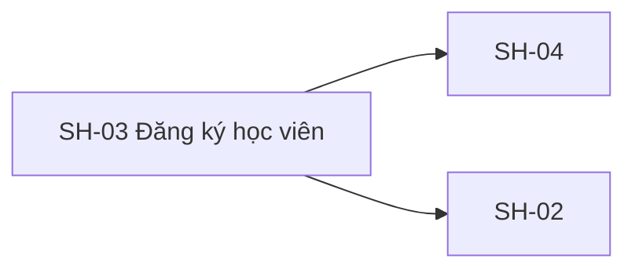
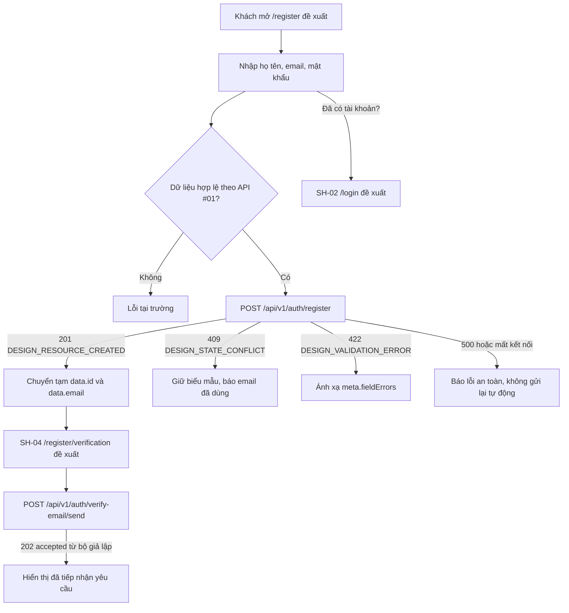

# SH-03 — Navigation

## 1. Route definition
- Current route in inventory: `/register`
- Status: candidate/design route; Study Web `UNWIRED` unless source code proves otherwise.
- Route params/types: Không có route param được biểu diễn trong inventory string; route runtime vẫn chưa xác minh.
- Query params/defaults: preserve the inventory route string; detailed parsing rules only from source DD.
- Route guards: see source DD/API contract; do not create role policy.

## 2. Điểm vào
| From screen/route | Trigger | Params | Guard / fallback |
|---|---|---|---|
| [SH-01](../SH-01-TrangGioiThieuStudyVariant1/00-overview.md), [SH-02](../SH-02-DangNhap/00-overview.md) | Theo DD nguồn/inventory | Theo source; không suy diễn | Xem source DD; route chưa xác nhận runtime |

## 3. Điểm ra
| Destination | Trigger | Params | Điều kiện |
|---|---|---|---|
| [SH-04](../SH-04-HandoffXacThucEmail/00-overview.md), [SH-02](../SH-02-DangNhap/00-overview.md) | Source event/inventory navigation | Theo source DD | Expected links; runtime chưa verify |

## 4. Back / refresh / deep link
- Back behavior: xem source DD; không mặc định browser history.
- Preserve filters/scroll/form state: chỉ nếu source có nêu, nếu không `CẦN_XÁC_NHẬN`.
- Refresh/direct URL: route trong inventory không chứng minh runtime.
- Invalid/missing ID: theo source DD/backend contract; không tự tạo validation.
- Not authenticated/authorized: theo source role guard; xem [Business Rules](05-business-rules.md).

## 5. Diagram

## Source navigation and flow detail

### Trích từ DD nguồn: 2. Sơ đồ luồng màn hình

Đường nối từ SH-03 sang SH-04 là luồng đích trong danh mục, không phải hành vi đã được nối ở phía giao diện. API #02 thuộc SH-04; không gọi API này trực tiếp từ SH-03 và không coi `accepted` là email đã gửi hoặc đã xác minh.
