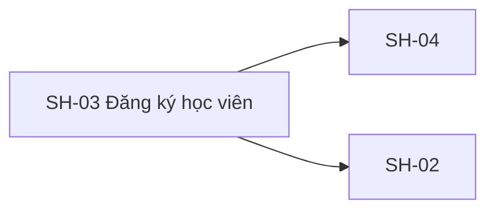
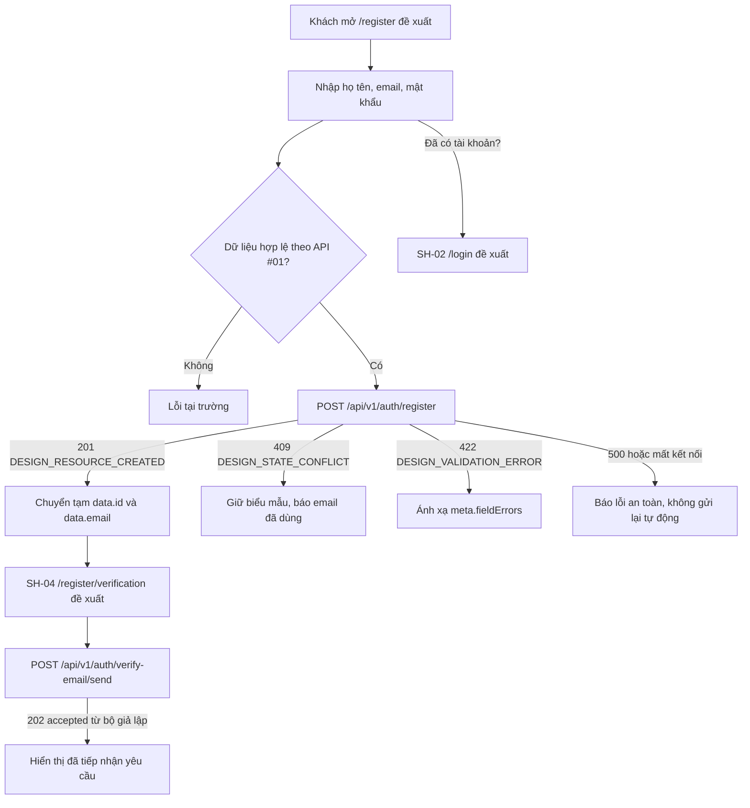

# SH-03 — Navigation

## 1. Route definition
- Current route in inventory: `/register`
- Status: `/register` is declared in `features/shared/shared.route.ts`; Angular app-route unit test passes. Browser runtime remains unverified.
- Route params/types: Không có route param được biểu diễn trong inventory string.
- Query params/defaults: preserve the inventory route string; detailed parsing rules only from source DD.
- Route guards: see source DD/API contract; do not create role policy.

## 2. Điểm vào
| From screen/route | Trigger | Params | Guard / fallback |
|---|---|---|---|
| [SH-01](../SH-01-TrangGioiThieuStudyVariant1/00-overview.md), [SH-02](../SH-02-DangNhap/00-overview.md) | Theo DD nguồn/inventory; SH-02 `/login` có route | Không truyền form values | Route presentation đã wire; browser runtime chưa xác minh |

## 3. Điểm ra
| Destination | Trigger | Params | Điều kiện |
|---|---|---|---|
| [SH-04](../SH-04-HandoffXacThucEmail/00-overview.md), [SH-02](../SH-02-DangNhap/00-overview.md) | User clicks continue after valid #01 result to reach SH-04; SH-02 remains the login link | One-use in-memory `{userId,email}`; no URL or persistent storage | Source-wired; invalid result blocks handoff; browser runtime unverified |

## 4. Back / refresh / deep link
- Back behavior: xem source DD; không mặc định browser history.
- Preserve filters/scroll/form state: chỉ nếu source có nêu, nếu không `CẦN_XÁC_NHẬN`.
- Refresh/direct URL: unit test xác nhận cấu hình route; browser deep-link behavior chưa được xác minh.
- Invalid/missing ID: theo source DD/backend contract; không tự tạo validation.
- Not authenticated/authorized: theo source role guard; xem [Business Rules](05-business-rules.md).

## 5. Diagram

## Source navigation and flow detail

### Trích từ DD nguồn: 2. Sơ đồ luồng màn hình

Current source connects SH-03 to SH-04 through a user-controlled action after the validated #01 response. The page stores `id/email` once in memory and navigates without placing them in the URL. API #02 belongs to SH-04; SH-03 does not call it, and `accepted` does not mean email sent or verified.
