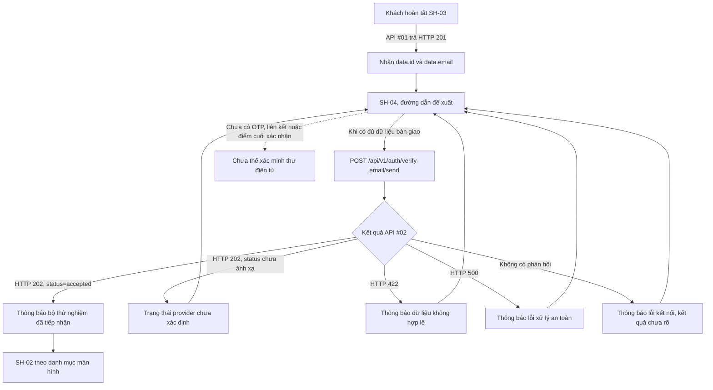

# SH-04 — Data Flow & State

## 1. Nguồn dữ liệu
| Field / object | Type | Source | Destination | Cập nhật khi |
|---|---|---|---|---|
| Chỉ liệt kê theo bằng chứng trong excerpt bên dưới | Theo DD/API source | API/inventory/design; status phải giữ nguyên | UI/state nêu ở DD nguồn | Theo event source |

## 2. State model

> Không tạo DTO/ViewModel mới khi chưa có contract. State, DTO và mapping được trích nguyên ngữ cảnh từ DD nguồn bên dưới.

## 3. API DTO → ViewModel mapping

### Trích từ DD nguồn: 2. Sơ đồ luồng màn hình và API

Việc gọi API sau đăng ký là đích F01. Thời điểm kích hoạt cụ thể — tự gọi khi mở SH-04 hay chờ thao tác riêng — chưa được chốt bằng mã giao diện hoặc hợp đồng tương tác. Bản mẫu hiển thị trạng thái `accepted` ngay khi tải và không có lời gọi API; không được coi đó là hành vi đã nối.

### Trích từ DD nguồn: 3. Luồng tổng quát

1. SH-03 nhận HTTP 201 từ API #01. Mã nguồn API #01 trả hồ sơ có `data.id` và `data.email` sau khi xác nhận giao dịch.
2. SH-04 cần nhận hai giá trị từ trạng thái bàn giao của SH-03; cơ chế truyền chưa được hiện thực hóa. Không đặt `user_id` hoặc `email` vào URL. Nếu thiếu một trong hai giá trị, không gọi API #02; phương án hiển thị/điều hướng dự phòng còn phải được duyệt.
3. Khi được kích hoạt theo quyết định sản phẩm, gửi một yêu cầu công khai tới API #02 với đúng hai trường `user_id` và `email`.
4. API #02 kiểm tra dữ liệu, chuẩn hóa địa chỉ thư điện tử rồi gọi `VerificationEmailProvider`. API không mở phiên cơ sở dữ liệu và không xác minh `user_id` có tồn tại hoặc thuộc địa chỉ thư điện tử đã gửi.
5. View gọi provider đồng bộ; factory hiện trả `StubVerificationEmailProvider`, provider mặc định trả `status="accepted"` không có `reason`. View trả HTTP 202 và map `status` cùng `reason` tùy chọn từ provider vào `data`.
6. Chỉ `data.status="accepted"` được map thành provider đã tiếp nhận; status khác chưa có semantics và phải vào trạng thái chưa ánh xạ. Không hiển thị `reason` tùy ý như nội dung người dùng nếu chưa duyệt.
7. Giao diện không được suy ra email đã gửi thật. Không mở ô OTP, không tạo liên kết giả, không đếm lùi và không chuyển trạng thái sang “đã xác minh”.
8. Khách có thể chọn quay lại SH-02 theo danh mục màn hình. Việc đăng nhập trước khi xác minh thư điện tử là quy tắc riêng chưa được xác nhận trong phạm vi này.

### Trích từ DD nguồn: 4. Bản đồ phần tử và dữ liệu trên màn hình

Ảnh nguồn có hai cột trên màn hình rộng: thẻ thông báo chính bên trái; thẻ thông tin API bên phải; ghi chú thiết kế ở dưới cột phải; chân trang chạy hết chiều ngang. HTML dùng một cột dưới mốc Tailwind `lg` và bố cục 7/12 + 5/12 từ mốc này trở lên. Giữ thứ tự đọc: ngữ cảnh trang → thông báo → giới hạn xác minh → điều hướng → chi tiết kỹ thuật.

| # / Element ID | Tên, loại và nội dung | Nguồn/điều kiện hiển thị | Trạng thái | Event / kết quả |
|---|---|---|---|---|
| 1 / `SH04-EL-01` | Mã SH-04 và route đề xuất · nhãn tĩnh. | Nội dung thiết kế; `/register/verification` chưa có router; hiển thị trang. | Default. | `SH04-EV-01`; không tự tạo link/API. |
| 2 / `SH04-EL-02` | Bộ chọn `Accepted / Stub Spec / No-Delivery / Error Handshake` · QA controls trong mock. | HTML/JavaScript cục bộ; không phải trạng thái API. Loại khỏi giao diện Khách. | Chỉ tồn tại trong mock; không có product state. | `SH04-EV-08`; không gọi API. |
| 3 / `SH04-EL-03` | Biểu tượng thư và nhãn phản hồi · trạng thái. | Dữ liệu state từ response; chỉ render `accepted` khi HTTP 202, business code đúng và `data.status="accepted"`. | Pending, accepted, validation error, provider error, unmapped, network unknown. | `SH04-EV-03..06, SH04-EV-09`; 202 không chứng minh delivery/verification. |
| 4 / `SH04-EL-04` | Tiêu đề và giải thích kết quả · heading/status text. | Nội dung đích theo API response; không hiển thị “đã vào hàng đợi”. Không hiển thị `reason` provider cho người dùng trước khi semantics được duyệt. | Pending, accepted, error, unmapped. | `SH04-EV-03..06, SH04-EV-09`; nói rõ email chưa gửi thật. |
| 5 / `SH04-EL-05` | Khung giới hạn xác minh · informational notice. | Nội dung tĩnh theo catalog/source: chưa có OTP, link hoặc confirm endpoint. | Visible; không điều khiển. | `SH04-EV-01`; không tạo OTP/input/countdown. |
| 6 / `SH04-EL-06` | Quay lại đăng nhập · anchor. | `href="/login"` trong HTML; SH-02 route đề xuất, runtime chưa xác nhận. | Default/focus. | `SH04-EV-07`; điều hướng, không gọi API. |
| 7 / `SH04-EL-07` | Copy Test cURL · button trong mock. | JavaScript dựng URL ngoài thiếu `/api/v1` và body thiếu `user_id`; không đưa vào product UI. | Chỉ mock; không dùng được. | `SH04-EV-08`; không copy/gửi lệnh. |
| 8 / `SH04-EL-08` | Thẻ tham chiếu hợp đồng API #02 · heading/card. | Nhãn tĩnh; không khẳng định telemetry live. | Visible. | `SH04-EV-01`; không có API riêng. |
| 9 / `SH04-EL-09` | Các hàng HTTP/delivery/auth/confirmation · status summary. | HTTP/body đã parse; delivery/verify chưa có nguồn phản hồi riêng; provider status ngoài `accepted` chưa có semantics. | Pending/accepted/error/unmapped/network unknown. | `SH04-EV-03..06, SH04-EV-09`; không hiển thị mock 200/503 như server response. |
| 10 / `SH04-EL-10` | JSON block · preformatted mock payload. | HTML hard-code `contract`, `delivery`, `artifacts`, `otp_generated`, `confirm_url`; các field này không có trong API response. Ẩn khỏi product UI. | Chỉ mock; không trình bày như response. | `SH04-EV-08`; ví dụ contract thực ở §6.2. |
| 11 / `SH04-EL-11` | Design rule card và nhãn `PASS WCAG AA`. | Ghi chú tĩnh; nhãn không có báo cáo kiểm định hỗ trợ. Bỏ tuyên bố đạt chuẩn khi triển khai. | Visible trong mẫu; chưa xác minh. | `SH04-EV-01`; không tương tác. |
| 12 / `SH04-EL-12` | Chân trang mã màn hình/route/protocol/auth label. | Nội dung HTML tĩnh; `Engineering Verification Protocol v2.4`/`Stub S-02` không phải trạng thái runtime đã xác nhận. | Default. | `SH04-EV-01`; không điều hướng/xác thực. |

Không có trường nhập liệu nào trên SH-04. Tên trường `user_id` và `email` chỉ là dữ liệu yêu cầu API, không phải ô để Khách tự sửa trên trang này. Marker JSON ghi tọa độ theo ảnh gốc 1600×1280 với gốc trên-trái và pixel; Element ID `SH04-EL-01..12` ánh xạ một-một tới số 1–12.

### Trích từ DD nguồn: 5. Hợp đồng trường và ánh xạ dữ liệu

| Trường nguồn | Trường API #02 | Kiểu / kiểm tra theo mã nguồn | Quy tắc hiển thị và riêng tư |
|---|---|---|---|
| API #01 `data.id` | `user_id` | Catalog yêu cầu `int64`. Source model dùng Python `int`; validator đòi JSON thô có kiểu integer, nhưng không kiểm tra miền int64 hoặc `> 0`. Đây là discrepancy; không tự thêm ràng buộc client. | Chỉ dùng trong request nội bộ; không đưa lên URL, nhật ký giao diện hoặc khung mẫu công khai. |
| API #01 `data.email` | `email` | `str`; địa chỉ được chuẩn hóa bởi `normalize_email`. Sai định dạng trả 422. | Chỉ hiển thị địa chỉ nếu nhóm sản phẩm duyệt nội dung này; ảnh mẫu hiện không nêu người nhận. Không ghi cố định địa chỉ minh họa vào giao diện. |
| Header `Authorization` | Không gửi | API #02 được gọi công khai; đường dẫn API không khai báo yêu cầu đăng nhập. | Không cần token; không lưu hoặc làm mới token vì thao tác này. |
| `traceId` | Tiêu đề HTTP/siêu dữ liệu phản hồi | Lớp trung gian tạo và chuyển mã truy vết tới hàm xử lý; lỗi chuẩn trả tiêu đề `X-Trace-Id`. | Chỉ dùng hỗ trợ chẩn đoán theo chính sách; không coi là mã xác minh hoặc bí mật để mở liên kết. |

API #02 không xác nhận danh tính, quyền sở hữu địa chỉ thư điện tử, sự tồn tại của `user_id`, trạng thái tài khoản hoặc tính duy nhất của yêu cầu. Phía giao diện không được suy ra các điều này từ HTTP 202.

Catalog/API DD quy định `ActionResult.status:string` và `reason?:string`; source map các giá trị provider này trực tiếp vào response. Default provider hiện chỉ trả `accepted`, nhưng status/reason khác chưa có allowlist hoặc semantics được duyệt. UI chỉ map `accepted`; giá trị khác thuộc `SH04-EV-09`.

### Trích từ DD nguồn: 7. Máy trạng thái giao diện đích

| Trạng thái | Vào trạng thái khi | Hiển thị / hành động | Event ID | Căn cứ |
|---|---|---|---|---|
| Chờ dispatch | Route mở và handoff đủ, trước khi dispatch được chấp thuận. | Trạng thái đích; không báo đã gửi. | `SH04-EV-01..02` | UI source chưa có; dispatch trigger/owner mở. |
| Đang gửi | API #02 đã bắt đầu. | Hiển thị tiến trình; ngăn gửi trùng trong cùng lượt. | `SH04-EV-02` | Target UI; chưa có runtime. |
| Đã tiếp nhận bởi bộ thử nghiệm | HTTP 202, `DESIGN_OPERATION_ACCEPTED`, `data.status="accepted"`. | Nêu thư chưa được gửi thật, không có xác minh; điều hướng SH-02 theo lựa chọn Khách. | `SH04-EV-03` | API source/provider stub và test source. |
| Dữ liệu không hợp lệ | HTTP 422 `DESIGN_VALIDATION_ERROR`. | Không hiện accepted; không tạo input; cần quyết định cách sửa handoff hoặc quay lại SH-03. | `SH04-EV-04` | API source/test; fallback chưa được duyệt. |
| Lỗi provider | HTTP 500 `DESIGN_INTERNAL_ERROR`. | Hiển thị lỗi chung; không lộ upstream detail. | `SH04-EV-05` | API source/test. |
| Kết quả chưa rõ | Timeout/mất mạng/body không đọc được. | Nêu kết quả không xác định; không tự gửi lại. | `SH04-EV-06` | Target transport handling; chưa có UI source/idempotency. |
| Thiếu dữ liệu bàn giao | Route mở trực tiếp hoặc thiếu `data.id`/`data.email`. | Không gọi API; fallback message/route chờ quyết định. | `SH04-EV-01` | Handoff channel chưa được hiện thực hóa. |
| Provider status chưa ánh xạ | HTTP 202 hợp lệ nhưng `data.status` khác `accepted`; nếu có `reason` thì không hiển thị giá trị chưa được duyệt. | Không claim email đã gửi/xác minh; giữ trạng thái nội bộ chưa ánh xạ; không retry. | `SH04-EV-09` | `ActionResult.status` là string, `reason` optional; enum còn mở. |
| Đã xác minh | Không có điều kiện vào trạng thái này ở API #02. | Không hiển thị ở SH-04. | — | Chưa có OTP, link hoặc endpoint xác nhận. |

Các nút chuyển `stub`, `no-delivery` và `error` của HTML không phải máy trạng thái máy chủ: JavaScript tự đổi tiêu đề, mã HTTP và JSON mà không gọi API. Chúng phải được loại khỏi luồng người dùng hoặc chỉ giữ trong bản trình diễn với nhãn giả lập rõ ràng.

### Trích từ DD nguồn: 11. Ma trận kiểm tra cho lần triển khai giao diện

Các mục sau là tiêu chí tương lai. Trong phiên soạn DD này chỉ đọc mã kiểm thử API #02; không chạy kiểm thử dự án.

| Nhóm | Trường hợp cần kiểm tra | Bằng chứng hiện có |
|---|---|---|
| Tích hợp API | Phần thân yêu cầu có `user_id` và `email`; không kèm Bearer; hiển thị HTTP 202 là “đã được bộ thử nghiệm tiếp nhận”. | Có đường dẫn API và mã kiểm thử cho API #02; chưa có mã giao diện, chưa chạy kiểm thử. |
| Ánh xạ bàn giao | `data.id` → `user_id`, `data.email` → `email`; không gọi khi thiếu dữ liệu. | Mã nguồn/mã kiểm thử API #01 xác nhận `id`, `email`; chưa có cơ chế giữa hai màn hình. |
| Chuẩn hóa/lỗi dữ liệu | Địa chỉ thư điện tử lỗi hoặc phần thân yêu cầu thiếu/sai kiểu trả 422; không hiện nội dung `accepted`. | Có bộ kiểm tra dữ liệu và mã kiểm thử API #02; chưa chạy kiểm thử. |
| Lỗi bộ gửi thư | Lỗi bộ gửi thư ánh xạ 500 `DESIGN_INTERNAL_ERROR`; không lộ ngoại lệ. | Có lớp điều phối và mã kiểm thử API #02; chưa chạy kiểm thử. |
| Giao thư/xác minh | Không nói đã gửi, không tạo OTP/liên kết và không hiện “đã xác minh”. | Mã nguồn bộ gửi thư không gửi thư/tạo token; chưa có điểm cuối xác nhận trong danh mục API. |
| Giả lập trong HTML | Các nút tự đổi JSON cục bộ; mẫu cURL thiếu `user_id` và sai đường dẫn. | Đã đọc HTML tĩnh; không thực thi JavaScript. |
| Điều hướng | Nút quay lại mở SH-02; truy cập trực tiếp khi thiếu dữ liệu không tự gửi yêu cầu. | Danh mục màn hình chỉ định SH-02; chưa có bộ định tuyến để kiểm tra. |
| Gửi lặp/mạng | Không tự gửi lặp khi chờ lâu hoặc không nhận phản hồi; kết quả chưa rõ. | Chưa có mã giao diện hoặc chính sách chống yêu cầu trùng. |
| Provider status/reason chưa biết | Không ánh xạ status ngoài accepted; không hiển thị reason chưa được duyệt. | Contract status là string, reason tùy chọn; API DD Q-02-05 còn mở. |
| Account/login gate | Không kết luận trạng thái đăng nhập sau SH-04 từ phản hồi API #02. | API #03 yêu cầu ACTIVE; API #01 bỏ qua status; DDL default ACTIVE chỉ là artifact, chưa có live-schema/verification-to-status evidence. |
| Tiếp cận/thích ứng | Bàn phím, tiêu điểm, thông báo trạng thái, chiều rộng 320px, phóng to, giảm chuyển động. | Chưa được kiểm tra trên mã giao diện vì môi trường chạy vắng mặt. |

## 4. Luồng đọc (Read)
- Orchestration từ inventory: POST #2 với user_id/email sau đăng ký, chỉ xác nhận accepted (stub), không tuyên bố email đã gửi hoặc đã verify.
- Chi tiết current/source mapping: xem [API Integration](04-api-integration.md) và DD nguồn.

## 5. Luồng ghi (Write)
- Chỉ mô tả mutation được DD/API source nêu; không thêm endpoint hoặc side effect.
- Source trace: [SH-04](../../screen_stitch/01_shared_auth_system/SH-04_handoff-xac-thuc-email/SH-04.md)

## 6. Cache / concurrency / lifecycle
- Cache, race, cleanup, pagination: xem các section source bên dưới; nếu không có bằng chứng thì để `CẦN_XÁC_NHẬN`.

## 7. Data errors & security
- Theo error/security/source-status section của DD nguồn; không coi state trong mockup là runtime behavior.

## 8. Trace
[Events](02-events.md) · [API](04-api-integration.md) · [Rules](05-business-rules.md)
