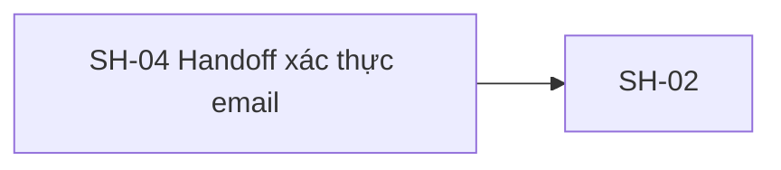
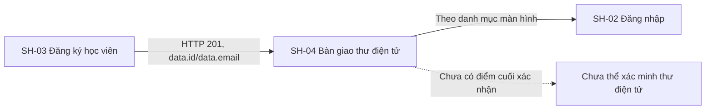
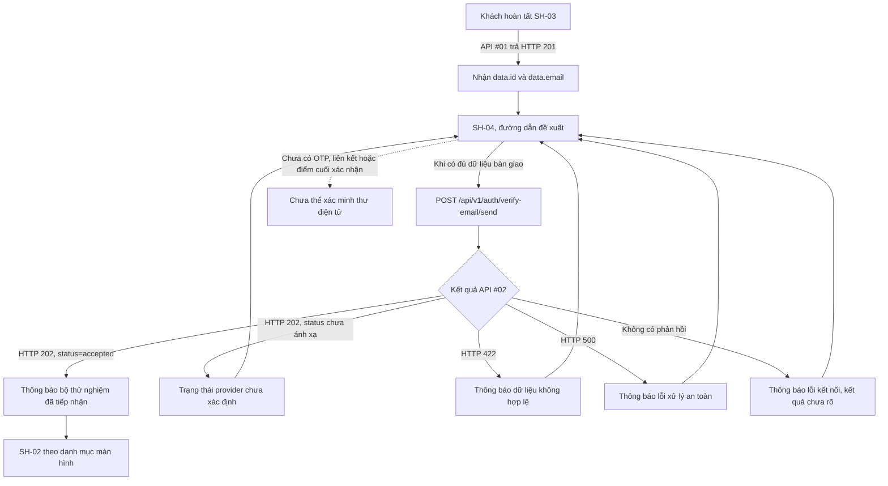

# SH-04 — Navigation

## 1. Route definition
- Current route in inventory: `/register/verification`
- Status: candidate/design route; Study Web `UNWIRED` unless source code proves otherwise.
- Route params/types: Không có route param được biểu diễn trong inventory string; route runtime vẫn chưa xác minh.
- Query params/defaults: preserve the inventory route string; detailed parsing rules only from source DD.
- Route guards: see source DD/API contract; do not create role policy.

## 2. Điểm vào
| From screen/route | Trigger | Params | Guard / fallback |
|---|---|---|---|
| [SH-03](../SH-03-DangKyHocVien/00-overview.md) | Theo DD nguồn/inventory | Theo source; không suy diễn | Xem source DD; route chưa xác nhận runtime |

## 3. Điểm ra
| Destination | Trigger | Params | Điều kiện |
|---|---|---|---|
| [SH-02](../SH-02-DangNhap/00-overview.md) | Source event/inventory navigation | Theo source DD | Expected links; runtime chưa verify |

## 4. Back / refresh / deep link
- Back behavior: xem source DD; không mặc định browser history.
- Preserve filters/scroll/form state: chỉ nếu source có nêu, nếu không `CẦN_XÁC_NHẬN`.
- Refresh/direct URL: route trong inventory không chứng minh runtime.
- Invalid/missing ID: theo source DD/backend contract; không tự tạo validation.
- Not authenticated/authorized: theo source role guard; xem [Business Rules](05-business-rules.md).

## 5. Diagram

## Source navigation and flow detail

### Trích từ DD nguồn: 8. Sơ đồ màn hình liên kết

| Màn hình | Quan hệ | Dữ liệu / hành vi |
|---|---|---|
| SH-03 | Màn hình trước | API #01 trả `data.id`, `data.email`; cơ chế giữ hai giá trị tới SH-04 cần được chốt. API #01 không gọi API #02. |
| SH-02 | Màn hình tiếp theo | Nút quay lại theo danh mục màn hình. Không suy ra trạng thái tài khoản hoặc kết quả đăng nhập từ API #02. |

### Trích từ DD nguồn: 2. Sơ đồ luồng màn hình và API

Việc gọi API sau đăng ký là đích F01. Thời điểm kích hoạt cụ thể — tự gọi khi mở SH-04 hay chờ thao tác riêng — chưa được chốt bằng mã giao diện hoặc hợp đồng tương tác. Bản mẫu hiển thị trạng thái `accepted` ngay khi tải và không có lời gọi API; không được coi đó là hành vi đã nối.

### Trích từ DD nguồn: 3. Luồng tổng quát

1. SH-03 nhận HTTP 201 từ API #01. Mã nguồn API #01 trả hồ sơ có `data.id` và `data.email` sau khi xác nhận giao dịch.
2. SH-04 cần nhận hai giá trị từ trạng thái bàn giao của SH-03; cơ chế truyền chưa được hiện thực hóa. Không đặt `user_id` hoặc `email` vào URL. Nếu thiếu một trong hai giá trị, không gọi API #02; phương án hiển thị/điều hướng dự phòng còn phải được duyệt.
3. Khi được kích hoạt theo quyết định sản phẩm, gửi một yêu cầu công khai tới API #02 với đúng hai trường `user_id` và `email`.
4. API #02 kiểm tra dữ liệu, chuẩn hóa địa chỉ thư điện tử rồi gọi `VerificationEmailProvider`. API không mở phiên cơ sở dữ liệu và không xác minh `user_id` có tồn tại hoặc thuộc địa chỉ thư điện tử đã gửi.
5. View gọi provider đồng bộ; factory hiện trả `StubVerificationEmailProvider`, provider mặc định trả `status="accepted"` không có `reason`. View trả HTTP 202 và map `status` cùng `reason` tùy chọn từ provider vào `data`.
6. Chỉ `data.status="accepted"` được map thành provider đã tiếp nhận; status khác chưa có semantics và phải vào trạng thái chưa ánh xạ. Không hiển thị `reason` tùy ý như nội dung người dùng nếu chưa duyệt.
7. Giao diện không được suy ra email đã gửi thật. Không mở ô OTP, không tạo liên kết giả, không đếm lùi và không chuyển trạng thái sang “đã xác minh”.
8. Khách có thể chọn quay lại SH-02 theo danh mục màn hình. Việc đăng nhập trước khi xác minh thư điện tử là quy tắc riêng chưa được xác nhận trong phạm vi này.
