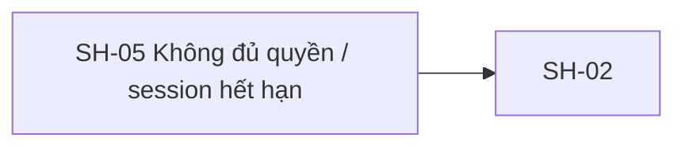

# SH-05 — Navigation

## 1. Route definition
- Current route in inventory: `/forbidden`
- Status: candidate/design route; Study Web `UNWIRED` unless source code proves otherwise.
- Route params/types: Không có route param được biểu diễn trong inventory string; route runtime vẫn chưa xác minh.
- Query params/defaults: preserve the inventory route string; detailed parsing rules only from source DD.
- Route guards: see source DD/API contract; do not create role policy.

## 2. Điểm vào
| From screen/route | Trigger | Params | Guard / fallback |
|---|---|---|---|
| Không khai báo trong cột điều hướng inventory. | Theo DD nguồn/inventory | Theo source; không suy diễn | Xem source DD; route chưa xác nhận runtime |

## 3. Điểm ra
| Destination | Trigger | Params | Điều kiện |
|---|---|---|---|
| [SH-02](../SH-02-DangNhap/00-overview.md) | Source event/inventory navigation | Theo source DD | Expected links; runtime chưa verify |

## 4. Back / refresh / deep link
- Back behavior: xem source DD; không mặc định browser history.
- Preserve filters/scroll/form state: chỉ nếu source có nêu, nếu không `CẦN_XÁC_NHẬN`.
- Refresh/direct URL: route trong inventory không chứng minh runtime.
- Invalid/missing ID: theo source DD/backend contract; không tự tạo validation.
- Not authenticated/authorized: theo source role guard; xem [Business Rules](05-business-rules.md).

## 5. Diagram

## Source navigation and flow detail

### Trích từ DD nguồn: 7. Ma trận trạng thái và điều hướng

| State | Điều kiện vào | UI/action | Chuyển tiếp |
|---|---|---|---|
| `INITIAL` | Router resolve, error context chưa parse | Không hiển thị dữ liệu giả; giữ shell/loading tối thiểu nếu cần | `RESOLVING` |
| `RESOLVING` | Đang chuẩn hóa status/envelope | Không có action refresh thứ hai | `UNAUTHORIZED`, `FORBIDDEN`, `SERVICE_ERROR` |
| `UNAUTHORIZED` | 401 sau khi recovery policy đã dừng, hoặc không có refresh token | Thông báo xác thực thất bại trung tính; chỉ nói phiên hết hạn khi đã xác nhận; login action theo policy; không render protected data | `LOGIN_NAVIGATION` hoặc outcome được Product chốt cho profile-missing |
| `REFRESHING` | Auth manager đang gọi R-X01 và attempt chưa dùng | Loading status; disable action lặp; không lộ token | `RETRYING`, `REFRESH_REJECTED`, `SERVICE_ERROR` |
| `RETRYING` | Refresh thành công, request gốc được phép replay | Giữ feedback loading; request gốc thử tối đa một lần | Route gốc/`UNAUTHORIZED`/`SERVICE_ERROR` |
| `FORBIDDEN` | API trả 403 | Thông điệp quyền bị từ chối; no refresh; safe-back action | `SAFE_BACK` |
| `REFRESH_REJECTED` | Refresh trả 401 hoặc account-inactive 403 | Không retry refresh; login hoặc access-denied outcome theo source/policy | `UNAUTHORIZED`/`FORBIDDEN` |
| `SERVICE_ERROR` | 5xx, timeout, network, parse error | Lỗi dịch vụ chung, trace ID nếu có; không giả thành 401/403 | Retry read theo policy hoặc safe navigation |
| `COPY_SUCCESS` / `COPY_FAILED` | EV-06 hoàn tất/thất bại | Accessible status/error feedback; auth state giữ nguyên | Trở lại state trước |
| `LOGIN_NAVIGATION` / `SAFE_BACK` | Người dùng chọn route action | Router điều hướng sau safe-route validation | SH-02 hoặc route an toàn |

| Từ | Điều kiện | Đến / dữ liệu được truyền |
|---|---|---|
| Màn hình được bảo vệ → SH-05 | 401 đã refresh-fail/không có token | `status`, `businessCode`, safe `message`, `traceId`, relative return route allowlisted nếu có. Không truyền token. |
| Màn hình được bảo vệ → SH-05 | 403 | Cùng error context; không gửi refresh token; không truyền role matrix. |
| SH-05 → SH-02 | 401 cuối cùng / login action | Safe `returnTo` relative route nếu policy/router xác nhận; không có token/PII. |
| SH-05 → route trước an toàn | 403 / safe-back | Chỉ route same-origin allowlisted; fallback khi direct entry cần Product chốt. |
| SH-05 → service error state | 5xx/network/timeout | Safe message và trace ID nếu có; giữ nguyên HTTP/business code, không đổi thành 403. |

### Trích từ DD nguồn: 2. Luồng hoạt động tổng thể

1. **Khởi tạo / nhận context:** Router hoặc lớp gọi chung chuyển tới SH-05 sau khi request được bảo vệ nhận lỗi xác thực cuối cùng, hoặc direct navigation vào route. Hợp đồng truyền status/error/return route vào view chưa được triển khai; không gọi #04 chỉ để dựng SH-05 vì có thể lặp lỗi.
2. **Chuẩn hóa response:** Đọc HTTP status, `businessCode`, `message`, `traceId` từ envelope và `X-Trace-Id` từ header. Chỉ dùng các giá trị server trả; không tạo `reason`, `timestamp`, role, hoặc trace ID giả. Nếu body/header cùng có trace ID nhưng khác nhau, giữ lỗi cho telemetry và không tự chọn giá trị thay thế theo quy tắc chưa được duyệt.
3. **Xử lý 401 trước khi hiển thị:** Theo intent inventory, auth manager có thể thử R-X01 tối đa một lần nếu có refresh token và policy cho phép. API #04 cũng trả cùng 401 khi profile không tồn tại; client không thể kết luận chỉ từ code rằng access token hết hạn. Nếu refresh thành công, cập nhật phiên theo storage đã duyệt và chỉ retry request gốc theo policy replay an toàn. Nếu request #04 vẫn trả 401, dừng retry; thông điệp/đích tiếp theo cần Product/Backend quyết định, không tự gọi đó là “hết phiên”.
4. **Xử lý 403:** Không gọi R-X01. Hiển thị thông điệp chung không tiết lộ role/permission nội bộ; giữ route trước đó chỉ khi là route nội bộ an toàn đã allowlist. Không tự điều hướng sang Mentor/Admin hoặc gán quyền.
5. **Xử lý lỗi dịch vụ:** 5xx, timeout, lỗi mạng, body không hợp lệ hoặc business code không khớp không được ánh xạ thành 403. Dùng trạng thái service error chung và giữ trace ID nếu có; retry chỉ theo chính sách an toàn của request, không tự lặp refresh.
6. **Ánh xạ UI:** State quyết định badge, title, mô tả và action. Trace card chỉ hiển thị dữ liệu lỗi allowlist; không render stack trace, token, profile, database detail hoặc payload chưa lọc.
7. **Tương tác:** Người dùng chọn login hoặc route lui an toàn. Hành động sao chép chỉ copy trace ID thật và thông báo kết quả accessible. Prototype state toggle không xuất hiện trong runtime.
8. **Rời màn hình:** Sau login thành công, SH-02 tiếp tục flow xác định role/profile theo contract riêng. Inventory G-14 ghi API #03 catalog `201/UserProfile-only` khác current source `200/profile+tokens`; SH-05 không định nghĩa response parser của SH-02, nên login handoff chưa thể xác minh end-to-end. `returnTo` chỉ được giữ nếu là relative route nội bộ đã allowlist; không đưa token hoặc PII vào URL. Sau 403, đích quay lại cụ thể cần được sản phẩm chốt khi không có route trước an toàn.

Quan hệ luồng: SH-05 có thể được gọi sau SH-02/API #04 hoặc bởi guard của một màn hình cần quyền. Với 401, SH-02 là đích đăng nhập. Với 403, route trước đó an toàn là đích ưu tiên; SH-01/GS-01 là các route công khai tham khảo trong inventory, không tự chọn làm fallback mặc định khi chưa có quyết định UX.
