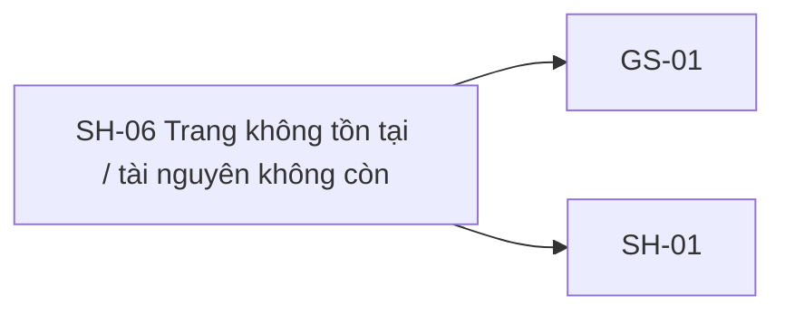

# SH-06 — Navigation

## 1. Route definition
- Current route in inventory: `/not-found`
- Status: candidate/design route; Study Web `UNWIRED` unless source code proves otherwise.
- Route params/types: Không có route param được biểu diễn trong inventory string; route runtime vẫn chưa xác minh.
- Query params/defaults: preserve the inventory route string; detailed parsing rules only from source DD.
- Route guards: see source DD/API contract; do not create role policy.

## 2. Điểm vào
| From screen/route | Trigger | Params | Guard / fallback |
|---|---|---|---|
| Không khai báo trong cột điều hướng inventory. | Theo DD nguồn/inventory | Theo source; không suy diễn | Xem source DD; route chưa xác nhận runtime |

## 3. Điểm ra
| Destination | Trigger | Params | Điều kiện |
|---|---|---|---|
| [GS-01](../GS-01-DanhSachKhoaHoc/00-overview.md), [SH-01](../SH-01-TrangGioiThieuStudyVariant1/00-overview.md) | Source event/inventory navigation | Theo source DD | Expected links; runtime chưa verify |

## 4. Back / refresh / deep link
- Back behavior: xem source DD; không mặc định browser history.
- Preserve filters/scroll/form state: chỉ nếu source có nêu, nếu không `CẦN_XÁC_NHẬN`.
- Refresh/direct URL: route trong inventory không chứng minh runtime.
- Invalid/missing ID: theo source DD/backend contract; không tự tạo validation.
- Not authenticated/authorized: theo source role guard; xem [Business Rules](05-business-rules.md).

## 5. Diagram

## Source navigation and flow detail

### Trích từ DD nguồn: 7. Ma trận trạng thái và điều hướng

| State | Điều kiện vào | UI/side effect | Chuyển tiếp |
|---|---|---|---|
| `INITIAL` | Router/client bắt đầu resolve | Không render mock course data như thật | `ROUTE_404`, `RESOURCE_LOADING`, `SERVICE_ERROR` |
| `ROUTE_404` | Router không match URL | Badge/title/copy chung; không gọi API; CTA GS-01/SH-01 | Điều hướng EV-03–05 |
| `RESOURCE_LOADING` | GS-03 đang gọi #08 | Loading thuộc GS-03; không render SH-06 trước kết quả | `COURSE_READY`, `RESOURCE_404`, `FORBIDDEN`, `SERVICE_ERROR` |
| `COURSE_READY` | #08 trả HTTP 200 hợp lệ và Page có item | Tiếp tục GS-03; không ở SH-06 | GS-03 ready |
| `RESOURCE_404` | #08 trả 404 `DESIGN_RESOURCE_NOT_FOUND` | Nội dung 404 chung, không hiển thị draft/private/course ID | SH-06 actions |
| `FORBIDDEN` | Auth guard khác trả 403 | Giữ access-denied state SH-05; #08 current source không có 403 | SH-05 / safe access flow |
| `SERVICE_ERROR` | 500, network, timeout, JSON/schema failure | Error dịch vụ riêng, trace ID nếu policy cho phép; không render 404 | Shared service-error retry/navigation policy |
| `NAVIGATING` | User click internal link | Chờ router resolve, không giữ href placeholder | GS-01, SH-01, route đích đã xác nhận |
| `RECOMMENDATIONS_BLOCKED` | Chưa có quyết định về section/data source | Không dùng mock values; production disposition chưa chốt nên event chưa implementable | DD giữ `BLOCKED` đến khi Product/UX chốt |

| Từ | Điều kiện | Đến / dữ liệu truyền |
|---|---|---|
| GS-03 → SH-06 | #08 404 `DESIGN_RESOURCE_NOT_FOUND` | Error state chung; không truyền/render private course payload. |
| GS-03 → GS-03 | #08 200 Page singleton hợp lệ | Course item và route ID từ API/route đã validate. |
| Caller → SH-05 | 403 thực tế từ guard | Access-denied state; không đổi thành SH-06. |
| SH-06 → GS-01 | CTA/list link | `/courses`, không truyền course ID. |
| SH-06 → SH-01 | Home/logo | `/`, không truyền dữ liệu riêng tư. |
| #08 → service error | 500/network/timeout | State/service component riêng; không dùng thông điệp 404. |

### Trích từ DD nguồn: 2. Luồng hoạt động tổng thể

1. **Route fallback:** Router tương lai nhận pathname không khớp và hiển thị `ROUTE_404`; SH-06 không gọi API. Không echo raw URL/query vào heading hoặc thông báo.
2. **Resource detail:** Từ GS-03, client gửi API #08 với `course_id`. Nếu API trả HTTP 200 `DESIGN_RESOURCE_RETRIEVED`, lấy `data.items[0]` và pagination đã validate rồi tiếp tục GS-03. Nếu trả 404 `DESIGN_RESOURCE_NOT_FOUND`, hiển thị cùng nội dung chung `RESOURCE_404`.
3. **Không phân biệt private/draft:** API query chỉ trả course `PUBLISHED`; absent/unpublished có cùng status, business code và message. SH-06 không hiển thị course ID, draft status hoặc lý do nội bộ.
4. **Phân nhánh lỗi:** API #08 500 `DESIGN_INTERNAL_ERROR`, network/timeout, JSON parse error hoặc envelope sai đi tới service-error handling riêng. Nếu response thực tế là 403, giữ access-denied state (SH-05); API #08 hiện không tạo nhánh này.
5. **Render:** Badge/title/body chỉ phản ánh trạng thái không tìm thấy. Không hiển thị course detail, mentor, giá, thumbnail hoặc API payload ở SH-06. Safe Scope notice có thể nói hệ thống không công khai nội dung không khả dụng, nhưng không khẳng định toàn bộ sản phẩm có cơ chế ẩn draft ngoài source đã xác minh.
6. **Điều hướng:** Primary action tới GS-01 `/courses`; secondary action/logo/home tới SH-01 `/`. Header link route là proposal theo inventory. Các card course/contact/footer links chỉ hoạt động sau khi có data ID/route/channel được duyệt; không điều hướng bằng href `#`.
7. **Rời màn hình:** Tới GS-01 thì GS-01 sở hữu API #05/#06; tới SH-01 thì SH-01 sở hữu API #05/#06 theo inventory. SH-06 không gọi trước các API này để render fallback.

Quan hệ hệ thống: SH-06 hỗ trợ GS-03 khi course không tồn tại/không public và làm route fallback cho toàn Study Web. Route fallback có thể được dùng từ mọi flow nhưng nội dung 404 không tiết lộ record/ownership. 403 là SH-05 và lỗi 500/mạng thuộc service-error handling; các trạng thái không thay thế nhau.
