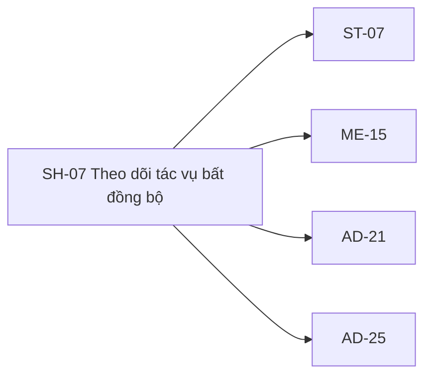

# SH-07 — Navigation

## 1. Route definition
- Current route in inventory: `/operations/:operationId`
- Status: candidate/design route; Study Web `UNWIRED` unless source code proves otherwise.
- Route params/types: `operationId` (type/validation: see source DD; CẦN_XÁC_NHẬN if absent)
- Query params/defaults: preserve the inventory route string; detailed parsing rules only from source DD.
- Route guards: see source DD/API contract; do not create role policy.

## 2. Điểm vào
| From screen/route | Trigger | Params | Guard / fallback |
|---|---|---|---|
| [ST-06](../ST-06-ThucHienThanhToan/00-overview.md), [ME-15](../ME-15-TheoDoiGuiThongBao/00-overview.md), [AD-20](../AD-20-SoanGuiThongBaoHeThong/00-overview.md), [AD-21](../AD-21-SuaKiemSoatDoTrangThaiThongBao/00-overview.md), [AD-25](../AD-25-XuatBaoCaoVaTheoDoiTienTrinh/00-overview.md) | Theo DD nguồn/inventory | Theo source; không suy diễn | Xem source DD; route chưa xác nhận runtime |

## 3. Điểm ra
| Destination | Trigger | Params | Điều kiện |
|---|---|---|---|
| [ST-07](../ST-07-KetQuaDangKyKhoaHoc/00-overview.md), [ME-15](../ME-15-TheoDoiGuiThongBao/00-overview.md), [AD-21](../AD-21-SuaKiemSoatDoTrangThaiThongBao/00-overview.md), [AD-25](../AD-25-XuatBaoCaoVaTheoDoiTienTrinh/00-overview.md) | Source event/inventory navigation | Theo source DD | Expected links; runtime chưa verify |

## 4. Back / refresh / deep link
- Back behavior: xem source DD; không mặc định browser history.
- Preserve filters/scroll/form state: chỉ nếu source có nêu, nếu không `CẦN_XÁC_NHẬN`.
- Refresh/direct URL: route trong inventory không chứng minh runtime.
- Invalid/missing ID: theo source DD/backend contract; không tự tạo validation.
- Not authenticated/authorized: theo source role guard; xem [Business Rules](05-business-rules.md).

## 5. Diagram

## Source navigation and flow detail

### Trích từ DD nguồn: 8. Ma trận trạng thái và điều hướng

| State | Điều kiện | UI/data | Chuyển tiếp hoặc route |
|---|---|---|---|
| `DESIGN_GATE` | Current prototype / API #18 chưa wired | Banner `Gated/Unavailable`; không status fetch/poll; lifecycle cards chỉ là reference. | Modal/clipboard CTA; recovery targets còn proposal. |
| `INITIAL` | Route vào, ID chưa resolve | Không hiển thị UUID fallback. Caller provenance phải được xác định. | `DESIGN_GATE` nếu API chưa sẵn; nếu đủ contract thì `LOADING`. |
| `LOADING` | Chỉ sau khi #18 source + canonical ID/owner/status contract được duyệt | Loading state; không fake progress. | `RESPONSE_READY`, `AUTHENTICATION_REQUIRED`, `ACCESS_DENIED`, `OPERATION_NOT_FOUND`, `SERVICE_ERROR`; exact UI mapping awaits shared route policy. |
| `RESPONSE_READY` | HTTP 200 envelope hợp lệ và status/kind đã được chuẩn hóa | Bind fields chỉ theo final schema; hiện không có mapping final. | Approved lifecycle state; stop/refresh rule unresolved. |
| `QUEUED`, `RUNNING`, `SUCCEEDED`, `FAILED`, `EXPIRED` | Chỉ là nhãn trên prototype/lifecycle reference | Không coi là canonical runtime enum. Không hiển thị một trong các trạng thái dựa trên timer hoặc ví dụ. | Không thể xác định terminal state cho tới khi enum/lifecycle owner duyệt. |
| `AUTHENTICATION_REQUIRED` | API #18 dự kiến 401 | Không show operation details; expected navigation/access flow qua SH-05. | SH-05/session policy, chưa có client runtime. |
| `ACCESS_DENIED` | API #18 dự kiến 403 | Không show owner/operation data. Wrong-owner 403 vs hidden 404 chưa chốt. | SH-05/access-denied flow theo shared route policy. |
| `OPERATION_NOT_FOUND` | API #18 dự kiến 404 | Generic not-found copy, không tiết lộ operation/owner existence vượt contract. | SH-06 candidate; exact routing unresolved. |
| `SERVICE_ERROR` | API 500, network/timeout, invalid envelope/JSON | Không convert sang 404, không show raw exception/SQL. Retry policy unknown; trace ID only if approved shared policy. | Shared service-error behavior chưa có route trong Study Web. |
| `INVALID_OR_UNKNOWN_STATE` | ID, kind/status/result không parse theo approved schema | Không tự uppercase/lowercase, không suy status từ notification API. | Hold behind gate; contract owner fixes producer/consumer schema. |
| Return navigation | User dùng CTA hoặc browser back | Inventory caller set ST-07/ME-15/AD-21/AD-25; HTML links GS-01/SH-01. | Safe-return source, history behavior và target route cần Product/FE decision. |

Không có state nào được `RUNTIME VERIFIED`. Ngay cả các state dự kiến từ API #18 cũng chưa thể chuyển thành implementation-ready mapping do contract còn mở.

### Trích từ DD nguồn: 4. Luồng hoạt động tổng thể

### 4.1. Trạng thái prototype hiện có

1. Browser render HTML prototype, không có router hay API client được xác minh.
2. Inline script đọc `window.location.pathname`; nếu match `/operations/<segment>` thì thay text ID bằng segment đó. Nếu không match, script gán UUID mẫu. Không có validation/auth/owner check.
3. UI hiển thị gate banner, mock environment, ID mẫu hoặc path text, các lifecycle reference cards và developer diagnostic. Không có status fetch, polling, timer, SSE, result download, cache hoặc error mapping.
4. Click “Xem Contract Spec” bật modal; click hai close controls đóng modal. Copy button gọi Clipboard API với text đang hiển thị. Các anchor route đều `href="#"`.

### 4.2. Luồng mục tiêu chỉ sau khi contract được duyệt

1. Caller (ST-06/ME-14/AD-20/AD-25 theo contract tương ứng) nhận một ID từ backend. Client chỉ điều hướng tới SH-07 sau khi ID field/path và producer response được thống nhất; không tự tạo ID và không suy từ notification ID sang operation ID.
2. Router xác thực format theo kiểu ID đã được contract owner chốt. Hiện không có quyết định giữa UUID và int64; do đó chưa thể viết validator/canonicalizer.
3. Backend phải thực thi Bearer authentication, role/ownership policy và lookup operation. SH-07 không tự xác thực quyền bằng `owner_id` trên client.
4. Khi API #18 route/module/response được triển khai và contract đã chốt, client gửi một GET ban đầu. Không gửi query/body; không gọi API #18 hiện tại vì route chưa tồn tại.
5. Client kiểm tra HTTP status, business code, envelope, field types và Operation status/kind theo canonical schema. Hiện các enum/result/ownership field mapping còn SOURCE_REQUIRED.
6. Chỉ khi mapping status được phê duyệt mới render status thật, timestamp và hành động được phép. Không dựng %, countdown, kết quả thanh toán, sent count hoặc download URL nếu API không trả field được contract định nghĩa.
7. Polling/SSE, cache, retry/backoff, interval, visibility/reconnect và điểm dừng phải được quyết định trước. HTML gợi ý hai cách nhưng không tạo contract.
8. Sau terminal state, cập nhật màn hình theo chính payload backend và điều hướng theo caller context đã được duyệt. Hiện `terminal states` và safe-return target chưa được thống nhất.
