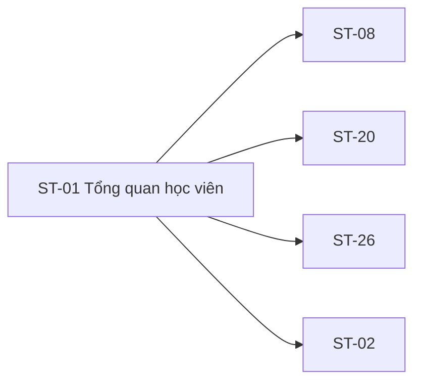

# ST-01 — Navigation

## 1. Route definition
- Current route in inventory: `/student`
- Status: candidate/design route; Study Web `UNWIRED` unless source code proves otherwise.
- Route params/types: Không có route param được biểu diễn trong inventory string; route runtime vẫn chưa xác minh.
- Query params/defaults: preserve the inventory route string; detailed parsing rules only from source DD.
- Route guards: see source DD/API contract; do not create role policy.

## 2. Điểm vào
| From screen/route | Trigger | Params | Guard / fallback |
|---|---|---|---|
| [SH-02](../SH-02-DangNhap/00-overview.md) | Theo DD nguồn/inventory | Theo source; không suy diễn | Xem source DD; route chưa xác nhận runtime |

## 3. Điểm ra
| Destination | Trigger | Params | Điều kiện |
|---|---|---|---|
| [ST-08](../ST-08-KhoaHocCuaToi/00-overview.md), [ST-20](../ST-20-TongQuanTienDo/00-overview.md), [ST-26](../ST-26-ThongBaoHocVien/00-overview.md), [ST-02](../ST-02-HoSoCaNhan/00-overview.md) | Source event/inventory navigation | Theo source DD | Expected links; runtime chưa verify |

## 4. Back / refresh / deep link
- Back behavior: xem source DD; không mặc định browser history.
- Preserve filters/scroll/form state: chỉ nếu source có nêu, nếu không `CẦN_XÁC_NHẬN`.
- Refresh/direct URL: route trong inventory không chứng minh runtime.
- Invalid/missing ID: theo source DD/backend contract; không tự tạo validation.
- Not authenticated/authorized: theo source role guard; xem [Business Rules](05-business-rules.md).

## 5. Diagram

## Source navigation and flow detail

### Trích từ DD nguồn: E. Ma trận trạng thái và điều hướng

### E.1. State matrix

| State | Entry condition | UI/data rule | Current evidence / exit |
|---|---|---|---|
| `static-gated` | HTML hand-off initial render. | Chỉ hiện status/unavailable copy; không có synthetic data. | Đây là state duy nhất thấy trong source asset; không phải API state. |
| `loading` | Inventory target sau khi widget request được bắt đầu. | Widget-local loading; không blank-fill với dữ liệu giả. | Chưa có UI design/route/request source; exit chưa xác định. |
| `ready` | Approved success response và projection cho widget. | Chỉ render fields đã được contract duyệt. | Không có loaded-state design hoặc runtime response. |
| `empty` | Successful empty response theo từng API's approved wire shape. | Không đồng nhất với access/API/network error. | #20/#21/#38/#43 empty semantics chưa thống nhất; AC-13 empty edge đang lệch. |
| `partial-widget` | Một số widget thành công, một số lỗi/rỗng, theo policy được duyệt. | Giữ trạng thái riêng cho từng widget; không làm dashboard-wide success giả. | Inventory target; ordering/failure/retry policy chưa xác định. |
| `forbidden` / `error` | 403 hoặc API/transport error theo contract. | Giữ 401/403/500 và #20 422 distinct; không đổi thành empty. | Page-level copy, recovery/redirect chưa được Study Web source xác nhận. |

### E.2. Navigation và handoff

| From | Expected target | Data/guard | Current evidence |
|---|---|---|---|
| Course CTA | ST-08 `/student/courses` | Student; no extra param unless contract requires it. | Inventory link; HTML `href="#"`; no Study Web route. |
| Progress CTA | ST-20 `/student/progress` | Student; progress/course data contract open. | Inventory link; HTML `href="#"`; no route. |
| Notification CTA | ST-26 `/student/notifications` | Student; no notification ID/deep link supplied. | Inventory link; HTML `href="#"`; no route. |
| Learner profile/navigation | ST-02 `/student/profile` | Student session; profile source outside ST-01 inventory API set. | Inventory relationship; header nav/profile controls have placeholder links or static sample. |
| Header discussions/home/legal/help | Destination TBD | No route/data/query assumed. | All anchors are `#`; current Study router absent. |

API #44/#45 state changes belong to AC-20 notification-center flow; ST-01 does not mark notifications read. No IDs other than approved API inputs are carried between screens.

### Trích từ DD nguồn: B. Luồng hoạt động tổng thể

1. **Đi vào route:** Inventory đề xuất `/student`; precondition theo AC là Student đã đăng nhập. Current Study Web router/source không có, nên không xác nhận direct-entry, page guard hoặc redirect.
2. **Khởi tạo:** Inventory muốn các widget độc lập, nạp #20/#21 khi vào trang, #38/#43 lazy hoặc parallel. AC-13 gọi #20 rồi #21; AC-18 đặt #21 → #37 → #38. Ghi nhận `DISCREPANCY`; không chọn một thứ tự làm contract.
3. **Nạp khóa học:** API #20 catalog có optional `status`/`page`, nhưng response `UserProfile` chưa thể map thành course list theo AC-13. Không gửi default/filter tự tạo.
4. **Nạp tiến độ:** API #21 query grammar và response chưa mô tả progress aggregate. Không ghép theo `course_id`, tính % hoặc tổng hợp lesson/quiz/assignment khi chưa có contract.
5. **Nạp achievements:** API #38 `Page<Achievement>` có contract design-only. Chỉ record được backend xác nhận mới có thể hiển thị sau khi award/projection/empty rules được chốt; không suy chứng nhận/proof từ copy.
6. **Nạp notification:** API #43 `Page<Notification>` design-only. “Latest” order, recipient, unread state và projection chưa rõ; không dùng URL prototype `/notifications/latest`.
7. **Trạng thái widget:** Mỗi widget cần giữ trạng thái loading/empty/partial/error độc lập theo inventory; hiện chỉ có gated static panel. Không đổi 401/403/500/network failure thành empty.
8. **Đi tiếp:** Course CTA tham chiếu ST-08, progress CTA ST-20, notification CTA ST-26. Các `href="#"` hiện tại không điều hướng; không truyền course ID, notification ID hoặc query chưa có nguồn.
9. **Rời trang:** Header, breadcrumb, profile và footer anchors vẫn là placeholder. Back-stack, target legal/help và route ngoài các liên kết inventory chưa được xác nhận.
