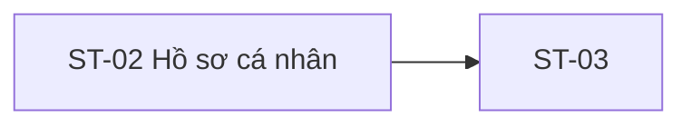

# ST-02 — Navigation

## 1. Route definition
- Current route in inventory: `/student/profile`
- Status: candidate/design route; Study Web `UNWIRED` unless source code proves otherwise.
- Route params/types: Không có route param được biểu diễn trong inventory string; route runtime vẫn chưa xác minh.
- Query params/defaults: preserve the inventory route string; detailed parsing rules only from source DD.
- Route guards: see source DD/API contract; do not create role policy.

## 2. Điểm vào
| From screen/route | Trigger | Params | Guard / fallback |
|---|---|---|---|
| [ST-01](../ST-01-TongQuanHocVien/00-overview.md), [ST-03](../ST-03-ChinhSuaHoSoAvatar/00-overview.md) | Theo DD nguồn/inventory | Theo source; không suy diễn | Xem source DD; route chưa xác nhận runtime |

## 3. Điểm ra
| Destination | Trigger | Params | Điều kiện |
|---|---|---|---|
| [ST-03](../ST-03-ChinhSuaHoSoAvatar/00-overview.md) | Source event/inventory navigation | Theo source DD | Expected links; runtime chưa verify |

## 4. Back / refresh / deep link
- Back behavior: xem source DD; không mặc định browser history.
- Preserve filters/scroll/form state: chỉ nếu source có nêu, nếu không `CẦN_XÁC_NHẬN`.
- Refresh/direct URL: route trong inventory không chứng minh runtime.
- Invalid/missing ID: theo source DD/backend contract; không tự tạo validation.
- Not authenticated/authorized: theo source role guard; xem [Business Rules](05-business-rules.md).

## 5. Diagram

## Source navigation and flow detail

### Trích từ DD nguồn: E. Ma trận trạng thái, điều hướng và khả năng tiếp cận

| State | Entry condition / source | Current visual or required treatment | Exit |
|---|---|---|---|
| `INITIAL` | Route resolution, before fetch | No current runtime state. | `LOADING` or auth block after implementation. |
| `LOADING` | Expected #04 request pending | Inventory expects loading; no skeleton/spinner design exists. | `READY`/`UNAUTHORIZED`/`FORBIDDEN`/`SERVICE_ERROR`. |
| `READY` | HTTP 200 and validated profile | No ready-state screenshot/layout. Only the field allowlist/source map is known. | Navigation to ST-03 if separately enabled by approved contract. |
| `UNAUTHENTICATED` | Missing/invalid/expired Bearer or missing user row (current #04 → 401) | HTML static sign-in fallback resembles this but does not prove an actual auth check. | Login/recovery route behavior unresolved; do not infinite-refresh. |
| `FORBIDDEN` | Valid token role does not include Student (current #04 → 403) | No current 403 UI. Do not treat as login success or refresh forever. | Safe prior route/SH-05 mapping requires client policy. |
| `SERVICE_ERROR` | API 500/network/timeout | API 500 exists; current mock has no error display/retry. | Retry is read-safe but retry limits/copy not specified. |
| `EDIT_DISABLED` | Static HTML initial | Edit button disabled with “Tạm khóa”. | No transition in ST-02. |

### Điều hướng và dữ liệu handoff

- **SH-02 → ST-02:** AC-02 says login returns token/profile and routes by role; F01 says Student then calls #04. Current #03 success already returns a basic profile with tokens, and #04 returns the base profile again. Purpose of second read, freshness, cache source and role routing are open. Mentor/Admin must not call Student `/users/me`; G-02 requires role profile/bootstrap policy.
- **ST-01 → ST-02:** listed as a possible dashboard link, but ST-01/API dashboard routes are not wired. No origin state can be presumed.
- **ST-02 → ST-03:** relation is listed; current edit button is disabled and no route is wired. Do not route from this screen until ST-03 authoring/contracts permit it.
- **Refresh/deep link/back:** route is only proposed; no Study Web router. Login return path must be safe relative internal route per global rule; no token or profile PII in URL. Exact history/cache behavior is unresolved.

### Accessibility, privacy and responsiveness

- `code.html` uses semantic heading, anchors and a native disabled button; button target is at least 44px high. The logo/links have text; decorative icon names are not app-level API data.
- Current screen is desktop 1280×1078. HTML contains responsive utility classes, but no tested app at mobile widths. This render is a static HTML preview only.
- Follow `.agents/web-study/design.md` for future focus-visible, keyboard order, contrast, 44×44 icon targets and 320px reflow. Do not treat classes or render as accessibility audit.
- Profile is sensitive personal data. Restrict to authenticated Student, do not expose credential fields, do not place PII/token in URL/log, and avoid confirming other-user existence through response content. Current endpoint emits generic 401 for missing user row and safe envelope errors.

### Trích từ DD nguồn: B. Luồng hoạt động tổng thể

### Luồng dự kiến theo AC-02/AC-11 và inventory

1. User tới route `/student/profile` sau SH-02 hoặc qua Student navigation. Route/query/user ID chưa có app source; không cho route tự mang PII.
2. Client xác nhận session có token và role Student theo auth state đã được duyệt. Role guard client chưa tồn tại để xác minh; backend guard vẫn bắt buộc.
3. Hiển thị loading state cho profile area và gọi #04 `GET /api/v1/users/me` với đúng một header `Authorization: Bearer <jwt>`, không body/path/query. Catalog lặp ký hiệu auth nhưng route thực tế chỉ nhận một header.
4. Backend decode access JWT theo thuật toán/key/issuer/audience/expiry hiện hành; yêu cầu claims bắt buộc, `type=access`, `sub` dạng chuỗi ID dương và `roles` là list string có `STUDENT` sau chuẩn hóa. Guard chạy trước DB access.
5. Backend query một row `users` theo `id` từ `sub`, lấy safe profile columns. Không lọc account status, không so role từ row với JWT role. Nếu row không có, current source trả 401.
6. Nếu thành công, map `UserProfile`, serialize datetime và trả envelope. Dự kiến UI chỉ map trường được duyệt; inventory nêu avatar/email/role/status nhưng chưa có loaded layout. `bio`/permissions không có trong current response. Không thể xác nhận cache, TTL, merge với profile từ login hoặc invalidation.
7. Chỉ điều hướng sang ST-03 sau khi user activate edit action có contract; hiện button disabled và chưa được mở. Chi tiết route/form/upload/save thuộc ST-03, không nằm trong ST-02 scope.

### Luồng hiện tại có thể xác nhận

- Study Web không có application source, package, router, entrypoint hoặc API client trong checkout.
- `screen.png` là trang gần như trống: header/footer hiện diện, body không có profile/card. `code.html` có page heading và static sign-in card, dùng prompt “Vui lòng đăng nhập...”, login links `href="#"`, và edit button disabled.
- HTML không có fetch/XHR/Axios, không có route binding, session read, data mapping, loading/error transition hay event handler. Header/footer `data-path` là metadata string, không phải điều hướng runtime.
- API #04 có current source; test source hiện hữu được đọc nhưng không chạy. Không có UI/API end-to-end, browser production hay live-schema verification.
