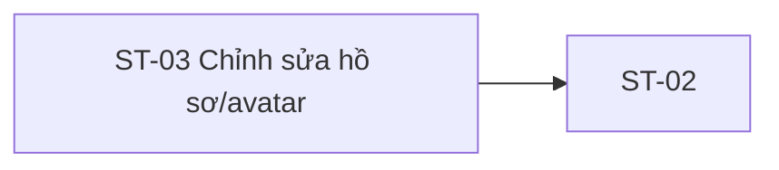

# ST-03 — Navigation

## 1. Route definition
- Current route in inventory: `/student/profile/edit`
- Status: route and page are declared in Study Web source; #04/#13/#14 use the Student Bearer adapter. Browser/runtime behavior remains unverified.
- Route params/types: Không có route param được biểu diễn trong inventory string; route runtime vẫn chưa xác minh.
- Query params/defaults: preserve the inventory route string; detailed parsing rules only from source DD.
- Route guards: see source DD/API contract; do not create role policy.

## 2. Điểm vào
| From screen/route | Trigger | Params | Guard / fallback |
|---|---|---|---|
| [ST-02](../ST-02-HoSoCaNhan/00-overview.md) | RouterLink hoặc mở route | Không có PII trong URL | Route được khai báo; API caller lấy Student Bearer qua session service; live session chưa xác minh |

## 3. Điểm ra
| Destination | Trigger | Params | Điều kiện |
|---|---|---|---|
| [ST-02](../ST-02-HoSoCaNhan/00-overview.md) | RouterLink hoặc #14 thành công rồi #04 tải lại thành công | Không có PII trong URL | Page source điều hướng đến /student/profile; browser runtime chưa verify |

## 4. Back / refresh / deep link
- Back behavior: xem source DD; không mặc định browser history.
- Preserve filters/scroll/form state: chỉ nếu source có nêu, nếu không `CẦN_XÁC_NHẬN`.
- Refresh/direct URL: route declaration có trong source; profile load calls #04 through the Student Bearer adapter. Browser guard/session persistence remain unverified.
- Invalid/missing ID: theo source DD/backend contract; không tự tạo validation.
- Not authenticated/authorized: theo source role guard; xem [Business Rules](05-business-rules.md).

## 5. Diagram

## Source navigation and flow detail

### Trích từ DD nguồn: E. Ma trận trạng thái và điều hướng

| State | Điều kiện / evidence | UI outcome / ranh giới |
|---|---|---|
| Static gate | Có trong Stitch/HTML tĩnh. | Angular page không dùng banner đó làm API gate; control states theo request state. Đây là thiết kế/current-source discrepancy. |
| Loading | GET #04 hoặc post-save refresh đang chờ. | Hiện thông báo trạng thái và khóa thao tác phụ thuộc hồ sơ. |
| Profile loaded | #04 success với UserProfile hợp lệ. | Bind full_name/email/phone/avatar_url; Bio giữ disabled. |
| Dirty | Họ tên, phone hoặc avatar URL khác dữ liệu đã tải. | Nút lưu bật khi có thay đổi hợp lệ và không có upload đang chờ. |
| Uploading | Đọc file hoặc POST #13 đang chạy. | Hiện trạng thái/lỗi upload; save bị khóa tới khi upload hoàn tất. |
| Saving | PUT #14 đang chạy. | Chặn submit lặp và khóa trường chỉnh sửa. |
| Validation/request error | Client validation hoặc #04/#13/#14 lỗi. | Hiện lỗi inline; profile read có thể retry; mutation không tự gửi lại. |
| Saved / refresh pending | #14 thành công nhưng #04 chưa thành công. | Giữ UserProfile trả về, cho retry riêng #04 và không gửi lại #14. |
| Return | #14 rồi #04 thành công, hoặc user chọn link ST-02. | Điều hướng đến /student/profile; không truyền PII trong URL. |

### Điều hướng

- ST-02 → ST-03: route `/student/profile/edit` đã source-wired; ST-02 edit entry hiện có thể vẫn bị khóa theo source riêng của ST-02.
- ST-03 → ST-02: RouterLink và successful save + #04 refresh đi tới `/student/profile`; không truyền user ID hoặc PII qua URL.
- SH-02/session handoff: StudentApiService lấy Student Bearer từ StudentSessionService; API kiểm role ở server. Live session persistence chưa xác minh.
- Header/footer destinations: chưa xác định từ app router. Không thêm route giả định.
- Không có profile cache, dirty-state confirmation hoặc returnTo. Save sequence gọi #04 sau #14; lỗi refresh có thể retry GET mà không gửi lại PUT.

### Trích từ DD nguồn: B. Luồng hoạt động tổng thể

### Luồng dự kiến theo inventory và AC-11

1. Student mở route đề xuất từ ST-02 hoặc Student navigation. Không truyền PII trong URL; route và session handoff chưa có source client để xác minh.
2. Client cần kiểm tra trạng thái đăng nhập và token theo auth/session contract dùng chung. Đây là phụ thuộc SH-02; không suy ra từ tên mẫu “Nguyễn Văn A” trên mockup.
3. Client gọi GET #04 bằng Authorization: Bearer token để lấy dữ liệu profile an toàn. Response hiện tại không có bio.
4. Khi thành công, client phải chờ quyết định mapping cho các field. Full name/email/phone/avatar_url có mặt trong #04 (phone/avatar_url nullable); bio không có. Mockup chưa phải loaded-state đã xác minh.
5. Khi người dùng chọn avatar, luồng dự kiến gọi POST #13 trước. API nhận JSON body {image: Data URL}; sau kiểm tra ảnh, ghi object storage theo avatars/{user_id} và trả data.avatar_url. API #13 không ghi DB.
6. Khi người dùng lưu, client gọi PUT #14 với full_name, phone và avatar_url; Bio không được gửi. Sau đó client làm GET #04 như inventory yêu cầu dù #14 đã trả UserProfile.
7. Sau khi #04 tải lại thành công, UI điều hướng tới ST-02. Nếu refresh lỗi, trang giữ response #14 và cho retry GET #04 mà không gửi lại PUT.
8. Lỗi #04/#13/#14 được hiển thị inline qua error mapping hiện có; StudentApiService kết thúc local session khi nhận HTTP 401. Browser/runtime chưa được xác minh.
9. Nếu #13 thành công nhưng #14 lỗi, object đã upload không rollback theo transaction DB. Cùng user dùng cùng object key nên lần upload mới ghi đè object hiện có. Không tự retry hoặc xóa object khi chưa có policy được duyệt.

### Hành vi hiện có trong asset và source

- screen.png là ảnh thiết kế tĩnh 1418×1600. SHA-256 trước/sau cần giữ nguyên: acd143a1a7d5dae4936f9bc8a3d51d015ba1fb501998a5434e96b57942d77fdc.
- code.html là HTML trình bày tĩnh. Firefox headless render tạm ở cùng viewport đã được xem để so sánh layout/copy; render không phải runtime capture và không phải tài sản thay thế ảnh gốc.
- Trong asset code.html, header/footer và anchors dùng href="#"; form chỉ là prototype tĩnh, các mutation controls disabled và không có API/session client.
- Gate pill, warning banner, diagnostics và “API #13 Halted” thuộc asset code.html. Chúng không phản ánh response backend; Angular source hiện có route, Student Bearer adapter và caller #04/#13/#14.
