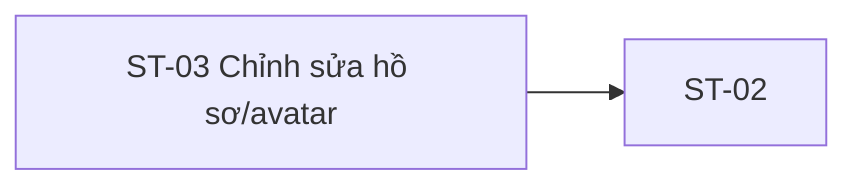

# ST-03 — Navigation

## 1. Route definition
- Current route in inventory: `/student/profile/edit`
- Status: candidate/design route; Study Web `UNWIRED` unless source code proves otherwise.
- Route params/types: Không có route param được biểu diễn trong inventory string; route runtime vẫn chưa xác minh.
- Query params/defaults: preserve the inventory route string; detailed parsing rules only from source DD.
- Route guards: see source DD/API contract; do not create role policy.

## 2. Điểm vào
| From screen/route | Trigger | Params | Guard / fallback |
|---|---|---|---|
| [ST-02](../ST-02-HoSoCaNhan/00-overview.md) | Theo DD nguồn/inventory | Theo source; không suy diễn | Xem source DD; route chưa xác nhận runtime |

## 3. Điểm ra
| Destination | Trigger | Params | Điều kiện |
|---|---|---|---|
| [ST-02](../ST-02-HoSoCaNhan/00-overview.md) | Source event/inventory navigation | Theo source DD | Expected links; runtime chưa verify |

## 4. Back / refresh / deep link
- Back behavior: xem source DD; không mặc định browser history.
- Preserve filters/scroll/form state: chỉ nếu source có nêu, nếu không `CẦN_XÁC_NHẬN`.
- Refresh/direct URL: route trong inventory không chứng minh runtime.
- Invalid/missing ID: theo source DD/backend contract; không tự tạo validation.
- Not authenticated/authorized: theo source role guard; xem [Business Rules](05-business-rules.md).

## 5. Diagram

## Source navigation and flow detail

### Trích từ DD nguồn: E. Ma trận trạng thái và điều hướng

| State | Điều kiện / evidence | UI outcome / ranh giới |
|---|---|---|
| Static gate | Trạng thái duy nhất trong screenshot/HTML hiện tại. | Banner và disabled controls hiển thị; không có runtime gate response. |
| Loading | Cần thiết cho expected GET #04 sau khi app được nối; không có asset/loading design. | Cách hiển thị/chặn thao tác chưa được chốt. |
| Profile loaded | Chỉ sau #04 success. | Mapping field và avatar preview chưa được duyệt; không coi mẫu tĩnh là dữ liệu. |
| Dirty | Inventory liệt kê. | Chỉ full name có thể nhập trong prototype; dirty tracking chưa có. |
| Uploading | Inventory liệt kê nếu đổi avatar. | #11 disabled; progress/cancel/reselect UI chưa được thiết kế. |
| Saving | Inventory liệt kê. | #19 disabled; double-submit policy chưa có. |
| Validation error / 422 | #13/#14 trả validation errors theo điều kiện ở trên. | Field error placement/focus/retention chưa được triển khai. |
| Request error | 401/403/500/network failure; inventory có error. | Route tới SH-05/retry/message policy chưa được nối. |
| Saved | #14 success; source trả updated UserProfile. | Inventory vẫn yêu cầu GET #04; chọn response mapping hay refetch còn BLOCKER. |
| Return | User click link quay lại. | Expected ST-02; HTML fragment-only. Không có dữ liệu route params được xác nhận. |

### Điều hướng

- ST-02 → ST-03: inventory link/route đề xuất; không có route source. Không gửi user ID qua URL vì API dùng token subject.
- ST-03 → ST-02: hai link trong mockup có data-path nhưng href="#"; route dự kiến /student/profile.
- SH-02/session handoff: phụ thuộc auth/session policy. API tự kiểm JWT; không có client auth store trong Study Web.
- Header/footer destinations: chưa xác định từ app router. Không thêm route giả định.
- Không xác nhận cache, back-stack, dirty-state confirmation, returnTo hoặc reload strategy.

### Trích từ DD nguồn: B. Luồng hoạt động tổng thể

### Luồng dự kiến theo inventory và AC-11

1. Student mở route đề xuất từ ST-02 hoặc Student navigation. Không truyền PII trong URL; route và session handoff chưa có source client để xác minh.
2. Client cần kiểm tra trạng thái đăng nhập và token theo auth/session contract dùng chung. Đây là phụ thuộc SH-02; không suy ra từ tên mẫu “Nguyễn Văn A” trên mockup.
3. Client gọi GET #04 bằng Authorization: Bearer token để lấy dữ liệu profile an toàn. Response hiện tại không có bio.
4. Khi thành công, client phải chờ quyết định mapping cho các field. Full name/email/phone/avatar_url có mặt trong #04 (phone/avatar_url nullable); bio không có. Mockup chưa phải loaded-state đã xác minh.
5. Khi người dùng chọn avatar, luồng dự kiến gọi POST #13 trước. API nhận JSON body {image: Data URL}; sau kiểm tra ảnh, ghi object storage theo avatars/{user_id} và trả data.avatar_url. API #13 không ghi DB.
6. Khi người dùng lưu, luồng dự kiến gọi PUT #14 với các trường body đã được chốt. Inventory hiện yêu cầu #04 lần nữa sau PUT, trong khi current #14 đã trả UserProfile trực tiếp. Không chọn một trong hai cách trước khi contract owner quyết định.
7. Sau thành công, UI dự kiến phản ánh profile và cho phép quay lại ST-02. Hành vi giữ dữ liệu, thông báo thành công, cache và lịch sử quay lại chưa được triển khai/đặc tả.
8. Lỗi 401/403/422/500 của backend cần được ánh xạ sang UI/SH-05 theo policy đã duyệt; Study Web hiện không có error mapping.
9. Nếu #13 thành công nhưng #14 lỗi, object đã upload không rollback theo transaction DB. Cùng user dùng cùng object key nên lần upload mới ghi đè object hiện có. Không tự retry hoặc xóa object khi chưa có policy được duyệt.

### Hành vi hiện có trong asset và source

- screen.png là ảnh thiết kế tĩnh 1418×1600. SHA-256 trước/sau cần giữ nguyên: acd143a1a7d5dae4936f9bc8a3d51d015ba1fb501998a5434e96b57942d77fdc.
- code.html là HTML trình bày tĩnh. Firefox headless render tạm ở cùng viewport đã được xem để so sánh layout/copy; render không phải runtime capture và không phải tài sản thay thế ảnh gốc.
- Header/footer và các anchor dùng href="#". Brand/nav/footer không có router. Hai link quay về có data-path="ho-so-ca-nhan" nhưng vẫn là fragment anchor.
- Form có onsubmit="return false". Full name là input text native có thể nhận ký tự nhưng không có validation/handler; email readonly; phone/bio disabled; upload/save disabled; không có file input hoặc handler nghiệp vụ; inline onsubmit chỉ return false; không có fetch/XHR/API client, cache hoặc session binding.
- Gate pill, warning banner, diagnostics và “API #13 Halted” là nội dung HTML tĩnh. Chúng không phản ánh trạng thái response của backend; backend hiện đăng ký source cho cả #13 và #14.
