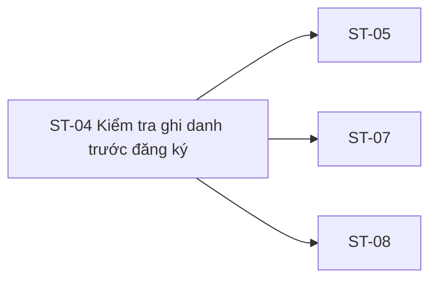

# ST-04 — Navigation

## 1. Route definition
- Current route: `/student/enroll/:courseId`
- Status: registered in Study Web; page calls #08 then Student-authenticated #15, offers the source-backed free #19→#20 path, and hands paid courses to ST-05. The #15 catalog actor discrepancy remains open; browser/runtime is unverified.
- Route params/types: `courseId` (type/validation: see source DD; CẦN_XÁC_NHẬN if absent)
- Query params/defaults: preserve the inventory route string; detailed parsing rules only from source DD.
- Route guards: see source DD/API contract; do not create role policy.

## 2. Điểm vào
| From screen/route | Trigger | Params | Guard / fallback |
|---|---|---|---|
| [GS-03](../GS-03-ChiTietKhoaHoc/00-overview.md), [ST-05](../ST-05-KiemTraDonHangCheckout/00-overview.md) | Theo DD nguồn/inventory | `courseId` raw path value | GS-03 route is declared; ST-05 remains unregistered |

## 3. Điểm ra
| Destination | Trigger | Params | Điều kiện |
|---|---|---|---|
| [ST-05](../ST-05-KiemTraDonHangCheckout/00-overview.md), [ST-07](../ST-07-KetQuaDangKyKhoaHoc/00-overview.md), [ST-08](../ST-08-KhoaHocCuaToi/00-overview.md) | Source event/inventory navigation | Theo source DD | Expected links; runtime chưa verify |

## 4. Back / refresh / deep link
- Back behavior: xem source DD; không mặc định browser history.
- Preserve filters/scroll/form state: chỉ nếu source có nêu, nếu không `CẦN_XÁC_NHẬN`.
- Refresh/direct URL: route trong inventory không chứng minh runtime.
- Invalid/missing ID: theo source DD/backend contract; không tự tạo validation.
- Not authenticated/authorized: theo source role guard; xem [Business Rules](05-business-rules.md).

## 5. Diagram

## Source navigation and flow detail

### Trích từ DD nguồn: E. Ma trận trạng thái và điều hướng

| State | Điều kiện vào / nguồn | Hành vi và state kế tiếp | Tình trạng |
|---|---|---|---|
| `course-loading` | Current route calls #08 | Loading status until course detail resolves | Current FE source |
| `prototype-static-error` | Mở trực tiếp `code.html` | Luôn hiện #9/#10 và CTA #11; không gọi API | Current HTML only |
| `route-input-pending` | `/student/enroll/:courseId` receives `courseId` | Pass raw string to #08; Student guard remains absent | Current FE source |
| `course-unavailable` | #08 returns 404 | Course does not exist, ID is invalid, or it is not `PUBLISHED`; show not-found | Current FE source |
| `course-error` | #08 returns a non-404 HTTP/envelope error | Show generic course-load error | Current FE source |
| `enrollment-check` | #08 succeeds and #15 uses Student Bearer | ACTIVE → My Courses; 404 → price branch; auth error → login-required | Current FE source; catalog discrepancy remains |
| `already-enrolled` | #15 returns current Student ACTIVE row | Open `/student/courses` | Current FE source |
| `free-enrollment` | #15 404 and #08 price is zero | Explicit #19 → #20 confirmation → ST-08 | Current FE source; database runtime unverified |
| `paid-checkout` | #15 404 and #08 price is positive | Link to ST-05; provider proof remains server-side | ST-04 handoff wired; ST-05/#16–#18 pending |
| `session-expired-or-forbidden` | Student API reports login-required/401/403 | Show login link; return path is not preserved | Current FE; route guard absent |
| `back-to-courses` | Click #11 | `/courses`; không giữ query/context | Prototype link only |

### Ma trận điều hướng và dữ liệu

| Từ | Điều kiện | Đến | Dữ liệu chuyển |
|---|---|---|---|
| GS-03 | Người dùng chọn ghi danh; AC-12 precondition | ST-04 (route đề xuất) | `courseId` candidate; slug/numeric mapping chưa chốt |
| ST-04 | #15 returns current Student enrollment with status `ACTIVE` | `/student/courses` / ST-08 | The course list is loaded from #20; no client entitlement token |
| ST-04 | #15 returns 404 after #08 succeeds and price is zero | #19 → #20 → ST-08 | `course_id` in path/body; #20 page 1 must contain that course |
| ST-04 | #15 returns 404 after #08 succeeds and price is positive | ST-05 at `/student/checkout/:courseId` | `courseId` route segment |
| ST-04 | Click #11 | `/courses` | Không truyền dữ liệu |
| Header/footer | Click static anchor | Path ghi trong HTML | Không truyền course/auth/filter state |

AC-12 places the free and paid paths in one flow. ST-04 currently implements its free branch and the paid handoff; ST-05/#16–#18 remain in progress. Do not treat this client navigation as live DB/provider runtime evidence.

### Trích từ DD nguồn: B. Luồng hoạt động tổng thể

### Luồng dự kiến theo AC-12

1. Student vào route `/student/enroll/:courseId`; the route exists, and protected API calls require a Student session. No route guard or return-after-login flow is present.
2. Sau khi có `course_id:int64` hợp lệ, gọi API #08 để đọc course công khai đã `PUBLISHED`. #08 không yêu cầu Bearer theo catalog.
3. Nếu #08 trả thành công, lấy course theo ID và hiển thị `title`/`price`; currency `VND` comes from the current #16 Order path, while free is `price === 0` per the existing #19 eligibility check.
4. Study Web currently calls #15 through `StudentApiService` with Student Bearer. Server query scopes to JWT user; the canonical catalog still declares Public/no-Bearer and remains a documented discrepancy.
5. Enrollment `ACTIVE` → `/student/courses`. A #15 404 after #08 success branches by price: free → explicit #19 then #20 confirmation; paid → ST-05/#16.
6. Kết quả giao dịch cần được xác minh bởi server. AC-12 có node #18 operation-status nhưng node này không nối trong diagram; chưa thể chốt thứ tự/gating #18 so với #19.
7. Free #19 success is followed by #20; only a matching course in the response opens ST-08. Paid enrollment waits for provider-verified server result; browser return is not evidence.
8. #08 404 maps to not-found; missing Student session or protected 401/403 maps to login-required. If #20 refresh fails after #19, retry #20 only. Existing test source still documents the old gate-only behavior; no test/runtime verification is claimed.

### Hành vi hiện tại

1. Tệp HTML tĩnh hiển thị trang ngay khi mở, không đọc URL để lấy course ID và không kiểm tra authentication/authorization.
2. Không khởi tạo API hoặc dữ liệu động; card báo “Chưa thể xác nhận thông tin ghi danh” luôn hiển thị trong prototype.
3. Người dùng chỉ có các anchor trong shell/breadcrumb/footer và CTA quay lại `/courses`. Điều hướng client-side, giữ lại filter/course context, và route đích trong runtime chưa được xác minh.
4. Study Web hiện không có mã nguồn route hoặc API #15. Vì vậy không có response, state, cache, session-expiry behavior hay enrollment result runtime để khẳng định.
