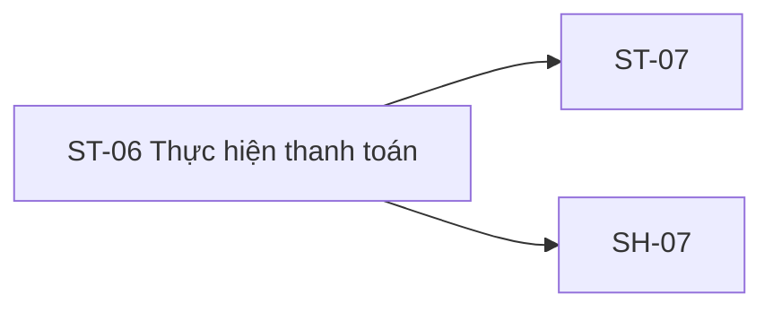

# ST-06 — Navigation

## 1. Route definition
- Current route in inventory: `/student/pay/:orderId`
- Status: candidate/design route; Study Web `UNWIRED` unless source code proves otherwise.
- Route params/types: `orderId` (type/validation: see source DD; CẦN_XÁC_NHẬN if absent)
- Query params/defaults: preserve the inventory route string; detailed parsing rules only from source DD.
- Route guards: see source DD/API contract; do not create role policy.

## 2. Điểm vào
| From screen/route | Trigger | Params | Guard / fallback |
|---|---|---|---|
| [ST-05](../ST-05-KiemTraDonHangCheckout/00-overview.md) | Theo DD nguồn/inventory | Theo source; không suy diễn | Xem source DD; route chưa xác nhận runtime |

## 3. Điểm ra
| Destination | Trigger | Params | Điều kiện |
|---|---|---|---|
| [ST-07](../ST-07-KetQuaDangKyKhoaHoc/00-overview.md), [SH-07](../SH-07-TheoDoiTacVuBatDongBo/00-overview.md) | Source event/inventory navigation | Theo source DD | Expected links; runtime chưa verify |

## 4. Back / refresh / deep link
- Back behavior: xem source DD; không mặc định browser history.
- Preserve filters/scroll/form state: chỉ nếu source có nêu, nếu không `CẦN_XÁC_NHẬN`.
- Refresh/direct URL: route trong inventory không chứng minh runtime.
- Invalid/missing ID: theo source DD/backend contract; không tự tạo validation.
- Not authenticated/authorized: theo source role guard; xem [Business Rules](05-business-rules.md).

## 5. Diagram

## Source navigation and flow detail

### Trích từ DD nguồn: E. Ma trận trạng thái và điều hướng

| State | Điều kiện / nguồn | Kết quả / chuyển tiếp | Tình trạng |
|---|---|---|---|
| `web-unwired` | Study Web has no editable app/router | Candidate route cannot execute | Current source status |
| `prototype-static-no-payment` | Open `code.html` | Always shows #10/#11 copy and #12 CTA; no #17/#18 call | Current HTML only |
| `route-auth-order-pending` | Candidate `/student/pay/:orderId` opened | Requires Student guard, valid Order ID and ownership rule | Expected; not wired |
| `payment-initiation-trigger-unresolved` | Order context available | #17 expected by inventory/AC; entry vs explicit initiation trigger not specified | Design blocker |
| `payment-pending` | Approved #17 trigger and request in flight | Wait for response; no duplicate/retry policy | Inventory state; #17 unwired |
| `operation-accepted` | #17 returns 202 `DESIGN_OPERATION_ACCEPTED` | Operation accepted; does not prove payment success | Catalog design only |
| `operation-poll-blocked` | #17 returns Operation but ID/policy unresolved | Do not call #18 until UUID/int64 and ownership policy resolved | Current contract blocker |
| `operation-running` | Approved #18 response maps to a nonterminal status | Continue only under approved polling/stop rule | Inventory label; enum/lifecycle unspecified |
| `payment-failed` | Trusted server/gateway says failed | Stop AC-12 flow; show approved error/recovery UI | AC-12 expected; mapping unavailable |
| `payment-cancelled` | Trusted server/gateway says cancelled | Stop AC-12 flow | AC-12/inventory expected; mapping unavailable |
| `payment-succeeded` | Trusted server/gateway confirms success | Continue to ST-07 then server-owned enrollment flow | AC-12 expected; no current proof source |
| `retry-safety-blocked` | Timeout, repeat action or unclear Operation state | Do not repeat #17 automatically; idempotency/status rules absent | Inventory retry wording conflicts with API contract gaps |
| `auth-or-validation-error` | #17/#18 return listed 401/403/422 | Render approved error handling; no local mapping/copy defined | Catalog codes only |
| `dependency-or-server-error` | #17 503/500 or #18 500 | Do not mark payment as failed/paid without trusted outcome | Catalog codes only |
| `return-to-order` | Click #12 | Current literal template route; breadcrumb route also lacks ID | Current prototype; destination blocked |

### Điều hướng và payload

| Từ | Điều kiện | Đến | Dữ liệu chuyển | Tình trạng |
|---|---|---|---|---|
| ST-05 | Approved logical Order created | ST-06 candidate | ST-05 `data.id:int64` → candidate `orderId` → API #17 `order_id:int64`; ownership/continuity must be confirmed | Expected; #16/#17 unwired |
| ST-06 | #17 returns Operation and #18 contract allows poll | API #18 / SH-07 tracking | Operation ID; UUID vs int64 and owner policy unresolved | Expected; blocked |
| ST-06 | Trusted payment success and approved state mapping | ST-07 | Course/order identity; ST-07 downstream enrollment state contract | Expected; not verified |
| ST-06 | Current CTA | `/student/checkout/:courseId` | Literal placeholder only; no actual courseId | Current HTML only |
| ST-06 | Current breadcrumb | `/student/checkout` | No ID | Current HTML only |

Không được hiển thị paid/enrolled, gọi #19, hoặc chuyển ST-07 dựa trên HTTP 202, browser return/callback hay static HTML. AC-12 yêu cầu payment success trước enrollment; trusted payment verification và operation mapping chưa được triển khai.

### Trích từ DD nguồn: B. Luồng hoạt động tổng thể

### Luồng dự kiến theo inventory và AC-12

1. Student đi từ ST-05 theo paid branch. Candidate route nhận `orderId`; API #17 lại cần body `order_id:int64`. ST-05/API #16 response dùng logical Order `data.id:int64`, nhưng mapping `data.id` → route `orderId` → #17 `order_id` chưa được owner xác nhận.
2. Kiểm tra Student session theo AC-12/#17 và resolve Order ownership/eligibility theo contract đã duyệt. Study Web guard, API #16 runtime, ownership query và Order persistence đều chưa có bằng chứng hiện hành.
3. Bắt đầu #17 chỉ theo trigger được product/contract phê duyệt. Inventory/AC đặt POST #17 sau tạo Order, nhưng không xác định trigger cụ thể trong UI; current HTML không có nút hoặc handler. Provider mapping cũng chưa có nguồn.
4. Request theo API catalog: Bearer Student; `POST /api/v1/payments`; JSON `{order_id:int64!, provider:string!}`; không path/query parameter. Success là HTTP 202 `DESIGN_OPERATION_ACCEPTED` với `ApiEnvelope<Operation>`. Error codes chỉ gồm 401 `DESIGN_AUTHENTICATION_REQUIRED`, 403 `DESIGN_ACCESS_DENIED`, 422 `DESIGN_VALIDATION_ERROR`, 503 `DESIGN_DEPENDENCY_UNAVAILABLE`, 500 `DESIGN_INTERNAL_ERROR`.
5. HTTP 202 biểu thị operation được accepted. Nếu contract sau này cho phép tracking, Operation có logical fields `id`, `kind`, `status`, `owner_id`, `submitted_at`, `updated_at`, optional `completed_at`, optional `result:Payment`. Enum/value/storage/lifecycle chưa được chốt.
6. Poll #18 chỉ khi operation ID type, caller ownership/role, endpoint semantics, cadence/stop rules và result mapping được thống nhất. Catalog row đòi `operation_id:int64`, AC-12/reusable schema ghi UUID. AC diagram đặt node #18 ngoài sequence, không có cạnh từ #17/gateway tới #18.
7. AC-12 mô tả Payment Gateway success → payment success → tiếp tục tạo enrollment #19; failure/cancel → dừng flow. Chưa có nguồn mô tả cách Operation status/result chứng minh gateway đã xác nhận, callback verification, hoặc map PaymentStatus sang inventory states. Không tự thêm nhánh.
8. Chỉ khi backend xác nhận paid mới điều hướng ST-07 để phản ánh kết quả enrollment. AC-12 sau đó gọi #19 tạo enrollment và #20 tải danh sách khóa học; #19/#20 thuộc downstream flow, không được giả lập ở ST-06.
9. Errors của #17/#18 phải giữ đúng catalog status/business code. UI error copy, refresh/retry policy, recovery, session expiry và operation-not-found/authorization privacy mapping chưa được chốt. Không thêm error code.

### Current behavior

- Mở HTML trực tiếp luôn hiển thị static “Chưa có thông tin thanh toán để hiển thị.”; không gọi #17/#18 hoặc gateway.
- Breadcrumb/CTA là anchors tĩnh. CTA dẫn tới literal template route `/student/checkout/:courseId`, không có course ID; breadcrumb dùng `/student/checkout` không có order/course ID.
- Study Web tree có docs, `dist`, `node_modules`; không có editable `src`, router hoặc package manifest. `/student/pay/:orderId` chưa wired.
- Study Server route search không tìm thấy #17/#18 route/module/query/model/test. `payments` trong DB.sql là schema artifact; không xác nhận endpoint, provider hoặc gateway behavior.
- Không có test/runtime được chạy trong phiên này. API DD #17/#18 là Draft/Needs Confirmation, không phải runtime.

### API boundary

| API | Request / quyền | Success | Errors | Runtime/effect boundary |
|---|---|---|---|---|
| #17 | `POST /api/v1/payments`; Bearer JWT; role Student; body `{order_id:int64!, provider:string!}` | 202 `DESIGN_OPERATION_ACCEPTED`; `ApiEnvelope<Operation>` | 401 `DESIGN_AUTHENTICATION_REQUIRED`, 403 `DESIGN_ACCESS_DENIED`, 422 `DESIGN_VALIDATION_ERROR`, 503 `DESIGN_DEPENDENCY_UNAVAILABLE`, 500 `DESIGN_INTERNAL_ERROR` | Catalog/Draft only. DB design labels payment insert/external payment `DESIGN_ONLY`; current Study route/module/query/test absent. Physical Order link, ownership, provider, amount/currency, transaction and gateway behavior unresolved. |
| #18 | `GET /api/v1/operations/{operation_id}`; Bearer JWT; path ID is `int64!` in row; owner actor in row | 200 `DESIGN_OPERATION_RETRIEVED`; `ApiEnvelope<Operation>` | 401 `DESIGN_AUTHENTICATION_REQUIRED`, 403 `DESIGN_ACCESS_DENIED`, 404 `DESIGN_RESOURCE_NOT_FOUND`, 500 `DESIGN_INTERNAL_ERROR` | Catalog/Draft only. UUID in shared Operation schema/AC conflicts with row int64. Owner/Admin policy, storage, lifecycle and poll rules unresolved; current route/module/query/test absent. |

No client-originated callback or gateway redirect parameter is a trusted payment confirmation source in the available contracts. API #18’s presence in catalog does not establish that #17 returns a pollable ID of the same type.
