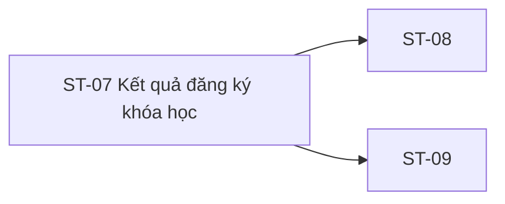

# ST-07 — Navigation

## 1. Route definition
- Current route in inventory: `/student/enroll/result/:courseId`
- Status: candidate/design route; Study Web `UNWIRED` unless source code proves otherwise.
- Route params/types: `courseId` (type/validation: see source DD; CẦN_XÁC_NHẬN if absent)
- Query params/defaults: preserve the inventory route string; detailed parsing rules only from source DD.
- Route guards: see source DD/API contract; do not create role policy.

## 2. Điểm vào
| From screen/route | Trigger | Params | Guard / fallback |
|---|---|---|---|
| [SH-07](../SH-07-TheoDoiTacVuBatDongBo/00-overview.md), [ST-04](../ST-04-KiemTraGhiDanhTruocDangKy/00-overview.md), [ST-06](../ST-06-ThucHienThanhToan/00-overview.md) | Theo DD nguồn/inventory | Theo source; không suy diễn | Xem source DD; route chưa xác nhận runtime |

## 3. Điểm ra
| Destination | Trigger | Params | Điều kiện |
|---|---|---|---|
| [ST-08](../ST-08-KhoaHocCuaToi/00-overview.md), [ST-09](../ST-09-TongQuanKhoaDangHoc/00-overview.md) | Source event/inventory navigation | Theo source DD | Expected links; runtime chưa verify |

## 4. Back / refresh / deep link
- Back behavior: xem source DD; không mặc định browser history.
- Preserve filters/scroll/form state: chỉ nếu source có nêu, nếu không `CẦN_XÁC_NHẬN`.
- Refresh/direct URL: route trong inventory không chứng minh runtime.
- Invalid/missing ID: theo source DD/backend contract; không tự tạo validation.
- Not authenticated/authorized: theo source role guard; xem [Business Rules](05-business-rules.md).

## 5. Diagram

## Source navigation and flow detail

### Trích từ DD nguồn: E. Ma trận trạng thái và điều hướng

| State | Điều kiện / nguồn | Kết quả / chuyển tiếp | Tình trạng |
|---|---|---|---|
| `study-web-unwired` | Current Study client has no editable route/client source | Candidate result route cannot execute | Current source status |
| `prototype-static-unconfirmed` | Open `code.html` | Always shows fixed #9/#10 and #11 CTA; no API call | Current HTML only; does not prove failure/pending |
| `route-context-pending` | Candidate result route loaded | Needs Student auth, courseId and approved free/paid result handoff | Expected; route/auth unwired |
| `awaiting-confirmation` | Inventory state; trusted payment/Enrollment outcome not available yet | Stay non-success; exact refresh/tracking UI not defined | Expected label only; no mapping/trigger |
| `eligible-enrollment` | Trusted backend confirms free entitlement or paid success | #19 may be called once under approved trigger | AC/inventory intent; eligibility and trigger open |
| `enrollment-creating` | Approved #19 request in flight | Avoid duplicate request while one outcome is unresolved | Expected; no UI/loading behavior in HTML |
| `enrolled` | #19 creation confirmed and AC-required reload/result mapping approved | Display result; route to ST-08 or course destination only when approved | AC/inventory intent; #20 response mismatch blocks final mapping |
| `conflict` | API #19 returns declared 409 | Present approved existing-enrollment state/recovery | Catalog status; duplicate predicate and UI mapping unresolved |
| `payment-failed-or-cancelled` | Trusted upstream result says payment failed/cancelled | AC-12 stops before #19; no success claim | AC expected; #18 mapping/route handoff missing |
| `authentication-or-access-error` | #18/#19/#20 return catalog 401/403 | Preserve auth/access boundary; show approved session/recovery UI | Catalog codes only; UI copy/redirect unspecified |
| `validation-or-resource-error` | #19 404/422 or #20 422 | Do not show enrolled; map only after condition/copy is approved | Catalog codes; conditions partly unresolved |
| `reload-after-create-uncertain` | #19 may have committed but #20 reload fails | Do not repeat #19 automatically; distinguish created vs reload failure after policy decision | Cross-API partial-success policy not defined |
| `system-error` | #18/#19/#20 returns 500 or network outcome is unknown | Do not infer paid/enrolled; retry/reconciliation policy required | Catalog design; no current runtime |

### Điều hướng và payload

| Từ | Điều kiện | Đến | Dữ liệu chuyển | Tình trạng |
|---|---|---|---|---|
| ST-04 | Free branch and backend entitlement confirmed | ST-07 candidate / API #19 flow | `courseId`; Student session. Exact screen that issues #19 is unresolved. | AC/inventory intent; not wired |
| ST-05 → ST-06 | Paid branch; trusted gateway success | ST-07 candidate | `courseId` is needed; Operation ID/payment outcome handoff is not defined. | Expected; ST-06/#18 blocked |
| ST-07 | Approved #19 returns 201 and required #20/result mapping succeeds | ST-08 My Courses | Student auth; course list/current course identity not supplied by #20 UserProfile schema. | AC/inventory intent; response mismatch |
| ST-07 | Course result has approved identity and route | ST-09 course detail candidate | `courseId` from current route could be carried only after route contract approval. | Inventory link only; no direct HTML link |
| ST-07 | Click CTA #11 | `/student/courses` / ST-08 candidate | No ID/query/state. | Current literal anchor; runtime unverified |
| ST-07 | Click #1–#5/#13 | Literal public/auth/course links | No result, course or Enrollment payload. | Current HTML only |

Không được hiển thị `enrolled`, gọi #19 lặp lại, hay chuyển thẳng sang ST-09 dựa trên icon, static copy, client callback, #20 `UserProfile` hoặc HTTP 202 của payment. #19/#20 sequence, Operation handoff và success destination cần được chốt trước khi implementation.

### Trích từ DD nguồn: B. Luồng hoạt động tổng thể

### Luồng dự kiến theo AC-12/AC-13

1. Student chọn đăng ký và vào paid/free branch từ ST-04. AC-12 yêu cầu Student đăng nhập và course tồn tại; candidate ST-07 route là `/student/enroll/result/:courseId`, nhưng có thể có direct entry/refresh nên cần auth và handoff rule được chốt trước khi xử lý.
2. Với paid branch, ST-05 tạo logical Order rồi ST-06 xử lý payment. Chỉ trusted backend/gateway success mới cho phép chuyển tiếp; HTTP 202 từ #17, client redirect/callback hoặc static copy không chứng minh thanh toán. ST-06 handoff hiện chưa cung cấp `operationId` cho ST-07; #18 là node detached và có ID/access discrepancy.
3. Với free branch, bỏ qua Order/Payment theo AC-12, nhưng backend vẫn phải chứng minh điều kiện entitlement. Catalog #15 hiện Public và identity/selection còn blocker; ST-07 không được tự coi route `courseId` là entitlement proof.
4. Khi trigger/eligibility đã được duyệt, API #19 nhận Student Bearer, path `course_id:int64!`, body contract notation `{course_id:int64!, user từ JWT:string!}`. Body wire identity chưa được định nghĩa. Catalog success là HTTP 201 `DESIGN_RESOURCE_CREATED`, `ApiEnvelope<Enrollment>`; errors: 401 `DESIGN_AUTHENTICATION_REQUIRED`, 403 `DESIGN_ACCESS_DENIED`, 404 `DESIGN_RESOURCE_NOT_FOUND`, 422 `DESIGN_VALIDATION_ERROR`, 409 `DESIGN_STATE_CONFLICT`, 500 `DESIGN_INTERNAL_ERROR`.
5. AC-12 #19 side effect dự kiến là insert Enrollment và initialize một hoặc nhiều Progress rows trong cùng transaction, với duplicate prevention. API #19 DD ghi đây là design-only: eligibility query, identity mapping, path/body equality, exact duplicate predicate, concurrent repeat/409, lesson set, empty-course behavior, values/defaults/timestamps và nullability chưa có quyết định/source runtime.
6. #19 201 response logical shape là `Enrollment {id:int64, course_id:int64, user_id:int64, status:EnrollmentStatus, enrolled_at:date-time, completed_at?:date-time}`. Initial status/timestamp/null-vs-omit rule chưa chốt. AC-12 đặt #20 sau #19; nếu #19 đã commit nhưng #20 fail, compensation, retry và UI state chưa được xác định. Không gọi #19 lặp lại để recover một lỗi reload không rõ kết quả.
7. API #20 là GET `/api/v1/users/me/courses` với optional query `status:string`, `page:int32`, Bearer Student. Catalog trả HTTP 200 `DESIGN_RESOURCE_RETRIEVED`, `ApiEnvelope<UserProfile>`; errors 401/403/422/500. AC-13 kỳ vọng Enrollment JOIN Course, sau đó gọi API #21 progress riêng và merge client-side. Response shape, status semantics, paging, empty result và JWT-sub-to-enrollment binding chưa chốt; không thêm progress hoặc đổi `UserProfile` thành `Page<Course>`.
8. AC-12 dự kiến sau #20 mới hiển thị “Đã đăng ký” và mở course. Vì #20 response chưa mô tả course list, chưa thể xác định cách tìm course hay liệu target là ST-08 hay ST-09. Inventory CTA hiện chỉ về ST-08 `/student/courses`, không truyền `courseId`.
9. Khi payment thất bại/cancel theo AC-12, flow dừng trước #19. Inventory có state `failure`; API #19 có 409 nhưng điều kiện conflict chưa được định nghĩa. Error copy, pending/awaiting confirmation, recovery và direct-entry behavior chưa được source-backed.

### Current behavior

- Mở `code.html` luôn hiển thị static “Chưa thể xác nhận kết quả đăng ký.”, không phát request hoặc thay UI theo state.
- Có 14 anchors, gồm header, breadcrumb, CTA, footer; không có button/input/form/listener/fetch/XHR. CTA #11 follow literal `/student/courses`, không truyền course ID.
- Study Web tree chỉ có docs/assets, ignored `dist` và dependencies; editable source/router/package manifest không có. Candidate `/student/enroll/result/:courseId` chưa wire.
- Study Server `app/api/v1.py` có route composition đến #98; source scan không thấy #18/#19/#20 route/module/query/model/focused test. API DD/catalog và DDL không chứng minh runtime.
- Không có Study application test/runtime được chạy trong phiên này.

### API boundary

| API | Request / quyền | Success | Errors | Runtime/effect boundary |
|---|---|---|---|---|
| #18 | `GET /api/v1/operations/{operation_id}`; Bearer JWT; row path `int64!`, AC/shared schema `uuid` | 200 `DESIGN_OPERATION_RETRIEVED`; `ApiEnvelope<Operation>` | 401 `DESIGN_AUTHENTICATION_REQUIRED`, 403 `DESIGN_ACCESS_DENIED`, 404 `DESIGN_RESOURCE_NOT_FOUND`, 500 `DESIGN_INTERNAL_ERROR` | Catalog/Draft only; no Study route/store/query/test. Owner vs owner/Admin, Operation fields/lifecycle/result, ID handoff and poll cadence unresolved; AC-12 node detached. |
| #19 | `POST /api/v1/courses/{course_id}/enrollments`; Bearer Student; path `course_id:int64!`; body `{course_id:int64!, user từ JWT:string!}` per catalog notation | 201 `DESIGN_RESOURCE_CREATED`; `ApiEnvelope<Enrollment>` | 401 `DESIGN_AUTHENTICATION_REQUIRED`, 403 `DESIGN_ACCESS_DENIED`, 404 `DESIGN_RESOURCE_NOT_FOUND`, 422 `DESIGN_VALIDATION_ERROR`, 409 `DESIGN_STATE_CONFLICT`, 500 `DESIGN_INTERNAL_ERROR` | Catalog/API DD only. AC describes Enrollment + Progress transaction; no runtime route/query/model/test. Identity field, eligibility, duplicates/transaction, status/lesson initialization and DDL/live schema remain unresolved. |
| #20 | `GET /api/v1/users/me/courses`; Bearer Student; optional query `status:string`, `page:int32`; no body | 200 `DESIGN_RESOURCE_RETRIEVED`; `ApiEnvelope<UserProfile>` | 401 `DESIGN_AUTHENTICATION_REQUIRED`, 403 `DESIGN_ACCESS_DENIED`, 422 `DESIGN_VALIDATION_ERROR`, 500 `DESIGN_INTERNAL_ERROR` | Catalog/API DD only. AC-13 requires Enrollment+Course list and separate #21 progress; schema/filter/page/empty/identity mismatch; no runtime route/query/model/test. |

No client-supplied payment callback or URL parameter may be treated as trusted outcome. The present screen route carries only `courseId`, so #18 cannot be called unless a separate approved state handoff supplies a canonical Operation ID.
