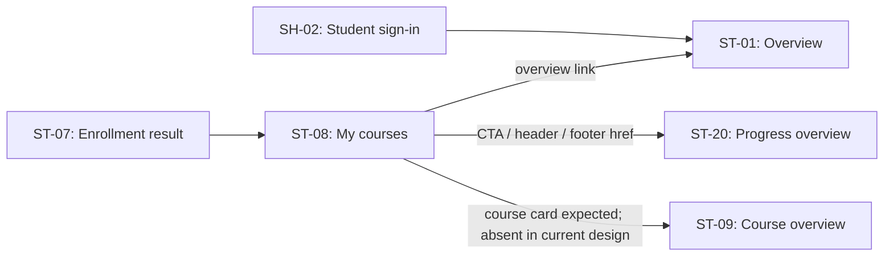

# ST-08 — Data Flow & State

## 1. Nguồn dữ liệu
| Field / object | Type | Source | Destination | Cập nhật khi |
|---|---|---|---|---|
| Chỉ liệt kê theo bằng chứng trong excerpt bên dưới | Theo DD/API source | API/inventory/design; status phải giữ nguyên | UI/state nêu ở DD nguồn | Theo event source |

## 2. State model

> Không tạo DTO/ViewModel mới khi chưa có contract. State, DTO và mapping được trích nguyên ngữ cảnh từ DD nguồn bên dưới.

## 3. API DTO → ViewModel mapping

### Trích từ DD nguồn: B. Luồng hoạt động tổng thể

### Tiền điều kiện và nguồn dữ liệu

- AC-13 yêu cầu Student đã đăng nhập; API catalog cũng khai báo Bearer JWT và role Student cho #20/#21.
- API dùng path `/users/me`; catalog không chỉ định user ID trong query/body. Cách backend liên kết JWT với `enrollments.user_id`/progress ownership vẫn là câu hỏi mở trong API DD. Không suy ra claim cụ thể hoặc cách xử lý user/profile không tồn tại.
- Route `/student/courses` là đề xuất. Không có bằng chứng về client session guard, redirect, route history hoặc dữ liệu được cache.
- Dữ liệu dự kiến là course/enrollment list từ #20 và tiến độ aggregate từ #21; khóa ghép dự kiến theo `course_id`. Trường, kiểu, ordering, paging tổng thể, quy tắc progress và empty representation chưa được xác nhận.

### Trình tự thiết kế và giới hạn hiện tại

1. Khi Student đi vào route dự kiến `/student/courses`, thiết kế yêu cầu có session Student hợp lệ. UI runtime/guard chưa tồn tại trong checkout nên bước auth hiện không được thực thi ở client.
2. Thiết kế gọi #20 để lấy khóa đã đăng ký, với query tùy chọn `status` và `page`. `page` có kiểu `int32`; catalog không định nghĩa default, base index, page size, maximum, sort hoặc total metadata.
3. AC-13 gọi thêm #21 và yêu cầu ghép theo `course_id`; inventory cho phép bỏ qua #21 nếu response #20 đã chứa progress. Điều kiện bỏ qua, query #21 và response schemas chưa chốt, nên request order/parallelism chưa thể được triển khai xác định.
4. AC-13 ghi nhánh `NO → empty state; YES → render`, nhưng hai cạnh `EMPTY` và `HAS DATA` của decision node cùng đi tới node “Hiển thị khóa học + % hoàn thành”. Cần làm rõ diagram destination trước khi chốt transition. Asset hiện có minh họa empty state tĩnh, nhưng không có wire response nào ánh xạ vào trạng thái đó.
5. Nếu có course, inventory mong đợi list/filter/progress bar và điều hướng chọn khóa sang ST-09. HTML không có list/card/filter/progress bar; không thể xác định vị trí, label, data fields hoặc card interaction từ asset hiện tại.
6. CTA “Xem tiến độ học tập” và nav links có `href` tới `/student/progress` (ST-20), còn brand/nav overview trỏ `/student` (ST-01). Router/runtime destination và back behavior chưa được xác minh.
7. Khi #20/#21 trả lỗi, catalog liệt kê các mã bên dưới; màn hình hiện tại không có error/loading/partial state UI hoặc retry logic. Không tự đặt retry, timeout hay cache policy.

ST-07 → ST-08 is appropriate only after the enrollment outcome is confirmed by the enrollment/payment flow; a client return or payment callback alone is not proof of enrollment. The ST-08 list API is intended to reload current enrollment data, but that API is not currently source-backed. ST-09 expects a `courseId` path segment (`/student/courses/:courseId`); ST-08 has no course-card payload or verified identifier to pass. ST-20 is a proposed destination and does not receive an identifier in the shown href.

### Trích từ DD nguồn: E. Ma trận trạng thái và điều hướng

| State | Điều kiện thiết kế | UI/transition hiện có | Gap |
|---|---|---|---|
| Initial / route entry | Student mở route đề xuất `/student/courses`. | HTML được render thẳng thành empty mock; không có app initialization. | Route, session guard và navigation history chưa wired. |
| Loading | Request #20/#21 đang xử lý. | Không có loading indicator trong asset. | Request lifecycle, ordering, cancellation, timeout chưa có source/contract. |
| Empty | AC-13 decision label says `NO → empty state`. | Empty card/copy có sẵn như nội dung tĩnh. | AC-13's `EMPTY` and `HAS DATA` edges both target the same course-render node; destination is ambiguous. #20/#21 empty wire shape and distinction between “no course” and “data not updated” are unresolved. |
| Loaded | #20 trả enrollment/course data hợp lệ. | Chưa có list/card trong HTML/PNG. | Course schema, ordering, paging, card contents và selection chưa được thiết kế. |
| Partial progress | Có courses nhưng một phần progress thiếu/không tải được, theo nhãn inventory. | Không có phần tử tương ứng. | Không rõ thiếu progress là 0, unknown, retry hay lỗi; merge/partial failure policy chưa chốt. |
| Filtered | User áp status filter. | Không có filter control. | Option/default/field semantics và query behavior #20 chưa chốt. |
| API/auth/validation error | API trả một status code đã khai báo hoặc xảy ra lỗi mạng. | Không có error state, copy hoặc recovery action trong asset. | Response error schema, retry, reauth và UI mapping chưa có contract. |

Các state `loading/empty/partial-progress/error` là inventory expectations. Chúng không phải state machine đã được triển khai. Không có transition nào được xác minh khi chạy.

## 4. Luồng đọc (Read)
- Orchestration từ inventory: GET #20 page/status → GET #21 nếu cần dữ liệu progress không kèm sẵn; merge theo course_id.
- Chi tiết current/source mapping: xem [API Integration](04-api-integration.md) và DD nguồn.

## 5. Luồng ghi (Write)
- Chỉ mô tả mutation được DD/API source nêu; không thêm endpoint hoặc side effect.
- Source trace: [ST-08](../../screen_stitch/03_student/ST-08_khoa-hoc-cua-toi/ST-08.md)

## 6. Cache / concurrency / lifecycle
- Cache, race, cleanup, pagination: xem các section source bên dưới; nếu không có bằng chứng thì để `CẦN_XÁC_NHẬN`.

## 7. Data errors & security
- Theo error/security/source-status section của DD nguồn; không coi state trong mockup là runtime behavior.

## 8. Trace
[Events](02-events.md) · [API](04-api-integration.md) · [Rules](05-business-rules.md)
