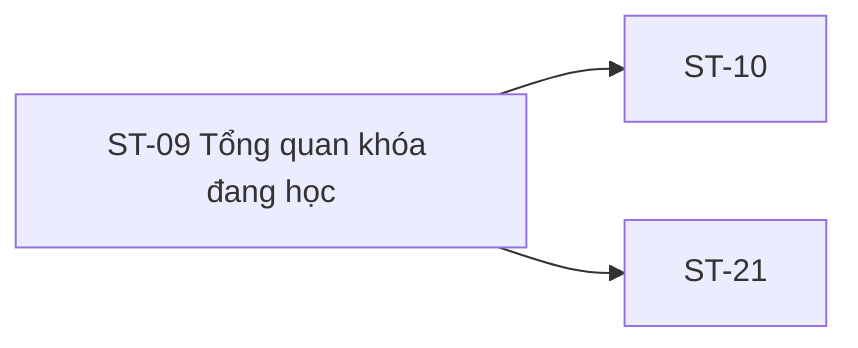

# ST-09 — Navigation

## 1. Route definition
- Current route in inventory: `/student/courses/:courseId`
- Status: candidate/design route; Study Web `UNWIRED` unless source code proves otherwise.
- Route params/types: `courseId` (type/validation: see source DD; CẦN_XÁC_NHẬN if absent)
- Query params/defaults: preserve the inventory route string; detailed parsing rules only from source DD.
- Route guards: see source DD/API contract; do not create role policy.

## 2. Điểm vào
| From screen/route | Trigger | Params | Guard / fallback |
|---|---|---|---|
| [ST-07](../ST-07-KetQuaDangKyKhoaHoc/00-overview.md), [ST-08](../ST-08-KhoaHocCuaToi/00-overview.md), [ST-10](../ST-10-KiemTraQuyenVaBatDauHoc/00-overview.md), [ST-11](../ST-11-TrinhHocBaiLessonPlayer/00-overview.md), [ST-16](../ST-16-KetQuaBaiKiemTra/00-overview.md), [ST-17](../ST-17-ChiTietBaiTap/00-overview.md), [ST-22](../ST-22-ThanhTichVaChungNhan/00-overview.md), [ST-26](../ST-26-ThongBaoHocVien/00-overview.md) | Theo DD nguồn/inventory | Theo source; không suy diễn | Xem source DD; route chưa xác nhận runtime |

## 3. Điểm ra
| Destination | Trigger | Params | Điều kiện |
|---|---|---|---|
| [ST-10](../ST-10-KiemTraQuyenVaBatDauHoc/00-overview.md), [ST-21](../ST-21-TienDoTheoKhoaHoc/00-overview.md) | Source event/inventory navigation | Theo source DD | Expected links; runtime chưa verify |

## 4. Back / refresh / deep link
- Back behavior: xem source DD; không mặc định browser history.
- Preserve filters/scroll/form state: chỉ nếu source có nêu, nếu không `CẦN_XÁC_NHẬN`.
- Refresh/direct URL: route trong inventory không chứng minh runtime.
- Invalid/missing ID: theo source DD/backend contract; không tự tạo validation.
- Not authenticated/authorized: theo source role guard; xem [Business Rules](05-business-rules.md).

## 5. Diagram

## Source navigation and flow detail

### Trích từ DD nguồn: E. Ma trận trạng thái và điều hướng

| State | Điều kiện vào dự kiến | Màn hình / hành động | Current evidence |
|---|---|---|---|
| Route unavailable | Study Web route chưa được nối | Implementation gap | UNWIRED; dist chỉ có / |
| Loading/auth pending | Route vào, session/course context đang xác minh | Loading treatment cần thiết kế | Không có UI state trong asset |
| Invalid/missing course | Path invalid, course không tồn tại/không public | #09 source maps non-integer path, missing course and unpublished course to 404; signed-int64 range handling is not explicit | No client mapping |
| Enrollment unconfirmed | #20 chưa trả membership decision | Gated/error state; không gọi private learning flow | #20 NOT_FOUND/schema mismatch |
| Not enrolled | Membership contract xác nhận không thuộc Student | Deny/return state cần Product/API approval | No source-backed state |
| Enrolled, loading | Enrollment verified, progress/curriculum loading | Loading layout cần thiết kế | Không có loaded/loading UI |
| Enrolled, no lessons | #09 trả 200 empty public list | No-lessons content chỉ được hiển thị sau membership/access policy; không đồng nghĩa khóa có thể học | API #09 empty behavior current; UI missing |
| Enrolled, loaded | #20 gate + #37/#09 valid payloads + approved projection | Course outline/progress UI cần bổ sung | Không có element/design/API contracts đủ |
| Partial failure | Một trong #09/#37 thất bại | Partial/error state và retry semantics chưa chốt | No source/UI |
| Session expired/forbidden | Auth/access layer trả 401/403 theo contract | Session/error handling cần thiết kế; không mặc định redirect | #20/#37 only declared codes |
| Lesson chosen | Lesson item + lessonId exists | Access handoff to ST-10 | Lesson item absent; #22–#24 NOT_FOUND |
| Progress detail requested | User selects ST-21 control | /student/progress/:courseId | Link/control absent; #37 unresolved |

### Điều hướng

| From | Trigger/data | To | Gaps |
|---|---|---|---|
| ST-08 | Chọn course card; pass courseId | ST-09 | ST-08 asset không có loaded course card; #20/#21 schemas absent |
| ST-09 | Select lesson; pass lessonId (and context if approved) | ST-10 | ST-09 has no lesson row; CTA provides no ID; #22–#24 absent |
| ST-09 | Progress detail action; pass courseId | ST-21 | Inventory relation only; visual control and #37 contract absent |
| ST-09 | Return link | ST-08 | href=#; route state/history unverified |
| Header/footer | Labels/data-path for ST-01/ST-08/ST-20/ST-23/ST-26 | Corresponding screen | href=#; router/auth guard absent |

Không có bằng chứng về back-stack, query/path restoration, tab persistence hoặc session redirect. Những hành vi này vẫn là quyết định thiết kế mở.

### Trích từ DD nguồn: B. Mô tả luồng hoạt động tổng thể

### Expected flow khi đủ contract

1. Student đi vào route từ một course selection ở ST-08. Client cần nhận courseId từ URL; cách parse, invalid format và courseId không được trả về bởi ST-08 hiện chưa có contract hoàn chỉnh.
2. Yêu cầu auth/session Student theo AC-13 và API catalog được kiểm tra. Không có source cho Study Web route guard/session behavior, vì vậy không xác định redirect hoặc session-expiry UI.
3. Enrollment được xác minh trước khi nạp tài nguyên học riêng tư. Inventory chỉ ra #20; cần contract xác định membership response, status hợp lệ và lỗi không thuộc khóa. API #20 hiện không có route/module/query/test source và response type trong catalog không biểu diễn danh sách khóa.
4. Khi membership được xác nhận, thiết kế cần lấy progress #37 và curriculum. AC-18 cần aggregate lesson + quiz + assignment. #09 hiện có thể trả danh sách lesson public. Thứ tự/parallelism và cách xử lý partial failure chưa được duyệt.
5. Chỉ sau khi có access contract, UI mới có thể hiển thị curriculum/progress đã gắn với Student. Không dùng #09 làm enrollment/access check và không coi content/video_url trong response public là quyền phát media.
6. Khi người học chọn lesson, ST-10 cần lessonId và phải chạy access/start APIs #22/#23/#24. ST-09 asset CTA hiện không chọn lesson, nên chưa có đầu vào đủ để điều hướng.
7. ST-21 là inventory destination để xem chi tiết progress theo courseId. PNG/HTML không có link/control; trigger và handoff vẫn cần được thiết kế.
8. Mất mạng, session hết hạn, không có enrollment, không có published lesson, lỗi progress, khóa không tồn tại và lỗi access cần state contract/UI riêng. Asset hiện không mô tả các trạng thái này ngoài gated handoff copy.

### Current behavior đã kiểm chứng

- HTML chỉ vẽ gated/unavailable copy và static developer handoff cards; không nạp course, enrollment, curriculum hoặc progress.
- HTML anchors trỏ #; các data-path không được nối router.
- API #09 route hiện hành gọi get_course_curriculum. Path course_id được parse integer; invalid path trả 404. Query đầu tiên chỉ chấp nhận course PUBLISHED; query thứ hai chỉ lấy lesson PUBLISHED, sắp thứ tự sort_order rồi id. Response 200 envelope chứa Page<Lesson>, gồm id, course_id, title, nullable content, nullable video_url, order, status; page=1, size=count, total=count và total_pages là 1 nếu có lesson, ngược lại 0. Khi rỗng message là “No published lessons.” Lỗi query/mapping trả 500; lỗi SQL rollback. Endpoint không khai JWT/enrollment check.
- Test source cho #09 tồn tại, nhưng test không được chạy trong task này.
- Không có current source cho #20/#37/#22/#23/#24 trong Study Server app/tests. Không có Study Web route/runtime để xác nhận bất kỳ screen event nào.
