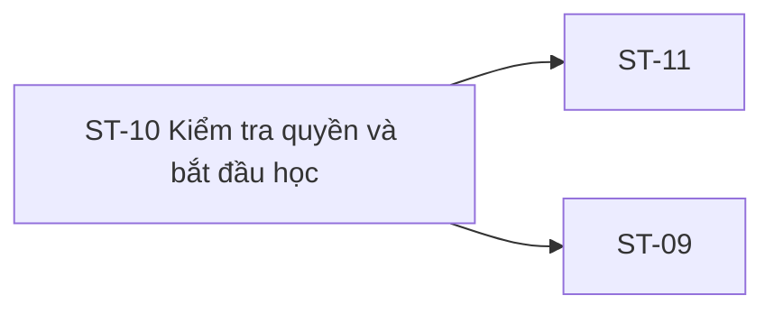

# ST-10 — Navigation

## 1. Route definition
- Current route in inventory: `/student/lessons/:lessonId/start`
- Status: candidate/design route; Study Web `UNWIRED` unless source code proves otherwise.
- Route params/types: `lessonId` (type/validation: see source DD; CẦN_XÁC_NHẬN if absent)
- Query params/defaults: preserve the inventory route string; detailed parsing rules only from source DD.
- Route guards: see source DD/API contract; do not create role policy.

## 2. Điểm vào
| From screen/route | Trigger | Params | Guard / fallback |
|---|---|---|---|
| [GS-04](../GS-04-DeCuongKhoaHoc/00-overview.md), [ST-09](../ST-09-TongQuanKhoaDangHoc/00-overview.md) | Theo DD nguồn/inventory | Theo source; không suy diễn | Xem source DD; route chưa xác nhận runtime |

## 3. Điểm ra
| Destination | Trigger | Params | Điều kiện |
|---|---|---|---|
| [ST-11](../ST-11-TrinhHocBaiLessonPlayer/00-overview.md), [ST-09](../ST-09-TongQuanKhoaDangHoc/00-overview.md) | Source event/inventory navigation | Theo source DD | Expected links; runtime chưa verify |

## 4. Back / refresh / deep link
- Back behavior: xem source DD; không mặc định browser history.
- Preserve filters/scroll/form state: chỉ nếu source có nêu, nếu không `CẦN_XÁC_NHẬN`.
- Refresh/direct URL: route trong inventory không chứng minh runtime.
- Invalid/missing ID: theo source DD/backend contract; không tự tạo validation.
- Not authenticated/authorized: theo source role guard; xem [Business Rules](05-business-rules.md).

## 5. Diagram

## Source navigation and flow detail

### Trích từ DD nguồn: E. Ma trận trạng thái và điều hướng

| State | Điều kiện vào dự kiến | Hành động/đích | Current evidence |
|---|---|---|---|
| Route missing/input unavailable | No wired ST-10 route or lessonId from ST-09 | Stop before API calls; design/client wiring needed | Current Study Web route absent; ST-09 asset lacks lesson selection |
| Checking | Route/auth context valid; #22 pending | No content/media; await access result | Static card only; no request |
| Denied | #22 returns 403 under approved semantics | Do not call #23/#24; keep content hidden; render approved reason | Copy-only denied card; reason payload unresolved |
| Access error | #22 returns 401/404/500 or network failure | No downstream calls; map status after contract; retry policy open | No error screen/handler |
| Starting | #22 allowed; #23 request pending | Prevent duplicate user action if implementation policy is approved | Current button disabled permanently; no request |
| Start failed | #23 returns error or ambiguous network result | Do not call #24 until success; safe retry/dedup needs idempotency contract | No failure UI; retry policy unresolved |
| Content loading | #23 success; #24 pending | Keep media hidden until authorized content response | No API or loading handler |
| Content error | #24 returns 401/403/404/500 or network failure | Remain gated; apply approved error mapping | No error UI or handler |
| Started/ready | #24 authorized success | Navigate to ST-11 with lessonId and approved context | FSM card is static; route absent |
| Session expired | Endpoint returns 401 | Handle per auth/session owner | No client session manager/source |
| Missing/unpublished | #22/#24 returns 404 per eventual semantics | Keep content hidden; distinguish from deny only if contract permits | 404 meaning open |

### Navigation matrix

| From | Trigger/data | To | Gap |
|---|---|---|---|
| ST-09 | Selected lessonId required | ST-10 | Current ST-09 design has no lesson item/ID handoff |
| ST-10 | Return link; intended course context | ST-09 | href=#; courseId/selection/history behavior absent |
| ST-10 | #22 allowed → #23 success → #24 success; pass lessonId | ST-11 | APIs/route absent; #24 is listed both here and in ST-11 load sequence |
| Header/footer | Static labels/data-path slugs | Inventory screens or legal pages | href=#; many destinations lack route contracts |

No current evidence defines browser back-stack behavior, course/lesson selection restoration, tab state, token refresh/redirect, or whether ST-11 reuses or refetches #24. These decisions remain open.

### UI, accessibility và design-system constraints

- Mockup uses Plus Jakarta Sans, primary #004AC6 and max width 1440px. Study UI guide targets Inter/system, ocean-primary #0B5F8A and content width around 1120px. Record as design discrepancy; do not alter the source image in this screen DD.
- Header nav is hidden below md and no mobile menu is present.
- Return anchor has focus:outline-none but no visible focus-ring utility in the markup; keyboard focus visibility needs review.
- Start control is natively disabled and aria-disabled=true, but its explanatory title/copy says permanent lock; that state has no business contract.
- Footer claims WCAG 2.1 AA Compliant without evidence of an audit. Do not treat the badge as verification.
- Screen uses contrast colors/animations but no motion preference handling is evident in static markup. Verify reduced motion, focus, keyboard navigation, screen-reader state announcement, contrast and responsive reflow when runtime exists.
- Course/student labels are hard-coded; do not use them as production data.

### Trích từ DD nguồn: B. Mô tả luồng hoạt động tổng thể

### Expected flow theo AC-14/15 và inventory

1. Student vào route ST-10 với lessonId được chọn từ ST-09. Route, session guard và ID handoff chưa được nối trong Study Web; ST-09 asset hiện thiếu lesson selection.
2. Yêu cầu Student Bearer JWT theo catalog. Mỗi endpoint phải tự thực thi authorization phía server; việc client gọi #22 trước không thay thế kiểm tra quyền cho một request #23 hoặc #24 độc lập.
3. Gọi GET #22 để kiểm tra quyền lesson. AC-14 nêu enrollment/prerequisite check. Theo flow inventory, nhánh success/allowed mới đi tiếp; nhánh denied không gọi #24 và không tải/phát media. Response status 403 được khai báo, nhưng predicate và reason payload chưa được chốt. Success body ApiEnvelope<Lesson> không có access field riêng.
4. Chỉ sau khi access được chấp thuận, gọi POST #23 để ghi nhận bắt đầu. AC-14 ghi UPSERT lesson_progress với trạng thái IN_PROGRESS; inventory mong chống gửi lặp. Catalog chỉ nói POST, path lesson_id và HTTP 201 ApiEnvelope<Lesson>; semantics khi row đã tồn tại, khóa idempotency, cột cập nhật và retry chưa có quyết định.
5. Sau khi #23 thành công theo contract được duyệt, gọi GET #24 để lấy nội dung. AC-15 yêu cầu quyền xem và kiểm tra publish status, nhưng chưa chốt lesson/course gate hoặc query. Chỉ render content/video khi response #24 được backend xác nhận đã được phép; không lấy media từ #09 public curriculum hoặc từ response #22/#23 theo suy đoán.
6. Nếu #24 trả success, chuyển tới ST-11 với lessonId theo route inventory. Không có client router/runtime để xác minh history, session carry-over hoặc state transfer. ST-11 dự kiến gọi #24 khi vào player, nên việc #24 bị gọi ở cả ST-10 và ST-11 cần Product/FE xác nhận để tránh tải trùng; inventory hiện mô tả cả hai bước.
7. Khi access denied, start/content lỗi, session hết hạn, lesson không tồn tại hoặc mạng lỗi, UI cần state/mapping rõ. Asset chỉ vẽ ba FSM labels tĩnh; không có loading/error/timeout/retry handler hay API call thật.

~~~mermaid
flowchart LR
  ST09[ST-09 lesson selection] -->|lessonId expected; absent in current design| ST10[ST-10 transition]
  ST10 --> AUTH[Student session check]
  AUTH --> A22[GET #22 access]
  A22 -->|denied / error| DENY[No #23, no #24, no media]
  A22 -->|allowed per approved contract| P23[POST #23 start]
  P23 -->|success| G24[GET #24 lesson]
  P23 -->|failure| FAIL[Failure state; retry policy open]
  G24 -->|authorized content success| ST11[ST-11 lesson player]
  G24 -->|403 / 404 / 500| FAIL
~~~

### Current behavior đã kiểm chứng

- PNG/HTML hiển thị gate active, static progress bar 2/5, status text 423_LOCKED, protected-player placeholder, FSM copy và API DESIGN_ONLY badges. Không có dữ liệu API hoặc auth được bind.
- HTML có header/breadcrumb/footer anchors href=#. Nút return ST-09 là anchor placeholder. Nút Start có disabled và aria-disabled=true, title chờ #22; không có click handler.
- Custom API/fetch/event handler không có trong HTML. Script chỉ cấu hình Tailwind và nạp Tailwind CDN.
- Study Web editable source/package/router vắng mặt; ignored dist chỉ có route /. Không có runtime ST-10 để xác minh.
- API search hiện tại: #22/#23/#24 không có Student route/module/query/test. Router có Admin lesson APIs #82–#86 dưới `/api/v1/admin/lessons...`, nhưng role/path khác và không thực hiện Student access/start flow.
- API #22–#24 DD và catalog là declaration. Test files riêng cho ba API không có; không chạy test suite.
- API #09 current source là public, chỉ lấy course/lesson `PUBLISHED`, sắp theo `sort_order,id` và trả `content`/`video_url`; không có JWT/enrollment context. Vì vậy response #09 không thể làm bằng chứng quyền học/media của Student.
- Hai DDL Study đều chưa xác nhận live: `infra/postgres/study-server/DB.sql` có BIGINT `lesson_progress(user_id, lesson_id, status, progress_percent, last_accessed_at, completed_at)` nhưng không khai báo unique `(user_id,lesson_id)`; V1-PILOT `infra/postgres/02_study_db.sql` có UUID `lesson_progress_facts(enrollment_id, lesson_id, status, first_started_at, completed_at)` và unique `(enrollment_id,lesson_id)`. Mô hình identity/field khác nhau; không suy ra API #23 conflict key, write mapping hoặc transaction từ một trong hai.
