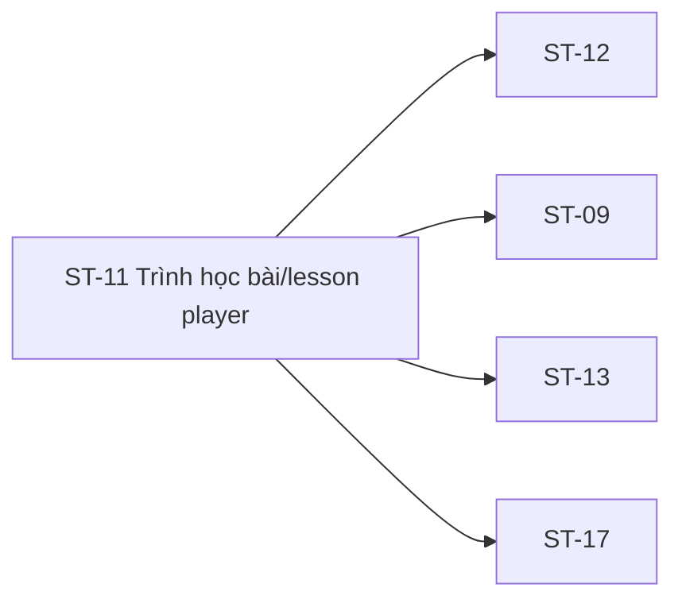

# ST-11 — Navigation

## 1. Route definition
- Current route in inventory: `/student/lessons/:lessonId`
- Status: candidate/design route; Study Web `UNWIRED` unless source code proves otherwise.
- Route params/types: `lessonId` (type/validation: see source DD; CẦN_XÁC_NHẬN if absent)
- Query params/defaults: preserve the inventory route string; detailed parsing rules only from source DD.
- Route guards: see source DD/API contract; do not create role policy.

## 2. Điểm vào
| From screen/route | Trigger | Params | Guard / fallback |
|---|---|---|---|
| [ST-10](../ST-10-KiemTraQuyenVaBatDauHoc/00-overview.md), [ST-12](../ST-12-TaiLieuKemBaiHoc/00-overview.md), [ST-21](../ST-21-TienDoTheoKhoaHoc/00-overview.md) | Theo DD nguồn/inventory | Theo source; không suy diễn | Xem source DD; route chưa xác nhận runtime |

## 3. Điểm ra
| Destination | Trigger | Params | Điều kiện |
|---|---|---|---|
| [ST-12](../ST-12-TaiLieuKemBaiHoc/00-overview.md), [ST-09](../ST-09-TongQuanKhoaDangHoc/00-overview.md), [ST-13](../ST-13-GioiThieuBaiKiemTra/00-overview.md), [ST-17](../ST-17-ChiTietBaiTap/00-overview.md) | Source event/inventory navigation | Theo source DD | Expected links; runtime chưa verify |

## 4. Back / refresh / deep link
- Back behavior: xem source DD; không mặc định browser history.
- Preserve filters/scroll/form state: chỉ nếu source có nêu, nếu không `CẦN_XÁC_NHẬN`.
- Refresh/direct URL: route trong inventory không chứng minh runtime.
- Invalid/missing ID: theo source DD/backend contract; không tự tạo validation.
- Not authenticated/authorized: theo source role guard; xem [Business Rules](05-business-rules.md).

## 5. Diagram

## Source navigation and flow detail

### Trích từ DD nguồn: E. Ma trận trạng thái và điều hướng

| State | Điều kiện expected | Hành động/đích expected | Current evidence / gap |
|---|---|---|---|
| Route/input unavailable | No route or no lessonId | Stop before protected API calls; approved recovery/return behavior needed | Study Web route absent; prior screen handoff missing lessonId |
| Loading lesson | Route/session context valid; #24 pending | Keep lesson/media hidden until authorized success | No loader or API handler in asset |
| Unavailable fallback | Lesson cannot be presented or is not ready | Show approved unavailable/error state | Current card is static; it does not identify a server state |
| Access denied | #24 returns 403 under approved policy | Hide content/media; show approved reason/recovery | No error payload/UI contract |
| Session expired | API returns 401 | Follow auth/session owner policy | No session manager or expired state in UI |
| Playing | Authorized lesson/media available and play action occurs | Show approved controls and track current playback | No media element or player state |
| Paused/seeking | Player pause/seek event | Maintain player/progress state by approved rules | No controls or seek/resume contract |
| Progress saving | Approved #25 event pending | Avoid stale overwrites; show approved saving result | No trigger, throttle, idempotency or loading state |
| Progress save failed | #25 returns error/network ambiguity | Map by approved error/retry rules; preserve last confirmed state | No failure UI/retry contract |
| Completed | Completion condition accepted by #25 | Mark finished and decide whether to request #27 | No completion control/threshold/state machine |
| Finished / has next | #27 returns approved Lesson | Show approved next action/navigation | No next control or route-update policy; response open |
| Finished / no next | Current lesson is final | Show approved end-of-course state | API #27 terminal response semantics unresolved |
| Resources loading/available/empty/forbidden | User opens resource UI and #26 responds | Render approved Resource collection or error | No resource UI; #26 type/visibility/empty behavior unresolved |

### Navigation matrix

| From | Trigger/data | To | Gap |
|---|---|---|---|
| ST-10 | `lessonId` and authorization handoff expected | ST-11 `/student/lessons/:lessonId` | ST-10 current design lacks lesson selection/ID; both inventories list #24. |
| ST-11 | Header/back CTA/breadcrumb/footer course links | Static `/student/courses` | Does not match ST-09 route with `courseId`; runtime route absent. |
| ST-11 | Resource action (expected) | ST-12 | No resource action in asset; #26 response/security open. |
| ST-11 | Completed/Next action (expected) | Next lesson or finished state | #27 response/order/end semantics and navigation trigger open. |
| ST-11 | Course quiz/assignment content (expected related screens) | ST-13 / ST-17 | No links or content metadata for quiz/assignment in current asset. |
| Footer | Static href | `/student`, `/student/courses`, `/student/progress` | Path strings only; router and auth state not verified. |

### Trích từ DD nguồn: B. Mô tả luồng hoạt động tổng thể

### Expected flow theo inventory và AC-14/15

1. Student được điều hướng tới `/student/lessons/:lessonId` với lessonId đã chọn. Inventory yêu cầu Student; API catalog yêu cầu Bearer JWT/role Student. Route, auth guard và lessonId handoff chưa được wired.
2. Khi lesson context hợp lệ, inventory gọi GET #24 để nạp `Lesson`. Tuy nhiên ST-10 cũng mô tả GET #24 trước handoff; Product/FE phải chỉ định owner của request và có/không handoff response/cache. Không giả định cache hay gọi trùng.
3. #24 response theo catalog là `ApiEnvelope<Lesson>`: `id`, `course_id`, `title`, `content?`, `video_url?`, `order`, `status`. Chỉ response thành công qua authorization mới có thể cung cấp lesson content/media; `content`/`video_url` optional, null serialization và LessonStatus chưa chốt.
4. Nếu media/player được thiết kế, người học có thể xem nội dung; nhưng asset hiện không có media element, control, URL binding, renderer, transcript/captions hoặc buffering model. Không tự chọn player vendor, autoplay, seek behavior, URL signing hay media token.
5. Inventory yêu cầu GET #26 lazy. Trigger UI chưa hiện diện. #26 catalog trả `ApiEnvelope<Lesson>` trong khi ý nghĩa là resources; type/cardinality/order/empty state/visibility/URL policy chưa được duyệt.
6. Inventory yêu cầu PATCH #25 “khi có biến cố progress hợp lệ”. Catalog body là `position:int32!`, `percent:int32!`, `completed:boolean!`; tần suất, event, đơn vị position, range/rounding, throttle, autosave, retry, dedup và state precedence chưa rõ. AC-14 nói cập nhật lesson progress và course aggregate; không có formula/transaction/schema nguồn cho aggregate.
7. AC-14 diagram nêu `completed = YES` → mark `COMPLETED`, `NO` → giữ `IN_PROGRESS`. Không có completion trigger/threshold trong UI hoặc contract. Inventory gọi GET #27 sau completed; tie-break, bài cuối, 404-vs-empty và navigation policy còn mở.
8. Expected navigation liên quan ST-09/ST-12/ST-13/ST-17 theo inventory. Asset chỉ có link về `/student/courses`, `/student` và `/student/progress`, không có ST-12/resources, quiz, assignment hay next-lesson control.

~~~mermaid
flowchart TD
  ST10[ST-10 handoff: lessonId missing in current design] --> ST11[ST-11 route expected]
  ST11 --> AUTH[Student session + lesson access]
  AUTH -->|approved| GET24[GET #24 Lesson; owner overlaps ST-10]
  GET24 --> PLAYER[Expected player; absent from current asset]
  PLAYER -->|approved progress event| PATCH25[PATCH #25; trigger/throttle/storage open]
  PLAYER -->|lazy resource action| GET26[GET #26; control absent, response type open]
  PATCH25 -->|completion semantics approved| GET27[GET #27 next; ordering/terminal behavior open]
  GET27 --> NEXT[Next lesson/navigation policy open]
  GET24 -->|401/403/404/500| ERR[Error/fallback mapping open]
  ST11 -. current asset .-> FALLBACK[Static “nội dung chưa sẵn sàng” fallback]
~~~

### Current behavior đã kiểm chứng

- PNG/HTML hiển thị header brand, back-to-courses link, breadcrumb, unavailable card/icon/title/message/description/CTA và footer. Nội dung bài học chưa sẵn sàng; đây là static copy.
- HTML có 7 anchors: `/student/courses` (5), `/student` (1), `/student/progress` (1). Không có `<video>`, `<audio>`, `<iframe>`, `<source>`, `<form>`, `<input>`, `<canvas>`, `<button>` hoặc inline event handler. Hai script tag chỉ nạp Tailwind CDN và Tailwind config; không có fetch/API/product logic.
- Study Web editable source/package/router không có trong checkout. Context ghi Study Web UNWIRED và ignored `dist` chỉ có `/`; không có runtime ST-11 để kiểm chứng.
- Exact search trên `apps/study-server/app/api/v1.py`, `app/modules/`, `tests/` không tìm thấy Student endpoints #24–#27 hoặc focused tests. Router có các Admin `/admin/lessons*` APIs #82–#86; role/path/use case khác.
- API #24–#27 catalog/DD là declaration; tất cả API DD đang Draft — Needs Confirmation. Không có query, mutation hay response assembly source để truy vết.
- Hai DDL candidate không cùng schema contract: `infra/postgres/study-server/DB.sql` mô tả legacy BIGINT `lessons`/`resources`/`lesson_progress`; `infra/postgres/02_study_db.sql` mô tả V1-PILOT UUID/versioned `lessons`, `lesson_progress_facts` và `block_progress_facts`. V1-PILOT `lesson_progress_facts` không có `position` hoặc `percent`; `block_progress_facts.last_position_seconds` thuộc content block và không chứng minh được mapping lesson-level của #25. Các artifact không chứng minh live schema.
- Trong legacy BIGINT DDL candidate, `lessons.course_id` và `resources.lesson_id` nullable; `lessons` có `content`, `video_url`, `sort_order`, `status`; `resources` có `resource_type`, `url` nhưng không có `visibility`; `lesson_progress` có `status`, `progress_percent`, `last_accessed_at`, `completed_at`, không có `position` hoặc unique `(user_id, lesson_id)`. Không xác nhận live schema.
