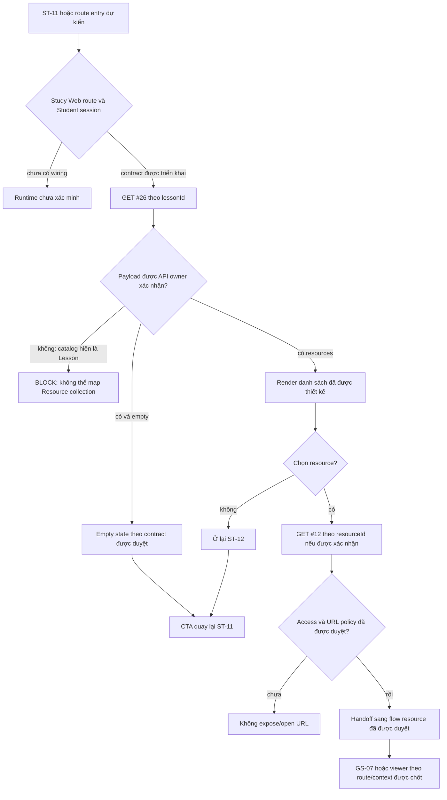

# ST-12 — Data Flow & State

## 1. Nguồn dữ liệu
| Field / object | Type | Source | Destination | Cập nhật khi |
|---|---|---|---|---|
| Chỉ liệt kê theo bằng chứng trong excerpt bên dưới | Theo DD/API source | API/inventory/design; status phải giữ nguyên | UI/state nêu ở DD nguồn | Theo event source |

## 2. State model

> Không tạo DTO/ViewModel mới khi chưa có contract. State, DTO và mapping được trích nguyên ngữ cảnh từ DD nguồn bên dưới.

## 3. API DTO → ViewModel mapping

### Trích từ DD nguồn: B. Luồng tổng thể

1. **Vào màn hình:** route dự kiến nhận `lessonId` từ lesson flow. ST-11 source hiện là unavailable fallback và không có resource control; việc điều hướng sang ST-12 chưa được xác minh.
2. **Authentication/authorization:** AC-15 yêu cầu quyền xem lesson. Catalog #26 yêu cầu Student Bearer. Không có Study Web client/router/session source để xác minh guard, token storage, refresh hoặc cách xử lý session hết hạn.
3. **Nạp danh sách:** inventory kỳ vọng `GET #26` theo `lessonId`; không query/body. Tuy nhiên route/module/test vắng mặt. Catalog và AC diagram trả `ApiEnvelope<Lesson>`, không nêu `Resource[]`, thứ tự, trang hoặc empty shape. Không thể ánh xạ item hay kết luận empty.
4. **Hiển thị:** ảnh chỉ có một empty/unavailable panel và hai thẻ trạng thái kỹ thuật. Không có card/row resource, tên tệp, type, dung lượng, URL hoặc hành động mở. Không giả lập các giá trị này.
5. **Lấy chi tiết:** API #12 chỉ có thể được cân nhắc sau khi một `resource_id` được cung cấp từ contract/list đã duyệt. Ảnh hiện không có resource selection. Source #12 là public, trả stored URL và thiếu visibility/signer/auth, do đó response hiện tại chưa đủ làm bằng chứng an toàn để tự mở/tải.
6. **Quay lại/đi tiếp:** CTA quay lại ST-11 và link diễn đàn chỉ là anchor prototype `href="#"`. Route/state/ID handoff chưa được triển khai. GS-07 là link nghiệp vụ theo inventory, nhưng route/return context cho ST-12 còn mở.
7. **Lỗi và phiên:** catalog #26 khai báo 401/403/404/500; current #12 source có 404/500 ngoài success. Không có UI mapping, retry, timeout, cache, polling hoặc session recovery implementation. Text “Tự động làm mới mỗi 30s” không có timer trong HTML.

### Sơ đồ màn hình liên kết

| Nguồn | Hành động/đầu vào dự kiến | Đích | Hiện trạng |
|---|---|---|---|
| ST-11 | Mở panel tài nguyên với `lessonId` | ST-12 `/student/lessons/:lessonId/resources` | Inventory và lazy #26 kỳ vọng; ST-11 asset hiện không có resource control; route/runtime chưa có. |
| ST-12 | Chọn Resource, truyền `resourceId` | GS-07 `/resources/:resourceId` hoặc viewer được duyệt | Inventory liên kết GS-07; ST-12 screenshot không có Resource item; API #26 chưa có list contract runnable. |
| ST-12 | CTA quay lại lesson | ST-11 `/student/lessons/:lessonId` | `data-path` ghi tên logical route, nhưng `href="#"`; giữ playback position/history chưa có contract. |
| ST-12 | Link “Diễn đàn Thảo luận” | Destination chưa xác nhận | `href="#"`; không có `courseId` trong route/asset để chọn đúng room. |

### Trích từ DD nguồn: E. Ma trận trạng thái

| State | Điều kiện/nguồn | UI/transition | Current status |
|---|---|---|---|
| Design fallback | Ảnh hiện tại | Hiển thị thông điệp #10, CTA ST-11 và status cards. | `VISIBLE IN PROTOTYPE`; không biết HTTP condition. |
| Route/session checking | Student mở route | Xác thực `lessonId`/session theo contract; không hiển thị resource data trước khi quyền được xác nhận. | Chưa có client route/session source. |
| Resources loading | #26 request đang chạy | Cần loading state đã được thiết kế. | Không hiện trong screenshot/HTML; API #26 chưa có source. |
| Empty resources | Response collection hợp lệ rỗng | Cần product/API xác nhận 200 empty hay response khác và copy/UI riêng. | `OPEN`; fallback hiện tại không chứng minh đây là empty result. |
| Resources available | Response có Resource items | Cần danh sách/card design, field mapping và trigger chọn item. | Không có UI hoặc payload hiện tại. |
| #26 authentication/access error | Catalog 401/403 | Cần session/login/recovery copy và policy 403. | Declared only; current source `NOT_FOUND`. |
| #26 missing/server/network error | Catalog 404/500 hoặc network failure | Cần inline/page error và retry policy. | Declared only; network/retry UI chưa có. |
| Resource detail loading | Chọn item và gọi #12 nếu được duyệt | Cần busy state, tránh mở URL trước response/access approval. | Không có selector/control trong asset. |
| Resource detail success | #12 trả 200 | Source trả `id/name/type/url/lesson_id`; URL direct, visibility omitted. Chưa đủ điều kiện tự mở. | API source-backed; UI/open policy blocked. |
| Resource detail not found/internal error | #12 404/500 | Cần inline/error destination policy; không tự dùng SH-06. | API source-backed; screen mapping chưa chốt. |
| Safe open/preview/download | Access, origin, type, MIME và URL policy đã được duyệt | Chỉ sau khi quyết định viewer/handoff. | Chưa có contract; signed URL/410/expiry không tồn tại trong #12 source. |

## 4. Luồng đọc (Read)
- Orchestration từ inventory: GET #26; nếu có resource_id hợp lệ GET #12; không tự mở URL ngoài chính sách.
- Chi tiết current/source mapping: xem [API Integration](04-api-integration.md) và DD nguồn.

## 5. Luồng ghi (Write)
- Chỉ mô tả mutation được DD/API source nêu; không thêm endpoint hoặc side effect.
- Source trace: [ST-12](../../screen_stitch/03_student/ST-12_tai-lieu-kem-bai-hoc/ST-12.md)

## 6. Cache / concurrency / lifecycle
- Cache, race, cleanup, pagination: xem các section source bên dưới; nếu không có bằng chứng thì để `CẦN_XÁC_NHẬN`.

## 7. Data errors & security
- Theo error/security/source-status section của DD nguồn; không coi state trong mockup là runtime behavior.

## 8. Trace
[Events](02-events.md) · [API](04-api-integration.md) · [Rules](05-business-rules.md)
