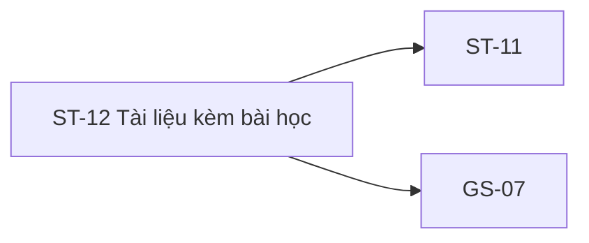
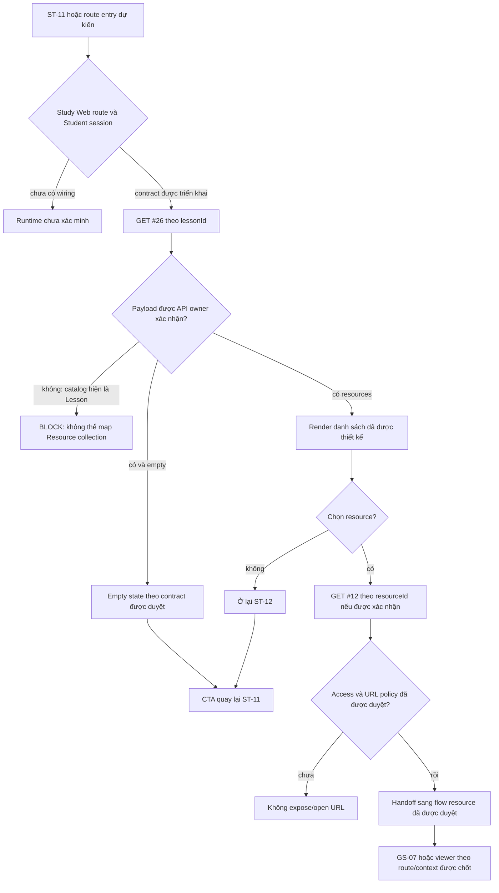

# ST-12 — Navigation

## 1. Route definition
- Current route in inventory: `/student/lessons/:lessonId/resources`
- Status: candidate/design route; Study Web `UNWIRED` unless source code proves otherwise.
- Route params/types: `lessonId` (type/validation: see source DD; CẦN_XÁC_NHẬN if absent)
- Query params/defaults: preserve the inventory route string; detailed parsing rules only from source DD.
- Route guards: see source DD/API contract; do not create role policy.

## 2. Điểm vào
| From screen/route | Trigger | Params | Guard / fallback |
|---|---|---|---|
| [ST-11](../ST-11-TrinhHocBaiLessonPlayer/00-overview.md) | Theo DD nguồn/inventory | Theo source; không suy diễn | Xem source DD; route chưa xác nhận runtime |

## 3. Điểm ra
| Destination | Trigger | Params | Điều kiện |
|---|---|---|---|
| [ST-11](../ST-11-TrinhHocBaiLessonPlayer/00-overview.md), [GS-07](../GS-07-XemTaiTaiNguyen/00-overview.md) | Source event/inventory navigation | Theo source DD | Expected links; runtime chưa verify |

## 4. Back / refresh / deep link
- Back behavior: xem source DD; không mặc định browser history.
- Preserve filters/scroll/form state: chỉ nếu source có nêu, nếu không `CẦN_XÁC_NHẬN`.
- Refresh/direct URL: route trong inventory không chứng minh runtime.
- Invalid/missing ID: theo source DD/backend contract; không tự tạo validation.
- Not authenticated/authorized: theo source role guard; xem [Business Rules](05-business-rules.md).

## 5. Diagram

## Source navigation and flow detail

### Trích từ DD nguồn: B. Luồng tổng thể

1. **Vào màn hình:** route dự kiến nhận `lessonId` từ lesson flow. ST-11 source hiện là unavailable fallback và không có resource control; việc điều hướng sang ST-12 chưa được xác minh.
2. **Authentication/authorization:** AC-15 yêu cầu quyền xem lesson. Catalog #26 yêu cầu Student Bearer. Không có Study Web client/router/session source để xác minh guard, token storage, refresh hoặc cách xử lý session hết hạn.
3. **Nạp danh sách:** inventory kỳ vọng `GET #26` theo `lessonId`; không query/body. Tuy nhiên route/module/test vắng mặt. Catalog và AC diagram trả `ApiEnvelope<Lesson>`, không nêu `Resource[]`, thứ tự, trang hoặc empty shape. Không thể ánh xạ item hay kết luận empty.
4. **Hiển thị:** ảnh chỉ có một empty/unavailable panel và hai thẻ trạng thái kỹ thuật. Không có card/row resource, tên tệp, type, dung lượng, URL hoặc hành động mở. Không giả lập các giá trị này.
5. **Lấy chi tiết:** API #12 chỉ có thể được cân nhắc sau khi một `resource_id` được cung cấp từ contract/list đã duyệt. Ảnh hiện không có resource selection. Source #12 là public, trả stored URL và thiếu visibility/signer/auth, do đó response hiện tại chưa đủ làm bằng chứng an toàn để tự mở/tải.
6. **Quay lại/đi tiếp:** CTA quay lại ST-11 và link diễn đàn chỉ là anchor prototype `href="#"`. Route/state/ID handoff chưa được triển khai. GS-07 là link nghiệp vụ theo inventory, nhưng route/return context cho ST-12 còn mở.
7. **Lỗi và phiên:** catalog #26 khai báo 401/403/404/500; current #12 source có 404/500 ngoài success. Không có UI mapping, retry, timeout, cache, polling hoặc session recovery implementation. Text “Tự động làm mới mỗi 30s” không có timer trong HTML.

### Sơ đồ màn hình liên kết

| Nguồn | Hành động/đầu vào dự kiến | Đích | Hiện trạng |
|---|---|---|---|
| ST-11 | Mở panel tài nguyên với `lessonId` | ST-12 `/student/lessons/:lessonId/resources` | Inventory và lazy #26 kỳ vọng; ST-11 asset hiện không có resource control; route/runtime chưa có. |
| ST-12 | Chọn Resource, truyền `resourceId` | GS-07 `/resources/:resourceId` hoặc viewer được duyệt | Inventory liên kết GS-07; ST-12 screenshot không có Resource item; API #26 chưa có list contract runnable. |
| ST-12 | CTA quay lại lesson | ST-11 `/student/lessons/:lessonId` | `data-path` ghi tên logical route, nhưng `href="#"`; giữ playback position/history chưa có contract. |
| ST-12 | Link “Diễn đàn Thảo luận” | Destination chưa xác nhận | `href="#"`; không có `courseId` trong route/asset để chọn đúng room. |
