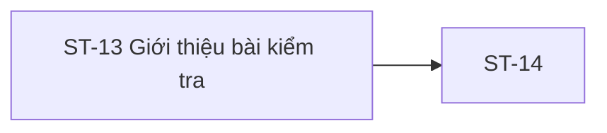

# ST-13 — Navigation

## 1. Route definition
- Current route in inventory: `/student/quizzes/:quizId`
- Status: candidate/design route; Study Web `UNWIRED` unless source code proves otherwise.
- Route params/types: `quizId` (type/validation: see source DD; CẦN_XÁC_NHẬN if absent)
- Query params/defaults: preserve the inventory route string; detailed parsing rules only from source DD.
- Route guards: see source DD/API contract; do not create role policy.

## 2. Điểm vào
| From screen/route | Trigger | Params | Guard / fallback |
|---|---|---|---|
| [ST-11](../ST-11-TrinhHocBaiLessonPlayer/00-overview.md) | Theo DD nguồn/inventory | Theo source; không suy diễn | Xem source DD; route chưa xác nhận runtime |

## 3. Điểm ra
| Destination | Trigger | Params | Điều kiện |
|---|---|---|---|
| [ST-14](../ST-14-LamBaiKiemTra/00-overview.md) | Source event/inventory navigation | Theo source DD | Expected links; runtime chưa verify |

## 4. Back / refresh / deep link
- Back behavior: xem source DD; không mặc định browser history.
- Preserve filters/scroll/form state: chỉ nếu source có nêu, nếu không `CẦN_XÁC_NHẬN`.
- Refresh/direct URL: route trong inventory không chứng minh runtime.
- Invalid/missing ID: theo source DD/backend contract; không tự tạo validation.
- Not authenticated/authorized: theo source role guard; xem [Business Rules](05-business-rules.md).

## 5. Diagram

## Source navigation and flow detail

### Trích từ DD nguồn: E. Ma trận trạng thái và điều hướng

| State / transition | Điều kiện có nguồn | Màn hình/UI effect | Giới hạn |
|---|---|---|---|
| `INITIAL → LOADING` | Mở route với `quizId`; là flow mục tiêu, chưa có UI runtime. | Pending GET #28. | Auth/router implementation chưa tồn tại trong Study Web. |
| `LOADING → AVAILABLE` | Chưa có condition đủ chi tiết; inventory có state `available`. | Chỉ sau response/data mapping và eligibility rule được duyệt. | HTTP 200 #28 một mình không chứng minh quiz được phép bắt đầu. |
| `LOADING → CLOSED` | Inventory có `closed`; API #28/API #29 không xác định status/deadline mapping. | Chưa thể định nghĩa copy hoặc action. | `duration_minutes`, status DDL candidate và sample UI không đủ để suy ra. |
| `LOADING → DENIED` | Catalog #28 có 403 `DESIGN_ACCESS_DENIED`; AC-16 yêu cầu entitlement. | Access-denied state theo policy được duyệt. | Eligibility predicate, 403/404 masking và recovery chưa chốt. |
| `LOADING → AUTH_REQUIRED` | Catalog #28 có 401 `DESIGN_AUTHENTICATION_REQUIRED`. | Session re-auth/handoff theo chính sách auth dùng chung. | Không tự chọn route/login return URL ở ST-13. |
| `LOADING → NOT_FOUND` | Catalog #28 có 404 `DESIGN_RESOURCE_NOT_FOUND`. | Not-found state nếu owner giữ mapping. | Quiz absent vs hidden/access masking chưa rõ. |
| `LOADING → SERVICE_ERROR` | Catalog #28 có 500 `DESIGN_INTERNAL_ERROR`; network/client errors không được catalog định nghĩa. | Error state/retry UI cần quyết định. | Retry/backoff/timeout/copy chưa chốt. |
| `AVAILABLE → STARTING` | ST-13 row gắn #16 với Start; F05/ST-14 inventory/DD đặt call-site/order khác. | POST #29 chỉ là candidate pending owner decision; pending/double-click UI behavior chưa có source. | Không tự chọn screen owner, không gửi POST ở cả ST-13 lẫn ST-14. |
| `ATTEMPT_CREATED → ST-14` | API #29 trả 201 `DESIGN_RESOURCE_CREATED` và `attemptId` hợp lệ; call-site phải được owner duyệt trước. | Handoff `quizId` + `attemptId` theo route design. | ST-14 route/access, attempt response, screen owner/order và schema mapping chưa được xác minh. Nếu #29 ở ST-14, path hiện vẫn đòi `attemptId` trước khi vào màn hình. |
| `STARTING → DENIED/NOT_FOUND/VALIDATION/CONFLICT/SERVICE_ERROR` | API #29 catalog codes 403/404/422/409/500; 401 auth. | Error/state-specific UI cần owner chốt. | Không gán condition cụ thể cho 409/422; 409 không có trong #28 catalog. |
| `STARTING → OUTCOME_UNKNOWN` | POST response bị mất hoặc timeout sau khi request có thể đã tới server. | Hiển thị/handoff/reconcile chưa có contract. | Không tự POST lại khi idempotency chưa có. |
| Click CTA/old attempt/header/footer | Có affordance trong PNG hoặc anchors trong HTML companion. | Không điều hướng nếu chưa được duyệt destination/handoff. | Screenshot và HTML khác nhau; Study Web router `UNWIRED`. |

**Quay lại / phiên đăng nhập:** route guard, deep-link entry, back/refresh, session expiry, resume và ownership/access checks ở ST-14 chưa được chứng minh. Không lưu token/answer/attempt state từ mockup.

### Trích từ DD nguồn: B. Luồng hoạt động tổng thể

1. **Mở route:** route đề xuất nhận `quizId`. Authentication hiện tại của Study Web không có source; contract API yêu cầu Bearer JWT và role Student. Không coi tên/avatar trong mockup là phiên đăng nhập thật.
2. **Khởi tạo:** trạng thái mục tiêu là `loading`. Lấy `quizId` từ URL; cách validate path ngoài kiểu `int64!`, redirect hoặc render lỗi khi thiếu/không parse được chưa có contract.
3. **Đọc quiz:** gọi `GET /api/v1/quizzes/{quiz_id}` theo API #28 design với `Authorization: Bearer <student-token>`. Không có query hoặc request body được catalog khai báo. Request chỉ là thiết kế, hiện chưa runnable từ Student router.
4. **Đọc response:**
   - HTTP 200 / `DESIGN_RESOURCE_RETRIEVED`: response là `ApiEnvelope<Quiz>`. API #28 DD ghi logical fields `id`, `course_id`, `title`, optional `duration_minutes`, `passing_score`, `questions`; cấu trúc question/choice và field nullability/serialization còn mở.
   - Chỉ map field đã có trong contract và có trong response. `title` là nguồn thiết kế cho tiêu đề; `duration_minutes` chỉ là optional duration, không tự tạo deadline/countdown; `passing_score` không đủ để suy ra công thức/điểm số hiển thị; `questions` không được dùng để tính count cho tới khi shape/cardinality được chốt.
   - Không map attempt count, lần còn lại, attempt history, instructor, cover, certification hoặc “đã sẵn sàng” từ Quiz response hiện được catalog mô tả.
   - Không trả/hiển thị `is_correct` hoặc đáp án đúng. Shape `QuizChoice` chưa được định nghĩa đầy đủ.
5. **Hiển thị trạng thái:** `available`/`closed` phụ thuộc eligibility, open-state và deadline policy còn thiếu. Không suy ra `available` chỉ vì API #28 trả 200 hoặc `closed` từ copy/giá trị trong PNG. API #28 catalog không khai báo 409.
6. **Người dùng nhấn Start:** ST-13 inventory row kỳ vọng POST #29 sau explicit click. Tuy nhiên F05 chỉ vị trí tạo attempt sau khi chuyển sang ST-14, còn ST-14 inventory ghi POST #29 trước GET #28; ST-14 DD cũng để discrepancy này mở. Owner phải chốt một call-site và thứ tự trước implementation; không gửi POST ở cả hai màn hình. Nếu POST thuộc ST-14, route design hiện yêu cầu `attemptId` trước khi màn hình được mở, nên route/entry handoff cũng phải được duyệt.
7. **Xử lý tạo attempt nếu owner xác nhận #29 tại ST-13:**
   - HTTP 201 / `DESIGN_RESOURCE_CREATED`: `ApiEnvelope<QuizAttempt>`. API #29 DD/AC-16 ghi trạng thái tạo `IN_PROGRESS`; ID lấy từ `data.id` nếu response thực tế tuân contract. Quy tắc khởi tạo `answers[]`, `started_at`, nullable `submitted_at`/`score` chưa chốt.
   - Chỉ khi có ID hợp lệ mới chuyển sang ST-14 với `quizId` và `attemptId`. Handoff route chưa được implement/verify. Nếu owner đặt #29 ở ST-14, trình tự và dữ liệu ST-13 → ST-14 phải được cập nhật đồng bộ; không chạy lại POST tại ST-14 sau khi ST-13 đã tạo attempt.
   - 401/403/404/422/409/500 map theo catalog #29; condition chính xác của 403, 404, 422, 409 chưa hoàn tất. API #29 Q-29-01..05 để mở eligibility, attempt limit/expiry/resume, identity, response và path mapping.
8. **Schema/persistence:** legacy DDL chỉ là một candidate BIGINT model; V1-PILOT DDL dùng UUID Assessment/AssessmentAttempt model khác. Không suy ra POST #29 có thể INSERT vào một trong hai schema hoặc map ID nếu chưa có contract và schema baseline được duyệt.
9. **Không chắc kết quả POST:** API #29 chưa có idempotency hoặc retry contract. Không tự động gửi lại POST sau timeout/mất kết nối có kết quả không rõ; cần policy/API recovery được duyệt để tránh tạo attempt trùng. Màn hình báo lỗi, hỏi thử lại hay tra cứu attempt hiện hữu chưa được chốt.
10. **Rời màn hình:** CTA ôn bài, xem lại bài làm, hỗ trợ, breadcrumb, header và footer chưa có navigation contract phù hợp với screenshot. Không tự gắn chúng sang ST-11, ST-16, diễn đàn hoặc route khác.
