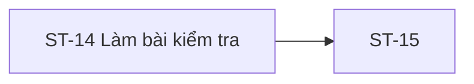

# ST-14 — Navigation

## 1. Route definition
- Current route in inventory: `/student/quizzes/:quizId/attempts/:attemptId`
- Status: candidate/design route; Study Web `UNWIRED` unless source code proves otherwise.
- Route params/types: `quizId` (type/validation: see source DD; CẦN_XÁC_NHẬN if absent), `attemptId` (type/validation: see source DD; CẦN_XÁC_NHẬN if absent)
- Query params/defaults: preserve the inventory route string; detailed parsing rules only from source DD.
- Route guards: see source DD/API contract; do not create role policy.

## 2. Điểm vào
| From screen/route | Trigger | Params | Guard / fallback |
|---|---|---|---|
| [ST-13](../ST-13-GioiThieuBaiKiemTra/00-overview.md), [ST-15](../ST-15-XacNhanNopBaiKiemTra/00-overview.md) | Theo DD nguồn/inventory | Theo source; không suy diễn | Xem source DD; route chưa xác nhận runtime |

## 3. Điểm ra
| Destination | Trigger | Params | Điều kiện |
|---|---|---|---|
| [ST-15](../ST-15-XacNhanNopBaiKiemTra/00-overview.md) | Source event/inventory navigation | Theo source DD | Expected links; runtime chưa verify |

## 4. Back / refresh / deep link
- Back behavior: xem source DD; không mặc định browser history.
- Preserve filters/scroll/form state: chỉ nếu source có nêu, nếu không `CẦN_XÁC_NHẬN`.
- Refresh/direct URL: route trong inventory không chứng minh runtime.
- Invalid/missing ID: theo source DD/backend contract; không tự tạo validation.
- Not authenticated/authorized: theo source role guard; xem [Business Rules](05-business-rules.md).

## 5. Diagram

## Source navigation and flow detail

### Trích từ DD nguồn: E. Ma trận trạng thái và điều hướng

### E.1. State matrix

| State | Điều kiện vào | Hành vi/element | Chuyển tiếp và giới hạn |
|---|---|---|---|
| `ROUTE_PENDING` | Mở route với IDs. | Loading shell dự kiến; chưa có implementation. | Parse/auth → `QUIZ_LOADING`; lỗi route/guard policy chưa chốt. |
| `QUIZ_LOADING` | Gọi #28 theo thứ tự được duyệt. | Loading placeholders cho quiz/question. | #28 200 → `QUIZ_RECEIVED`; 401/403/404/500 → state lỗi tương ứng. |
| `QUIZ_RECEIVED` | #28 success và map được Quiz schema. | Có thể render question list; chưa khôi phục attempt/answers. | Chưa đủ điều kiện thành `IN_PROGRESS` nếu attempt handoff không được xác thực. |
| `ATTEMPT_HANDOFF_REQUIRED` | `attemptId` thiếu/không được tạo từ #29; direct entry/refresh. | Không tự tạo attempt; không hiện sample answers. | Chờ API/route owner xác định attempt read/resume/handoff. |
| `IN_PROGRESS` | Valid attempt/answer state được server/contract xác nhận. | Cho phép chọn câu; timer chỉ khi server cung cấp. | Answer change → `DIRTY`; navigation không tự persist. |
| `DIRTY` | Answer thay đổi local; body #30 đang chờ. | Không hiển thị saved; giữ lựa chọn theo design. | Khi #30 được chốt/call → `SAVING`; nếu exit/submit cần policy. |
| `SAVING` | PUT #30 đang xử lý. | Pending visual state; double-submit/concurrent request behavior chưa định nghĩa. | 200 → `SAVED`; error → `SAVE_ERROR/OUTCOME_UNKNOWN` mapping cần quyết định. |
| `SAVED` | #30 200 `DESIGN_RESOURCE_UPDATED`. | Có thể hiển thị save success; timestamp không có nguồn server đã chốt. | Answer mới → `DIRTY`; submit click → ST-15. |
| `SAVE_ERROR` | #30 401/403/404/422/500. | Không tuyên bố persisted; error details/copy chưa chốt. | Recovery/retry chỉ sau API policy; #30 không có 409. |
| `OUTCOME_UNKNOWN` | Timeout/response mất sau request có thể đã tới server. | Không replay mù, không xác nhận saved. | Reconcile/idempotency endpoint/header/policy chưa có. |
| `EXPIRED` | Chỉ khi server trả authoritative expiry/state theo policy. | Không tự khóa/submit dựa trên client clock. | Mã/route recovery chưa chốt; G-09 blocker. |
| `SUBMIT_CONFIRMATION` | User chọn nút nộp. | Điều hướng ST-15. | ST-15 xác nhận, flush #30 và POST #31 theo inventory; không đổi thành submitted ở ST-14. |
| `AUTH_REQUIRED / DENIED / NOT_FOUND / SERVICE_ERROR` | API response của #28/#30 theo code catalog. | State lỗi tương ứng; không ánh xạ 403/404 sang rule quiz tự nghĩ. | Reauth/back/retry behavior chưa có Study Web implementation/contract. |
| `EXIT_PENDING` | User chọn thoát/back. | Có thể dirty state. | Destination, warn/flush/discard policy chưa xác nhận. |

`unsaved/saving/saved/retrying/expired` là state list từ inventory. `retrying` chưa thể xác định do API #30 retry/idempotency contract mở. Các state chi tiết trong bảng là mô hình thiết kế phục vụ ghi nhận blocker, không phải runtime state đã xác minh.

### E.2. Điều hướng và dữ liệu truyền

| Từ → đến | Điều kiện | Dữ liệu cần thiết | Trạng thái |
|---|---|---|---|
| ST-13 → ST-14 | Attempt tạo thành công và route được mở. | `quizId`, `attemptId`; response/handoff từ #29 cần thống nhất. | ST-13 EV-02 nói #29 trên Start; ST-14 row/F05 có cách đọc khác. `BLOCKER`; không double POST. |
| ST-14 → ST-15 | User chọn submit. | `attemptId`, quiz context nếu cần; dirty answer queue/status nếu ST-15 cần flush. Không đưa token/answers vào URL. | Route inventory `/student/attempts/:attemptId/submit`; field/handoff chưa chốt. |
| ST-15 → ST-16 | #31 submit success/accepted theo contract. | `attemptId`; result screen gọi #32 theo policy. | Thuộc ST-15/ST-16; không xác nhận trong ST-14. |
| ST-14 → ST-13/khác | User thoát/back. | `quizId`, potential attempt/dirty state. | Destination và unsaved policy chưa xác nhận. |

### Trích từ DD nguồn: B. Luồng hoạt động tổng thể

1. **Vào màn hình và xác thực:** router nhận `quizId`/`attemptId` từ path. Kiểu catalog là `int64!`; parse/range/error route policy chưa được định nghĩa. Kiểm tra Student session theo auth contract dùng chung; Study Web chưa có source để xác nhận guard, refresh hoặc redirect.
2. **Xác lập attempt handoff:** AC-16 đặt GET #28 rồi eligibility decision rồi POST #29. ST-13 row/DD gắn POST #29 với nút Start; ST-14 row liệt kê #29 nhưng route đã yêu cầu `attemptId`. Screen owner/entry route vẫn cần owner quyết định. Không tạo attempt khi ST-14 render và không gọi lại #29 nếu ST-13 đã tạo.
3. **Nạp Quiz:** inventory liệt kê GET #28 để lấy Quiz/question set. API #28 không phải endpoint đọc attempt. Giữ order của AC-16 ở mức API; sau khi screen owner/entry handoff được chốt, gọi #28 với Bearer Student và path `quizId`, không có body/query được catalog khai báo.
4. **Xử lý #28:** 200 trả `ApiEnvelope<Quiz>` theo catalog. Chỉ map `Quiz.id`, `course_id`, `title`, `duration_minutes?`, `passing_score`, `questions:QuizQuestion[]` khi response/schema thực tế được xác nhận. Hình dạng `QuizChoice`, thứ tự question/choice, answer projection, field nullability và policy lộ đáp án chưa hoàn chỉnh. 401/403/404/500 giữ đúng business code; UI recovery/copy chưa được xác định.
5. **Nạp attempt và answer:** inventory không có GET attempt hoặc GET answers. #29 có `QuizAttempt` response nhưng hiện được gọi tại ST-13 theo DD; không có contract durable restore cho browser refresh. Không tạo câu trả lời đã chọn, progress, flag hoặc thời gian từ PNG.
6. **Chọn answer:** người dùng chọn một choice. Client có thể cần phản ánh thay đổi local trước khi gọi autosave; representation, validation, question membership, dirty-state ownership, debounce/order và conflict handling chưa được quyết định. #30 chỉ được tích hợp khi API owner chốt body/storage/access/state.
7. **Lưu answer:** theo inventory, mỗi thay đổi answer cần PUT #30. Catalog success là 200 `DESIGN_RESOURCE_UPDATED`; lỗi gồm 401/403/404/422/500; không có 409 hoặc retry/idempotency/version contract. Không báo “Đã đồng bộ” trước success response.
8. **Điều hướng câu:** previous/next, grid, filter và phím tắt là các affordance trong PNG. Chuyển câu không được làm mất local dirty state; thứ tự, trạng thái lưới, filter và cách flush request đang chờ cần contract. Không gắn cờ như persisted khi chưa có endpoint/state source.
9. **Timer và trạng thái mạng:** chỉ render timer nếu server/contract cấp duration/deadline và nguồn thời gian. Không tính từ client clock, tự submit, chặn đáp án hay tuyên bố WebSocket/idempotency từ copy trong PNG. Network/timeout/ambiguous outcome chưa có API retry/reconcile rule.
10. **Nộp/thoát:** “Nộp bài” đưa người dùng tới ST-15. ST-15 inventory sở hữu flush PUT #30 pending và POST #31 một lần sau xác nhận; chưa chốt state machine. Header “Thoát bài thi” và mũi tên quay lại chưa có destination/dirty-state policy; không tự điều hướng hay bỏ dữ liệu.
