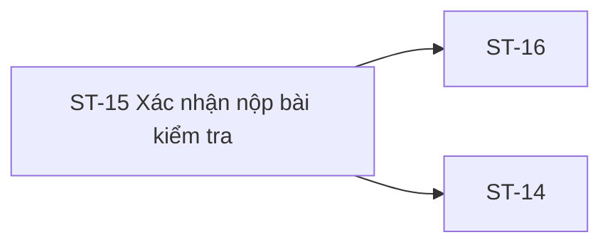

# ST-15 — Navigation

## 1. Route definition
- Current route in inventory: `/student/attempts/:attemptId/submit`
- Status: candidate/design route; Study Web `UNWIRED` unless source code proves otherwise.
- Route params/types: `attemptId` (type/validation: see source DD; CẦN_XÁC_NHẬN if absent)
- Query params/defaults: preserve the inventory route string; detailed parsing rules only from source DD.
- Route guards: see source DD/API contract; do not create role policy.

## 2. Điểm vào
| From screen/route | Trigger | Params | Guard / fallback |
|---|---|---|---|
| [ST-14](../ST-14-LamBaiKiemTra/00-overview.md) | Theo DD nguồn/inventory | Theo source; không suy diễn | Xem source DD; route chưa xác nhận runtime |

## 3. Điểm ra
| Destination | Trigger | Params | Điều kiện |
|---|---|---|---|
| [ST-16](../ST-16-KetQuaBaiKiemTra/00-overview.md), [ST-14](../ST-14-LamBaiKiemTra/00-overview.md) | Source event/inventory navigation | Theo source DD | Expected links; runtime chưa verify |

## 4. Back / refresh / deep link
- Back behavior: xem source DD; không mặc định browser history.
- Preserve filters/scroll/form state: chỉ nếu source có nêu, nếu không `CẦN_XÁC_NHẬN`.
- Refresh/direct URL: route trong inventory không chứng minh runtime.
- Invalid/missing ID: theo source DD/backend contract; không tự tạo validation.
- Not authenticated/authorized: theo source role guard; xem [Business Rules](05-business-rules.md).

## 5. Diagram


## Source navigation and flow detail

### Trích từ DD nguồn: E. Ma trận trạng thái và điều hướng

### E.1. State matrix

| State | Ý nghĩa/entry | Cho phép | Không được làm |
|---|---|---|---|
| `opening` | Nhận route và kiểm tra context/handoff. | Chuẩn bị dữ liệu từ nguồn được duyệt. | Gọi #31 hoặc tin dữ liệu mẫu. |
| `confirm` | Tóm tắt và hai hành động xác nhận/quay lại. | Continue hoặc bắt đầu submit. | Khóa attempt trước server accept. |
| `flushing_answers` | Đang đợi pending #30 writes. | Chờ barrier, hiển thị progress nếu có nguồn. | Gửi #31 trước khi barrier thành công; cho double submit. |
| `flush_error` | Một #30 write trả lỗi đã biết. | Giữ state và hiện lỗi sau khi copy/mapping được duyệt. | Fall through sang #31 hoặc xóa answer. |
| `flush_ambiguous` | Kết quả #30 chưa rõ do mạng. | Chờ reconciliation policy. | Tự replay #30 hay gọi #31 theo suy đoán. |
| `submitting` | Một POST #31 đang chờ. | Khóa submit control trong request hiện tại. | Gửi request lặp từ click thứ hai. |
| `submitted` | #31 trả accepted success. | Điều hướng ST-16. | Hiển thị điểm cuối khi `PENDING_GRADE`. |
| `submit_error` | #31 trả business error đã biết. | Hiện lỗi theo mapping được duyệt; giữ context. | Điều hướng ST-16 hoặc tự retry. |
| `conflict` | #31 trả 409. | Giữ context chờ recovery contract. | Coi là duplicate success hoặc tự gọi #32. |
| `ambiguous_network` | #31 có thể đã được xử lý nhưng response mất. | Chờ hướng dẫn/reconciliation được duyệt. | Auto-retry, báo submitted hoặc mở attempt chỉnh sửa không có xác nhận. |

### E.2. Điều hướng và dữ liệu truyền

| Từ | Đến | Dữ liệu | Trạng thái |
|---|---|---|---|
| ST-14 | ST-15 | `attemptId`; pending #30 state và summary cần thiết. | Route/link có trong inventory; shape/persistence của handoff chưa chốt. |
| ST-15 Continue | ST-14 | Cùng `attemptId`; dirty queue/selected question nếu contract hỗ trợ. | Destination là suy luận phù hợp graph; URL/history/restore chưa xác minh. |
| ST-15 accepted submit | ST-16 | `attemptId` và #31 response nếu schema/route contract cho phép. | Chỉ sau #31 accepted 200; ST-16 dùng #32 theo inventory. |
| ST-15 error/ambiguous | ST-15 hoặc recovery route | Giữ `attemptId` và pending state an toàn. | Recovery/409/timeout route chưa được owner chốt; không tự sang ST-16. |

### Trích từ DD nguồn: B. Luồng hoạt động tổng thể

```text
ST-14 (attemptId + state handoff chưa chốt)
  → mở ST-15 / kiểm tra Student context
  → confirm
  → flush các answer #30 còn pending
      ├─ flush lỗi/không rõ kết quả → dừng, không gọi #31
      └─ flush thành công
          → một POST #31 (path attemptId, không body/query)
              ├─ 200 accepted → ST-16; AC-16: PENDING_GRADE hoặc GRADED
              ├─ business error/conflict → giữ màn hình và báo trạng thái theo mapping được duyệt
              └─ mất phản hồi → ambiguous_network; không tự replay

“Tiếp tục kiểm tra” → ST-14 cùng attemptId (route/history và dirty-state restore chưa chốt)
```

1. Nhận route `attemptId` và Student context. Quy tắc parse/range cụ thể của route, auth guard và direct-entry behavior chưa có implementation.
2. Lấy summary từ handoff ST-14 đã được phê duyệt. Không gọi API đọc mới hoặc dựng summary từ screenshot/HTML; inventory không cung cấp endpoint đọc attempt/answers cho ST-15.
3. Hiển thị trạng thái xác nhận. Nguồn của unanswered count, saved count, timer, flags và attempt history hiện chưa hoàn chỉnh; chỉ render dữ liệu khi producer/contract chốt.
4. Khi Student chọn tiếp tục, quay về cùng attempt. Không gọi #31.
5. Khi Student xác nhận nộp, khóa thao tác submit lặp trong cùng request đang chạy. Chờ queue #30 pending theo flush contract; chưa có contract để quyết định drain/order/retry hoặc xử lý timeout.
6. Nếu flush không được xác nhận thành công, dừng tại trạng thái lỗi/không rõ của flush; tuyệt đối không fall through sang #31.
7. Sau barrier thành công, gửi duy nhất một #31 POST cho `attemptId`, Bearer Student, không body/query. Không tự retry nếu response bị mất.
8. Với 200 `DESIGN_RESOURCE_UPDATED`, dùng response schema chỉ sau khi được xác nhận; đánh dấu submitted và điều hướng ST-16. AC-16 có thể trả `PENDING_GRADE` hoặc `GRADED`.
9. Với business error hoặc kết quả mạng không rõ, không tuyên bố đã nộp, không bỏ answer local, không tự điều hướng và không replay. Cách reconciliation cho conflict/timeout cần API owner chốt.
