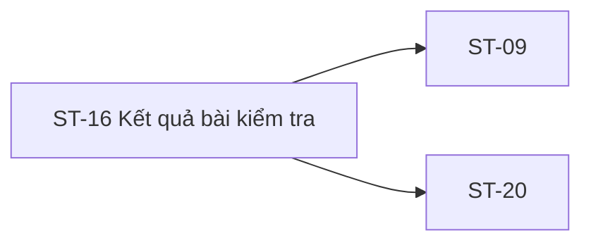

# ST-16 — Navigation

## 1. Route definition
- Current route in inventory: `/student/attempts/:attemptId/result`
- Status: candidate/design route; Study Web `UNWIRED` unless source code proves otherwise.
- Route params/types: `attemptId` (type/validation: see source DD; CẦN_XÁC_NHẬN if absent)
- Query params/defaults: preserve the inventory route string; detailed parsing rules only from source DD.
- Route guards: see source DD/API contract; do not create role policy.

## 2. Điểm vào
| From screen/route | Trigger | Params | Guard / fallback |
|---|---|---|---|
| [ST-15](../ST-15-XacNhanNopBaiKiemTra/00-overview.md) | Theo DD nguồn/inventory | Theo source; không suy diễn | Xem source DD; route chưa xác nhận runtime |

## 3. Điểm ra
| Destination | Trigger | Params | Điều kiện |
|---|---|---|---|
| [ST-09](../ST-09-TongQuanKhoaDangHoc/00-overview.md), [ST-20](../ST-20-TongQuanTienDo/00-overview.md) | Source event/inventory navigation | Theo source DD | Expected links; runtime chưa verify |

## 4. Back / refresh / deep link
- Back behavior: xem source DD; không mặc định browser history.
- Preserve filters/scroll/form state: chỉ nếu source có nêu, nếu không `CẦN_XÁC_NHẬN`.
- Refresh/direct URL: route trong inventory không chứng minh runtime.
- Invalid/missing ID: theo source DD/backend contract; không tự tạo validation.
- Not authenticated/authorized: theo source role guard; xem [Business Rules](05-business-rules.md).

## 5. Diagram


## Source navigation and flow detail

### Trích từ DD nguồn: E. Ma trận trạng thái và điều hướng

### E.1. State matrix

| State | Entry condition | Visible behavior | Exit |
|---|---|---|---|
| `loading` | Open route; #32 request in progress. | Loading treatment is not represented in the current PNG/HTML; design copy/layout TBD. | Supported 200 or error. |
| `pending` | #32 success has `PENDING_GRADE`. | Show waiting status only; score/correctness/feedback follow approved projection. Never show score 0. | Later read after grading only by approved refresh/navigation policy. |
| `graded` | #32 success has `GRADED`. | Render allowed fields only; passing state requires independent approved threshold/result field. | User navigates through approved destination. |
| `unsupported_status` | #32 returns another/missing status. | Safe unavailable state; do not guess. | API owner defines mapping. |
| `unavailable` | #32 404 or no result resource under approved meaning. | Honest not-available copy; don't reveal another Student's attempt. | Approved back/recovery action. |
| `access_denied` | #32 403. | Access-denied state; ownership masking unresolved. | Approved navigation/auth policy. |
| `error` | 401, 500, network error, malformed response. | Safe error state; no mock-data fallback. | Retry/reauth only after recovery policy is approved. |

### E.2. Navigation and data handoff

| From | To | Data | Status |
|---|---|---|---|
| ST-15 | ST-16 | `attemptId` after #31 accepted response. | F05 expected; route navigation is not present in Study Web runtime. |
| ST-16 route load | API #32 | `attempt_id` path + Student Bearer. | Contract only; no current route/module/test. |
| ST-16 | ST-09 / ST-20 | Potential related course/progress context. | Inventory says related screens, not that these are CTA destinations; exact action/IDs/handoff unresolved. |
| ST-16 → next lesson/PDF/course outline | Not defined. | Course/lesson IDs or file reference are not in route/#32 contract. | Do not infer from PNG. |

### Trích từ DD nguồn: B. Luồng hoạt động tổng thể

```text
ST-15 (#31 accepted) → route /student/attempts/:attemptId/result
  → Student context + path attemptId
  → GET #32 (Bearer; path only)
      ├─ 200 + status PENDING_GRADE → trạng thái đang chờ; không coi score là 0
      ├─ 200 + status GRADED → đọc field được policy cho phép; GRADED không tự nghĩa là pass
      ├─ 401 / 403 / 404 / 500 → lỗi theo catalog; ownership mapping còn mở
      └─ mất mạng/response không hợp lệ → error/unavailable; không tự khẳng định kết quả
```

1. Nhận `attemptId` từ route sau ST-15; kiểm tra type ở client chỉ theo định dạng route đã được duyệt. Không tự ánh xạ parse failure sang HTTP code ngoài catalog.
2. Yêu cầu Student auth context; current Study Web chưa có router/guard để xác minh. Server #32 phải là boundary cuối cho role và ownership.
3. Khi vào route, gọi một GET #32 theo contract. Không gọi #28 để dựng title/questions, #27 để tìm bài tiếp theo hoặc #37 để tính progress vì inventory ST-16 không khai báo các request này và chưa có orchestration được duyệt.
4. Với 200, kiểm tra envelope/business code và `data.status` theo schema được chốt. AC-16 chỉ định danh `PENDING_GRADE` và `GRADED`; status khác phải đi vào trạng thái chưa hỗ trợ, không tự diễn giải.
5. Chỉ bind fields được API trả và policy cho phép. `QuizAttempt` không chứa quiz title, passing threshold, GPA, skill aggregate, question text/options, feedback hay next-module data; không dựng chúng từ mockup.
6. Filter đáp án chỉ có thể là thao tác local sau khi answer projection, question content/order và correctness disclosure được duyệt. Hiện chưa đủ contract để lọc đúng/sai an toàn.
7. CTA PDF, course outline và next lesson chỉ là controls trong ảnh mẫu. Không tạo file, cập nhật tiến độ, đổi route hay gọi API khi destination/contract chưa được duyệt.
8. Xử lý 401/403/404/500 theo catalog. Timeout, invalid envelope, owner masking, retry và recovery UX chưa có policy; không tuyên bố kết quả thành công từ screenshot hoặc stale state.
