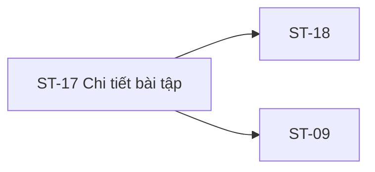

# ST-17 — Navigation

## 1. Route definition
- Current route in inventory: `/student/assignments/:assignmentId`
- Status: candidate/design route; Study Web `UNWIRED` unless source code proves otherwise.
- Route params/types: `assignmentId` (type/validation: see source DD; CẦN_XÁC_NHẬN if absent)
- Query params/defaults: preserve the inventory route string; detailed parsing rules only from source DD.
- Route guards: see source DD/API contract; do not create role policy.

## 2. Điểm vào
| From screen/route | Trigger | Params | Guard / fallback |
|---|---|---|---|
| [ST-11](../ST-11-TrinhHocBaiLessonPlayer/00-overview.md), [ST-18](../ST-18-SoanVaNopBaiTap/00-overview.md), [ST-19](../ST-19-BaiDaNopVaPhanHoi/00-overview.md), [ST-26](../ST-26-ThongBaoHocVien/00-overview.md) | Theo DD nguồn/inventory | Theo source; không suy diễn | Xem source DD; route chưa xác nhận runtime |

## 3. Điểm ra
| Destination | Trigger | Params | Điều kiện |
|---|---|---|---|
| [ST-18](../ST-18-SoanVaNopBaiTap/00-overview.md), [ST-09](../ST-09-TongQuanKhoaDangHoc/00-overview.md) | Source event/inventory navigation | Theo source DD | Expected links; runtime chưa verify |

## 4. Back / refresh / deep link
- Back behavior: xem source DD; không mặc định browser history.
- Preserve filters/scroll/form state: chỉ nếu source có nêu, nếu không `CẦN_XÁC_NHẬN`.
- Refresh/direct URL: route trong inventory không chứng minh runtime.
- Invalid/missing ID: theo source DD/backend contract; không tự tạo validation.
- Not authenticated/authorized: theo source role guard; xem [Business Rules](05-business-rules.md).

## 5. Diagram


## Source navigation and flow detail

### Trích từ DD nguồn: E. State matrix và điều hướng

### E.1. State matrix

| State | Entry condition | Visible behavior | Exit |
|---|---|---|---|
| `loading` | Proposed route load; #33 request pending. | Loading UI is not represented by current PNG/HTML; design treatment TBD. | Approved 200 or error. |
| `open` | #33 result plus approved access/deadline policy permits submission. | Show supported assignment fields; CTA may continue to ST-18. Current schema has no `status` field. | Approved ST-18 handoff. |
| `closed` | Approved server policy says submission window closed or unavailable. | Honest closed state; no local clock-only decision. Exact #33 response/error mapping unresolved. | Product-approved return/recovery action. |
| `not-found` | #33 returns 404 `DESIGN_RESOURCE_NOT_FOUND`. | Safe unavailable state; do not expose hidden assignment existence. | Approved return route. |
| `access-denied` | #33 returns 403 `DESIGN_ACCESS_DENIED`. | Safe access-denied state; owner 403/404 masking remains open. | Approved auth/course recovery. |
| `error` | 401, 500, network failure or malformed response. | Safe message; no internal detail or mock-data fallback. | Retry/reauth only after recovery policy is defined. |
| `not-submitted` sample | Shown only in screenshot. | Not derivable from `Assignment`; treat as design-only until an approved source exists. | No state transition defined in ST-17. |

### E.2. Navigation and data handoff

| From | To | Data | Status |
|---|---|---|---|
| Assignment list/course context | ST-17 | `assignmentId` path value. | Inventory does not identify a preceding screen; direct-entry policy/source required. |
| ST-17 route | API #33 | `assignment_id` path + Student Bearer; no query/body. | Catalog/DD only; current route/module/test absent. |
| ST-17 CTA | ST-18 | Same `assignmentId` in proposed route `/student/assignments/:assignmentId/submit`. | Related-screen flow expected; destination/eligibility runtime not wired. |
| ST-17 | ST-09 | Course context could be related; no direct CTA mapping or course title in #33. | Do not invent a destination. |
| ST-18/AC-17 later flow | #34 → #35 → #36 | File upload, assignment submission, then submission ID confirmation. | Downstream flow; not called by ST-17. |

### Trích từ DD nguồn: B. Luồng hoạt động tổng thể

```text
ST-17 route /student/assignments/:assignmentId
  → yêu cầu Student context
  → GET #33 (Bearer, path assignment_id; không query/body)
      ├─ 200 + Assignment → chỉ bind fields được schema/policy duyệt
      ├─ 401 / 403 / 404 / 500 → error/access/not-found state theo catalog
      └─ network / malformed envelope → safe error; không dùng sample PNG làm fallback
  → permission/deadline decision (server policy chưa chốt)
      ├─ allowed → CTA có thể handoff assignmentId sang proposed ST-18
      └─ denied/closed → mapping còn blocker; AC-17 409 khác catalog #33
```

1. Lấy `assignmentId` từ route. Client chỉ được parse theo quy tắc đã duyệt; catalog không nêu positivity, range hay status khi parse thất bại.
2. Yêu cầu Student auth context. Study Web hiện không có route/guard; backend #33 phải thực thi role/access boundary khi route được xây dựng.
3. Khi route load, thiết kế yêu cầu một `GET #33` với `assignment_id` path và Bearer. Không gửi query/body/user ID; không gọi #34/#35/#36 từ màn hình chi tiết.
4. Với success envelope, kiểm tra `businessCode=DESIGN_RESOURCE_RETRIEVED` và map các field trong `Assignment`. `description`/`due_at` là optional; null/omit, timestamp timezone và `max_score` formatting còn mở.
5. Chỉ render title/description/course ID/deadline/max score nếu có trong response và quy tắc mapping được duyệt. Không tự ghép course title hoặc tính progress, trọng số điểm, rubric, submission state hay history.
6. Deadline countdown trong PNG là giá trị mẫu. Nếu UI cần countdown, phải có timezone/clock source đã duyệt; không dùng countdown để cấp/thu quyền nộp.
7. Khi permission/deadline policy xác nhận cho phép, CTA có thể chuyển sang ST-18 và truyền `assignmentId`; route/runtime chưa tồn tại. ST-17 không upload hoặc tạo submission.
8. Với 401/403/404/500 hoặc network/invalid response, hiển thị state an toàn; không lộ lỗi nội bộ, không giả lập success, không thêm retry/error code chưa có contract.
