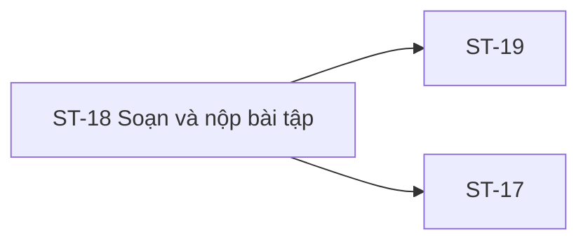

# ST-18 — Navigation

## 1. Route definition
- Current route in inventory: `/student/assignments/:assignmentId/submit`
- Status: candidate/design route; Study Web `UNWIRED` unless source code proves otherwise.
- Route params/types: `assignmentId` (type/validation: see source DD; CẦN_XÁC_NHẬN if absent)
- Query params/defaults: preserve the inventory route string; detailed parsing rules only from source DD.
- Route guards: see source DD/API contract; do not create role policy.

## 2. Điểm vào
| From screen/route | Trigger | Params | Guard / fallback |
|---|---|---|---|
| [ST-17](../ST-17-ChiTietBaiTap/00-overview.md) | Theo DD nguồn/inventory | Theo source; không suy diễn | Xem source DD; route chưa xác nhận runtime |

## 3. Điểm ra
| Destination | Trigger | Params | Điều kiện |
|---|---|---|---|
| [ST-19](../ST-19-BaiDaNopVaPhanHoi/00-overview.md), [ST-17](../ST-17-ChiTietBaiTap/00-overview.md) | Source event/inventory navigation | Theo source DD | Expected links; runtime chưa verify |

## 4. Back / refresh / deep link
- Back behavior: xem source DD; không mặc định browser history.
- Preserve filters/scroll/form state: chỉ nếu source có nêu, nếu không `CẦN_XÁC_NHẬN`.
- Refresh/direct URL: route trong inventory không chứng minh runtime.
- Invalid/missing ID: theo source DD/backend contract; không tự tạo validation.
- Not authenticated/authorized: theo source role guard; xem [Business Rules](05-business-rules.md).

## 5. Diagram

## Source navigation and flow detail

### Trích từ DD nguồn: E. Ma trận trạng thái và điều hướng

| State | Entry condition | Visible behavior / allowed transition | Evidence status |
|---|---|---|---|
| loading | ST-18 opens or approved #33 read begins | Keep submit unavailable until assignment/access decision completes. | Expected; no Study Web route or #33 source. |
| editing | Approved Assignment context permits form | Student edits visible fields and may select files. Sample checks/values are not trusted. | Design only. |
| uploading | One #34 request in flight | Track each file separately; do not set submission status to submitted. | #34 backend source exists; client progress is unwired. |
| upload-failed / partial-upload | #34 fails or some prior files succeeded | Represent the per-file result; do not equate it with submission failure/success. Whether the form or selected files are retained is open. Previously uploaded objects may remain orphaned. | #34 errors source-backed; UI/cleanup unresolved. |
| submitting | Approved #35 request in flight | Prevent immediate repeat action; do not imply idempotency or server lock. | #35 design-only. |
| submit-failed | #35 validation/access/deadline/network error | Exact error mapping and form/draft retention are open. Ambiguous timeout needs an approved recovery path. | Expected; current #35 route absent. |
| submitted | Confirmed API #35 success | Navigate to ST-19 using resolved response ID; #36 read is associated with ST-19 per inventory. | Expected only; #35/#36 routes absent. |
| closed / denied | Approved server policy refuses late/ineligible Student | Show server response; never derive permission from local countdown. | AC-17 expected; status policy conflicts with #33 catalog. |
| not-found | #33/#35 returns 404 per approved route | Keep assignment ID/context out of unsafe error details. | Catalog expected; current routes absent. |
| session-expired / error | 401, 500, network or malformed envelope | Show safe retry/login guidance after auth/navigation policy is approved; draft persistence/retention remains to be defined. | UI/runtime handling not wired. |

### E.1. Screen handoff

- **ST-17 → ST-18:** proposed route carries assignmentId; inventory requests #33 on each screen while AC-17 shows one earlier read. Cache/re-read ownership and stale-deadline revalidation require a decision.
- **ST-18 → ST-19:** inventory expects submission_id; API #35 logical response/DD uses data.id. Resolve property and whether ST-19 alone calls #36. Current Student #35/#36 routes and screen routes are absent.
- **Back/cancel:** proposed route returns to ST-17 with assignmentId; unsaved draft and already-uploaded object lifecycle are open.
- **Header/footer:** destinations in companion HTML are placeholder anchors, not verified Study Web navigation.

### Trích từ DD nguồn: B. Luồng tổng thể

1. **Đi vào:** ST-17 hoặc direct link mang assignmentId; yêu cầu actor Student theo design. Direct refresh/deep-link/auth redirect chưa có frontend route policy.
2. **Khởi tạo:** chuyển sang loading. Theo inventory, GET #33 dùng Bearer và path ID; do AC-17 đã gọi #33 ở ST-17, re-read/cache behavior cần owner quyết định. Không gọi #34 hay #35 khi mới mở trang.
3. **Đọc context và quyền:** chỉ sau response #33 hợp lệ mới có thể xét Assignment fields. #33 chưa có route hiện hành; access, deadline, submission rule, path parsing và nullability chưa được chốt. Nếu server trả 401/403/404/500 theo catalog thì hiển thị trạng thái tương ứng; AC-17 409 cho deadline là discrepancy.
4. **Hiển thị form:** ảnh có URL repository, deployment, checklist, file dropzone, mentor/rubric, draft history, rich-text và academic-integrity fields. Chỉ text và file-ref field được API #35 catalog nêu; các field còn lại không có wire/persistence mapping. Không ánh xạ chúng vào text hay giả định draft API.
5. **Chọn và upload file:** khi cần, gửi một file mỗi request #34 với multipart file, purpose=SUBMISSION; gửi course_id chỉ khi assignment/course source có giá trị được duyệt. Chờ response từng upload; data.id là ID asset theo #34. Song song/tuần tự, progress percent, file cap, allowlist và retry không được quyết định bởi screen DD hiện tại.
6. **Xử lý upload:** thành công trả UploadAsset và đặt file ở trạng thái upload-succeeded. Nếu upload lỗi, ghi nhận file-level failure nhưng không chuyển sang submission success; chính sách giữ file local/nội dung form chưa được chốt. Nếu đã upload object rồi người dùng xóa/thoát, lifecycle cleanup chưa có contract.
7. **Submit:** sau khi các điều kiện client/server được duyệt, API #35 nhận path assignment và body/media format còn cần chốt; catalog yêu cầu text và file refs đều là string bắt buộc. Không tự encode asset IDs, đổi key thành file_refs, flatten file URL hoặc thêm link fields. Gửi một lần trong trạng thái in-flight; retry sau timeout mơ hồ/idempotency chưa được định nghĩa.
8. **Response thành công:** chỉ theo #35 success 201 mới được chuyển trạng thái sang submitted. Dùng response ID sau khi owner thống nhất data.id với inventory submission_id; handoff sang ST-19. GET #36 thuộc màn hình sau theo inventory; AC-17 vẽ bước GET #36 trước khi hiển thị “Đã nộp”, nên ranh giới này cũng cần owner xác nhận.
9. **Lỗi và dữ liệu chưa gửi:** hiển thị lỗi theo response đã được chốt; F06 yêu cầu phân biệt upload success với submission success nhưng chưa chốt việc giữ nội dung, draft hoặc asset sau lỗi. Không xóa hoặc phục hồi draft theo quy tắc tự suy luận; không khẳng định đã nộp khi chưa có #35 success.
10. **Rời màn hình:** Cancel/back dự kiến về ST-17 với assignmentId; việc cảnh báo thay đổi chưa lưu, xóa file đã upload, và destinations của header/footer links chưa có contract/runtime.
