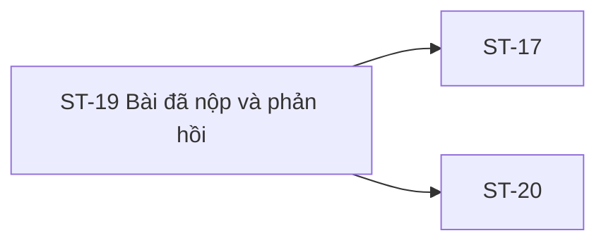

# ST-19 — Navigation

## 1. Route definition
- Current route in inventory: `/student/submissions/:submissionId`
- Status: candidate/design route; Study Web `UNWIRED` unless source code proves otherwise.
- Route params/types: `submissionId` (type/validation: see source DD; CẦN_XÁC_NHẬN if absent)
- Query params/defaults: preserve the inventory route string; detailed parsing rules only from source DD.
- Route guards: see source DD/API contract; do not create role policy.

## 2. Điểm vào
| From screen/route | Trigger | Params | Guard / fallback |
|---|---|---|---|
| [ST-18](../ST-18-SoanVaNopBaiTap/00-overview.md) | Theo DD nguồn/inventory | Theo source; không suy diễn | Xem source DD; route chưa xác nhận runtime |

## 3. Điểm ra
| Destination | Trigger | Params | Điều kiện |
|---|---|---|---|
| [ST-17](../ST-17-ChiTietBaiTap/00-overview.md), [ST-20](../ST-20-TongQuanTienDo/00-overview.md) | Source event/inventory navigation | Theo source DD | Expected links; runtime chưa verify |

## 4. Back / refresh / deep link
- Back behavior: xem source DD; không mặc định browser history.
- Preserve filters/scroll/form state: chỉ nếu source có nêu, nếu không `CẦN_XÁC_NHẬN`.
- Refresh/direct URL: route trong inventory không chứng minh runtime.
- Invalid/missing ID: theo source DD/backend contract; không tự tạo validation.
- Not authenticated/authorized: theo source role guard; xem [Business Rules](05-business-rules.md).

## 5. Diagram

## Source navigation and flow detail

### Trích từ DD nguồn: E. Ma trận trạng thái và điều hướng

### E.1. Trạng thái

| State | Điều kiện | Nội dung/hành động |
|---|---|---|
| Route unresolved | Route/user context không có trong current Study Web | Current runtime is `UNWIRED`; không khẳng định trang có thể mở. |
| Loading | Route and Student auth are available; GET #36 pending | Skeleton/loading treatment chưa có runtime/design contract. |
| Loaded — submitted | API returns a confirmed submitted status | Show only fields approved for that state; must not show `GRADED` by inference. |
| Loaded — pending review | Inventory lists `pending-review`; API enum/casing is not defined | Preserve server status; exact label/transitions need confirmation. |
| Loaded — graded | API returns confirmed graded status and disclosure policy permits fields | Score/feedback only if fields and release policy are approved; screenshot isn't proof. |
| Denied | API returns 403 `DESIGN_ACCESS_DENIED` | Show access-denied state; predicate and whether to mask as 404 are unresolved. |
| Not found | API returns 404 `DESIGN_RESOURCE_NOT_FOUND` | Show unavailable/not-found state; no row details. |
| Authentication required | API returns 401 `DESIGN_AUTHENTICATION_REQUIRED` | Session recovery/navigation policy is not specified by this screen DD. |
| System error | API returns 500 `DESIGN_INTERNAL_ERROR` | Safe error presentation; do not expose SQL/stack/provider detail. |
| Transport error | Client cannot obtain an API response | Client retry/timeout copy and cache behavior are not contracted; do not recast as a catalog business code. |
| Denied submission status | Inventory includes `denied`; API status enum and meaning are open | Do not equate with HTTP 403; field-level state and available action need owner confirmation. |

### E.2. Điều hướng và dữ liệu truyền

| From / action | Target | Data dependency | Current status |
|---|---|---|---|
| ST-18 successful submit | ST-19 | Submission ID. Inventory names `submission_id`; API #35 DD draft response uses `data.id`. | Handoff mismatch; unresolved. |
| Breadcrumb “Khóa học của tôi” | ST-20 or course progress context | Course ID/return context not present in #36 logical contract. | Design-only; route absent. |
| Breadcrumb assignment detail | ST-17 | Assignment ID; #36 has candidate `assignment_id` but access and return policy unresolved. | Design-only; route absent. |
| Return CTA | ST-20 | Course/progress target context. | Design-only; route absent. |
| Next assignment CTA | Next assignment detail | Requires next assignment/order/access source. | No source/API contract. |
| Header/footer links | Global Study routes | Destination, role guard and current session. | Prototype placeholders; no current Study Web router. |
| Comments/meeting actions | PR comments / booking flow | External identifiers, permissions and mutations. | No contract; blocked. |

### E.3. Bảo vệ phiên và quyền truy cập

- Bearer authentication and Student role are API #36 design requirements; route guard and token handling are not present in current Study Web source.
- A successful role check alone is insufficient: row ownership/course policy must be defined on the API.
- Do not expose score, feedback, file URLs or existence of a foreign submission based on client-side checks.
- 401, 403, 404, and 500 retain catalog codes; exact navigation/copy and 403-vs-404 policy remain open.

### Trích từ DD nguồn: B. Luồng hoạt động tổng thể

1. **Đi vào màn hình:** ST-18 dự kiến chuyển submission identifier; direct link/refresh cần `:submissionId`. Inventory và API #35 draft chưa thống nhất ID key. Chưa có route/auth guard để thực thi.
2. **Đọc path:** nhận route segment và chuẩn hóa theo type int64 của API catalog. Positive range, invalid parse response và route-level 404 chưa được chốt; client không tự đổi sang status API ngoài catalog.
3. **Tạo request:** với ID hợp lệ, gửi GET #36 kèm `Authorization: Bearer <token>`; không có query/body. Không gọi Mentor #55.
4. **Xử lý auth/access:** API contract xác định 401/403. Predicate ownership/enrollment chưa có; 404 masking của row không thuộc user còn mở. Client không tự quyết quyền truy cập dựa vào `user_id` response.
5. **Xử lý success:** chỉ khi HTTP 200 và `businessCode=DESIGN_RESOURCE_RETRIEVED` mới đọc `data: Submission`. Map `status` và `submitted_at` sau khi enum/timezone serialization được chốt. Không dùng trạng thái `GRADED` hard-code của PNG để nâng response `SUBMITTED`.
6. **Map nội dung:** candidate schema cho phép id/assignment/user/content/status/time/score/feedback; logical response yêu cầu `files[]`. Mọi field optional, danh sách asset và disclosure cần bám contract đã xác nhận; nếu thiếu hoặc sai shape, không dựng placeholder từ mockup.
7. **Render UI:** hiển thị receipt và phản hồi trong giới hạn response được phép. Mockup rubric, metrics, repository/demo/report links, mentor metadata, comments, meeting, skill index và next assignment không có mapping từ #36; giữ là design-only/blocker.
8. **Lỗi:** chuyển sang trạng thái lỗi phù hợp với envelope của 401/403/404/500; giữ traceId để chẩn đoán theo API Guidelines. Copy, login redirect, retry/timeout and network error presentation chưa có screen contract.
9. **Rời trang:** breadcrumb/CTA có đích dự kiến ST-17/ST-20 nhưng cần submission/course/assignment context và router. Không tự tạo ID bài tiếp theo hoặc điều hướng tới link mẫu trong HTML.
