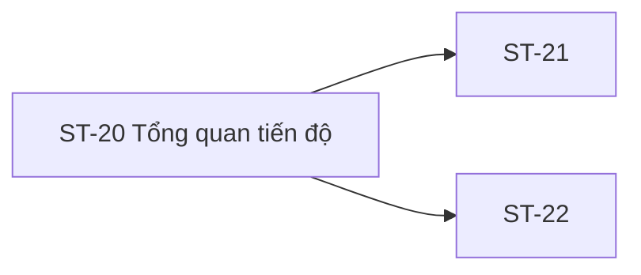

# ST-20 — Navigation

## 1. Route definition
- Current route in inventory: `/student/progress`
- Status: candidate/design route; Study Web `UNWIRED` unless source code proves otherwise.
- Route params/types: Không có route param được biểu diễn trong inventory string; route runtime vẫn chưa xác minh.
- Query params/defaults: preserve the inventory route string; detailed parsing rules only from source DD.
- Route guards: see source DD/API contract; do not create role policy.

## 2. Điểm vào
| From screen/route | Trigger | Params | Guard / fallback |
|---|---|---|---|
| [ST-01](../ST-01-TongQuanHocVien/00-overview.md), [ST-08](../ST-08-KhoaHocCuaToi/00-overview.md), [ST-16](../ST-16-KetQuaBaiKiemTra/00-overview.md), [ST-19](../ST-19-BaiDaNopVaPhanHoi/00-overview.md), [ST-21](../ST-21-TienDoTheoKhoaHoc/00-overview.md), [ST-22](../ST-22-ThanhTichVaChungNhan/00-overview.md) | Theo DD nguồn/inventory | Theo source; không suy diễn | Xem source DD; route chưa xác nhận runtime |

## 3. Điểm ra
| Destination | Trigger | Params | Điều kiện |
|---|---|---|---|
| [ST-21](../ST-21-TienDoTheoKhoaHoc/00-overview.md), [ST-22](../ST-22-ThanhTichVaChungNhan/00-overview.md) | Source event/inventory navigation | Theo source DD | Expected links; runtime chưa verify |

## 4. Back / refresh / deep link
- Back behavior: xem source DD; không mặc định browser history.
- Preserve filters/scroll/form state: chỉ nếu source có nêu, nếu không `CẦN_XÁC_NHẬN`.
- Refresh/direct URL: route trong inventory không chứng minh runtime.
- Invalid/missing ID: theo source DD/backend contract; không tự tạo validation.
- Not authenticated/authorized: theo source role guard; xem [Business Rules](05-business-rules.md).

## 5. Diagram

## Source navigation and flow detail

### Trích từ DD nguồn: E. Ma trận trạng thái và điều hướng

### E.1. Trạng thái

| State | Điều kiện | UI / hành động được phép |
|---|---|---|
| Route/runtime chưa wire | Current Study Web không có ST-20 route | Không khẳng định trang mở được; status current `UNWIRED`. |
| Loading | Expected request #21/#38 đang chờ | Inventory ghi `loading`; skeleton/layout và request ordering chưa được duyệt. |
| Progress success | #21 trả contract progress đã xác nhận | Hiện đúng field được cấp phép; hiện chưa có response schema để đạt. |
| Achievement success | #38 trả Page/Achievement được xác nhận | Chỉ hiển thị award do backend xác nhận; chưa có award rule/source. |
| Partial | Một widget có data và widget kia lỗi/đang chờ | Inventory yêu cầu widget độc lập; policy hiển thị/timing chưa chốt do mâu thuẫn AC-18. |
| Empty | API/widget trả empty theo contract được chốt | Không đồng nhất no-enrollment, no-progress, no-award hoặc sync pending; empty semantics hiện chưa có. |
| API 401 | API trả `DESIGN_AUTHENTICATION_REQUIRED` | Yêu cầu xử lý session theo auth flow chung; ST-20 redirect/copy chưa xác định. |
| API 403 | API trả `DESIGN_ACCESS_DENIED` | Không hiển thị dữ liệu bị từ chối; access policy/copy chưa xác định. |
| API 500 | API trả `DESIGN_INTERNAL_ERROR` | Giữ error state cho widget; không lộ nội bộ; retry chưa được định nghĩa. |
| Transport / parse error | Không nhận API response hoặc envelope không hợp lệ | Không tạo business code mới; xử lý hiển thị/retry chưa có screen contract. |
| HTML prototype empty | Static fallback được render từ `code.html` | Chỉ là hình tham khảo; không khẳng định API empty, loading hay sync pending. |

### E.2. Điều hướng và dữ liệu truyền

| From / action | Target | Data dependency | Current status |
|---|---|---|---|
| ST-01 dashboard widget/link | ST-20 | Student session; course context optional nhưng chưa được nêu là route param | Inventory relation; route absent. |
| ST-08 course list/progress | ST-20 | User/session context; exact navigation state chưa xác định | Inventory relation; route absent. |
| ST-19 result page | ST-20 | Không có data handoff contract riêng; route có thể được mở từ link thiết kế | Inventory relation; route absent. |
| Empty-state CTA | ST-08 `/student/courses` | Không truyền course ID | Prototype href + inventory route; runtime absent. |
| Chọn course progress | ST-21 `/student/progress/:courseId` | Course ID từ progress response đã xác nhận | Expected inventory link; loaded UI/source absent. |
| Xem tất cả achievements | ST-22 `/student/achievements` | Optional course filter chỉ khi được chốt | Expected inventory link; route/source absent. |
| Header/footer/breadcrumb | Global/Student pages | Route destinations/session guard | Static prototype; current router absent. |

### E.3. Quyền và phiên

- Bearer Student theo API design; xác thực thực tế và route guard chưa có Study Web source.
- `/me` không được phép nhận user identity tùy chọn từ client; server phải lấy principal từ token.
- 401/403 phải được giữ đúng business code catalog; không tự suy ra redirect/reauth pattern ở ST-20.
- Không trả/giữ progress hoặc achievement đã từ chối; không đưa token, user identity hoặc thông tin riêng vào route query.

### Trích từ DD nguồn: B. Luồng hoạt động tổng thể

1. **Đi vào màn hình:** điều kiện thiết kế là actor Student; route `/student/progress` được inventory đề xuất. Entry có thể từ ST-01/ST-08/ST-19 hoặc mở trực tiếp; hiện chưa có route hay guard chạy được. Không dùng HTML prototype để xác nhận phiên.
2. **Xác thực/ủy quyền:** client cần session Bearer hợp lệ theo API design. Server phải xác định principal của `/me`; policy role/ownership và cách phục hồi phiên 401 chưa được triển khai/xác nhận ở màn hình này.
3. **Khởi tạo request:** inventory yêu cầu GET #21 và #38 độc lập. #21 có query selector chưa rõ; #38 có thể nhận `course_id` optional nhưng overview không có nguồn lựa chọn mặc định được xác định. Body không khai báo cho cả hai. AC-18 lại vẽ #37 chen giữa #21 và #38 trước render; thời điểm/concurrency bị để mở.
4. **Kiểm tra response:** chỉ HTTP 200 cùng `DESIGN_RESOURCE_RETRIEVED` mới là success theo catalog. #21 trả `ApiEnvelope<UserProfile>` không chứa schema progress; #38 trả `ApiEnvelope<Page<Achievement>>` nhưng cấu trúc Page chưa đủ cho paging UI. Không biến code/field giả định thành response contract.
5. **Map dữ liệu:** các field cần để hiển thị tổng lesson, progress/course và award chưa được xác định đầy đủ. Không tính toán từ `lesson_progress` nếu aggregate, scope, mẫu số, trạng thái và quy tắc làm tròn chưa được duyệt. Achievement chỉ render nếu server trả item đã xác nhận theo award policy.
6. **Cập nhật widget:** khi schema và orchestration được chốt, mỗi widget cần giữ trạng thái request riêng theo inventory để biểu diễn success/empty/error/partial. Không có runtime source để xác định loading skeleton, request race, cancellation hay thứ tự render. Empty card trên HTML là một ảnh tĩnh, không phải UI contract cho API 204/empty.
7. **Tương tác và điều hướng:** chọn course dự kiến mở ST-21 với course ID hợp lệ; xem tất cả thành tích dự kiến mở ST-22. Empty-state button trong HTML trỏ `/student/courses` (ST-08). Các route/deep link hiện chỉ là thiết kế.
8. **Lỗi và rời trang:** giữ riêng lỗi #21 và #38 để hỗ trợ partial state; mã catalog 401/403/500 không bị đổi. Transport/timeout/query parse policy chưa có contract. Không điều hướng một widget lỗi như thể user không có dữ liệu. Header/footer links là prototype links, không khẳng định route hiện hành.
