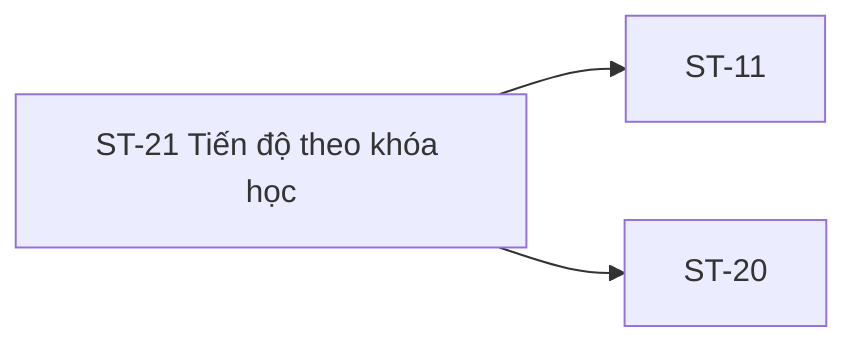

# ST-21 — Navigation

## 1. Route definition
- Current route in inventory: `/student/progress/:courseId`
- Status: candidate/design route; Study Web `UNWIRED` unless source code proves otherwise.
- Route params/types: `courseId` (type/validation: see source DD; CẦN_XÁC_NHẬN if absent)
- Query params/defaults: preserve the inventory route string; detailed parsing rules only from source DD.
- Route guards: see source DD/API contract; do not create role policy.

## 2. Điểm vào
| From screen/route | Trigger | Params | Guard / fallback |
|---|---|---|---|
| [ST-09](../ST-09-TongQuanKhoaDangHoc/00-overview.md), [ST-20](../ST-20-TongQuanTienDo/00-overview.md) | Theo DD nguồn/inventory | Theo source; không suy diễn | Xem source DD; route chưa xác nhận runtime |

## 3. Điểm ra
| Destination | Trigger | Params | Điều kiện |
|---|---|---|---|
| [ST-11](../ST-11-TrinhHocBaiLessonPlayer/00-overview.md), [ST-20](../ST-20-TongQuanTienDo/00-overview.md) | Source event/inventory navigation | Theo source DD | Expected links; runtime chưa verify |

## 4. Back / refresh / deep link
- Back behavior: xem source DD; không mặc định browser history.
- Preserve filters/scroll/form state: chỉ nếu source có nêu, nếu không `CẦN_XÁC_NHẬN`.
- Refresh/direct URL: route trong inventory không chứng minh runtime.
- Invalid/missing ID: theo source DD/backend contract; không tự tạo validation.
- Not authenticated/authorized: theo source role guard; xem [Business Rules](05-business-rules.md).

## 5. Diagram

## Source navigation and flow detail

### Trích từ DD nguồn: E. Ma trận trạng thái và điều hướng

### E.1. Trạng thái

| State | Điều kiện | UI / hành động |
|---|---|---|
| Route/runtime chưa wire | Current Study Web không có ST-21 router | Không khẳng định trang có thể truy cập; status `UNWIRED`. |
| Loading | Expected GET #37 đang chờ | Inventory state; skeleton/layout chưa được thiết kế hoặc xác minh. |
| In progress | API trả progress DTO và rule cho trạng thái chưa hoàn tất được duyệt | Hiện các unit/percent/timestamp đúng mapping; hiện chưa đủ schema. |
| Completed | Contract xác định course complete và API trả evidence tương ứng | Không suy từ màu/mockup; completion rule chưa chốt. |
| Empty | API contract phân biệt course hợp lệ nhưng không có activity | Shape/code/zero-vs-empty chưa chốt; empty HTML chỉ là prototype. |
| Authentication required | HTTP 401 `DESIGN_AUTHENTICATION_REQUIRED` | Giữ code; session recovery/redirect theo app-level policy chưa xác định. |
| Access denied | HTTP 403 `DESIGN_ACCESS_DENIED` | Không lộ progress; access predicate và masking còn mở. |
| Not found | HTTP 404 `DESIGN_RESOURCE_NOT_FOUND` | Không kết luận course absent hay progress absent vì semantics chưa chốt. |
| Internal error | HTTP 500 `DESIGN_INTERNAL_ERROR` | Safe error state; không lộ SQL/stack; retry chưa định nghĩa. |
| Path invalid | `courseId` không parse/range không hợp lệ | Q-07 open; không thêm HTTP/business code ngoài catalog. |
| Transport/parse error | Không có API response hoặc envelope invalid | Client handling chưa có screen contract; không map thành API business code. |

### E.2. Điều hướng và handoff

| From / action | Target | Data dependency | Current status |
|---|---|---|---|
| ST-20 chọn course | ST-21 `/student/progress/:courseId` | `courseId` từ selected course; API path yêu cầu `course_id:int64!` | Expected inventory; API/# route absent. |
| ST-21 chọn lesson row | ST-10 access/start → ST-11 player | `lesson_id`, course context, Student session; API #22–#24 gate theo flow học | Expected inventory; ST-21 loaded row và handoff chưa có source. |
| Breadcrumb/CTA quay lại | ST-20 `/student/progress` | Không khai báo query/body; course ID có thể chỉ thuộc browser history, policy chưa chốt | HTML prototype href; router absent. |
| Header/footer links | Trang tổng quan, courses, terms/privacy/academic/support | Route/access policy | Static `#` / labels; current Study Web destination absent. |

### E.3. Bảo vệ quyền

- API catalog yêu cầu Student Bearer; server cần xác thực principal và course access trước khi trả progress.
- `course_id` từ URL chỉ là resource selector, không chứng minh enrollment, ownership hoặc entitlement.
- Không gửi user ID trong route/query/body cho `/me`; không dùng Mentor #65/#67 để lấp authorization/payload.
- Giữ nguyên catalog 401/403/404/500 và để open câu hỏi masking; không cho browser mở lesson content trực tiếp từ progress record.

### Trích từ DD nguồn: B. Luồng hoạt động tổng thể

1. **Đi vào ST-21:** expected navigation từ ST-20 course link với route `:courseId`. Inventory/API đặt cùng định danh là course ID nhưng chưa quy định cách đổi UI param casing sang `course_id`. Current Study Web không có route/handoff.
2. **Xác thực và lấy context:** expected actor là Student có Bearer session. Route guard, token storage, current-user mapping và recovery behavior chưa có trong Study Web source/API #37.
3. **Kiểm tra path:** nhận `courseId` rồi chuẩn hóa theo catalog `course_id:int64!`. Min/max và behavior khi rỗng, âm, không parse được hoặc ngoài domain chưa có contract; không thêm 400/422.
4. **Gọi API:** với ID hợp lệ theo parser đã được quyết định, expected request là GET #37 kèm Bearer, path `course_id`; không có query/body. Không gọi API Mentor #65/#67 và không gửi user ID.
5. **Đọc response:** chỉ HTTP 200 và `DESIGN_RESOURCE_RETRIEVED` là success theo catalog. Response đang là `ApiEnvelope<UserProfile>`; payload UserProfile không cho phép lấy lesson/course progress, vì vậy UI không được map profile fields thành tiến độ.
6. **Tổng hợp và hiển thị:** AC-18 yêu cầu lesson + quiz + assignment aggregate, nhưng tập dữ liệu, selection policy, công thức và output DTO chưa có. Chỉ khi contract được duyệt mới phân loại unit, tính tỷ lệ và hiển thị thời gian; không dùng empty fallback như API result evidence.
7. **Tương tác:** expected lesson navigation phải mang `lesson_id` qua access gate của ST-10/ST-11; HTML hiện không có lesson list hoặc link. Nút/breadcrumb quay lại ST-20 có href `/student/progress` trong HTML nhưng route runtime absent.
8. **Lỗi:** catalog #37 có 401/403/404/500. Path parse, response parse, timeout/network và retry không có endpoint-specific rule. Giữ lỗi riêng; không biến `404` thành “chưa có tiến độ” nếu chưa có business decision.
