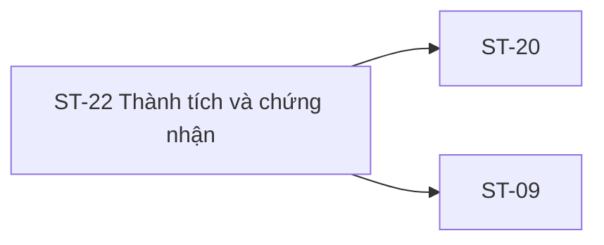

# ST-22 — Navigation

## 1. Route definition
- Current route in inventory: `/student/achievements`
- Status: candidate/design route; Study Web `UNWIRED` unless source code proves otherwise.
- Route params/types: Không có route param được biểu diễn trong inventory string; route runtime vẫn chưa xác minh.
- Query params/defaults: preserve the inventory route string; detailed parsing rules only from source DD.
- Route guards: see source DD/API contract; do not create role policy.

## 2. Điểm vào
| From screen/route | Trigger | Params | Guard / fallback |
|---|---|---|---|
| [ST-20](../ST-20-TongQuanTienDo/00-overview.md) | Theo DD nguồn/inventory | Theo source; không suy diễn | Xem source DD; route chưa xác nhận runtime |

## 3. Điểm ra
| Destination | Trigger | Params | Điều kiện |
|---|---|---|---|
| [ST-20](../ST-20-TongQuanTienDo/00-overview.md), [ST-09](../ST-09-TongQuanKhoaDangHoc/00-overview.md) | Source event/inventory navigation | Theo source DD | Expected links; runtime chưa verify |

## 4. Back / refresh / deep link
- Back behavior: xem source DD; không mặc định browser history.
- Preserve filters/scroll/form state: chỉ nếu source có nêu, nếu không `CẦN_XÁC_NHẬN`.
- Refresh/direct URL: route trong inventory không chứng minh runtime.
- Invalid/missing ID: theo source DD/backend contract; không tự tạo validation.
- Not authenticated/authorized: theo source role guard; xem [Business Rules](05-business-rules.md).

## 5. Diagram

## Source navigation and flow detail

### Trích từ DD nguồn: E. Ma trận trạng thái và điều hướng

### E.1. State matrix

| State | Entry condition | UI/data rule | Exit |
|---|---|---|---|
| `loading` | Entry/refresh sau khi request #38 bắt đầu. | Không hiển thị screenshot sample như dữ liệu đã-earned; giữ state đang tải. | Success → `earned` hoặc `empty` sau khi empty contract được xác nhận; API/transport failure → `error`. |
| `earned` | HTTP 200 success và có item `Achievement` được backend trả về. | Chỉ render record theo field/mapping được contract duyệt; không tự suy certificate/proof/metrics. | Refresh/route change → `loading`; API failure → `error`. |
| `empty` | HTTP 200 và response page rỗng theo empty-page rule được xác nhận. | Empty HTML chỉ là prototype copy, chưa phải API evidence; không coi lỗi/403/404 thành empty. | Refresh/filter change → `loading`; error → `error`. |
| `error` | 401/403/500, transport/network/timeout hoặc response parse failure. | Phân biệt auth/access/server/transport; không render earned sample; recovery copy/action chưa được định nghĩa. | Retry/re-auth/navigation chỉ theo shared policy sau khi duyệt. |

`course_id` filter state (global vs per-course, including unscoped awards) chưa có semantics; không đưa vào state machine như behavior đã chốt. Inventory chỉ liệt kê bốn state trên.

### E.2. Navigation and data handoff

| From / action | Expected target | Data/guard | Current evidence |
|---|---|---|---|
| ST-20 overview achievements link | ST-22 `/student/achievements` | Student session; course context chỉ nếu caller/`course_id` semantics được xác nhận. | Inventory link; no Study Web route/caller source. |
| ST-09 course overview | ST-22 achievements | Course-specific filter có thể là ý định, nhưng không tự truyền `course_id` cho đến khi approved. | Inventory link; no runtime handoff source. |
| ST-22 back/breadcrumb | ST-20 progress or prior route | Preserve return context only if route design approves. | Static HTML empty prototype có back-to-progress anchor; href runtime not verified. |
| Certificate/CTA/footer actions | Detail, course, verifier, download/share/legal/support | Require canonical route/API/destination and access policy. | Mockup affordances only; no destination source. |

Deep-link auth fallback, back-stack behavior, route param shape, query persistence and focus restoration are not specified. No IDs other than optional `course_id` may be invented as request data.

### Trích từ DD nguồn: B. Luồng hoạt động tổng thể

1. **Đi vào màn hình:** Expected links trong inventory là ST-20 và ST-09. `/student/achievements` là route inventory; chưa có frontend router/caller/handoff source để xác nhận route thực tế hoặc tham số được truyền.
2. **Xác thực:** actor là Student; API catalog yêu cầu Bearer JWT. UI/session guard và expired-session recovery chưa có trong Study Web. Backend phải ràng buộc dữ liệu `/me` với principal sau khi route được triển khai.
3. **Khởi tạo:** vào `loading` khi gọi API #38. Chỉ gắn `course_id` nếu một caller/filter policy được duyệt cung cấp giá trị int64 hợp lệ. Không gửi user ID, paging hoặc sort tự thêm. Nếu chưa có semantics filter, không suy diễn chip UI thành query.
4. **Gọi API:** `GET /api/v1/users/me/achievements`, Authorization Bearer, query tùy chọn `course_id`; body rỗng. Không gọi mutation/award API. API #38 chưa có route/module/query/test hiện hành.
5. **Đọc response:** chỉ success envelope và `Page<Achievement>` theo catalog. Kiểm tra kiểu/nullable theo contract khi có response runtime; không map metadata/page total thành metric summary.
6. **Render:** chỉ các achievement records đã được API trả về mới có thể render trong earned list, sau khi award/projection rule được chốt. Mapping `id/code/title/awarded_at/course_id` không đủ để render certificate/PDF/GPA/hash/QR, competency taxonomy, reputation/rank hoặc next-cert readiness.
7. **Empty/error:** inventory yêu cầu empty và error riêng. Empty chỉ được xác định từ success response rỗng khi API chốt page shape; không suy từ 401/403/500, lỗi mạng, HTML prototype hoặc 404 ngoài contract. Error catalog hiện chỉ 401/403/500.
8. **Tương tác và rời trang:** screenshot thể hiện copy/view/download/share/QR/CTA/nav affordances, nhưng không có route/API/handler contract kèm theo. Event D liệt kê chúng là blocked design affordances. Expected navigation relation là ST-20/ST-09; target screen, route params, return behavior và back policy chưa được xác nhận.
9. **Current result:** HTML chỉ có static empty copy/back-to-progress anchor; không chứng minh data request, role gate, event behavior, success/empty/error transition, route serving hoặc API runtime.
