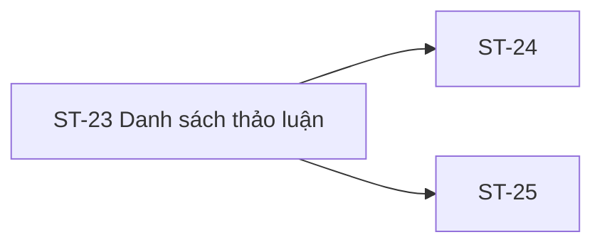

# ST-23 — Navigation

## 1. Route definition
- Current route in inventory: `/student/discussions`
- Status: candidate/design route; Study Web `UNWIRED` unless source code proves otherwise.
- Route params/types: Không có route param được biểu diễn trong inventory string; route runtime vẫn chưa xác minh.
- Query params/defaults: preserve the inventory route string; detailed parsing rules only from source DD.
- Route guards: see source DD/API contract; do not create role policy.

## 2. Điểm vào
| From screen/route | Trigger | Params | Guard / fallback |
|---|---|---|---|
| [ST-24](../ST-24-TaoCauHoiChuDe/00-overview.md), [ST-25](../ST-25-ChiTietThreadVaPhanHoi/00-overview.md) | Theo DD nguồn/inventory | Theo source; không suy diễn | Xem source DD; route chưa xác nhận runtime |

## 3. Điểm ra
| Destination | Trigger | Params | Điều kiện |
|---|---|---|---|
| [ST-24](../ST-24-TaoCauHoiChuDe/00-overview.md), [ST-25](../ST-25-ChiTietThreadVaPhanHoi/00-overview.md) | Source event/inventory navigation | Theo source DD | Expected links; runtime chưa verify |

## 4. Back / refresh / deep link
- Back behavior: xem source DD; không mặc định browser history.
- Preserve filters/scroll/form state: chỉ nếu source có nêu, nếu không `CẦN_XÁC_NHẬN`.
- Refresh/direct URL: route trong inventory không chứng minh runtime.
- Invalid/missing ID: theo source DD/backend contract; không tự tạo validation.
- Not authenticated/authorized: theo source role guard; xem [Business Rules](05-business-rules.md).

## 5. Diagram

## Source navigation and flow detail

### Trích từ DD nguồn: E. Ma trận trạng thái và điều hướng

### E.1. State matrix

| State | Điều kiện vào | Data/UI behavior | Chuyển tiếp |
|---|---|---|---|
| `loading` | Request #39 begins after route/session gate. | Do not show static no-topic copy as a live response; no skeleton is present in source. | 200 with renderable nonempty page → `ready`; approved success-empty → `empty`; auth/access/server/transport/parse failure → `error`. |
| `empty` | HTTP 200 success and `items=[]` under confirmed page/scope policy. | Current HTML copy is illustrative only; do not infer “syncing” from it. | Filter/sort/page/refresh → `loading` after control/API behavior approved. |
| `ready` | HTTP 200 success with items and an approved mapping for required fields. | Render only authorized discussion items; list card and comments inclusion remain unresolved. | Filter/sort/page → `loading`; select topic → ST-25 after route decision; create → ST-24 only after CTA approval. |
| `error` | 401/403/500, transport/timeout or invalid response. | Keep failure separate from no topics; exact copy/recovery CTA unspecified. | Re-auth/retry/navigation follow future shared policy. |

Current runtime has no verified state transitions; this matrix describes inventory intent conditioned on API decisions.

### E.2. Navigation/handoff

| Origin/action | Expected target | Data / authorization | Current evidence |
|---|---|---|---|
| ST-23 back-to-courses link | ST-08 `/student/courses` | Student role/session; preserve course context only if approved. | HTML prototype href exists; no Study Web runtime route verified. |
| Topic row click | ST-25 `/student/discussions/:discussionId` | `discussion_id` from server response; access rule unresolved. | Inventory/F07 expected; source HTML has no rows or links. |
| Create-topic action | ST-24 `/student/discussions/new` | Course ID/eligibility handoff unresolved; #40 body has content type discrepancy. | Inventory/F07 expected; source HTML has no create control. |
| Header/footer links | Other destinations | Canonical route and role guard needed. | Prototype mostly uses `#`; no runtime. |
| Public course review | GS-05 / API #10 | Separate guest/review context. | Do not merge into ST-23 without product/API approval. |

Direct-route behavior, current/expired session recovery, back-stack, URL query persistence and focus restoration require shared Study Web decisions; no user IDs or unapproved body data are passed between screens.

### Trích từ DD nguồn: B. Luồng hoạt động tổng thể

1. **Mở route:** inventory đề xuất `/student/discussions`, liên kết từ Student shell/các luồng community. Current Study Web không có router/caller. Không suy caller hoặc route state từ `data-path` trong prototype.
2. **Xác thực và quyền:** expected actor là Student đã đăng nhập; AC-19 yêu cầu quyền tham gia discussion của course. Bearer token phải đi theo shared auth contract sau khi UI/API được triển khai. Predicate enrollment/course scope chưa duyệt; không gửi user ID.
3. **Khởi tạo query:** API catalog cho `course_id`, `page`, `sort`. Inventory nói lọc/sort; source HTML không có controls/URL state. Không đặt default page, sort, course scope hoặc size từ mockup. API DD proposals page=1/size20/sort values/enrollment gate vẫn là DERIVED.
4. **Gọi list API:** expected GET #39 `/api/v1/discussions`, Authorization Student Bearer, chỉ query fields được catalog khai báo; no body. Current API runtime #39 `NOT_FOUND`, nên request không được thực thi.
5. **Đọc response:** expected `ApiEnvelope<Page<Discussion>>`. `Discussion.title` thiếu physical source; comments inclusion, visibility/status and pagination values unresolved. Không giả lập title từ `content`, không lấy `total` làm số card khi query mapping chưa quyết định.
6. **Ánh xạ UI:** chỉ map record và metadata sau khi API #39 source/contract được chốt. Asset hiện tại chỉ biểu diễn empty fallback; không có design card/list/filter/pagination/author/timestamp fields.
7. **Tương tác:** expected create CTA tới ST-24 hoặc chọn topic tới ST-25. Các affordances không có trong HTML; không có #40/#42 call tại ST-23 prototype. AC-19/F07 là expected flow, chưa có client wiring.
8. **Empty/error:** `empty` chỉ nên phản ánh HTTP 200 success với `items=[]` theo empty-page rule được duyệt. 401/403/500, transport và parse failures là error khác nhau. HTML static text không chứng minh API empty hoặc sync trạng thái.
9. **Rời trang:** prototype back link dùng `/student/courses` (inventory ST-08); destinations header/footer khác dùng `#`. ST-24/ST-25 routes theo inventory nhưng runtime chưa xác nhận. Không truyền payload ngoài route IDs khi contract chưa có.
