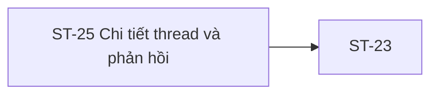

# ST-25 — Navigation

## 1. Route definition
- Current route in inventory: `/student/discussions/:discussionId`
- Status: candidate/design route; Study Web `UNWIRED` unless source code proves otherwise.
- Route params/types: `discussionId` (type/validation: see source DD; CẦN_XÁC_NHẬN if absent)
- Query params/defaults: preserve the inventory route string; detailed parsing rules only from source DD.
- Route guards: see source DD/API contract; do not create role policy.

## 2. Điểm vào
| From screen/route | Trigger | Params | Guard / fallback |
|---|---|---|---|
| [ST-23](../ST-23-DanhSachThaoLuan/00-overview.md), [ST-24](../ST-24-TaoCauHoiChuDe/00-overview.md), [ST-26](../ST-26-ThongBaoHocVien/00-overview.md) | Theo DD nguồn/inventory | Theo source; không suy diễn | Xem source DD; route chưa xác nhận runtime |

## 3. Điểm ra
| Destination | Trigger | Params | Điều kiện |
|---|---|---|---|
| [ST-23](../ST-23-DanhSachThaoLuan/00-overview.md) | Source event/inventory navigation | Theo source DD | Expected links; runtime chưa verify |

## 4. Back / refresh / deep link
- Back behavior: xem source DD; không mặc định browser history.
- Preserve filters/scroll/form state: chỉ nếu source có nêu, nếu không `CẦN_XÁC_NHẬN`.
- Refresh/direct URL: route trong inventory không chứng minh runtime.
- Invalid/missing ID: theo source DD/backend contract; không tự tạo validation.
- Not authenticated/authorized: theo source role guard; xem [Business Rules](05-business-rules.md).

## 5. Diagram

## Source navigation and flow detail

### Trích từ DD nguồn: E. Ma trận trạng thái và điều hướng

| State | Entry condition | UI/data behavior | Exit/next state | Evidence/status |
|---|---|---|---|---|
| `loading` | Enter expected route; call GET #42. | Screenshot has loaded content only; no current loading implementation. | `ready` or load error | Inventory; Study Web UNWIRED. |
| `ready` | Valid #42 response mapped. | Render one thread and comments per approved response. Screenshot sample includes additional fields without source. | Reply draft, back, or unsupported control | API #42 Page<Discussion>; item/page projection is Draft/DERIVED. |
| `replying` | User edits composer. | Local string only; no autosave. API #41 requires integer. | `submitting` only after contract fix; otherwise stay blocked | Inventory state; body mismatch blocks implementation. |
| `submitting` | One valid #41 request in flight. | Prevent concurrent duplicate click as a UI safeguard proposal; no server idempotency. | `reply-created` or submit error | API #41 is not wired; state only expected. |
| `reply-created / reloading` | #41 returns 201. | Run GET #42 in sequence; do not take #41 Page as final view or increment counts locally. | `ready` after #42 success | AC-19 diagram. |
| `moderated` | Discussion/comment status prohibits participation/visibility. | No approved status enum or policy; no screenshot badge mapping. | Unknown | Inventory state; rule `SOURCE_REQUIRED`. |
| `closed` | Discussion is closed to replies. | No API field/transition or enforcement response specified. | Unknown | Inventory state; rule `SOURCE_REQUIRED`. |
| `not-found` | #42 returns 404. | Distinct from empty thread; copy/navigation not defined. | Back/other action TBD | API catalog code only. |
| `unauthenticated` | #41/#42 returns 401. | Login prompt/return path not defined. | Auth flow TBD | API catalog code only. |
| `forbidden` | #41/#42 returns 403. | Course membership/hidden-resource behavior not defined. | Back/retry TBD | API catalog code only; predicate open. |
| `validation-error` | #41 returns 422. | Catalog code exists but permitted validation rules/error-field mapping are not detailed. | Edit/retry TBD | API #41 catalog; content rule open. |
| `transport/internal-error` | 500/network/timeout. | Do not infer retry or POST idempotency; post-commit ambiguity needs decision. | Reconcile/manual reload TBD | API codes plus absent client runtime. |
| `current-unavailable-fallback` | Static HTML loaded as source artifact. | Shows unavailable message and link to discussions; not a runtime route or #42 response. | Link target only in static HTML | Current artifact behavior. |

### E.1. Navigation/handoff matrix

| From | Action/condition | To | Data contract | Status |
|---|---|---|---|---|
| ST-23 | Open selected discussion | ST-25 `/student/discussions/:discussionId` | Discussion ID should resolve to `discussion_id:int64`; ST-23 #39 response/item navigation not runtime-verified. | Expected link; route absent. |
| ST-25 | Reply submit success | ST-25 reload | #41 POST then #42 GET with same discussion ID; request content conversion and #42 Page/title mapping open. | AC-19 sequence; APIs absent in Student runtime. |
| ST-25 | Back-to-list | ST-23 `/student/discussions` | Return/filter/page state unspecified. | HTML fallback has a static link; runtime absent. |
| ST-25 | Course/lesson/related/Mentor CTA | Unknown | Screenshot sample IDs and route payloads have no source. | `SOURCE_REQUIRED`; do not navigate by inference. |

### Trích từ DD nguồn: B. Luồng hoạt động tổng thể

### B.1. Khởi tạo và tải thread

1. Expected router nhận `/student/discussions/:discussionId`, xác định Student session và route ID. Current Study Web không có router/component; không có auth redirect/runtime behavior để mô tả.
2. `discussionId` dự kiến ánh xạ vào path `discussion_id:int64!`. Quy tắc positivity, malformed ID và framework error mapping chưa được catalog xác định cho #42; không tự thêm 422. API #42 DD đề xuất 404 cho malformed ID nhưng đây vẫn là `DERIVED`.
3. Khi API #42 được triển khai/contract chốt, request expected là `GET /api/v1/discussions/{discussion_id}` với `Authorization: Bearer <Student token>`; không có query hoặc body. Không có API call hiện tại từ UI.
4. Expected success là HTTP 200 `DESIGN_RESOURCE_RETRIEVED` với `ApiEnvelope<Page<Discussion>>`. DD #42 đề xuất `items` chứa đúng một root thread và `comments[]` trực tiếp; `pagination={page:1,size:1,total:1,total_pages:1}` là `DERIVED`, chưa approved.
5. Mapping có thể dùng `id/course_id/content/status/author/comments` theo reusable schema khi response đủ field. `title` bắt buộc nhưng chưa có physical source; không thay bằng `content`. Không áp các screenshot counters, sorting, accepted flag hoặc course/mentor data lên API response khi chưa có contract.
6. HTTP 401/403/404/500 theo catalog được giữ đúng code; thông điệp, login return path, retry và cách render denied/closed/moderated chưa có quyết định. Lỗi transport/session cũng chưa có client implementation.

### B.2. Reply và reload theo AC-19

1. Student nhập comment tại ST25-EL-35. PNG hiển thị toolbar và nút gửi; HTML không có form. Không có autosave theo F07.
2. Trigger gửi là ST25-EL-37. Inventory yêu cầu xử lý double-send; một in-flight guard/disable button là đề xuất UI cục bộ trong khi POST đang pending, không phải server idempotency. API #41 không khai báo idempotency key. Nếu kết quả POST mơ hồ do mất mạng, không tự retry mutation vì có thể tạo comment trùng.
3. API #41 expected: `POST /api/v1/discussions/{discussion_id}/comments`, Student Bearer, body `{content:int64!}`. Editor value là text; do mismatch `int64` vs `string/TEXT` chưa có conversion/validation, request hiện không thể được serialization-implementable. Không gửi text qua integer, numeric prefix, hash, encoding hay field mới.
4. Nếu sau này contract cho phép và server trả 201 `DESIGN_RESOURCE_CREATED`, response vẫn là `ApiEnvelope<Page<Discussion>>` theo catalog. API #41 DD chỉ đề xuất một updated-thread page; metadata/items chưa approved. AC-19 vẫn yêu cầu gọi API #42 sau POST, nên không dùng #41 response làm dữ liệu cuối cùng.
5. Theo diagram, chỉ sau POST success mới gọi lại `GET /api/v1/discussions/{discussion_id}`. Map response #42 thành thread mới nhất nếu hợp đồng/fields được chốt; không tự increment counter/likes/reply count.
6. API #41 catalog errors: 401 auth, 403 access, 404 resource, 422 validation, 500 internal. Nếu #41 thành công nhưng #42 reload lỗi, mutation có thể đã xảy ra; UI cần trạng thái “reply đã gửi/chưa tải lại” nhưng nội dung/copy/refresh policy chưa được duyệt. Không cho user gửi lại mù quáng.

### B.3. Rời màn hình và các control ngoài contract

- ST25-EL-08 và HTML fallback có link về `/student/discussions`; target phù hợp inventory ST-23 nhưng route runtime chưa có. Quay lại/return context, giữ filter/page và browser history behavior chưa được xác định.
- Save, like/vote, reply-to-reply, sort, course/material, related discussion, mentor booking và code/source controls chỉ có trong screenshot. Không có API/route/source mapping được xác nhận; các control này không được xem là hành vi triển khai được.
- Screenshot/footer/header chứa nhiều link tĩnh hoặc literal. Các đích `#` trong HTML fallback không phải route evidence cho populated PNG.
