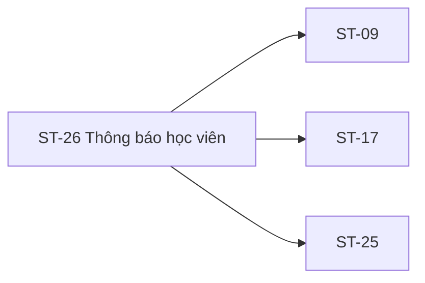

# ST-26 — Navigation

## 1. Route definition
- Current route in inventory: `/student/notifications`
- Status: candidate/design route; Study Web `UNWIRED` unless source code proves otherwise.
- Route params/types: Không có route param được biểu diễn trong inventory string; route runtime vẫn chưa xác minh.
- Query params/defaults: preserve the inventory route string; detailed parsing rules only from source DD.
- Route guards: see source DD/API contract; do not create role policy.

## 2. Điểm vào
| From screen/route | Trigger | Params | Guard / fallback |
|---|---|---|---|
| [ST-01](../ST-01-TongQuanHocVien/00-overview.md) | Theo DD nguồn/inventory | Theo source; không suy diễn | Xem source DD; route chưa xác nhận runtime |

## 3. Điểm ra
| Destination | Trigger | Params | Điều kiện |
|---|---|---|---|
| [ST-09](../ST-09-TongQuanKhoaDangHoc/00-overview.md), [ST-17](../ST-17-ChiTietBaiTap/00-overview.md), [ST-25](../ST-25-ChiTietThreadVaPhanHoi/00-overview.md) | Source event/inventory navigation | Theo source DD | Expected links; runtime chưa verify |

## 4. Back / refresh / deep link
- Back behavior: xem source DD; không mặc định browser history.
- Preserve filters/scroll/form state: chỉ nếu source có nêu, nếu không `CẦN_XÁC_NHẬN`.
- Refresh/direct URL: route trong inventory không chứng minh runtime.
- Invalid/missing ID: theo source DD/backend contract; không tự tạo validation.
- Not authenticated/authorized: theo source role guard; xem [Business Rules](05-business-rules.md).

## 5. Diagram

## Source navigation and flow detail

### Trích từ DD nguồn: E. Ma trận trạng thái và điều hướng

| State | Entry condition | Expected transition/output | Source status |
|---|---|---|---|
| `loading` | Open route or request #43 | Wait for #43 result; do not render sample as API data. | Expected; no UI runtime. |
| `ready` | Valid #43 Page and approved Notification mapping | Show result list and approved read/filter state. | Blocked by schema/Page gaps. |
| `empty` | Valid #43 result with no items | Empty-state copy/action should be approved; HTML prototype has sample empty copy only. | Expected state; copy/handoff unapproved. |
| `unread` | User chooses unread filter and approved #43 query returns rows | Show unread rows/badge from approved read-state/count contract. | Query exists; response state/count unresolved. |
| `read` | API confirms state after #44/#45 and #43 refresh | Show read representation from approved response field. | No approved mapping; screenshot conflicts. |
| `marking` | #44/#45 pending after user action | Prevent duplicate in-flight action if policy approved; retain enough UI context. | Inventory state; no implementation/idempotency policy. |
| `error` | Catalog error, transport failure or invalid response | Preserve 401/403/404/422/500 per specific API; display/retry policy awaits UI contract. | API errors declared; runtime absent. |
| `deep-link-blocked` | No trusted typed target, unknown route or unsafe URL | Do not navigate; keep user in current context until a safe mapping exists. | Blocked by missing payload/allowlist contract. |
| `category-filter-blocked` | User selects screenshot category tab | Do not send undeclared query or pretend a filter succeeded. | #43 supports no category field. |

Navigation links from inventory are ST-09/ST-17/ST-25. Screenshot links ST-19/ST-25/ST-11/ST-22/Meet remain illustrative. Route IDs, ownership/access checks, return context and mark-before-navigation ordering are not defined by #43–#45. Current Study Web has no route guard or browser history implementation to verify.

### Trích từ DD nguồn: B. Luồng hoạt động tổng thể

### B.1. Mở trung tâm và tải danh sách

1. Expected route is `/student/notifications`; actor must be an authenticated Student per AC-20/catalog. Current Study Web has no router/component/guard, so no runtime redirect or previous-route behavior is known.
2. Expected list load is `GET /api/v1/users/me/notifications` with Student Bearer token; only catalog inputs are optional `unread_only:boolean` and `page:int32`. Catalog gives no `size`, sort, category, date, or notification-type query. API #43 DD's omitted page=1, size=20 and newest-first sort are `DERIVED` and need approval.
3. On 200 `DESIGN_RESOURCE_RETRIEVED`, expected envelope is `ApiEnvelope<Page<Notification>>`. Map only approved fields. Required `channels/status` have no approved physical source; read state, sender, category, count and deep link are absent. A complete populated card cannot currently be projected without resolution.
4. Empty result is a possible Page state, but exact pagination/empty metadata is still in Draft API DD. HTTP 401/403/500 retain catalog codes. Client network/timeout/malformed envelope behavior and display copy are not defined by current Study Web.

### B.2. Bộ lọc và danh sách

1. “Tất cả thông báo” vs “Chưa đọc” are visible controls. API #43 exposes `unread_only`; mapping all→omitted/false and unread→true follows the intended names but is not fully approved in the catalog/API DD. Page reset on tab change, query URL sync and cache keys are not specified for this UI.
2. Category tabs “Bài tập & Chấm điểm”, “Lịch hẹn Mentor”, “Hoạt động diễn đàn” have no category/type parameter in API #43. Their sample labels cannot be converted into query values from DDL `type` because enum values are undefined. Selection semantics remain blocked until contract update.
3. API #43 accepts `page`, but screenshot has no page control. Do not invent pagination buttons, cursor or infinite scroll. API DD's page size/order are proposal only.
4. Card timestamps, category chips, action buttons, read dots/checkmarks, descriptions and identifiers in PNG are illustrative. They are not API data; the screenshot itself has read marker/label/count conflicts.

### B.3. Đánh dấu một notification và deep link

1. Inventory/AC expect a one-item read action when Student opens/marks a notification. API #44 takes only path `notification_id:int64!`, Student Bearer; no body/query/header is declared.
2. Catalog success is 200 `DESIGN_RESOURCE_UPDATED`. Errors: 401 authentication, 403 access, 404 resource, 422 validation, 500 internal. API #44 DD proposes direct-owner `UPDATE notifications.is_read=TRUE`, same 404 for missing/foreign/broadcast, then a singleton Page; all are `DERIVED`. AC diagram instead names `NotificationRecipient.read_at`; choose neither physical mapping here.
3. AC-20/inventory expect refreshed list/read state; after mutation success, GET #43 is the expected refresh sequence. The response fields/Page semantics cannot yet prove a stable read state, and #43's Notification schema does not expose `is_read`.
4. Navigation order (mark then refresh then open, open then mark, or another sequence) is not explicitly approved. Do not choose it. A deep-link destination is unavailable in catalog `Notification`; do not navigate from title/content or the screenshot's sample URL.
5. If #44 returns an error or refresh fails after mutation, the mutation may already have committed. Avoid blind repeat until idempotency/recovery policy is approved; exact client copy/retry behavior remains open.

### B.4. Đánh dấu tất cả

1. User activates ST26-EL-10. Expected target is `PATCH /api/v1/notifications/read-all`, Student Bearer, catalog `body{}`. The API DD suggests `{}` but catalog does not define whether body is required or how unknown/malformed fields are handled.
2. Success is 200 `DESIGN_RESOURCE_UPDATED`; errors are 401/403/422/500. Do not add 404/409/503 or `Idempotency-Key` to the catalog contract.
3. AC-20 calls for bulk unread update and UI sync. API #45 response is `Page<Notification>` but whether it contains changed items, a bounded page, or empty summary is open. Candidate `is_read` bulk update and per-recipient rule are not approved.
4. After a successful mutation the inventory expects GET #43 refresh. Badge/list update is based on that approved response only; do not decrement the visible “5 mới” sample locally. Pending/error/refresh-failure UI and duplicate-action policy need confirmation.

### B.5. Các control ngoài contract

- Channel preferences, API #48 status strip, weekly totals/chart, emergency coordinator and footer contact/legal/navigation are visible screenshot content only. #43–#45 do not expose these operations; API #48 belongs to Mentor lecture detail. Do not send requests or persist toggle state.
- Header search/profile and cross-product links have no current Study Web handler. Their destination/history semantics are not part of API #43–#45.
- Footer/category/contact values are design samples; they do not establish current URLs or support services.
