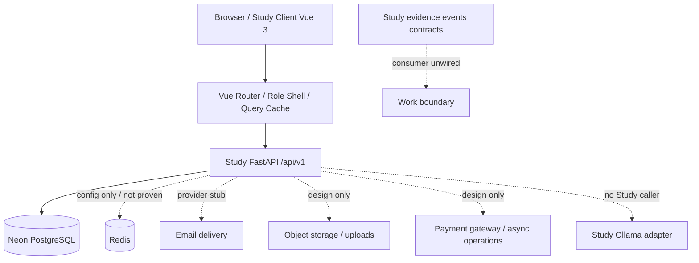
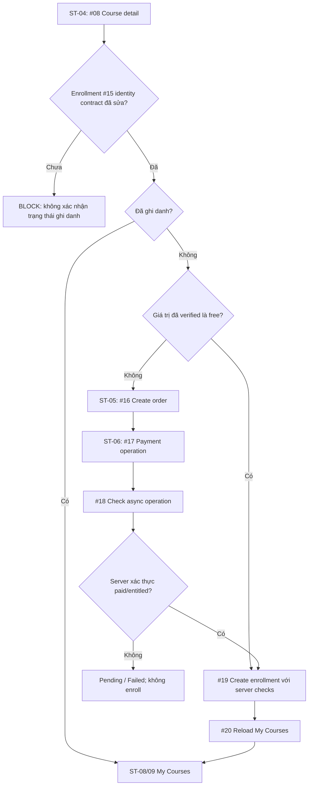

# Study2Work — LIST_SCREEN: Tổng thiết kế màn hình Study LMS V1

> **Loại tài liệu:** Master screen inventory / solution UI architecture / API traceability, là đầu vào để tạo **DD Screen** chi tiết; **không** phải tài liệu xác nhận UI đã implement.  
> **Phạm vi:** **Study** — `apps/study-client/` ↔ `apps/study-server/`, bốn actor Guest, Student, Mentor, Admin. Work/AI/DB Admin được mô tả tại ranh giới tích hợp, **không** nhập màn hình riêng của chúng vào Study.  
> **Nguồn GitHub:** `daovanhung-dev/Study2Work`, `main` HEAD `bb9e2be2e146285f004cdc00e8d632ca8ed1b4a3` (commit nguồn kiểm tra 2026-09-27 UTC), đánh giá tài liệu 2026-10-25 (Asia/Bangkok).  
> **Đường dẫn đề xuất trong repo:** `apps/study-client/docs/design/list_screen.md` (chưa tự ghi vào GitHub).  
> **Trạng thái:** `DESIGN_BASELINE / NEEDS_CONTRACT_REVIEW`, danh mục đủ để lập kế hoạch DD Screen, **chưa đạt gate triển khai toàn hệ thống**.

## 0. Kết quả kiểm kê và định nghĩa phạm vi

| Chỉ số | Giá trị đã đối chiếu | Ý nghĩa |
|---|---|---|
| Actor | 4 | Guest, Student, Mentor, Admin |
| Use Case / Activity | 30/30 | 6 Guest + 10 Student + 6 Mentor + 8 Admin |
| API V1 | 103 API ID; 103/103 được ít nhất một screen tham chiếu | Tính theo `docs/lists/list_api.md` và `AC_UNICA/00_AC_API_INDEX.md`; API #18 dùng chung |
| UI screen/task surface | 83 | Gồm page, tab, panel, dialog và transition; không đồng nghĩa 83 URL độc lập |
| Study DD API | 15 bộ (#01–#15), mỗi bộ gồm Overview/Request/Response/Mapping/Error... | Các API #16–#103 có **contract V1/diagram**, chưa có bộ DD API tương ứng trong thư mục Study DD |
| API backend | API #01–#07 và runtime `/auth/refresh` được wire | API #02 chỉ là email stub; runtime chưa xác thực live Neon tại thời điểm phân tích |
| Study frontend | Vue 3 + TypeScript + Vite; router hiện chỉ khai báo `/` | Các route ở tài liệu là *đề xuất thiết kế*; không phải source routes |
| Database | ERD drawio 16 bảng, DDL `DB.sql` 18 bảng | DDL bổ sung `refresh_tokens`, `categories`; không xác nhận schema live |
| Tích hợp khác | Payment, Object Storage, email, operation jobs chưa được chứng minh đã chạy | Không suy ra service chạy thực tế từ diagram/README |

### 0.1. Thứ bậc chứng cứ & ký hiệu

- **`R` — RUNTIME_SOURCE:** Route/logic có trong `apps/study-server/app/api/v1.py`, source + test; **không** đồng nghĩa đã kiểm chứng live database hay deploy.
- **`S` — STUB:** Có route/hợp đồng response nhưng external side effect không thực thi thật (`#02` email).
- **`D` — DESIGN_ONLY:** Mới có API catalog/AC/DD, chưa route runtime. Mọi UI phụ thuộc D là *target-state UI*, không được gọi API thật trong production khi chưa implement.
- **`M` — MIXED:** Screen tham chiếu cả R và D/S. **`UX`**: screen/state theo nhu cầu điều hướng, không có API nghiệp vụ riêng.
- **`BLOCK` — REQUIREMENT/SECURITY BLOCKER:** Mâu thuẫn khiến không thể khép kín data mapping hay flow an toàn; UI phải disabled/placeholder cho đến khi được giải quyết.
- **`P0`** foundation, **`P1`** luồng chức năng chính, **`P2`** mở rộng/analytics/integration. Priority là **đề xuất** để lập kế hoạch, không phải commitment phát triển.

**Quy tắc ưu tiên cho `CURRENT_BEHAVIOR`:** current source + test > context hiện hành > DD/contract/diagram. **Quy tắc cho `TARGET_BEHAVIOR`:** approved contract + AC/UC > DD assumptions > đề xuất UX; khi xung đột, lập `DISCREPANCY`, không tự đổi API để khớp mockup.

**Nguồn đọc và truy vết chính** (liên kết GitHub):

- [docs/lists/list_api.md](https://github.com/daovanhung-dev/Study2Work/blob/main/docs/lists/list_api.md)
- [apps/study-server/docs/diagrams/AC_UNICA/00_AC_API_INDEX.md](https://github.com/daovanhung-dev/Study2Work/blob/main/apps/study-server/docs/diagrams/AC_UNICA/00_AC_API_INDEX.md)
- [apps/study-server/docs/diagrams/AC_UNICA/AC_01_GUEST_ACCOUNT.drawio](https://github.com/daovanhung-dev/Study2Work/blob/main/apps/study-server/docs/diagrams/AC_UNICA/AC_01_GUEST_ACCOUNT.drawio)
- [apps/study-server/docs/diagrams/AC_UNICA/AC_02_STUDENT_LEARNING.drawio](https://github.com/daovanhung-dev/Study2Work/blob/main/apps/study-server/docs/diagrams/AC_UNICA/AC_02_STUDENT_LEARNING.drawio)
- [apps/study-server/docs/diagrams/AC_UNICA/AC_03_MENTOR_TEACHING.drawio](https://github.com/daovanhung-dev/Study2Work/blob/main/apps/study-server/docs/diagrams/AC_UNICA/AC_03_MENTOR_TEACHING.drawio)
- [apps/study-server/docs/diagrams/AC_UNICA/AC_04_ADMIN_MANAGEMENT.drawio](https://github.com/daovanhung-dev/Study2Work/blob/main/apps/study-server/docs/diagrams/AC_UNICA/AC_04_ADMIN_MANAGEMENT.drawio)
- [apps/study-server/docs/diagrams/UC.drawio](https://github.com/daovanhung-dev/Study2Work/blob/main/apps/study-server/docs/diagrams/UC.drawio)
- [apps/study-server/docs/diagrams/DB_UNICA_ERD.drawio](https://github.com/daovanhung-dev/Study2Work/blob/main/apps/study-server/docs/diagrams/DB_UNICA_ERD.drawio)
- [apps/study-server/docs/diagrams/DB_UNICA_TABLES.md](https://github.com/daovanhung-dev/Study2Work/blob/main/apps/study-server/docs/diagrams/DB_UNICA_TABLES.md)
- [infra/postgres/study-server/DB.sql](https://github.com/daovanhung-dev/Study2Work/blob/main/infra/postgres/study-server/DB.sql)
- [infra/README.md](https://github.com/daovanhung-dev/Study2Work/blob/main/infra/README.md)
- [.agents/project/architecture.md](https://github.com/daovanhung-dev/Study2Work/blob/main/.agents/project/architecture.md)
- [.agents/server-study/apis/declared-routes.md](https://github.com/daovanhung-dev/Study2Work/blob/main/.agents/server-study/apis/declared-routes.md)
- [apps/study-client/src/app/router/index.ts](https://github.com/daovanhung-dev/Study2Work/blob/main/apps/study-client/src/app/router/index.ts)
- [apps/study-server/app/api/v1.py](https://github.com/daovanhung-dev/Study2Work/blob/main/apps/study-server/app/api/v1.py)

**DD API #01–#15:** `apps/study-server/docs/dd/{01_auth_register,02_auth_verify_email_send,03_auth_login,04_users_me,05_categories,06_courses,07_courses_search,08_courses_detail,09_courses_curriculum,10_courses_reviews,11_courses_resources,12_resources_detail,13_users_me_avatar,14_users_me_profile,15_courses_enrollment_status}/`. Ưu tiên trang `02_Overview.md`, `03_Request.md`, `04_Response.md`, `05_Data_Mapping.md`, `06_Error.md` và `OPEN_QUESTIONS.md` (nếu có) trước khi author từng DD Screen. Nguồn DD có chỗ stale so với runtime; **không** mặc định đúng khi mâu thuẫn.

## 1. Kiến trúc màn hình và ranh giới tích hợp

**Deployment reality:** Study Web `127.0.0.2:3002`, Study API `127.0.0.1:3003` là địa chỉ **development theo project architecture**, không phải URL public. Client HTTP hiện đọc `VITE_STUDY_API_URL` hoặc fallback địa chỉ API local. Lịch sử meeting có mô tả Angular/port cũ; current `study-client/package.json` chứng minh frontend hiện là Vue 3. `infra/README.md` mô tả *historical* compose PostgreSQL/Redis/MinIO/Mailhog; tại HEAD đã kiểm kê **không có** root `docker-compose.yml`/`compose.yaml` trong Git tree; không đánh dấu các dịch vụ đó là running.

**Bảo mật hiện hữu:** source có hardcoded Neon credential, signing private key trong `app/core/constants.py` công khai. Trước khi deploy thật phải rotate/thu hồi credential, thay signing key, di chuyển secrets sang cơ chế an toàn; tuyệt đối không chép khóa vào DD Screen, fixture, mock, ảnh hay file này. Không cấp DB credential cho browser; mọi query nghiệp vụ đi qua Study API.

### 1.1. Actor, layout và điều hướng cấp cao

| Role | Shell/navigation đề xuất | Guard/điểm vào | Trạng thái xác thực |
|---|---|---|---|
| Guest | Header công khai: Trang chủ, Khóa học, Tìm kiếm, Đăng nhập/Đăng ký | `/`, `/courses`, `/courses/search`, `/courses/:id` | Public API #05–#07 source-backed; detail #08+ design only |
| Student | Sidebar/Bottom Nav: Tổng quan, Khóa học, Tiến độ, Thảo luận, Thông báo, Hồ sơ | `/student/*`; login #03 → `/users/me` #04 | Student-only #04 source-backed; domain student #13+ design only |
| Mentor | Tổng quan, Khóa học, Nội dung, Chấm bài, Hỗ trợ, Thông báo, Tiến độ | `/mentor/*` | Login hiện cho role trong token nhưng **không có** `/me` dành cho Mentor; guard/identity contract cần chốt |
| Admin | Tổng quan, Users, Courses, Content review, Lessons, Quizzes, Notifications, Moderation, Reports | `/admin/*` | Tương tự: không dùng #04 Student-only để xác minh Admin; backend RBAC còn design only |

`/login`, `/register` là **route đề xuất**, hiện `study-client` mới có route `/`. Đối với page `/:id` cần parse/validate ID, chặn ID rỗng/không hợp lệ trước khi request, route 404 bảo đảm không rò dữ liệu private. Dialog/Tab/Transition trong inventory **có mã DD Screen riêng** nhưng có thể implement bằng component/modal/sub-route, không bắt buộc deploy như URL độc lập.

### 1.2. Data ownership, cache, điều hướng

- **API client:** HTTP `ApiEnvelope<T>` đúng keys `success`, `businessCode`, `message`, `data`, `meta`, `traceId`; giữ response header `X-Trace-Id` để chẩn đoán. JSON contract/response phải validate bằng TypeScript/Zod nếu triển khai Vue; không ép mọi response thành `Page<T>` khi nguồn chỉ là object.
- **Auth:** Access JWT `type=access`, `sub`, `roles`, `jti`, `iat`, `exp`, `iss`, `aud`; refresh **opaque** runtime `/api/v1/auth/refresh` (không nằm trong 103 API V1). 401 → retry refresh tối đa một lần có đồng bộ concurrent requests; 403 → access denied; không lưu token vào URL/query hoặc log. Chiến lược token storage/CSRF cần security review trước DD Screen.
- **Cache keys đề xuất:** `categories(locale)`, `courses(page,size,sort)`, `course-search(q,page,sort)`, `course(id)`, `curriculum(id)`, `reviews(id,page)`, `me`, `my-courses(status,page)`, `progress(courseId)`, `mentor-courses(filters)`, `admin-users(filters)`; đây là **client architecture proposal**, không phải backend cache contract.
- **Mutations:** optimistic UI chỉ khi có rollback và dữ liệu trả về xác thực. Default sau create/update/delete là invalidate query liên quan và re-fetch; không coi `202 Accepted` là completed.
- **Error strategy:** 422 hiển thị per-field; 401 refresh/login; 403 access denied; 404 route resource-not-found; 409 conflict giữ dữ liệu form; 500/503 thông báo ngắn + Retry + trace ID. Các API chưa có 503 trong contract **không tự thêm 503 business code**.
- **Pagination:** lấy `data.pagination` theo response thực, không ước lượng số trang. Bật `category` UI chỉ khi #06/#07 hỗ trợ; tại runtime chúng **trả 422** nếu `category` được cung cấp.
- **Accessibility:** Web keyboard navigation, focus-visible, input/error association, WCAG AA, hit area ≥44px, responsive mobile/tablet/desktop; reduced motion, loading/empty/error độc lập từng data source.

## 2. Danh sách màn hình chuẩn (83 mã)

**Định nghĩa một dòng:** `STT` global ổn định theo tài liệu, `Mã` stable ID dùng để đặt tên DD Screen, `Surface` Page/Tab/Dialog/Panel/Transition, `Route` là thiết kế, `API #` tham chiếu danh mục §5, `Orchestration` ghi call order và quy tắc nối dữ liệu, `Trạng thái UI` là checklist states, `BE` là nguồn hiện hữu (R/S/D/M/UX), `Gate` là blocker cụ thể. Không đổi Screen ID khi thay URL; một bước UX có thể tạo nhiều component trong DD chi tiết.

### 2.1. Shared / Auth / System — 7 surfaces

| STT | Mã · màn hình · surface | Route đề xuất | AC | API # | Mục đích / logic màn hình | Orchestration API / dữ liệu | Điều hướng | UI states | Ưu tiên | BE / Gate |
|---|---|---|---|---|---|---|---|---|---|---|
| 01 | **SH-01** Trang giới thiệu Study (Page) | `/` | AC-03 | #05, #06 | Giới thiệu giá trị học tập, tìm khóa học và CTA đăng nhập/đăng ký. | Có thể nạp một trang khóa học PUBLISHED; không tạo API hero/KPI mới. | GS-01, SH-02, SH-03 | skeleton/list/empty/network-error | P0 | **R** |
| 02 | **SH-02** Đăng nhập (Page) | `/login` | AC-02 | #03, #04 | Email/password, lỗi tại trường, nhớ route đích, tách thông báo 401 và tài khoản bị chặn. | POST #3 → lưu token ở client an toàn → #4 CHỈ cho Student; Mentor/Admin chưa có /me phù hợp. | ST-01 hoặc role-shell chờ xác nhận; SH-03 | idle/validating/submitting/401/403/network-error | P0 | **R**; **BLOCK:** Role bootstrapping Mentor/Admin chưa hoàn chỉnh |
| 03 | **SH-03** Đăng ký học viên (Page) | `/register` | AC-01 | #01 | Nhập tên/email/password và xác nhận điều khoản nếu có contract; không tự thêm CAPTCHA/OTP. | POST #1 → nhận user_id,email → SH-04; 409 email trùng trở lại form. | SH-04, SH-02 | validating/submitting/409/422/201 | P0 | **R** |
| 04 | **SH-04** Handoff xác thực email (Page) | `/register/verification` | AC-01 | #02 | Hiển thị trạng thái yêu cầu gửi email; chưa có API xác nhận OTP/link. | POST #2 với user_id/email sau đăng ký, chỉ xác nhận accepted (stub), không tuyên bố email đã gửi hoặc đã verify. | SH-02 | accepted/stub/no-delivery/error | P1 | **S**; **BLOCK:** Email provider mới là stub, chưa có confirm endpoint |
| 05 | **SH-05** Không đủ quyền / session hết hạn (State view) | `/forbidden` | AC-02,AC-11 | #04 | Phân biệt 401 (hết hạn/thiếu token), 403 (không đủ quyền), bảo toàn redirect an toàn. | Khi 401 có thể thử refresh runtime R-X01 1 lần; 403 KHÔNG refresh vô hạn. | SH-02 hoặc previous-safe-route | 401/403/token-refresh-failed | P0 | **R** |
| 06 | **SH-06** Trang không tồn tại / tài nguyên không còn (State view) | `/not-found` | AC-05 | #08 | Thông báo 404 không tiết lộ draft/private, cung cấp quay về khóa học. | Router 404 hoặc resource 404 chuyển state; không chuyển 500 thành 404. | GS-01, SH-01 | route-404/resource-404 | P0 | **D** |
| 07 | **SH-07** Theo dõi tác vụ bất đồng bộ (Panel) | `/operations/:operationId` | AC-12,AC-25,AC-36,AC-38 | #18 | Dùng lại trạng thái job thanh toán/gửi thông báo/export theo ownership. | Chỉ GET #18 nếu đã có operation_id do BE xác nhận; không tự sinh ID, stop theo terminal state. | ST-07, ME-15, AD-21, AD-25 | queued/running/succeeded/failed/expired | P2 | **D**; **BLOCK:** Operation status enum/ID mapping còn mâu thuẫn |

### 2.2. Guest / Discovery — 7 surfaces

| STT | Mã · màn hình · surface | Route đề xuất | AC | API # | Mục đích / logic màn hình | Orchestration API / dữ liệu | Điều hướng | UI states | Ưu tiên | BE / Gate |
|---|---|---|---|---|---|---|---|---|---|---|
| 08 | **GS-01** Danh sách khóa học (Page) | `/courses` | AC-03 | #05, #06 | Grid/list khóa học public; sort, paging, số kết quả, thao tác xem chi tiết. | GET #5 cache-first locale → GET #6 page=1,size=20; reset page sau sort/filter; không gửi category đến khi BE hỗ trợ. | GS-02,GS-03 | loading/empty/ready/query-error | P0 | **R**; **BLOCK:** Category chỉ hiển thị metadata; filter category chưa hoạt động |
| 09 | **GS-02** Tìm kiếm khóa học (Page) | `/courses/search?q=` | AC-04 | #05, #07 | Tìm theo q, đồng bộ URL, debounce và reset page khi query đổi. | GET #5 cache-first song song #7 nếu độc lập; q được trim phía UI; #7 cố định 20/page; không gửi category. | GS-01,GS-03 | typing/loading/no-result/error | P0 | **R**; **BLOCK:** Không khẳng định bộ lọc category đã chạy |
| 10 | **GS-03** Chi tiết khóa học (Page) | `/courses/:courseId` | AC-05 | #08, #09, #10 | Thông tin khóa học, mentor, giá, tab đề cương/đánh giá, CTA ghi danh. | GET #8 để xác định published → lazy GET #9 và #10 theo tab; course ID thống nhất. | GS-04,GS-05,GS-06,ST-04 | loading/course-404/partial-tab-error | P1 | **D**; **BLOCK:** API #8–#10 chưa wired; #8 trả Page<Course> |
| 11 | **GS-04** Đề cương khóa học (Tab) | `/courses/:courseId?tab=curriculum` | AC-05 | #09 | Hiển thị danh sách lesson public theo sort_order; item private không mở bằng guest. | Tái dùng #8 từ cache → GET #9; phân biệt empty curriculum và lỗi. | GS-03,ST-10 | loading/empty/ready/error | P1 | **D**; **BLOCK:** Các quy tắc visibility lesson ở mức DD assumption |
| 12 | **GS-05** Đánh giá và thảo luận công khai (Tab) | `/courses/:courseId?tab=reviews` | AC-05 | #08, #10 | Danh sách review/reply; không hiển thị sao trung bình khi không có rating contract. | Tái dùng #8 → GET #10 phân trang; 404 course riêng với empty reviews. | GS-03 | loading/empty/ready/error | P2 | **D**; **BLOCK:** Thiếu rating/title schema; reviews đang map discussions |
| 13 | **GS-06** Tài nguyên khóa học (Tab) | `/courses/:courseId?tab=resources` | AC-06 | #11, #12 | Tài nguyên public theo khóa học; thể hiện quyền mở/tải theo metadata từ BE. | GET #11 → người dùng chọn id → GET #12 trước khi mở URL; không suy diễn visibility. | GS-07,GS-03 | empty/list/forbidden/expired-link | P2 | **D**; **BLOCK:** API #11 dạng Resource đơn thay vì list; visibility chưa có |
| 14 | **GS-07** Xem/tải tài nguyên (Page) | `/resources/:resourceId` | AC-06 | #12 | Preview metadata/media hỗ trợ; fallback download khi URL hợp lệ và được phép. | GET #12 tại thời điểm mở; không cache signed URL vô hạn hoặc lộ internal storage key. | GS-06 | loading/ready/403-unclear/404/link-expired | P2 | **D**; **BLOCK:** Access public vs private và signer chưa chốt |

### 2.3. Student / Learning & Interaction — 26 surfaces

| STT | Mã · màn hình · surface | Route đề xuất | AC | API # | Mục đích / logic màn hình | Orchestration API / dữ liệu | Điều hướng | UI states | Ưu tiên | BE / Gate |
|---|---|---|---|---|---|---|---|---|---|---|
| 15 | **ST-01** Tổng quan học viên (Page) | `/student` | AC-13,AC-18,AC-20 | #20, #21, #38, #43 | Tổng quan khóa đang học, tiến độ, thành tích và thông báo; widget độc lập. | Chỉ sau role STUDENT hợp lệ; load #20/#21; thành tích #38, thông báo #43 lazy/parallel. | ST-08,ST-20,ST-26,ST-02 | partial-widget/empty/loading/403 | P1 | **D**; **BLOCK:** Các API dashboard chưa wired |
| 16 | **ST-02** Hồ sơ cá nhân (Page) | `/student/profile` | AC-11 | #04 | Xem thông tin profile không lộ trường bảo mật; avatar/email/role/status. | GET #4 với Bearer; cache profile; profile có thể thiếu bio. | ST-03 | loading/ready/401/403 | P0 | **R** |
| 17 | **ST-03** Chỉnh sửa hồ sơ/avatar (Page) | `/student/profile/edit` | AC-11 | #04, #13, #14 | Form chỉnh sửa fullname/phone/bio/avatar, theo dõi upload/save riêng. | GET #4 → nếu đổi avatar thì POST #13 → nhận tham chiếu chưa xác định → PUT #14 → GET #4 để đồng bộ; chặn khi mapping chưa chốt. | ST-02 | dirty/uploading/saving/422/error | P1 | **M**; **BLOCK:** API #13/#14 chưa wired; avatar, bio, phone contract xung đột |
| 18 | **ST-04** Kiểm tra ghi danh trước đăng ký (Page) | `/student/enroll/:courseId` | AC-12 | #08, #15 | Xem giá, quyền học hiện có, nhánh khóa miễn phí/trả phí; không tự xác nhận đã ghi danh. | GET #8 trước; #15 chỉ gọi khi BE chốt identity/selection; nếu miễn phí → #19, nếu trả phí → #16. | ST-05,ST-07,ST-08 | loading/not-eligible/already-enrolled/free/paid | P1 | **D**; **BLOCK:** BLOCKER: API #15 Public nhưng không xác định user |
| 19 | **ST-05** Kiểm tra đơn hàng / checkout (Page) | `/student/checkout/:courseId` | AC-12 | #08, #16 | Hiển thị khoản tiền, nhà cung cấp, xác nhận mua trước khi tạo Order. | Revalidate #8; POST #16 một lần theo action người dùng; lưu order_id từ response. | ST-06,ST-04 | confirming/order-creating/422/order-error | P2 | **D**; **BLOCK:** Order table và payment policy chưa source-backed |
| 20 | **ST-06** Thực hiện thanh toán (Page) | `/student/pay/:orderId` | AC-12 | #17, #18 | Theo dõi trạng thái thanh toán và điều hướng ngoài nếu gateway xác nhận, có retry an toàn. | POST #17 → nhận operation_id → GET #18 theo điều kiện chốt; client callback không phải bằng chứng đã paid. | ST-07,SH-07 | pending/running/failed/cancelled/succeeded | P2 | **D**; **BLOCK:** Payment gateway/operation contract chưa triển khai |
| 21 | **ST-07** Kết quả đăng ký khóa học (Page) | `/student/enroll/result/:courseId` | AC-12 | #18, #19, #20 | Thể hiện enrolled hoặc thanh toán chưa hoàn tất; tránh ghi danh trùng. | Chỉ sau BE chứng minh free/paid entitlement, POST #19; GET #20 cập nhật khóa của tôi. | ST-08,ST-09 | awaiting-confirmation/enrolled/conflict/failure | P2 | **D**; **BLOCK:** BE phải sở hữu kiểm tra payment, atomic/idempotent enrollment |
| 22 | **ST-08** Khóa học của tôi (Page) | `/student/courses` | AC-13 | #20, #21 | Danh sách khóa đã ghi danh, filter trạng thái và thanh tiến độ. | GET #20 page/status → GET #21 nếu cần dữ liệu progress không kèm sẵn; merge theo course_id. | ST-09,ST-20 | loading/empty/partial-progress/error | P1 | **D**; **BLOCK:** Response #20/#21 catalog lệch dạng |
| 23 | **ST-09** Tổng quan khóa đang học (Page) | `/student/courses/:courseId` | AC-13,AC-18 | #09, #20, #37 | Đề cương, tiến độ từng bài và CTA tiếp tục học. | Xác nhận course thuộc #20 → GET #37; GET #9 chỉ chứa phần public; lesson access #22 trước khi học. | ST-10,ST-21 | enrolled/not-enrolled/loading/no-lessons | P1 | **D**; **BLOCK:** Chưa có contract course-learning tree đầy đủ |
| 24 | **ST-10** Kiểm tra quyền và bắt đầu học (Transition) | `/student/lessons/:lessonId/start` | AC-14 | #22, #23, #24 | Không phát video hay lộ nội dung khi chưa có entitlement. | GET #22 → nếu allow, POST #23 (chống submit lặp) → GET #24 → ST-11. | ST-11,ST-09 | checking/denied/started/failure | P1 | **D**; **BLOCK:** Chưa có API runtime access/start |
| 25 | **ST-11** Trình học bài/lesson player (Page) | `/student/lessons/:lessonId` | AC-14,AC-15 | #24, #25, #26, #27 | Video/nội dung, mục lục, nút complete, vị trí học, bài tiếp theo. | GET #24; GET #26 lazy; PATCH #25 khi có biến cố progress hợp lệ; GET #27 sau completed. | ST-12,ST-09,ST-13,ST-17 | loading/playing/paused/progress-saving/finished | P1 | **D**; **BLOCK:** Throttle progress và autosave policy cần chốt |
| 26 | **ST-12** Tài liệu kèm bài học (Panel) | `/student/lessons/:lessonId/resources` | AC-15 | #26, #12 | Tài nguyên theo lesson, xem/tải an toàn và quay lại vị trí học. | GET #26; nếu có resource_id hợp lệ GET #12; không tự mở URL ngoài chính sách. | ST-11,GS-07 | empty/loading/available/forbidden | P2 | **D**; **BLOCK:** Response #26 hiện được catalog là Lesson, cần làm rõ |
| 27 | **ST-13** Giới thiệu bài kiểm tra (Page) | `/student/quizzes/:quizId` | AC-16 | #28 | Tiêu đề, thời hạn và quy định chấm; xác nhận bắt đầu. | GET #28 để xem metadata/câu hỏi được phép; POST #29 chỉ khi người dùng bắt đầu. | ST-14 | loading/closed/available/denied | P1 | **D**; **BLOCK:** Rule time limit và exposure answers TBD |
| 28 | **ST-14** Làm bài kiểm tra (Page) | `/student/quizzes/:quizId/attempts/:attemptId` | AC-16 | #28, #29, #30 | Điều hướng câu hỏi, đồng hồ nếu server cung cấp, lưu đáp án, đánh dấu câu chưa trả lời. | POST #29 tạo attempt → GET #28 theo quyền → PUT #30 khi đáp án đổi; quản lý xung đột mạng. | ST-15 | unsaved/saving/saved/retrying/expired | P1 | **D**; **BLOCK:** Autosave idempotency/time-source và answer schema thiếu |
| 29 | **ST-15** Xác nhận nộp bài kiểm tra (Dialog) | `/student/attempts/:attemptId/submit` | AC-16 | #30, #31 | Xem số câu chưa làm, xác nhận nộp và khóa chỉnh sửa khi server chấp nhận. | Flush PUT #30 còn pending → POST #31 một lần → ST-16; xử lý double submit/409. | ST-16,ST-14 | confirm/submitting/submitted/ambiguous-network | P1 | **D**; **BLOCK:** Submit state machine chưa chốt |
| 30 | **ST-16** Kết quả bài kiểm tra (Page) | `/student/attempts/:attemptId/result` | AC-16 | #32 | Điểm/trạng thái chấm và feedback nếu được trả; không lộ đáp án ngoài policy. | GET #32 khi attempt đã submit; pending grading hiển thị trạng thái, không suy ra score=0. | ST-09,ST-20 | pending/graded/unavailable/error | P1 | **D** |
| 31 | **ST-17** Chi tiết bài tập (Page) | `/student/assignments/:assignmentId` | AC-17 | #33 | Đề bài, hạn nộp, điểm tối đa, file liên quan và nút nộp. | GET #33 → kiểm tra điều kiện deadline/permission từ server, không dùng clock UI làm nguồn duy nhất. | ST-18,ST-09 | loading/open/closed/not-found | P1 | **D** |
| 32 | **ST-18** Soạn và nộp bài tập (Page) | `/student/assignments/:assignmentId/submit` | AC-17 | #33, #34, #35 | Soạn nội dung, file đính kèm, kiểm tra tiến độ upload/nộp một lần. | GET #33 → POST #34 cho từng file khi cần → thu asset reference → POST #35 → nhận submission_id. | ST-19,ST-17 | editing/uploading/submitting/failed/submitted | P1 | **D**; **BLOCK:** Upload constraints, retry/orphan cleanup chưa khóa |
| 33 | **ST-19** Bài đã nộp và phản hồi (Page) | `/student/submissions/:submissionId` | AC-17 | #36 | Hiển thị timestamp, file, trạng thái chấm, score/feedback khi có. | GET #36 theo owner; không tự hiển thị GRADED nếu chỉ SUBMITTED. | ST-17,ST-20 | submitted/pending-review/graded/denied | P1 | **D** |
| 34 | **ST-20** Tổng quan tiến độ (Page) | `/student/progress` | AC-18 | #21, #38 | Tổng số bài học, tiến độ theo course và achievements thực tế. | GET #21 và #38 độc lập; render từng widget theo trạng thái API riêng. | ST-21,ST-22 | loading/partial/empty/error | P2 | **D**; **BLOCK:** Response progress chưa có schema domain chuẩn |
| 35 | **ST-21** Tiến độ theo khóa học (Page) | `/student/progress/:courseId` | AC-18 | #37 | Các bài đã/đang/chưa học, tỷ lệ hoàn thành, mốc thời gian có chứng cứ. | GET #37 theo course_id; liên kết lesson_id → ST-10/11 sau gate. | ST-11,ST-20 | loading/empty/in-progress/completed | P2 | **D** |
| 36 | **ST-22** Thành tích và chứng nhận (Page) | `/student/achievements` | AC-18 | #38 | Danh sách achievement theo course; tuyệt đối không tự cấp chứng chỉ. | GET #38 (filter course_id optional); thành tích chỉ hiển thị khi backend xác nhận. | ST-20,ST-09 | loading/empty/earned/error | P2 | **D**; **BLOCK:** Achievement persistence đang design-derived |
| 37 | **ST-23** Danh sách thảo luận (Page) | `/student/discussions` | AC-19 | #39 | Topic theo khóa học, filter/sort, nút tạo thảo luận. | GET #39 theo course_id/page; không tự gộp với public reviews #10 nếu chưa được chốt. | ST-24,ST-25 | loading/empty/ready/error | P2 | **D** |
| 38 | **ST-24** Tạo câu hỏi / chủ đề (Page) | `/student/discussions/new` | AC-19 | #40, #39 | Soạn title/body, chọn course đã ghi danh, lưu và quay về danh sách. | POST #40 sau hợp đồng title/content hợp lệ → refresh #39; không tự tạo content numeric. | ST-23,ST-25 | draft/invalid/submitting/created | P2 | **D**; **BLOCK:** Contract content:int64 mâu thuẫn ngữ nghĩa rich text |
| 39 | **ST-25** Chi tiết thread và phản hồi (Page) | `/student/discussions/:discussionId` | AC-19 | #42, #41 | Danh sách nội dung phản hồi theo thứ tự; composer bình luận và trạng thái gửi. | GET #42 → POST #41 → reload #42; xử lý double-send/ownership. | ST-23 | loading/replying/moderated/closed | P2 | **D**; **BLOCK:** Response thảo luận Page<Discussion> không đồng nhất |
| 40 | **ST-26** Thông báo học viên (Page) | `/student/notifications` | AC-20 | #43, #44, #45 | Lọc chưa đọc, mở deep link an toàn, mark-one/mark-all. | GET #43 → khi user mở POST? Không, PATCH #44; PATCH #45 khi user bấm tất cả → refresh #43. | ST-09,ST-17,ST-25 | unread/read/empty/marking/error | P2 | **D**; **BLOCK:** Payload deep-link thông báo chưa định nghĩa |

### 2.4. Mentor / Teaching & Support — 18 surfaces

| STT | Mã · màn hình · surface | Route đề xuất | AC | API # | Mục đích / logic màn hình | Orchestration API / dữ liệu | Điều hướng | UI states | Ưu tiên | BE / Gate |
|---|---|---|---|---|---|---|---|---|---|---|
| 41 | **ME-01** Dashboard mentor (Page) | `/mentor` | AC-21,AC-23,AC-24 | #46, #54, #58 | Card khóa đang phụ trách, submission chưa chấm, yêu cầu hỗ trợ. | GET #46/#54/#58 theo quyền; mỗi widget có trạng thái lỗi độc lập. | ME-02,ME-09,ME-11 | loading/partial/empty/error | P1 | **D**; **BLOCK:** Role introspection Mentor chưa có |
| 42 | **ME-02** Các khóa học phụ trách (Page) | `/mentor/courses` | AC-21 | #46 | Course list theo ownership/assignment, status/page/size, action manage. | GET #46; mentor chỉ thao tác course hợp quyền từ server, không tự suy ownership ở client. | ME-03,ME-04,ME-16 | loading/empty/ready/denied | P1 | **D** |
| 43 | **ME-03** Workspace khóa học của mentor (Page) | `/mentor/courses/:courseId` | AC-22,AC-26 | #49, #65 | Tổng quan cây nội dung, tiến độ lớp, hành động tạo bài giảng. | GET #49 và #65 sau khi course thuộc #46; render module theo permissions. | ME-04,ME-06,ME-16 | loading/no-content/partial/error | P1 | **D** |
| 44 | **ME-04** Tải lên và tạo bài giảng (Page) | `/mentor/courses/:courseId/lectures/new` | AC-21 | #46, #34, #47 | Form lecture metadata, sắp xếp thứ tự, đính kèm media. | GET #46 xác minh course context → POST #34 cho asset → POST #47; không nhận content:int64 như rich-text nếu chưa chốt. | ME-05,ME-03 | draft/uploading/creating/422/error | P1 | **D**; **BLOCK:** Schema lecture.content và asset refs còn ambiguity |
| 45 | **ME-05** Xem bài giảng mentor (Page) | `/mentor/lectures/:lectureId` | AC-21 | #48 | Thông tin bài giảng vừa tạo, file, trạng thái và link về course. | GET #48; không tự bổ sung edit lecture endpoint nếu không có contract. | ME-03,ME-06 | loading/ready/not-found | P1 | **D** |
| 46 | **ME-06** Cây nội dung khóa học (Page) | `/mentor/courses/:courseId/content` | AC-22 | #49 | Tree sections/contents và thứ tự; mở editor/publish/delete khi được phép. | GET #49; preserve ids/version, tránh render draft như published. | ME-07,ME-08 | loading/empty/ready/error | P1 | **D**; **BLOCK:** Content không nằm trong 18 bảng DB.sql |
| 47 | **ME-07** Tạo/chỉnh sửa nội dung (Page) | `/mentor/courses/:courseId/content/:contentId?` | AC-22 | #49, #50, #51 | Editor theo content_type/payload, xác thực dirty state. | GET #49 tìm content hiện hữu → POST #50 hoặc PUT #51 → refresh #49. | ME-06,ME-08 | draft/dirty/validating/saving/conflict | P1 | **D**; **BLOCK:** PUT #51 chưa mô tả body rõ trong catalog |
| 48 | **ME-08** Xuất bản/xóa nội dung (Dialog) | `/mentor/content/:contentId/actions` | AC-22 | #52, #53, #49 | Review cảnh báo dependency, xác nhận publish/unpublish hoặc xóa. | PATCH #52 hay DELETE #53 theo action → GET #49 refresh; không tự đặt soft-delete policy. | ME-06 | confirm/processing/success/blocked | P2 | **D**; **BLOCK:** Publish state machine và delete dependency cần chốt |
| 49 | **ME-09** Danh sách bài cần chấm (Page) | `/mentor/submissions` | AC-23 | #54 | Lọc course/status, danh sách bài nộp có deadline/owner. | GET #54; click submission_id → ME-10; không khẳng định response Page khi contract chỉ Submission. | ME-10 | loading/empty/ready/error | P1 | **D**; **BLOCK:** Response cardinality #54 sai kiểu |
| 50 | **ME-10** Chấm điểm và phản hồi (Page) | `/mentor/submissions/:submissionId` | AC-23 | #55, #56, #57 | Đọc bài làm + file, form điểm, rubric, nhận xét; tách 2 thao tác nếu API tách. | GET #55 → POST #56 điểm → POST #57 feedback khi người dùng yêu cầu → revalidate #55. | ME-09 | loading/dirty/grading/feedback-sent/conflict | P1 | **D**; **BLOCK:** Rubric fields, score type, atomicity chưa khóa |
| 51 | **ME-11** Hộp thư hỗ trợ học viên (Page) | `/mentor/support` | AC-24 | #58 | Danh sách request thuộc course phụ trách, filter status. | GET #58; không tự hiển thị liên hệ ngoài SupportRequest cho phép. | ME-12 | loading/empty/ready/error | P2 | **D**; **BLOCK:** SupportRequest không có bảng trong DB.sql |
| 52 | **ME-12** Trao đổi và đóng yêu cầu (Page) | `/mentor/support/:requestId` | AC-24 | #59, #60, #61 | Timeline message, attachment, reply composer, resolve confirmation. | GET #59 → POST #60 reply → reload #59; PATCH #61 resolve sau xác nhận. | ME-11 | loading/replying/resolving/resolved/error | P2 | **D**; **BLOCK:** Không có create support request cho Student |
| 53 | **ME-13** Chọn người nhận thông báo (Step) | `/mentor/notifications/new/recipients` | AC-25 | #46, #62 | Chọn course và học viên được phép nhận, không tự lấy toàn bộ users. | GET #46 → GET #62 theo course_id → preserve recipient IDs để ME-14. | ME-14 | loading/empty/selected/denied | P2 | **D**; **BLOCK:** Recipient payload định dạng string chưa khóa |
| 54 | **ME-14** Soạn thông báo mentor (Page) | `/mentor/notifications/new` | AC-25 | #62, #63 | Soạn title/content/channels và preview phạm vi gửi. | Từ ME-13 có recipients → POST #63 → operation #18 nếu server trả operation_id. | ME-15 | draft/validating/sending/accepted/error | P2 | **D**; **BLOCK:** Delivery job chưa wired |
| 55 | **ME-15** Theo dõi gửi thông báo (Page) | `/mentor/notifications/:notificationId/status` | AC-25 | #18, #64 | Thể hiện accepted, queued, delivered/failed theo dữ liệu thực. | GET #64 cho notification_id; GET #18 nếu có operation_id (hai ID khác nhau). | ME-14,SH-07 | queued/sending/complete/failed | P2 | **D**; **BLOCK:** Mapping operation_id vs notification_id chưa chốt |
| 56 | **ME-16** Tiến độ toàn khóa học (Page) | `/mentor/courses/:courseId/progress` | AC-26 | #65 | Bảng theo học viên, lesson completion, phân nhóm cần hỗ trợ. | GET #65 → student_id action ME-17; không tự tính từ client khi thiếu dữ liệu. | ME-17,ME-18 | loading/empty/ready/denied | P2 | **D**; **BLOCK:** Response #65 Page<Course> chưa đúng analytics shape |
| 57 | **ME-17** Tiến độ từng học viên (Page) | `/mentor/courses/:courseId/students/:studentId/progress` | AC-26 | #67 | Timeline học tập và các bài còn thiếu của một học viên. | GET #67 với cả course_id/student_id, server kiểm ownership; không dùng API profile Student. | ME-16 | loading/ready/denied/not-found | P2 | **D** |
| 58 | **ME-18** Analytics khóa học (Page) | `/mentor/courses/:courseId/analytics` | AC-26 | #66 | Biểu đồ hiệu suất/hoàn thành dựa trên KPI được BE trả. | GET #66 theo course_id; ghi chú metric definitions, period, aggregation TBD. | ME-16 | loading/no-data/ready/error | P2 | **D**; **BLOCK:** Metric schema chưa được xác lập |

### 2.5. Admin / Management — 25 surfaces

| STT | Mã · màn hình · surface | Route đề xuất | AC | API # | Mục đích / logic màn hình | Orchestration API / dữ liệu | Điều hướng | UI states | Ưu tiên | BE / Gate |
|---|---|---|---|---|---|---|---|---|---|---|
| 59 | **AD-01** Dashboard quản trị (Page) | `/admin` | AC-38 | #101 | Tổng quan hệ thống theo khoảng ngày: học viên, khóa, tác động và các KPI. | GET #101 với from/to; không tự bịa KPI từ bảng nếu BE chưa trả. | AD-02,AD-06,AD-24 | loading/partial/no-data/error | P1 | **D**; **BLOCK:** Thiếu admin role-profile endpoint |
| 60 | **AD-02** Danh sách người dùng (Page) | `/admin/users` | AC-31 | #68 | Bảng users, keyword, status, role, pagination, hành động quản trị. | GET #68 với filter; giữ query URL; chỉ role Admin. | AD-03,AD-04 | loading/empty/ready/filter-error | P1 | **D** |
| 61 | **AD-03** Chi tiết người dùng (Page) | `/admin/users/:userId` | AC-31 | #69 | Thông tin account/status/role/audit khi backend thực sự trả. | GET #69; không hiển thị hash/email private ngoài quyền và contract. | AD-04,AD-05 | loading/ready/404/403 | P1 | **D** |
| 62 | **AD-04** Chỉnh sửa người dùng (Page) | `/admin/users/:userId/edit` | AC-31 | #69, #70 | Chỉnh field và role được hợp đồng cho phép; dirty-state + cancel. | GET #69 → PUT #70 → GET #69; không đổi ownership tự ý. | AD-03 | loading/dirty/saving/validation-error | P1 | **D**; **BLOCK:** PUT body API #70 chưa đặc tả |
| 63 | **AD-05** Khóa/mở khóa/xóa tài khoản (Dialog) | `/admin/users/:userId/actions` | AC-31 | #69, #71, #72 | Cảnh báo tác động session và ràng buộc trước khi khóa/xóa. | GET #69 → PATCH #71 hoặc DELETE #72 → refresh #68, không tự giả định revoke token. | AD-02,AD-03 | confirm/in-progress/success/dependency-conflict | P2 | **D**; **BLOCK:** Delete/role status policy chưa khóa |
| 64 | **AD-06** Danh sách khóa học quản trị (Page) | `/admin/courses` | AC-32 | #73 | Tìm kiếm/filter mentor/status, mở chi tiết, sửa trạng thái. | GET #73; category filter cần relation DB, không auto-enable. | AD-07 | loading/empty/ready/error | P1 | **D**; **BLOCK:** Course-category relation chưa có |
| 65 | **AD-07** Chi tiết khóa học quản trị (Page) | `/admin/courses/:courseId` | AC-32 | #74 | Xem metadata, owner, trạng thái, counters nếu API trả. | GET #74; không nhầm với GET #8 chỉ public published. | AD-08,AD-09,AD-12 | loading/ready/404/error | P1 | **D** |
| 66 | **AD-08** Chỉnh sửa khóa học (Page) | `/admin/courses/:courseId/edit` | AC-32 | #74, #75 | Sửa metadata khóa, ảnh/giá nếu contract xác nhận. | GET #74 → PUT #75 → revalidate #74; không có API create admin course ở V1. | AD-07 | dirty/saving/422/conflict | P1 | **D**; **BLOCK:** PUT body #75 và upload thumbnail chưa xác nhận |
| 67 | **AD-09** Thay đổi trạng thái/xóa khóa (Dialog) | `/admin/courses/:courseId/actions` | AC-32 | #74, #76, #77 | Confirmation đổi trạng thái và cảnh báo enrollment/content phụ thuộc. | PATCH #76 hoặc DELETE #77 sau xác nhận → GET #73/#74; không tự soft-delete. | AD-06,AD-07 | confirm/working/conflict/done | P2 | **D**; **BLOCK:** Delete policy chưa xác nhận |
| 68 | **AD-10** Hàng đợi kiểm duyệt nội dung (Page) | `/admin/content/pending` | AC-33 | #78 | List pending content theo type/course/page; có trạng thái trống. | GET #78 → chọn content_id mở AD-11. | AD-11 | loading/empty/ready/error | P1 | **D**; **BLOCK:** Content persistence chưa có trong DDL |
| 69 | **AD-11** Duyệt/từ chối nội dung (Page) | `/admin/content/:contentId/review` | AC-33 | #79, #80, #81 | Preview nội dung, author/version, form lý do từ chối. | GET #79 → PATCH #80 hoặc PATCH #81 với reason → refresh hàng đợi #78. | AD-10 | loading/pending/approving/rejecting/conflict | P1 | **D**; **BLOCK:** Rules approval vs publish chưa khóa |
| 70 | **AD-12** Danh sách bài học quản trị (Page) | `/admin/lessons` | AC-34 | #82 | List lesson theo course/status/type và thao tác sửa. | GET #82; metadata filter chỉ bật khi catalog xác nhận. | AD-13 | loading/empty/ready/error | P1 | **D** |
| 71 | **AD-13** Chi tiết bài học quản trị (Page) | `/admin/lessons/:lessonId` | AC-34 | #83 | Xem lesson content/status/linked progress theo contract. | GET #83; không gọi Student #24 vì bị RBAC Student. | AD-14 | loading/ready/404/error | P1 | **D** |
| 72 | **AD-14** Sửa, đổi trạng thái, xóa bài học (Page) | `/admin/lessons/:lessonId/edit` | AC-34 | #83, #84, #85, #86 | Editor, confirm publish/status, confirm delete có dependency. | GET #83 → PUT #84; PATCH #85 hoặc DELETE #86 bằng action riêng → refresh #82/#83. | AD-12,AD-13 | dirty/saving/status-changing/deleting/error | P1 | **D**; **BLOCK:** DELETE/lesson-progress dependency phải chốt |
| 73 | **AD-15** Danh sách bài kiểm tra (Page) | `/admin/quizzes` | AC-35 | #87 | Bảng quiz theo course/status, CTA tạo, thống kê. | GET #87; open builder / stats; page/filter theo contract. | AD-16,AD-17,AD-18 | loading/empty/ready/error | P1 | **D** |
| 74 | **AD-16** Tạo/chỉnh sửa quiz (Page) | `/admin/quizzes/new hoặc /admin/quizzes/:quizId/edit` | AC-35 | #88, #89 | Quiz builder gồm câu hỏi/lựa chọn/đáp án, chống mất dữ liệu chưa lưu. | POST #88 khi tạo; PUT #89 khi sửa; không giả định GET admin quiz detail vì V1 không có. | AD-15,AD-17 | draft/invalid/saving/created/conflict | P1 | **D**; **BLOCK:** Thiếu GET quiz admin detail và config/questions schema |
| 75 | **AD-17** Thống kê bài kiểm tra (Page) | `/admin/quizzes/:quizId/statistics` | AC-35 | #91 | KPI quiz: lượt làm, phân phối điểm nếu contract trả. | GET #91 → render analytics thực có; không tự tính analytics từ Quiz raw. | AD-15 | loading/no-data/ready/error | P2 | **D**; **BLOCK:** Response #91 Quiz không đủ thống kê |
| 76 | **AD-18** Xác nhận xóa bài kiểm tra (Dialog) | `/admin/quizzes/:quizId/delete` | AC-35 | #90 | Xem tác động đối với attempts và nhận xác nhận xóa. | DELETE #90 → invalidate #87; nếu conflict giữ nguyên màn. | AD-15 | confirm/deleting/conflict/deleted | P2 | **D**; **BLOCK:** Delete policy với attempts TBD |
| 77 | **AD-19** Danh sách thông báo quản trị (Page) | `/admin/notifications` | AC-36 | #92 | List status/channel, tìm draft/scheduled/sent. | GET #92; open composer hoặc status. | AD-20,AD-21 | loading/empty/ready/error | P1 | **D** |
| 78 | **AD-20** Soạn/gửi thông báo hệ thống (Page) | `/admin/notifications/new` | AC-36 | #93 | Chọn recipients/segment, channels, preview và xác nhận. | POST #93; nếu 202 và có operation_id thì sang SH-07, không coi accepted là sent. | AD-21,SH-07 | draft/submitting/accepted/failed | P1 | **D**; **BLOCK:** Recipient/segment delivery schema và operation ID chưa rõ |
| 79 | **AD-21** Sửa/kiểm soát/đo trạng thái thông báo (Page) | `/admin/notifications/:notificationId` | AC-36 | #18, #94, #95, #96 | Sửa nháp, cancel/delete khi policy cho phép; xem delivery. | GET #96 khi xem; PUT #94 sửa hoặc DELETE #95, poll #18 nếu có operation_id. | AD-19,SH-07 | draft/scheduled/sending/delivered/failed | P1 | **D**; **BLOCK:** Không có GET notification detail riêng |
| 80 | **AD-22** Danh sách thảo luận bị báo cáo (Page) | `/admin/discussions/reported` | AC-37 | #97 | Queue theo severity/reason, pagination, ưu tiên pending. | GET #97 → detail AD-23; không tự giả lập endpoint report discussion. | AD-23 | loading/empty/ready/error | P1 | **D**; **BLOCK:** Chưa có POST report từ Student |
| 81 | **AD-23** Điều tra/kiểm duyệt thảo luận (Page) | `/admin/discussions/:discussionId/moderate` | AC-37 | #98, #99, #100 | Đọc full thread/report, action hide/lock/warn/delete có lý do. | GET #98 → PATCH #99 với action/reason hoặc DELETE #100 → refresh #97. | AD-22 | loading/reviewing/processing/resolved/conflict | P1 | **D**; **BLOCK:** Report persistence/audit chưa source-backed |
| 82 | **AD-24** Báo cáo tác động cộng đồng (Page) | `/admin/reports/community-impact` | AC-38 | #101, #102 | Date range, phân khúc, KPI và biểu đồ tác động. | GET #101 tổng quan, GET #102 theo from/to/segment; giữ filter URL cho export. | AD-25 | loading/no-data/partial/ready | P2 | **D**; **BLOCK:** Report metric definitions chưa xác nhận |
| 83 | **AD-25** Xuất báo cáo và theo dõi tiến trình (Page) | `/admin/reports/export` | AC-38 | #103, #18 | Chọn format và filter, tiến độ xuất, tải file khi operation có kết quả. | GET #103 (theo contract, status 202) → GET #18 nếu có operation_id → download chỉ khi server cung cấp URL. | AD-24,SH-07 | queued/processing/ready/failed/expired | P2 | **D**; **BLOCK:** Export URL/result schema/format allowlist chưa chốt |

## 3. Các luồng nghiệp vụ liên kết API (screen → request → response → điều hướng)

> Các chuỗi dưới đây là **target journey**. Những API đánh dấu `D` là sequence cần implement; không được chạy trên môi trường thật cho đến khi BE có route và contract đã khóa. Trừ khi đặc tả đã chốt, việc retry mutation phải đợi xử lý idempotency ở backend.

### F01 — Đăng ký → email handoff → đăng nhập (AC-01, AC-02)

1. `SH-03` validate form → **#01 POST /auth/register**. Success `201` lấy `data.id`, `data.email`; `409` email trùng dừng flow và giữ form.
2. `SH-04` **#02 POST /auth/verify-email/send** với `user_id`, `email`. Runtime mới là **stub**; HTTP `202` chỉ bảo đảm request được chấp nhận bởi stub, **không** chứng minh đã gửi hoặc đã xác thực.
3. `SH-02` **#03 POST /auth/login** → nhận token/profile runtime → với `STUDENT` mới gọi **#04 GET /users/me**. 401/403 tách trạng thái. `#04` **không** dùng để nạp Mentor/Admin profile.
4. Khi access hết hạn, runtime phụ trợ **R-X01 POST /auth/refresh**; refresh rotation làm token cũ không thể sử dụng lần nữa. No server logout/revoke endpoint được bảo đảm trong contract.

### F02 — Khám phá → tìm kiếm → course detail → tài nguyên (AC-03..AC-06)

1. `GS-01` **#05 categories** (cache-first theo locale) + **#06 courses** (page/size/sort). Category chips hiện chỉ trình bày dữ liệu; #06 gửi `category` sẽ 422.
2. `GS-02` dùng **#07 courses/search**, `q` trimmed/lowercase; `page=1` khi q/sort đổi, size=20 cố định; `category` vẫn không supported.
3. Click course `course_id` → `GS-03` **#08 detail**; chỉ khi course `PUBLISHED` mới hiện CTA/đề cương. **#09 curriculum** và **#10 reviews** nạp lazy theo tab. #08 design response singleton `Page<Course>` dù là detail, cần xác nhận.
4. `GS-06` **#11 course resources** (cardinality bất nhất `Resource` vs list) → click resource `GS-07` **#12 resource detail**; URL signed/private **không** được tự mở nếu quyền/expiry chưa giải quyết. Không dựng rating tổng hợp khi DB không có rating.

### F03 — Student ghi danh: miễn phí / có thanh toán (AC-12)

**Critical:** Chỉ #08 course price không đủ xác minh payment. #15 **Public** nhưng response một `Enrollment` có `user_id`, request chỉ có `course_id` → **BLOCK** trước khi triển khai; phải sửa/duyệt identity + selection semantics, bảo đảm backend tạo enrollment chỉ khi user sở hữu entitlement. Payment callback ở client không phải trusted source. Cần chốt bảo vệ chống double order/double enrollment, thời hạn job, 404 của #15 và handling 409.

### F04 — Khóa học của tôi → lesson/access/progress (AC-13..AC-15)

- `ST-08` **#20 my courses** + **#21 aggregate progress** → merge theo `course_id` xác nhận.
- `ST-09` **#37 course progress** + **#09 curriculum** (lưu ý #09 chỉ public published). Không dùng public curriculum thay cho permission-based learning tree.
- `ST-10` **#22 lesson access** → allowed → **#23 lesson start** → **#24 lesson content** → `ST-11`. Nếu denied, không call #24/không phát media.
- `ST-11` **#25 progress** chỉ khi có thay đổi hợp lệ, có pending/save-failed state; lazy **#26 resources**; hoàn thành mới **#27 next**. Không suy ra `completed=true` chỉ từ vị trí video khi chưa có server policy.

### F05 — Quiz (AC-16)

`ST-13 #28 quiz` → nút Start → `ST-14 #29 create attempt` → `#30 save answer` có queue/retry → `ST-15 #31 submit` sau khi flush pending → `ST-16 #32 result`. State máy: `READY → IN_PROGRESS → SAVING → SUBMITTING → SUBMITTED → GRADING / GRADED`; xử lý 409 duplicate, tab close, network ambiguity, time sourced từ backend. Không expose đáp án đúng trước thời điểm cho phép.

### F06 — Assignment (AC-17)

`ST-17 #33 brief/deadline` → `ST-18 #34 upload nếu có` → lấy asset refs → `#35 submit` → nhận submission_id → `ST-19 #36 receipt/grade`. Tách `upload succeeded` khỏi `submission succeeded`. Chưa có policy cleanup orphan files, size, mime, retry; form phải giữ draft nếu lỗi.

### F07 — Tiến độ, thành tích, thảo luận và thông báo (AC-18..AC-20)

- `ST-20 #21 + #38` tổng quan; `ST-21 #37` course; `ST-22 #38` achievements (không tự cấp).
- `ST-23 #39 list` → `ST-24 #40 create topic` hoặc `ST-25 #42 thread` → `#41 add comment` → reload #42. Content type/mapping chưa chốt, không dựng autosave mutation.
- `ST-26 #43 notifications` → `#44 mark one` hoặc `#45 mark all` → invalidate #43; deep link an toàn cần schema payload/route mapping.

### F08 — Mentor tạo và quản lý nội dung (AC-21, AC-22)

`ME-02 #46 owned courses` → `ME-04 #34 upload` → `#47 lecture create` → `ME-05 #48 detail`. Song song `ME-06 #49 content tree` → `ME-07 #50 create / #51 update` → `ME-08 #52 publish / #53 delete` → invalidate #49. Chỉ enable action khi server trả ownership/allowed transition. Entity Content và Lecture thiếu mapping đủ trong DDL.

### F09 — Mentor chấm điểm và hỗ trợ (AC-23, AC-24)

`ME-09 #54 submissions` → `ME-10 #55 detail` → `#56 grade`, `#57 feedback` (hai mutation có thể thành công độc lập, trạng thái cần hiển thị riêng) → refetch #55. Hỗ trợ: `ME-11 #58 inbox` → `ME-12 #59 detail` → `#60 reply` → `#61 resolve` chỉ khi được phép. Thiếu API Student tạo support request; không tạo CTA gửi yêu cầu tương ứng trong Student V1.

### F10 — Mentor notifications / cohort analytics (AC-25, AC-26)

`ME-13 #46 → #62 recipients` → `ME-14 #63 send` → nếu nhận operation_id `SH-07 #18`, sau đó `ME-15 #64 delivery status`. Tách `notification_id` và `operation_id`. Tiến độ: `ME-16 #65 class progress` → `ME-17 #67 student progress`; `ME-18 #66 analytics`. Các response `Page<Course>` cho analytics cần chuẩn hóa trước khi mock chart chi tiết.

### F11 — Admin quản lý user/course/lesson/quiz (AC-31, AC-32, AC-34, AC-35)

- User: `AD-02 #68 list → AD-03 #69 detail → AD-04 #70 update` hoặc `AD-05 #71 status / #72 delete`; refetch #68/#69, xử lý 403/409.
- Course: `AD-06 #73 → AD-07 #74 → AD-08 #75` hoặc `AD-09 #76 status/#77 delete`; không dùng public detail #08 thay admin detail #74.
- Lesson: `AD-12 #82 → AD-13 #83 → AD-14 #84 update / #85 status / #86 delete`.
- Quiz: `AD-15 #87 → AD-16 #88 create/#89 edit → AD-17 #91 statistics`, `AD-18 #90 delete`. Thiếu `GET /admin/quizzes/{quiz_id}` nên edit deep-link không thể tự populate từ ID; yêu cầu thêm contract hoặc dùng list payload đã được backend xác minh đầy đủ.

### F12 — Admin duyệt và moderation (AC-33, AC-37)

`AD-10 #78 pending` → `AD-11 #79 detail` → `#80 approve` hoặc `#81 reject(reason)` → invalidate #78. `AD-22 #97 reported` → `AD-23 #98 thread` → `#99 moderate(action,reason)` hoặc `#100 delete` → invalidate #97. Audit log, report creation và rollback review còn ngoài contract; không tạo UI giả cho action không có API.

### F13 — Admin thông báo / báo cáo / export (AC-36, AC-38)

`AD-19 #92 list` → `AD-20 #93 create/send` (202 chưa đủ chứng minh delivered) → `AD-21 #94 edit / #95 delete / #96 delivery status`; nếu backend trả operation_id dùng thêm #18. `AD-01 #101 overview` → `AD-24 #102 impact(range,segment)` → `AD-25 #103 GET export` trả 202 → `#18 operation` → tải file khi backend trả URL. Không gắn download button hoạt động thật trước khi chốt export result/URL.

## 4. Mô hình dữ liệu và API-to-data dependencies

### 4.1. 18 bảng thực sự có trong `infra/postgres/study-server/DB.sql` (không phải live DB check)

| Entity/nhóm | Truy vết màn hình | Quan hệ/ghi chú |
|---|---|---|
| `users`, `refresh_tokens` | SH-02..04, ST-02/03, AD-02..05 | User identity/role/profile; refresh HMAC token hash; JWT/refresh lifecycle |
| `categories`, `courses` | GS-01..05, ST-04..09, ME-02..04, AD-06..09 | Course mentor_id → users; **thiếu** course-category FK ở DDL |
| `lessons`, `resources` | GS-04/06/07, ST-09..12, ME-04..08, AD-12..14 | lesson.course_id; resource.lesson_id; thiếu resource.visibility |
| `enrollments`, `lesson_progress` | ST-04..12/20/21, ME-16/17 | User/course enrollment; per-lesson progress, identity/duplicate selection của #15 chưa chốt |
| `quizzes`, `quiz_questions`, `quiz_choices`, `quiz_attempts`, `quiz_answers` | ST-13..16, AD-15..18 | Question/attempt/answer lifecycle; rubric, save/submit consistency TBD |
| `assignments`, `assignment_submissions` | ST-17..19, ME-09/10 | Due date/submission/score/feedback |
| `discussions`, `notifications` | GS-05, ST-23..26, ME-13..15, AD-19..23 | Public review currently mapped discussions; no rating field, notification payload differs catalog |
| `payments` | ST-05..07 | DDL has payments but **không có** orders; payment gateway/operation chưa có physical schema chuẩn |

**Không có physical schema được chứng minh cho:** `orders`, generic `content`, `support_requests`, storage `uploads/assets`, `achievements`, `operations`, `reviews/ratings`, moderation reports/audits. Có thể có suy diễn/tính toán trong API design, nhưng không thiết kế stateful UI dựa vào bảng tự tưởng tượng. `DB_UNICA_ERD.drawio` liệt kê 16 bảng; `DB.sql` là nguồn tĩnh đã bổ sung `categories` và `refresh_tokens` (18 bảng). Hai file migration `002_refresh_tokens.sql`, `003_categories.sql` tồn tại, nhưng live apply không xác minh.

### 4.2. Quy tắc join ID qua UI

- `{courseId}` = `courses.id`; `mentor_id` chỉ từ course/ownership response; không dùng mentor full name làm khóa.
- `{lessonId}` = `lessons.id`; lesson phải thuộc course/enrollment đã xác minh.
- `{quizId}`/`{attemptId}`: quiz id khác attempt id, lưu cả hai khi đi từ intro → làm bài → kết quả; không suy ra từ position/ordinal.
- `{assignmentId}`/`{submissionId}`: bài tập khác bài nộp, lấy `submission_id` từ POST #35.
- `{orderId}`/`{operationId}`: order id, payment operation id và notification id là các namespace riêng; **operation_id phải chốt uuid vs int64 trước khi cast**.
- `{userId}` trong admin page không được dùng thay JWT `sub` của Student; server phải kiểm ownership/role.
- `PageMeta` theo contract `{page,size,total,total_pages}`; `decimal-string` cho price/amount không ép IEEE float trong UI trước khi có decimal-safe formatting.

## 5. API dependency index ngược: 103/103 API có screen tham chiếu

Status/API là hiện trạng của `apps/study-server/app/api/v1.py`, **không** phải xác nhận toàn bộ endpoints đã chạy trên live DB. `R-X01` là runtime ngoài bộ catalog V1.

| API # | Method | Endpoint (canonical `/api/v1`) | Source | Screen consumers |
|---|---|---|---|---|
| 001 | POST | `/api/v1/auth/register` | R | SH-03 |
| 002 | POST | `/api/v1/auth/verify-email/send` | S | SH-04 |
| 003 | POST | `/api/v1/auth/login` | R | SH-02 |
| 004 | GET | `/api/v1/users/me` | R | SH-02, SH-05, ST-02, ST-03 |
| 005 | GET | `/api/v1/categories` | R | SH-01, GS-01, GS-02 |
| 006 | GET | `/api/v1/courses` | R | SH-01, GS-01 |
| 007 | GET | `/api/v1/courses/search` | R | GS-02 |
| 008 | GET | `/api/v1/courses/{course_id}` | D | SH-06, GS-03, GS-05, ST-04, ST-05 |
| 009 | GET | `/api/v1/courses/{course_id}/curriculum` | D | GS-03, GS-04, ST-09 |
| 010 | GET | `/api/v1/courses/{course_id}/reviews` | D | GS-03, GS-05 |
| 011 | GET | `/api/v1/courses/{course_id}/resources` | D | GS-06 |
| 012 | GET | `/api/v1/resources/{resource_id}` | D | GS-06, GS-07, ST-12 |
| 013 | POST | `/api/v1/users/me/avatar` | D | ST-03 |
| 014 | PUT | `/api/v1/users/me/profile` | D | ST-03 |
| 015 | GET | `/api/v1/courses/{course_id}/enrollment-status` | D | ST-04 |
| 016 | POST | `/api/v1/orders` | D | ST-05 |
| 017 | POST | `/api/v1/payments` | D | ST-06 |
| 018 | GET | `/api/v1/operations/{operation_id}` | D | SH-07, ST-06, ST-07, ME-15, AD-21, AD-25 |
| 019 | POST | `/api/v1/courses/{course_id}/enrollments` | D | ST-07 |
| 020 | GET | `/api/v1/users/me/courses` | D | ST-01, ST-07, ST-08, ST-09 |
| 021 | GET | `/api/v1/users/me/progress` | D | ST-01, ST-08, ST-20 |
| 022 | GET | `/api/v1/lessons/{lesson_id}/access` | D | ST-10 |
| 023 | POST | `/api/v1/lessons/{lesson_id}/start` | D | ST-10 |
| 024 | GET | `/api/v1/lessons/{lesson_id}` | D | ST-10, ST-11 |
| 025 | PATCH | `/api/v1/lessons/{lesson_id}/progress` | D | ST-11 |
| 026 | GET | `/api/v1/lessons/{lesson_id}/resources` | D | ST-11, ST-12 |
| 027 | GET | `/api/v1/lessons/{lesson_id}/next` | D | ST-11 |
| 028 | GET | `/api/v1/quizzes/{quiz_id}` | D | ST-13, ST-14 |
| 029 | POST | `/api/v1/quizzes/{quiz_id}/attempts` | D | ST-14 |
| 030 | PUT | `/api/v1/attempts/{attempt_id}/answers` | D | ST-14, ST-15 |
| 031 | POST | `/api/v1/attempts/{attempt_id}/submit` | D | ST-15 |
| 032 | GET | `/api/v1/attempts/{attempt_id}/result` | D | ST-16 |
| 033 | GET | `/api/v1/assignments/{assignment_id}` | D | ST-17, ST-18 |
| 034 | POST | `/api/v1/uploads` | D | ST-18, ME-04 |
| 035 | POST | `/api/v1/assignments/{assignment_id}/submissions` | D | ST-18 |
| 036 | GET | `/api/v1/submissions/{submission_id}` | D | ST-19 |
| 037 | GET | `/api/v1/users/me/progress/{course_id}` | D | ST-09, ST-21 |
| 038 | GET | `/api/v1/users/me/achievements` | D | ST-01, ST-20, ST-22 |
| 039 | GET | `/api/v1/discussions` | D | ST-23, ST-24 |
| 040 | POST | `/api/v1/discussions` | D | ST-24 |
| 041 | POST | `/api/v1/discussions/{discussion_id}/comments` | D | ST-25 |
| 042 | GET | `/api/v1/discussions/{discussion_id}` | D | ST-25 |
| 043 | GET | `/api/v1/users/me/notifications` | D | ST-01, ST-26 |
| 044 | PATCH | `/api/v1/notifications/{notification_id}/read` | D | ST-26 |
| 045 | PATCH | `/api/v1/notifications/read-all` | D | ST-26 |
| 046 | GET | `/api/v1/mentor/courses` | D | ME-01, ME-02, ME-04, ME-13 |
| 047 | POST | `/api/v1/mentor/courses/{course_id}/lectures` | D | ME-04 |
| 048 | GET | `/api/v1/mentor/lectures/{lecture_id}` | D | ME-05 |
| 049 | GET | `/api/v1/mentor/courses/{course_id}/content` | D | ME-03, ME-06, ME-07, ME-08 |
| 050 | POST | `/api/v1/mentor/content` | D | ME-07 |
| 051 | PUT | `/api/v1/mentor/content/{content_id}` | D | ME-07 |
| 052 | PATCH | `/api/v1/mentor/content/{content_id}/publish` | D | ME-08 |
| 053 | DELETE | `/api/v1/mentor/content/{content_id}` | D | ME-08 |
| 054 | GET | `/api/v1/mentor/submissions` | D | ME-01, ME-09 |
| 055 | GET | `/api/v1/mentor/submissions/{submission_id}` | D | ME-10 |
| 056 | POST | `/api/v1/mentor/submissions/{submission_id}/grade` | D | ME-10 |
| 057 | POST | `/api/v1/mentor/submissions/{submission_id}/feedback` | D | ME-10 |
| 058 | GET | `/api/v1/mentor/support/requests` | D | ME-01, ME-11 |
| 059 | GET | `/api/v1/mentor/support/{request_id}` | D | ME-12 |
| 060 | POST | `/api/v1/mentor/support/{request_id}/reply` | D | ME-12 |
| 061 | PATCH | `/api/v1/mentor/support/{request_id}/resolve` | D | ME-12 |
| 062 | GET | `/api/v1/mentor/courses/{course_id}/students` | D | ME-13, ME-14 |
| 063 | POST | `/api/v1/mentor/notifications` | D | ME-14 |
| 064 | GET | `/api/v1/mentor/notifications/{notification_id}/status` | D | ME-15 |
| 065 | GET | `/api/v1/mentor/courses/{course_id}/progress` | D | ME-03, ME-16 |
| 066 | GET | `/api/v1/mentor/courses/{course_id}/analytics` | D | ME-18 |
| 067 | GET | `/api/v1/mentor/courses/{course_id}/students/{student_id}/progress` | D | ME-17 |
| 068 | GET | `/api/v1/admin/users` | D | AD-02 |
| 069 | GET | `/api/v1/admin/users/{user_id}` | D | AD-03, AD-04, AD-05 |
| 070 | PUT | `/api/v1/admin/users/{user_id}` | D | AD-04 |
| 071 | PATCH | `/api/v1/admin/users/{user_id}/status` | D | AD-05 |
| 072 | DELETE | `/api/v1/admin/users/{user_id}` | D | AD-05 |
| 073 | GET | `/api/v1/admin/courses` | D | AD-06 |
| 074 | GET | `/api/v1/admin/courses/{course_id}` | D | AD-07, AD-08, AD-09 |
| 075 | PUT | `/api/v1/admin/courses/{course_id}` | D | AD-08 |
| 076 | PATCH | `/api/v1/admin/courses/{course_id}/status` | D | AD-09 |
| 077 | DELETE | `/api/v1/admin/courses/{course_id}` | D | AD-09 |
| 078 | GET | `/api/v1/admin/content/pending` | D | AD-10 |
| 079 | GET | `/api/v1/admin/content/{content_id}` | D | AD-11 |
| 080 | PATCH | `/api/v1/admin/content/{content_id}/approve` | D | AD-11 |
| 081 | PATCH | `/api/v1/admin/content/{content_id}/reject` | D | AD-11 |
| 082 | GET | `/api/v1/admin/lessons` | D | AD-12 |
| 083 | GET | `/api/v1/admin/lessons/{lesson_id}` | D | AD-13, AD-14 |
| 084 | PUT | `/api/v1/admin/lessons/{lesson_id}` | D | AD-14 |
| 085 | PATCH | `/api/v1/admin/lessons/{lesson_id}/status` | D | AD-14 |
| 086 | DELETE | `/api/v1/admin/lessons/{lesson_id}` | D | AD-14 |
| 087 | GET | `/api/v1/admin/quizzes` | D | AD-15 |
| 088 | POST | `/api/v1/admin/quizzes` | D | AD-16 |
| 089 | PUT | `/api/v1/admin/quizzes/{quiz_id}` | D | AD-16 |
| 090 | DELETE | `/api/v1/admin/quizzes/{quiz_id}` | D | AD-18 |
| 091 | GET | `/api/v1/admin/quizzes/{quiz_id}/statistics` | D | AD-17 |
| 092 | GET | `/api/v1/admin/notifications` | D | AD-19 |
| 093 | POST | `/api/v1/admin/notifications` | D | AD-20 |
| 094 | PUT | `/api/v1/admin/notifications/{notification_id}` | D | AD-21 |
| 095 | DELETE | `/api/v1/admin/notifications/{notification_id}` | D | AD-21 |
| 096 | GET | `/api/v1/admin/notifications/{notification_id}/status` | D | AD-21 |
| 097 | GET | `/api/v1/admin/discussions/reported` | D | AD-22 |
| 098 | GET | `/api/v1/admin/discussions/{discussion_id}` | D | AD-23 |
| 099 | PATCH | `/api/v1/admin/discussions/{discussion_id}/moderate` | D | AD-23 |
| 100 | DELETE | `/api/v1/admin/discussions/{discussion_id}` | D | AD-23 |
| 101 | GET | `/api/v1/admin/reports/summary` | D | AD-01, AD-24 |
| 102 | GET | `/api/v1/admin/reports/community-impact` | D | AD-24 |
| 103 | GET | `/api/v1/admin/reports/community-impact/export` | D | AD-25 |

**Runtime support ngoài catalog V1:** `R-X01 POST /api/v1/auth/refresh` (opaque token rotation, được SH-02/SH-05 gọi qua auth interceptor); `GET /`, `GET /health/live`, `GET /health/ready`, `GET /api/v1/hello`, `GET /api/v1/test/db` là system/dev endpoints; không phải màn hình nghiệp vụ. `/health/ready` chỉ báo dependency *configured*, **không** probe DB. Tránh đưa `/api/v1/test/db` ra frontend production.

## 6. Screen states, navigation state machine và presentation rules

### 6.1. Ma trận UI state tối thiểu cho mọi DD Screen

| State | Điều kiện vào | Giao diện | Thoát/điều hướng |
|---|---|---|---|
| `INITIAL` | Router resolve, chưa request | Skeleton đúng layout, không flash dữ liệu giả | LOADING |
| `LOADING` | GET chưa hoàn tất | Skeleton/cards hoặc spinner theo vùng | READY/EMPTY/ERROR |
| `READY` | Success + data đã validate | Nội dung có field từ contract, action theo role/state | DIRTY/MUTATING/NAVIGATE |
| `EMPTY` | 200 với items rỗng/không có record | Empty state thân thiện, CTA chỉ khi API hành động có thật | NAVIGATE/RELOAD |
| `DIRTY` | User chỉnh dữ liệu form | Nhắc unsaved changes, validate local theo contract | MUTATING/CANCEL |
| `MUTATING` | POST/PUT/PATCH/DELETE đang chạy | Disable duplicate submit; không đánh dấu thành công sớm | SUCCESS/ERROR/CONFLICT |
| `ACCEPTED` | 202 async | Processing state + operation id nếu BE cung cấp | POLL/RETRY_POLICY/FAIL |
| `UNAUTHORIZED` | 401 | Refresh tối đa 1 lần hoặc chuyển login + preserve safe return | LOGIN |
| `FORBIDDEN` | 403 | Không đủ quyền, không leak payload | SAFE_BACK |
| `NOT_FOUND` | 404 | Not found, không reveal draft/private | COURSE_LIST/SAFE_BACK |
| `CONFLICT` | 409 | Dữ liệu thay đổi/trùng, giữ form & hướng xử lý | REFRESH/RETRY_USER |
| `VALIDATION_ERROR` | 422 | Field errors từ `meta.fieldErrors`, không đoán rules | DIRTY |
| `SERVICE_ERROR` | 500/503/network | Retry read an toàn, trace ID, không lộ details | RETRY/SAFE_BACK |

### 6.2. Deep link / refresh / quay lại

1. Route params ưu tiên bất biến (`courseId`, `lessonId`, `quizId`, `attemptId`, `submissionId`); filter/sort/page/search vào query URL nếu page cần share/reload; draft form/PII/token **không** nằm trong URL.
2. Khi truy cập deep link sau reload: guard role → fetch dữ liệu chính → render. Nếu là mutation-only screen thiếu GET để nạp hiện trạng, đánh dấu `BLOCK` (ví dụ Admin Quiz edit).
3. Login `returnTo` chỉ nhận relative internal route allowlisted, chống open redirect. Nếu Mentor/Admin token có role nhưng chưa có profile endpoint, không ép gọi Student `/users/me` gây 403 liên tục.
4. Mỗi màn hình với nhiều API phải phân biệt `primary blocking request` và `secondary lazy/independent request`; tab lỗi không làm cả course detail 500.
5. `ErrorDisplay` tối thiểu: message có ngữ cảnh, recovery CTA, trace ID (nếu server trả). Không dùng fake score, fake course status, fake order paid, fake email verified.

### 6.3. Thiết kế hệ thống visual UI (baseline đề xuất)

- **Brand surface:** Study dành cho học tập, có 4 shell; hệ thống component chia AppHeader, Sidebar/BottomNav, Breadcrumb, PageHeader, CourseCard, DataTable, FilterBar, ProgressDisplay, FormField, FileUpload, DocumentPreview, StatusChip, ConfirmDialog, Toast, EmptyState, ErrorState, AsyncOperationPanel.
- **Responsive:** desktop max-width content khoảng 1200px; tablet sidebar collapsible; mobile bottom nav cho Student, nav drawer cho Mentor/Admin; bảng management ưu tiên horizontal scroll có aria-label hoặc chuyển list-row, không ẩn thao tác trọng yếu.
- **Tokens:** 4px spacing scale; radius 8–16px, content spacing 16/24/32px, nút chạm ≥44px; typography rõ title/subtitle/body/metadata; màu success/warning/error theo semantic và luôn kèm chữ/icon. Đây là suggestion theo quy tắc accessibility dự án, cần sign-off brand Study trước DD visual.
- **Lesson/quiz:** ưu tiên đọc chữ, tốc độ tải, giữ vị trí scroll, bàn phím; mọi timer chỉ là client indicator, server quyết định deadline/attempt validity.
- **Admin:** density cao hơn Student nhưng giữ focus/keyboard, audit-friendly confirmations và field-level errors.

## 7. Danh sách xung đột/decision gates phải giải quyết trước DD Screen detailed logic

| Gate | Cấp độ | Nguồn xung đột | Tác động UI | Quyết định bắt buộc / chủ sở hữu đề xuất |
|---|---|---|---|---|
| `G-01` | **BLOCK security** | #15 enrollment-status `Public` chỉ nhận course_id nhưng trả một Enrollment có user_id | ST-04, ST-07 có nguy cơ lộ dữ liệu/chọn sai enrollment | Product + Backend: chốt authenticated current-user identity, anonymous response hoặc public-safe aggregate; khóa unique/selection và 404 |
| `G-02` | **BLOCK role** | #04 `/users/me` chỉ `STUDENT`; login dùng role trong JWT | Mentor/Admin không có bootstrap profile/permissions | Auth backend: chốt role-aware me endpoint hoặc role profile riêng + guard authorization |
| `G-03` | BLOCK profile | #13 `image:string`/UserProfile dù upload-only; #14 có `bio` không tồn tại, `phone` nullable, avatar URL chưa rõ | ST-03 không có asset→profile mapping an toàn | BE+Storage: request encoding, response asset URL, bio policy, replace semantics |
| `G-04` | **BLOCK payment** | Orders/operation/payment gateway chưa implement; #17 returns 202 | ST-05..07 không được hiển thị paid/đăng ký từ callback client | Payment BE: trusted verification, ID mapping, idempotency, server-side enrollment eligibility |
| `G-05` | BLOCK catalog | #06/#07 runtime reject `category` với 422; thiếu join course-category | GS-01/02 filter không hoạt động | BE+DB: relation, migration, pagination/count, UI activation criteria |
| `G-06` | BLOCK content | #08 detail `Page<Course>`; #09 lesson status assumption; #10 rating/title thiếu DDL | GS-03..05 thiếu thống nhất schema và rating | BE+Product: detail payload, curriculum visibility, review model/rating thật hoặc bỏ UI rating |
| `G-07` | **BLOCK resources** | #11 trả `Resource` đơn trong list; #12 public vs private, thiếu visibility/signer | GS-06/07, ST-12 không được mở/tải secure | BE+Storage: list cardinality, auth access, signed URL expiry, 403/404 contract |
| `G-08` | BLOCK async | #18 operation_id UUID ở reusable schema/AC, int64 trong row #18; job result schema chưa rõ | SH-07, thanh toán, notification, export | BE: unified Operation schema/terminal state, owner, polling, expiry, error mapping |
| `G-09` | BLOCK assignment/quiz | #30 body answer(s) string chung chung; #35 file refs; #28 đáp án & duration policy | ST-14..19 có thể mất bài/lộ answer | BE+Product: answer versioning/autosave, submit idempotency, deadline/time policy, upload allowlist |
| `G-10` | BLOCK mentor content | `content`, `support_requests`, `lecture` source tables thiếu; #47 content:int64, #51 missing body | ME-04..12 không có persistence contract hoàn chỉnh | BE+DB: schema/DTO/ownership/status transitions; UI không tạo data giả |
| `G-11` | BLOCK admin quiz | #89 update không có GET admin quiz detail; #91 trả Quiz dù là statistics | AD-16 edit deep link/AD-17 thiếu dữ liệu | BE: GET detail, quiz editing schema, metric return type |
| `G-12` | BLOCK notification/moderation | #93 admin 202 trả Notification; reports/content moderation không có storage schema, Student không có report API | AD-20..23, ST-25 thông báo/trạng thái không đầy đủ | BE+Product: notification status/operation correlation; audit/report lifecycle |
| `G-13` | **SECURITY** | Committed Neon credential + JWT private key trong source | Nguy cơ trước mọi UI deployment | DevOps/BE: rotate/revoke, secure secret manager, audit access, update safe deployment strategy |
| `G-14` | INTEGRATION | Study DD #03 ghi login HTTP 201/UserProfile không tokens; runtime HTTP 200/tokens + refresh hash | SH-02 response parser có thể bị codegen sai | BE+BA: reconcile DD với runtime trước DD Screen API model |
| `G-15` | INTEGRATION | DD/meeting dùng Angular/port cũ; current frontend Vue và port 3002; infra README mô tả compose không còn tracked | Setup/devops, route assumptions | FE+DevOps: chuẩn hóa frontend stack, CORS, Vite proxy và deployment paths |
| `G-16` | DATA | `users/me/courses` #20 và `users/me/progress` #21 trong list API trả `UserProfile` dù thực tế cần collection/progress | ST-01/08/20 không thể map progress DTO | BA+BE: thiết kế schema MyCoursePage/ProgressSummary và relation source |

**Gate priority:** `G-01`, `G-02`, `G-04`, `G-07`, `G-13` là trọng yếu cho quyền truy cập/bảo mật; giải quyết trước khi khẳng định flow production. Các xung đột chỉ liên quan presentation có thể triển khai mock có nhãn `DESIGN_ONLY`, nhưng không giả kết quả remote.

## 8. Kế hoạch tạo DD Screen và tiêu chí sẵn sàng

### 8.1. Đề xuất các wave

| Wave | Màn hình / Mục tiêu | Điều kiện exit |
|---|---|---|
| W0 | SH-01..03, SH-05..06, GS-01..02, ST-02 | Vue shell/router, auth boundary, #01/#03/#04/#05/#06/#07 mock-to-live contract, tests UI chính |
| W1 | GS-03..07, ST-03, ST-08..12 | Khóa schema #08..#14, resource policy, Student enrollment/progress contract |
| W2 | ST-04..07, ST-13..19 | Chốt payment/enrollment identity, quiz state machine, upload/submission, API BE tương ứng |
| W3 | ST-20..26, ME-01..18 | Học tập tương tác, Mentor role-profile, permissions, content/support persistence |
| W4 | AD-01..25, SH-07 | RBAC Admin, approval/audit, notification jobs, analytics/export contracts |

Thứ tự wave thể hiện **độ phụ thuộc**; không tuyên bố W0 frontend đã được implement. `SH-04` email thực tế chỉ có thể trở thành flow xác minh khi provider + verify endpoint được phê duyệt.

### 8.2. Mẫu cấu trúc chuẩn bắt buộc cho **mỗi** `DD_SCREEN_<ID>.md`

1. **Metadata:** Screen ID, UI route, role, permission, type (page/tab/dialog), wave, owner, last source SHA, status R/M/D/UX và `BLOCK`.
2. **Trace matrix:** AC/UC, từng API `method/path/#`, DB entity, diagram page, DD API link, frontend source/component references.
3. **Business intent:** user story, goal, precondition, postcondition, happy path, alternate/error flows, invariants/forbidden behavior.
4. **UI architecture:** layout sketch/sections, component tree, navigation breadcrumbs, actions, tabs/dialogs, responsive variations.
5. **Field contract:** field ID/label/source/nullable/type/format/validation/redaction/display formatter; never fabricate field absent from API/schema.
6. **API choreography:** triggering event, request sample and field source, dependency graph, execution order/parallel/lazy, success data mapping, errors and retry/refresh/cancel, mutation invalidation; `202` job tracking when applicable.
7. **State machine:** states + transitions incl loading/empty/ready/error/401/403/404/409/422/500/503, network loss, duplicate submit, unsaved edits, optimistic update fallback.
8. **Security & privacy:** RBAC/ownership, resource access, PII, token storage, XSS in rich text, file safety, no direct DB/API secret in client.
9. **UX quality:** mobile/tablet/desktop, keyboard/focus, aria semantics, localization, timing, pagination, iconography, design tokens, skeleton.
10. **Test matrix:** API mocked contract tests, component/unit, navigation/permission, e2e happy/alternate, visual regression, a11y, network/signed URL expiry.
11. **Open questions:** discrepancy ID(s), owner, decision deadline/approval, which UI interactions remain disabled pending resolution.
12. **Acceptance / handoff:** cross-review FE+BE+BA+QA; assets/design link if created; release/feature-flag, no hidden assumptions.

### 8.3. Entry/Exit gate cho việc author DD Screen

- Entry: Screen ID trong inventory; AC + API refs tồn tại; route kind/actor xác định; schema nguồn đọc được hoặc đánh dấu `SOURCE_REQUIRED`.
- Exit: đủ tất cả 12 mục trên, không còn API tham chiếu bịa; decision gate có owner và UX fallback; các luồng end-to-end không ngắt khỏi màn hình trước/sau; DD Screen được review theo ảnh/mock nếu có; API version nhất quán.
- Khi blocker chưa được quyết: có thể tạo **DD Screen DRAFT** ghi chỗ chặn, **không** gắn nhãn `IMPLEMENTATION_READY`.
- Thay API/DB/diagram sau này: kiểm cả reverse API→screen trong §5, AC mapping trong §2, flow §3, test impact; không thay Screen ID nếu không phải chức năng khác.

## 9. Kiểm chứng tính đầy đủ và giới hạn bản thiết kế

| Kiểm tra tự động khi tạo file | Kết quả |
|---|---|
| Screen IDs không trùng | PASS — 83 unique |
| API #1–#103 trong catalog | PASS — 103 entries, 103/103 referenced |
| Reverse link API→screen | PASS — không API orphan trong V1 |
| UC/AC coverage | PASS — 30/30 AC covered |
| Các screen có gate mô tả | 62/83 (không đồng nghĩa gate đã resolved) |
| Backend dependency classification | D:74, M:1, R:7, S:1 |
| Runtime behavior smoke test mới trong phiên | NOT RUN — chỉ đối chiếu GitHub source/test/worklog, không có live PostgreSQL |
| Visual UI / Figma / mockups | NOT CREATED — đúng phạm vi inventory, là input để thiết kế DD Screen |

**Không thuộc scope:** Work Web/Mobile, DB Admin dashboard, AI chatbot Study chưa wire, email verification complete flow không có endpoint, quên mật khẩu/reset password, certificate issuance, refund/cancel order, Student tạo support ticket, Student report discussion, report audit trails, realtime/WebSocket. Những chức năng này **không được tự động thêm màn hình** nếu Product/BA chưa phê duyệt API mới.

**Kết luận:** Inventory này định nghĩa đầy đủ **các surface cần thiết để thể hiện 30 AC và 103 API V1**, kèm 83 Screen ID, route proposal, logic UI, API dependencies, data/role/UX state, navigation và blockers. Đây là baseline để author DD Screen **theo từng ID**; chưa phải lời xác nhận toàn bộ contract + database + runtime sẵn sàng triển khai.
