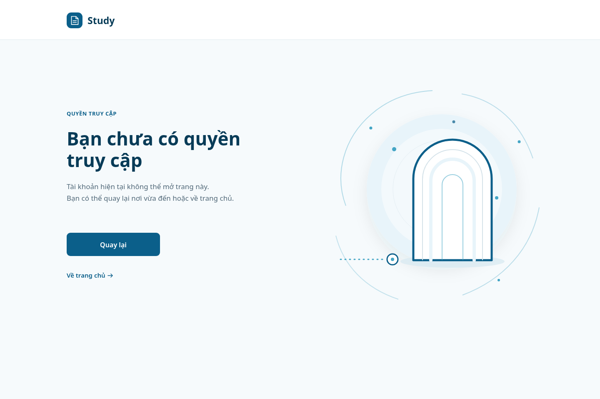
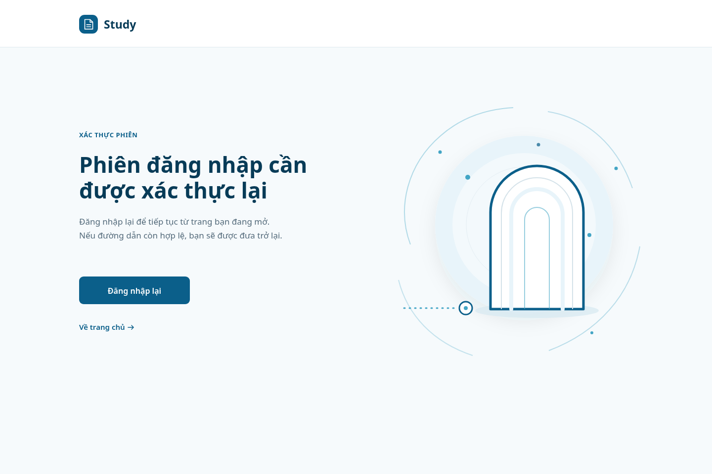
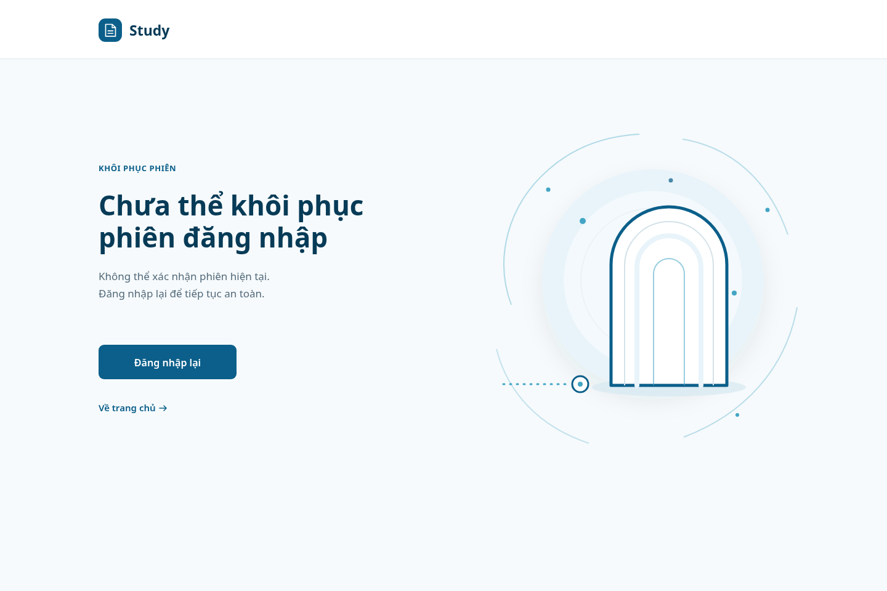

# SH-05 — Không đủ quyền / xác thực lại phiên

**Trạng thái:** `DESIGN_TARGET / NOT_IMPLEMENTED` · **Route:** `/forbidden` (theo inventory) · **Surface:** State view · **AC:** AC-02, AC-11 · **API:** #04 và runtime R-X01.

## Tệp bàn giao và phạm vi

- `PLAN.md` ghi plan nguồn, luồng, bố cục và element map trước khi dựng ảnh.
- `SH-05_<STATE>_desktop_clean.png` và `SH-05_<STATE>_mobile_clean.png` là ảnh sạch; hậu tố `_annotated` là ảnh có marker #1–#12. Mỗi SVG có thể chỉnh sửa là nguồn của PNG cùng tên.
- `build.py` dựng lại đủ 3 trạng thái ở desktop 1440×960 và mobile 390×844.
- `SH-05_design_handoff_v1.zip` chứa plan, đặc tả, nguồn SVG, ảnh PNG và script dựng ảnh.

`apps/study-client/` hiện không có frontend source, router, auth interceptor, token store hoặc client redirect allowlist. Các màn và tương tác dưới đây là design target, chưa phải runtime. Tôi đã thử mở ChatGPT qua @Chrome nhưng CUA không có browser khả dụng (`getState()` trả `browsers: []`, tạo Chrome tab báo `Browser is not available: chrome`). Vì vậy ảnh này được dựng bằng SVG tùy chỉnh có thể chỉnh sửa và render bằng Chrome headless; không gán kết quả cho website ChatGPT.

## Ảnh xem trước

### `ACCESS_DENIED` — API #04 hoặc R-X01 trả 403

### `SESSION_REQUIRED` — cần xác thực lại sau 401

### `TOKEN_REFRESH_FAILED` — không khôi phục được phiên

Ảnh mobile và ảnh có số nằm cùng thư mục. Ảnh có số xác định trực tiếp 12 element ở bảng dưới; marker có leader line khi cần để không che nội dung.

## Mục tiêu và giới hạn thiết kế

Screen dừng gọn một luồng truy cập và chỉ đưa người dùng tới hành động an toàn tiếp theo. Minh họa là một ngưỡng mở và đường dẫn ngắt trước ngưỡng: không gắn lỗi với một người dùng hoặc role cụ thể. H1, body và CTA nói rõ trạng thái bằng chữ; màu không mang nghĩa trạng thái duy nhất.

- Không hiển thị HTTP status, business code, role, account status, claim, API payload, access/refresh token, trace ID, email hay tên người dùng.
- API #04 500 là lỗi dịch vụ, không chuyển thành 401/403 và không dùng một trong ba ảnh này.
- Không có nút thử refresh lần nữa, logout, hỗ trợ, đổi role hay API mới.
- Không có screen con trong inventory SH-05. Ba ảnh là ba biến thể của cùng state view, không phải route con.

## Biến thể trạng thái và copy

| State | Điều kiện vào từ source / flow | Eyebrow và headline trên ảnh | Supporting copy desktop | Primary CTA | Secondary CTA |
|---|---|---|---|---|---|
| `ACCESS_DENIED` | API #04 trả 403 khi JWT hợp lệ nhưng role không có `STUDENT`; R-X01 cũng có nhánh 403. | `QUYỀN TRUY CẬP` · **Bạn chưa có quyền / truy cập** | “Tài khoản hiện tại không thể mở trang này. Bạn có thể quay lại nơi vừa đến hoặc về trang chủ.” | `Quay lại` → previous-safe-route; nếu không có route an toàn thì SH-01 `/`. | `Về trang chủ` → SH-01 `/`. |
| `SESSION_REQUIRED` | Thiếu/không hợp lệ/hết hạn token; claim hoặc user row không hợp lệ; refresh không có hoặc R-X01 trả 401. | `XÁC THỰC PHIÊN` · **Phiên đăng nhập cần / được xác thực lại** | “Đăng nhập lại để tiếp tục từ trang bạn đang mở. Nếu đường dẫn còn hợp lệ, bạn sẽ được đưa trở lại.” | `Đăng nhập lại` → SH-02 `/login`, chỉ giữ relative `returnTo` nếu allowlisted. | `Về trang chủ` → SH-01 `/`. |
| `TOKEN_REFRESH_FAILED` | Refresh không khôi phục được phiên; 500/network/rotation-uncertain là mapping UI còn cần phía client xác nhận. | `KHÔI PHỤC PHIÊN` · **Chưa thể khôi phục / phiên đăng nhập** | “Không thể xác nhận phiên hiện tại. Đăng nhập lại để tiếp tục an toàn.” | `Đăng nhập lại` → SH-02 `/login`, chỉ giữ safe `returnTo`. | `Về trang chủ` → SH-01 `/`. |

Copy mobile 390px được rút gọn để tránh tràn: `ACCESS_DENIED`: “Tài khoản này không thể mở trang này.” / “Bạn có thể quay lại hoặc về trang chủ.”; `SESSION_REQUIRED`: “Đăng nhập lại để tiếp tục.” / “Bạn sẽ trở lại nếu đường dẫn an toàn.”; `TOKEN_REFRESH_FAILED`: “Không thể xác nhận phiên hiện tại.” / “Đăng nhập lại để tiếp tục an toàn.” Nghĩa và điều kiện điều hướng không đổi.

## Bố cục, màu và kiểu chữ

| Vùng | Desktop 1440×960 | Mobile 390×844 | Hành vi co ở 320px |
|---|---|---|---|
| Header | Cao 96px; mark x=160,y=30; wordmark Study; nền trắng, divider token. | Cao 72px; mark x=24,y=18; wordmark ngay bên phải. | Gutter 16px; không ẩn brand. |
| Copy | Bắt đầu x=160; eyebrow baseline y=278; H1 baselines y=350/402; body y=455/483. | Gutter 24px; eyebrow baseline 116; H1 166/204; body 257/282. | Gutter 16px; H1 28/38px; body 15/25px để headline/copy vẫn đủ chỗ. |
| Actions | Primary x=160,y=560,w=224,h=56; home link hit-area x=160,y=640,w=180,h=44. | Primary x=24,y=328,w=342,h=54; home link hit-area x=24,y=398,w=342,h=44. | Primary x=16,w=288; hit area luôn cao ≥44px. |
| Illustration | Vùng phải; halo 360×360px, arch khoảng 250×308px, không chồng cột copy. | Cùng vector group co về khoảng 285×291px, đặt dưới actions. | Co thêm theo tỉ lệ; giữ text và action; không có cuộn ngang. |

**Token được dùng:** nền trang `#F6FAFC`, header/surface `#FFFFFF`, heading `#073B57`, body/link-secondary `#536A7A`/`#0B5F8A`, action `#0B5F8A`, hover/pressed `#084968`, halo `#E8F4FA`, accent trang trí `#43A5C5`, border `#D4E2E9`. Không thêm màu ngoài Study palette, gradient, dark panel, alert đỏ hoặc shadow cạnh tranh.

**Font:** `Noto Sans, Arial, sans-serif`; Noto Sans là system sans trên môi trường render. Không tải font từ mạng. H1 desktop 44/52px weight 700; mobile 32/38px, 320px 28/38px. Body desktop 17/28px weight 400; mobile 16/25px, 320px 15/25px. Eyebrow desktop 13/18px weight 700, mobile 12/18px. CTA 16/24px weight 600; link 15/22px weight 600; Study wordmark desktop 23/30px, mobile 22/28px weight 700.

## Bảng đặc tả toàn bộ element

Tọa độ là pixel trong canvas tương ứng. Bounds của text là vùng dàn trang tối đa để wrap; baseline được ghi riêng. Vùng hit-area lớn hơn glyph được tính trong bounds của element tương tác. Marker chỉ có trên biến thể `_annotated`.

| # | Element nhỏ nhất / nội dung | Bounds desktop | Bounds mobile 390 | Cỡ chữ / hình thức | Sự kiện, đích và trạng thái | Hover, focus, responsive |
|---:|---|---|---|---|---|---|
| 1 | Brand mark Study — ô xanh + glyph trang giấy | Vẽ `160,30,38×38`; hit-area link tối thiểu `157,27,44×44`. | Vẽ `24,18,36×36`; hit-area `20,14,44×44`. | Nền `#0B5F8A`, radius 11px desktop/10px mobile; glyph trắng, nét 1.5–1.7px. | Bấm/tap → SH-01 `/`; không gọi API. | Hover/pressed đổi nền `#084968` trong 140ms; focus-visible viền 2px `#0B5F8A`, offset 2px. Ở 320px mark x=16. |
| 2 | Wordmark `Study` | Text anchor x=210, baseline y=58; vùng nav trong header. | Anchor x=72, baseline y=43. | Desktop 23/30px, mobile 22/28px, 700, `#073B57`. | Cùng điều hướng SH-01 `/` với mark #1; nên cùng một anchor lớn, không tạo hai lần tab-stop. | Hover/pressed `#084968`; focus chung với brand link; không wrap. |
| 3 | Eyebrow theo state: `QUYỀN TRUY CẬP`, `XÁC THỰC PHIÊN`, `KHÔI PHỤC PHIÊN` | Text box `160,264,280×20`; baseline y=278. | Text box từ x=24,y=100; baseline y=116. | Desktop 13/18px, mobile 12/18px, 700, tracking 0.45–0.55px, `#0B5F8A`. | Nhãn tĩnh giúp đọc ngữ cảnh; không click. | Không hover/focus. Ở 320px x=16; cùng label không wrap. |
| 4 | H1 theo state: “Bạn chưa có quyền truy cập”; “Phiên đăng nhập cần được xác thực lại”; “Chưa thể khôi phục phiên đăng nhập” | Max box `160,312,540×104`; hai baseline y=350,402. | Max box `24,136,342×78`; baselines y=166,204. | Desktop 44/52px, mobile 32/38px, 700, `#073B57`; ở 320px 28/38px. | H1 duy nhất; screen reader nhận nguyên headline, không đọc từng dòng như heading riêng. | Không tương tác. Text wrap tự nhiên; line break ảnh theo từng state; không truncate. |
| 5 | Supporting copy — hai dòng theo state | Max box `160,436,520×60`; baselines y=455,483. | Max box `24,242,342×48`; baselines y=257,282. | Desktop 17/28px, mobile 16/25px, 400, `#536A7A`; 320px 15/25px. | Chỉ giải thích bước tiếp theo; không render response/raw error/token/PII. | Không tương tác. Cho wrap tự nhiên; 320px dùng copy rút gọn trong bảng state. |
| 6 | Primary action button — `Quay lại` hoặc `Đăng nhập lại` | `160,560,224×56`, radius 9px. | `24,328,342×54`; tại 320px `16,328,288×54`. | Nền `#0B5F8A`; text trắng 16/24px, 600; căn giữa. | 403: điều hướng previous-safe-route, fallback `/`. 401/refresh-failed: điều hướng SH-02 `/login`, thêm `returnTo` chỉ khi relative và allowlisted. Chỉ navigation, không mutation/API mới. | Hover/pressed `#084968`, transition 140ms; focus-visible 2px `#0B5F8A` + offset 2px. Không có loading giả; chặn duplicate chỉ nếu router runtime hỗ trợ. Mobile full width, cao ≥44px. |
| 7 | Secondary link `Về trang chủ` + arrow icon | Hit-area `160,640,180×44`; text baseline y=668; arrow nét 1.6px. | Hit-area `24,398,342×44`; text baseline y=420; arrow kế label. 320px x=16. | Text 15/22px, 600, `#0B5F8A`; arrow line icon cùng màu. | Bấm/tap → SH-01 `/`; không gọi API, không kèm token/return query. | Hover underline + `#084968`; pressed `#084968`; focus-visible 2px + offset 2px. Hit-area ≥44px, không layout shift. |
| 8 | Halo vòng nền minh họa | `880,275,360×360`; tâm (1060,455), radius 180px. | `90.6,560.6,208.8×208.8`; được scale 0.58. | Vòng `#E8F4FA`, vòng trong trắng opacity 48%, viền mảnh `#D4E2E9`; shadow khuếch tán nhẹ, không gradient. | Trang trí `aria-hidden=true`; không click/focus. | Không hover. Co tỉ lệ; ở 320px scale 0.51. |
| 9 | Open threshold frame — cung mở, lớp viền và ground ellipse | Group bounds x=961..1211, y=336..644 (`250×308`). | Sau scale 0.58: x≈138..282, y≈596..775. | Nét chính 5px `#0B5F8A`, lớp trong 2px `#D4E2E9`, plane `#E8F4FA`; không khóa/chữ. | Trang trí, một SVG group `aria-hidden=true`; không click/focus. | Không hover/focus. Scale đồng bộ halo; không che route node hoặc action. |
| 10 | Interrupted route — đường chấm trước ngưỡng | Visible stroke bounds x≈816..927, y≈622.5..625.5. | x≈54..128, y≈762; nét sau scale khoảng 1.7px. | `#43A5C5`, nét desktop 3px, dash `2 9`, line-cap round. | Ẩn với assistive tech; không phải progress/status control. | Không hover/focus; không animation/autoplay. |
| 11 | Route stop node | Bounds gồm stroke `927.5,609.5,29×29`; tâm (942,624). | Tâm sau scale ≈(126.6,763.9), đường kính ≈15px. | Ring trắng, viền `#0B5F8A` 3px desktop, chấm lõi `#43A5C5`; không X/check. | Trang trí, endpoint của đường; `aria-hidden=true`. | Không hover/focus. Giữ khoảng trống trước ngưỡng ở desktop/mobile. |
| 12 | Orbit arcs + ba chấm trang trí | Tổng bounds x≈802..1296, y≈218..720. | Tổng bounds x≈47..332, y≈528..819; transform scale 0.58. | Nét 2px `#43A5C5`, opacity 0.28–0.38; dots 3–3.5px. | Trang trí, chung nhóm illustration `aria-hidden=true`; các path không phải controls riêng. | Không hover/focus, không chuyển động lặp. Scale 0.51 ở 320px; không gây scroll ngang. |

### Vị trí marker trong ảnh annotated

Badge desktop rộng 24px, mobile 20px để không chạm/cắt ở gutter hẹp; nền `#073B57`, số trắng 12px/10.5px 700, keyline trắng; leader line mảnh nối ra target. Marker không xuất hiện trong ảnh `_clean` và không nằm trong accessibility tree của sản phẩm.

| # | Tâm badge desktop 1440×960 | Tâm badge mobile 390×844 |
|---:|---:|---:|
| 1 | (138,32) | (12,12) |
| 2 | (304,26) | (177,12) |
| 3 | (138,261) | (12,98) |
| 4 | (138,327) | (12,151) |
| 5 | (138,444) | (12,247) |
| 6 | (138,566) | (12,355) |
| 7 | (138,646) | (12,414) |
| 8 | (851,270) | (53,553) |
| 9 | (968,307) | (141,579) |
| 10 | (798,608) | (32,764) |
| 11 | (928,660) | (126,804) |
| 12 | (1262,247) | (337,536) |

## Luồng sự kiện, điều hướng và source truth

| Thứ tự | Sự kiện | Hành vi/đích | Phân loại bằng chứng |
|---:|---|---|---|
| 1 | Mở trang được bảo vệ; API #04 trả 401 | Theo inventory, thử R-X01 một lần, đồng bộ các request 401; nếu refresh thành công, retry request gốc tối đa một lần và không flash SH-05. | Expected flow; Study Web interceptor chưa có trong checkout. |
| 2 | R-X01 trả 200 | Refresh token opaque được xoay vòng; client kỳ vọng retry request gốc một lần rồi quay về safe route. Không đưa token lên URL/log/ảnh. | Current server source cho rotation; phần client xử lý chưa được implement. |
| 3 | R-X01 trả 401 hoặc không có refresh token dùng được | Render `SESSION_REQUIRED`; CTA mở SH-02 và chỉ giữ safe relative `returnTo`. Không tự lặp refresh. | Server 401 source + screen inventory. |
| 4 | API #04 trả 403 | Render `ACCESS_DENIED`, không gọi refresh. `Quay lại` dùng safe previous route; fallback SH-01. | API #04 role guard + inventory. |
| 5 | R-X01 trả 403 | Dùng copy 403 chung; không nêu account inactive hay role. | Current refresh source trả 403 inactive; cùng HTTP code không đồng nghĩa cùng nguyên nhân. |
| 6 | Refresh trả 500, network error hoặc response mất sau rotation | `TOKEN_REFRESH_FAILED` là mapping thiết kế chờ xác nhận ở client; không retry refresh tự động vì token cũ có thể đã bị revoke. | Client behavior chưa source-backed (`OPEN_DECISION`). |
| 7 | Bấm mark/wordmark/home | Điều hướng công khai về SH-01 `/`; không gửi auth request. | Điều hướng thiết kế từ screen inventory. |

`returnTo` chỉ được nhận nếu là đường dẫn tương đối nội bộ và thuộc allowlist đã duyệt. Từ chối absolute/external URL, `//...`, malformed path, `/login`, `/forbidden` hoặc route gây auth loop. Không có client source/allowlist trong checkout, nên đây là ràng buộc phải triển khai, chưa phải hành vi đã xác minh.

### Bằng chứng source đã đối chiếu

- Screen inventory: `apps/study-client/docs/dd_screens/list_screen.md`, dòng SH-05 và shared auth/safe-return rules.
- Design tokens: `.agents/web-study/design.md` (`LIGHT_FIRST`, ocean palette, 4px spacing, breakpoints, reduced motion và WCAG AA).
- API #04 source/test: `apps/study-server/app/modules/guest/api_04_users_me/{view.py,query.py,models.py}` và `apps/study-server/tests/modules/guest/api_04_users_me/test_users_me.py`.
- API #04 DD vẫn `Draft — Needs Confirmation`; missing user row hiện về 401 trong source, permission/claim policy còn câu hỏi. Source 403 hiện tại là role thiếu `STUDENT` trước profile query; 500 được giữ riêng.
- R-X01 source/test: refresh handler trong `apps/study-server/app/modules/guest/api_03_auth_login/view.py`, route wiring `apps/study-server/app/api/v1.py`, refresh token helper `apps/study-server/app/core/security/refresh_token.py`, tests `apps/study-server/tests/modules/guest/api_03_auth_login/test_auth_login.py`.
- R-X01 hiện không nằm trong API catalog và không có DD riêng. Refresh 200 xoay opaque token; token thiếu/sai/reused/expired trả 401; inactive account trả 403; lỗi server an toàn trả 500. Tests dùng fake DB/session; trong task thiết kế này không chạy lại và không dùng chúng làm bằng chứng live DB/deploy.
- `.agents/web-work/study/` và Study Web source/runtime không có trong checkout hiện tại; các ảnh không chứng minh route hoặc auth client tồn tại.

## Accessibility, trạng thái tương tác và chất lượng

- DOM implementation: brand link → H1 → paragraph → primary anchor/button → secondary home link; artwork có `aria-hidden="true"`. Trên ảnh, số marker chỉ là lớp chú giải.
- Một H1 theo state; trạng thái được nói rõ bằng text, không phụ thuộc màu. Không focus tự động, không refresh lặp khi mở route.
- Noto Sans system sans; body tối thiểu 16px ở 390px và 15px tại 320px; text-wrap, không ellipsis hoặc cắt dấu tiếng Việt.
- Text dùng `#073B57`/`#536A7A` trên nền sáng; CTA dùng chữ trắng trên `#0B5F8A`. Accent `#43A5C5` chỉ trang trí. Kiểm tra token contrast trên composition thực tế; focus ring dùng primary đậm.
- Tất cả target tương tác cao ít nhất 44px; primary button mobile 54px. Thứ tự tab theo thứ tự điều hướng, focus không bị art che.
- Hover/focus chuyển màu tối đa 140ms; `prefers-reduced-motion: reduce` bỏ hiệu ứng entrance/transform. Minh họa không chạy hoặc lặp.
- Rà ảnh: ba trạng thái trên desktop 1440×960, mobile 390×844; SESSION_REQUIRED cũng được render để kiểm tra ở 320×844. Copy/actions không tràn; mobile giữ CTA toàn chiều ngang và không có horizontal scroll.

## Discrepancies, open decisions và liên kết screen

| Item | Tình trạng | Ảnh hưởng |
|---|---|---|
| Study Web app/router/auth interceptor | `NOT_FOUND / NOT_IMPLEMENTED` dù context manifest khai báo skeleton. | Tất cả click, route guard, refresh và safe return là target; chưa có runtime để xác nhận. |
| API #04 contract | `Draft — Needs Confirmation`; current source role=STUDENT; missing user row về 401. | Dùng wording chung; không tự quyết định claim/permission hay account meaning. |
| 403 source semantics | API #04 403 là role khác Student; R-X01 403 là inactive account. | Không tiết lộ nguyên nhân cụ thể trên UI. |
| Refresh failure client mapping | `SOURCE_REQUIRED / OPEN_DECISION`; server refresh 500 hoặc network sau rotation không nói chính xác session có còn dùng được không. | Không tuyên bố token đã hết hạn, không auto-retry; CTA login/home là recovery target. |
| Return allowlist/token persistence | Chưa có client source hoặc policy đã implement. | Chỉ mô tả ràng buộc allowlist; không đưa token/PII vào URL. |
| ChatGPT via @Chrome | CUA browser unavailable. | Artifact được tác giả hóa từ SVG trong repository và render local; chưa phải file xuất từ ChatGPT website. |

| Screen liên quan | Điều kiện kết nối |
|---|---|
| SH-02 `/login` | Primary CTA của `SESSION_REQUIRED`/`TOKEN_REFRESH_FAILED`; chỉ giữ `returnTo` safe. |
| SH-01 `/` | Brand, home link và fallback khi không có previous-safe-route. |
| Previous safe route | Primary CTA `ACCESS_DENIED`; chỉ internal/allowlisted, nếu không có thì `/`. |

## Rà soát bàn giao

- [x] Ba nhánh 401, 403, refresh failure có headline/copy/action khác nhau; không gộp API #04 500 thành auth state.
- [x] Mỗi ảnh annotated có đúng marker #1–#12; ảnh clean không có marker.
- [x] Desktop và mobile có SVG nguồn, ảnh PNG; tiếng Việt hiển thị đúng dấu.
- [x] Rà bố cục ở 1440×960, 390×844 và 320×844; không thấy text/action bị cắt hoặc tràn ngang.
- [x] CTA không tự tạo API call; 403 không kích hoạt refresh; login return chỉ là target safe-relative.
- [ ] ChatGPT website đã tạo/tải artifact: không thực hiện được vì CUA không có browser Chrome trong phiên này.
