# SH-06 — Trang không tồn tại / tài nguyên không còn

**Trạng thái:** `DESIGN_TARGET / NOT_IMPLEMENTED` · **Route target:** `/not-found` · **Surface:** state view · **Inventory:** SH-06 · **API liên quan:** #08.

SH-06 có hai biến thể trong cùng một screen folder: `ROUTE_NOT_FOUND` và `RESOURCE_NOT_FOUND`. Đây không phải hai route con. Screen cho người dùng biết địa chỉ hiện tại không dùng được và đưa ra một bước khôi phục dễ hiểu. Minh họa giấy xếp lớp, nhãn ngắn, headline lớn và một CTA chính tạo thành cùng một nhịp thị giác; không đưa mã lỗi hoặc thông tin khóa học vào UI.

## Tệp bàn giao

- `PLAN.md`: phân tích screen, flow, state, bố cục, art direction và element map trước khi tạo ảnh.
- `SH-06_<STATE>_<VIEWPORT>_clean.png`: ảnh xem UI không có số chú giải.
- `SH-06_<STATE>_<VIEWPORT>_annotated.png`: ảnh có badge #1–#12 và leader line trỏ tới từng element.
- Các SVG cùng tên là nguồn có thể chỉnh sửa; `build.py` dựng lại SVG và PNG.
- `SH-06_paper-illustration.png`: artwork RGBA dùng trong nhóm minh họa #9.
- `SH-06_design_handoff_v1.zip`: gói đầy đủ các file trong folder.

`VIEWPORT` có ba giá trị: `desktop` = 1440×960, `mobile` = 390×844, `compact` = 320×844. Mỗi state có cả ảnh clean và annotated ở cả ba kích thước.

## Ảnh xem trước

### ROUTE_NOT_FOUND

| Clean desktop | Clean mobile 390px | Clean compact 320px |
|---|---|---|
| 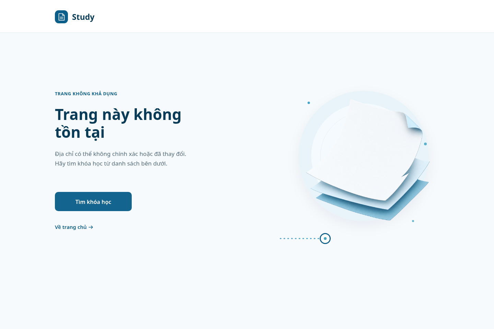 | 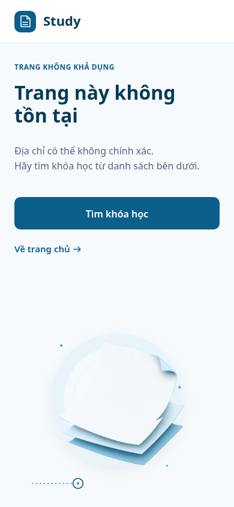 | 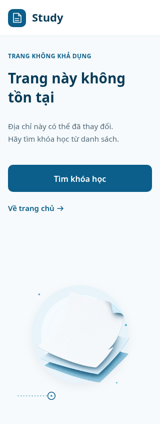 |

Ảnh có số chú giải:

| Desktop | Mobile 390px | Compact 320px |
|---|---|---|
| 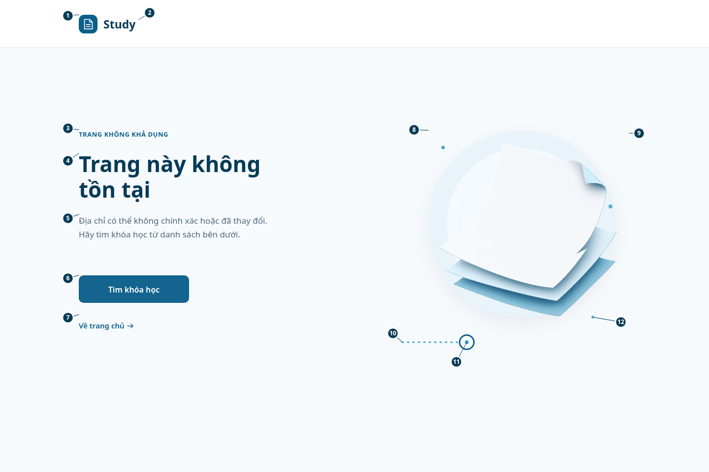 | 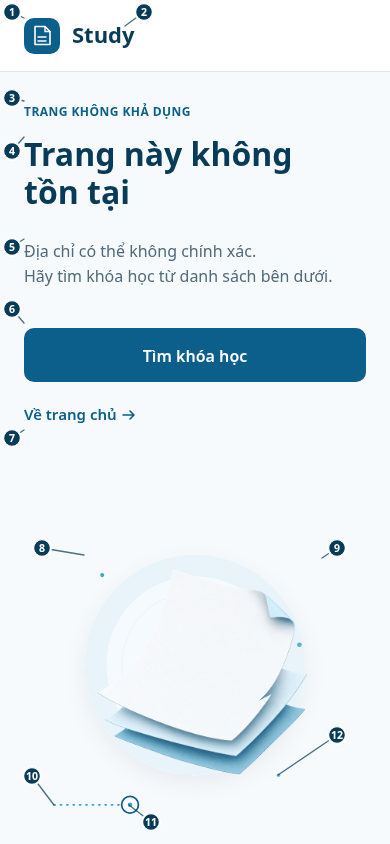 | 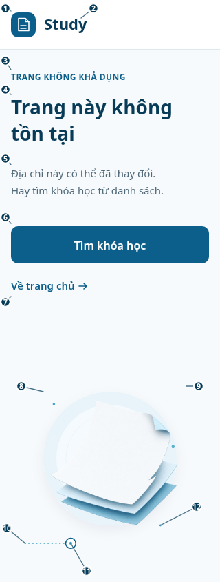 |

### RESOURCE_NOT_FOUND

| Clean desktop | Clean mobile 390px | Clean compact 320px |
|---|---|---|
| 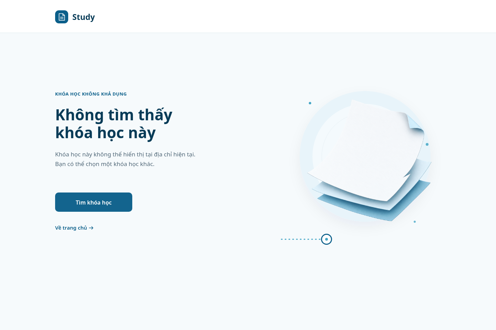 | 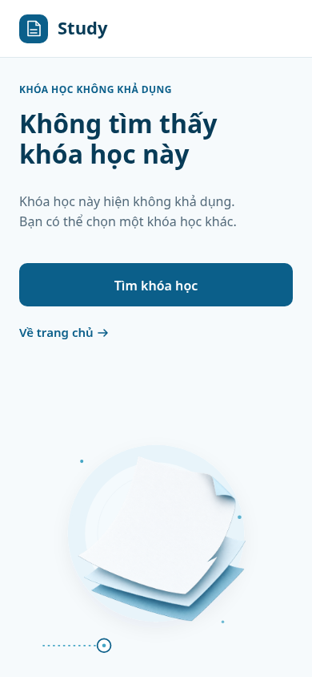 | 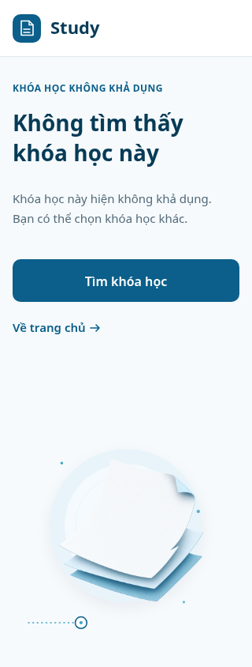 |

Ảnh có số chú giải:

| Desktop | Mobile 390px | Compact 320px |
|---|---|---|
| 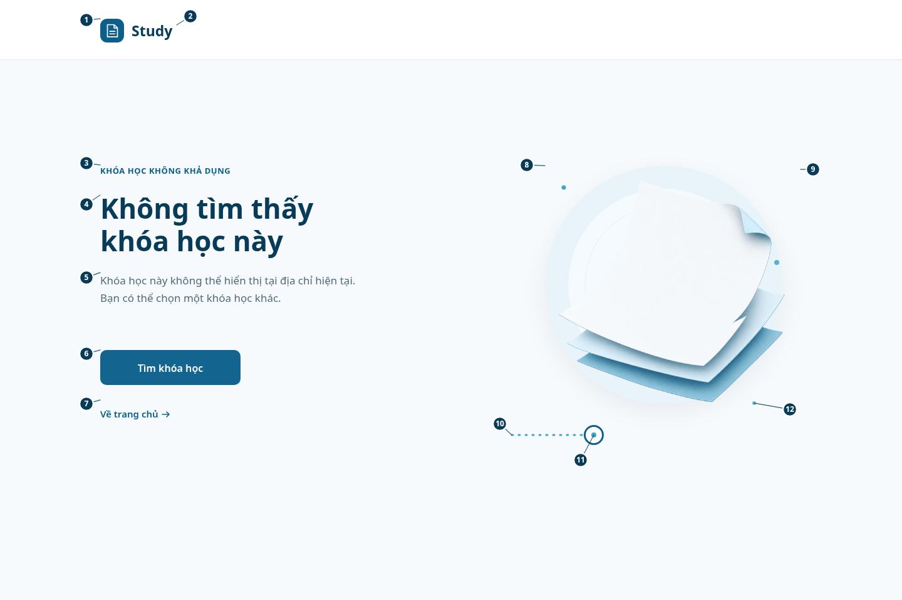 | 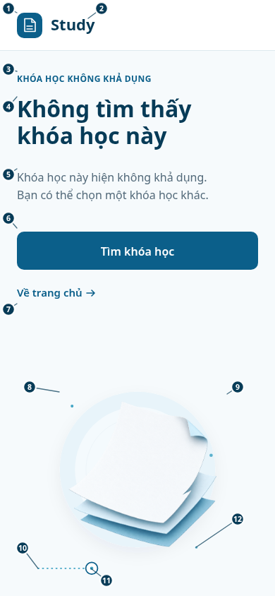 | 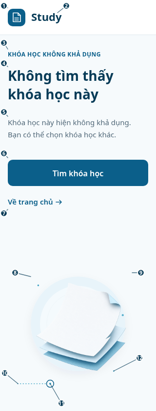 |

## Trạng thái và copy

| State | Điều kiện vào | Eyebrow | Headline hiển thị | Body desktop | Body mobile 390px | Body compact 320px |
|---|---|---|---|---|---|---|
| `ROUTE_NOT_FOUND` | Client router không khớp đường dẫn đã đăng ký. Không gọi API #08. | `TRANG KHÔNG KHẢ DỤNG` | `Trang này không`<br>`tồn tại` | “Địa chỉ có thể không chính xác hoặc đã thay đổi.”<br>“Hãy tìm khóa học từ danh sách bên dưới.” | “Địa chỉ có thể không chính xác.”<br>“Hãy tìm khóa học từ danh sách bên dưới.” | “Địa chỉ này có thể đã thay đổi.”<br>“Hãy tìm khóa học từ danh sách.” |
| `RESOURCE_NOT_FOUND` | GS-03 nhận HTTP 404 từ API #08 cho ID sai, course không tồn tại hoặc không `PUBLISHED`. | `KHÓA HỌC KHÔNG KHẢ DỤNG` | `Không tìm thấy`<br>`khóa học này` | “Khóa học này không thể hiển thị tại địa chỉ hiện tại.”<br>“Bạn có thể chọn một khóa học khác.” | “Khóa học này hiện không khả dụng.”<br>“Bạn có thể chọn một khóa học khác.” | “Khóa học này hiện không khả dụng.”<br>“Bạn có thể chọn khóa học khác.” |

Các biến thể dùng chung CTA `Tìm khóa học` → GS-01 `/courses` và link `Về trang chủ` → SH-01 `/`. Không hiển thị `404`, `course_id`, URL đầy đủ, tên course, trạng thái draft/private, raw response hoặc chi tiết không tồn tại/không publish. Copy cho missing và unpublished giống nhau để không tiết lộ course có từng tồn tại hay không.

## Bố cục và visual system

| Vùng | Desktop 1440×960 | Mobile 390×844 | Compact 320×844 |
|---|---|---|---|
| Header | Cao96px; mark x160,y30; wordmark x210; divider y95.5. | Cao72px; mark x24,y18; wordmark x72; divider y71.5. | Cao72px; mark x16,y18; wordmark x64; divider y71.5. |
| Copy | Cột trái x160..700; eyebrow baseline278; H1 baselines350/402; body455/483. | Gutter24; eyebrow baseline116; H1 166/204; body257/282. | Gutter16; eyebrow baseline116; H1 166/204; body257/282. |
| Primary | x160,y560,224×56; radius10. | x24,y328,342×54. | x16,y328,288×54. |
| Secondary | Hit area x160,y640,180×44; text baseline668. | Hit area x24,y398,342×44; text baseline420. | Hit area x16,y398,288×44; text baseline420. |
| Artwork | Halo x870,y265,380×380; paper PNG x858,y250,420×420; route baseline696. | Artwork co 0.58 quanh tâm (1060,455), đặt dưới actions; route baseline≈806. | Artwork co 0.51 quanh tâm (1060,455), đặt dưới actions; route baseline≈789. |

- Nền `#F6FAFC`, header/surface `#FFFFFF`, heading `#073B57`, body `#536A7A`, action/link `#0B5F8A`, hover/pressed `#084968`, halo `#E8F4FA`, trang trí `#43A5C5`, divider `#D4E2E9`.
- Font Noto Sans, fallback Arial/sans-serif; đây là system sans khả dụng trong môi trường render. Không import font hoặc dependency từ mạng.
- Headline desktop 44/52px, 700; mobile 390px 32/38px; compact 28/38px. Body desktop17/28px; mobile16/25px; compact15/25px. Nhãn desktop13/18px; mobile12/18px. Button16/24px, 600; link15/22px, 600.
- Layout dùng khoảng trắng, không có card/gradient/shadow đậm. Minh họa #9 được đặt trên halo #8; route chấm dừng tại vòng mở #11. Nhóm art là trang trí và `aria-hidden=true` trong target implementation.

## Bảng đặc tả từng element

Kích thước dưới đây tính theo pixel của viewport tương ứng. Leader lines/badge chỉ là lớp chú giải trong ảnh `_annotated`; không phải UI element và không xuất hiện trong ảnh `_clean`.

| # | Element | Kích thước/vị trí desktop | Kích thước/vị trí 390px / 320px | Chữ, màu và hình thức | Click/tap/keyboard | Hover, focus, pressed, disabled/loading |
|---:|---|---|---|---|---|---|
| 1 | Study brand mark — ô xanh và glyph tờ giấy | Vẽ `160,30,38×38`; vùng link tối thiểu `157,27,44×44`. | 390: vẽ `24,18,36×36`, hit `20,14,44×44`. 320: vẽ `16,18,36×36`, hit `12,14,44×44`. | Nền `#0B5F8A`, radius11px desktop/10px mobile; glyph trắng, stroke1.5–1.7px. | Click/Enter → SH-01 `/`; dùng chung một link với wordmark #2 nên chỉ có một điểm dừng Tab. | Hover/pressed nền `#084968`, 140ms. Focus-visible viền2px `#0B5F8A`, offset2px. Link không disabled/loading trong state view. |
| 2 | Wordmark `Study` | Anchor x210, baseline58; vùng chữ khoảng66×30px. | 390: x72, baseline43. 320: x64, baseline43. | Noto Sans23/30px desktop, 22/28px mobile, 700, `#073B57`. | Cùng anchor với #1; click/tap/Enter → `/`. Không thêm tab-stop thứ hai. | Hover/pressed đổi sang `#084968`; focus ring chung với #1. Không có disabled/loading state. |
| 3 | State eyebrow | Text box `160,264,340×20`; baseline278. | 390: x24, baseline116. 320: x16, baseline116. | Desktop13/18px, mobile12/18px, 700, tracking0.55/0.45px, `#0B5F8A`. | Static label; không click, không nhận focus, đổi đúng theo state. | Không hover/pressed/focus; không animate. |
| 4 | H1 | `160,312,540×104`; baselines350/402. | 390: x24 baselines166/204, 32/38px. 320: x16 baselines166/204, 28/38px. | 700, `#073B57`; hai dòng trong SVG nhưng một heading duy nhất về semantics. | Static heading; không click/focus. Screen reader đọc thành một tiêu đề liền mạch theo state. | Không hover/pressed/disabled/loading. Không ellipsis hoặc truncate; copy rút gọn chỉ ở body. |
| 5 | Supporting copy | `160,436,520×60`; baselines455/483. | 390: x24 baselines257/282, 16/25px. 320: x16 baselines257/282, 15/25px. | Desktop17/28px, 400, `#536A7A`; mobile giảm nhẹ theo viewport. | Static context; không click/focus. Không chứa API code, ID, tên course hoặc status private. | Không hover/pressed/focus; wrap theo dòng đã chỉ định; không cắt dấu tiếng Việt. |
| 6 | Primary button `Tìm khóa học` | `160,560,224×56`; radius10px; label baseline595. | 390: `24,328,342×54`; label baseline362. 320: `16,328,288×54`; label baseline362. | Nền `#0B5F8A`, chữ trắng16/24px, 600, căn giữa. Hit area bằng mặt nút và cao≥54px. | Click/tap/Enter → GS-01 `/courses`. Điều hướng tĩnh; SH-06 không gọi API mới. | Hover/pressed `#084968`, transition140ms cubic-bezier(0.22,1,0.36,1), không dịch layout. Focus-visible ring2px primary + offset2px. Không disabled/loading trong normal state; không giả spinner. |
| 7 | Secondary link `Về trang chủ` + arrow | Hit `160,640,180×44`; text baseline668; arrow stroke1.6px. | 390: hit `24,398,342×44`, baseline420. 320: hit `16,398,288×44`, baseline420. | Link15/22px, 600, `#0B5F8A`; arrow line icon cùng màu, khoảng8px sau label. | Click/tap/Enter → SH-01 `/`; không truyền query/token hoặc gọi API. | Hover underline + `#084968`, 140ms; pressed màu hover. Focus-visible ring2px + offset2px. Không phụ thuộc hover để nhận biết là link. |
| 8 | Soft halo | Circle x870,y265, diameter380px; shadow lan nhẹ ngoài bounds. | Co cùng transform art: khoảng `84.8,554.8,220.4×220.4` tại390; `63.1,568,193.8×193.8` tại320. | Vòng `#E8F4FA`; lớp trắng opacity0.52; viền `#D4E2E9` opacity0.42; không gradient. | Trang trí; không click/focus; `aria-hidden=true`. | Không hover/pressed/focus/loading/animation. |
| 9 | Minh họa giấy gập, asset PNG | `<image>` box `858,250,420×420`; asset 1254×1254, alpha trong suốt. | Co theo art transform: box x77.8,y546.1,243.6×243.6 tại390; x57,y560.5,214.2×214.2 tại320. | Giấy trắng trên hai lớp xanh nhạt, góc gập, shadow mềm; không chữ/icon/mã lỗi. | Một nhóm trang trí `aria-hidden=true`; không link/click/focus. | Không hover/pressed/focus/loading/motion; nếu asset lỗi tải thì halo và text/CTA vẫn đủ ý nghĩa. |
| 10 | Dotted route | Đường từ `(817,696)` tới `(930,696)`, stroke3px. | Transform art: x≈54..120,y≈806 ở390; x≈36..94,y≈789 ở320; stroke co theo scale. | `#43A5C5`, linecap round, dash `2 9`. | Trang trí, không phải progress/status và không click/focus. | Không hover/pressed/focus/animation. |
| 11 | Open endpoint ring | Tâm `(948,696)`, visual bounds `933.5,681.5,29×29`. | Tâm≈`129.4,805.7`, đường kính≈16.8 ở390; tâm≈`102.9,788.9`, đường kính≈14.8 ở320. | Fill trắng; stroke3px `#0B5F8A`; lõi đường kính8px `#43A5C5`; không X/dấu hỏi. | Trang trí, `aria-hidden=true`; không tương tác. | Không hover/pressed/focus/animation. |
| 12 | Ba accent dots | Tâm `(900,300)`, `(1240,420)`, `(1204,645)`. | Co theo transform chung với halo; không vượt canvas 390/320. | Bán kính3–4px, `#43A5C5`; chấm xa dưới opacity0.78–0.86. | Nhóm trang trí `aria-hidden=true`; không tương tác riêng. | Không hover/pressed/focus/animation. |

### Số chú giải

Mỗi ảnh annotated có đủ #1–#12. Badge là lớp biên tập, không thuộc UI/accessibility tree. Kích thước badge: 24×24px desktop, 20×20px tại 390px và 16×16px tại 320px; leader line dừng ở mép/vùng trắng của element, tránh chữ và nhãn nút.

| # | Tâm badge desktop | Tâm badge 390px | Tâm badge 320px |
|---:|---:|---:|---:|
| 1 | `(138,32)` | `(12,12)` | `(8,12)` |
| 2 | `(304,26)` | `(144,12)` | `(136,12)` |
| 3 | `(138,261)` | `(12,98)` | `(8,88)` |
| 4 | `(138,327)` | `(12,151)` | `(8,130)` |
| 5 | `(138,444)` | `(12,247)` | `(8,230)` |
| 6 | `(138,566)` | `(12,309)` | `(8,315)` |
| 7 | `(138,646)` | `(12,438)` | `(8,438)` |
| 8 | `(841,264)` | `(42,548)` | `(31,560)` |
| 9 | `(1298,271)` | `(337,548)` | `(289,560)` |
| 10 | `(798,678)` | `(32,776)` | `(10,766)` |
| 11 | `(927,736)` | `(151,822)` | `(126,828)` |
| 12 | `(1261,655)` | `(337,735)` | `(286,735)` |

## Logic, event routing và screen liên quan

```text
Unmatched Study Web path
  → ROUTE_NOT_FOUND
  → “Tìm khóa học” /courses hoặc brand-home /

GS-03 /courses/:courseId
  → public GET API #08 /api/v1/courses/{course_id}
  → 200: GS-03 (ngoài SH-06)
  → 404: RESOURCE_NOT_FOUND
  → 500/network: SERVICE_ERROR (ngoài SH-06)
```

| Event | Kết quả kỳ vọng | Nguồn/giới hạn |
|---|---|---|
| Router không khớp URL | Render `ROUTE_NOT_FOUND`; không gọi #08. | Client router Study Web chưa có trong checkout; đây là design target. |
| API #08 trả 404 | Render `RESOURCE_NOT_FOUND` với cùng copy cho malformed ID, missing row và course không `PUBLISHED`. | Current server source; client mapping chưa được implement. |
| API #08 trả 500 hoặc network lỗi | Render `SERVICE_ERROR`, không dùng SH-06 và không đổi thành 404. | View/query hiện trả safe 500 khi lỗi query/mapping; service error screen là state riêng trong inventory. |
| Bấm #6 | Điều hướng đến GS-01 `/courses`; không gửi API call mới từ SH-06. | Design target. |
| Bấm #1/#2/#7 | Điều hướng đến SH-01 `/`. | Design target; #1 và #2 cùng một link. |

SH-06 không có screen con trong inventory. GS-01, GS-03 và SH-01 là screen liên quan, không phải folder con của SH-06.

## Accessibility và nội dung

- Thứ tự đọc: brand link → eyebrow → một H1 → paragraph → primary → secondary. Art có `aria-hidden="true"`; số chú giải chỉ nằm trong ảnh annotated.
- Hit area link/controls ít nhất44×44px; primary cao54px trên mobile. Body 320px dùng15px/25px và copy gọn; không có cuộn ngang, cắt chữ hoặc mất action.
- Focus-visible dùng ring2px màu `#0B5F8A`, offset2px; tab order đi từ brand link tới CTA rồi secondary link. Hover chỉ bổ sung phản hồi, không phải cách duy nhất để hiểu link.
- Accent chỉ dùng trang trí; state được diễn đạt bằng chữ. Không có thông báo lỗi dựa riêng vào màu.
- Chuyển màu/underline 140ms; không có animation artwork. `prefers-reduced-motion: reduce` vẫn giữ phản hồi tức thời và bỏ mọi chuyển động không thiết yếu.
- Không đưa ID, API payload, raw error, draft/private state, hoặc metadata chưa có trong source vào hình ảnh và copy.

## Bằng chứng source, discrepancy và giới hạn

- Canonical visual target: `.agents/web-study/design.md`; nó đặt Study Web light-first, ocean tokens, sans-serif cục bộ, khoảng trắng, responsive 320px, hit area44px và reduced motion.
- Expected screen/flow: `apps/study-client/docs/dd_screens/list_screen.md` — SH-06, GS-01, GS-03, F02 và shared 404/error rules.
- Current API #08 source: `apps/study-server/app/api/v1.py` đăng ký `GET /courses/{course_id}`; module `apps/study-server/app/modules/guest/api_08_courses_detail/` xác thực ID, query chỉ lấy `courses.status = 'PUBLISHED'`, và dùng cùng 404 an toàn cho malformed/missing/unpublished. Lỗi query/mapping đi 500 `DESIGN_INTERNAL_ERROR`; success là singleton `CoursePage`, read-only.
- API #08 test source `apps/study-server/tests/modules/guest/api_08_courses_detail/test_courses_detail.py` có nhánh invalid ID, missing row, lỗi query→500, success và route GET. Không chạy lại test trong task thiết kế này; test dùng fake DB không chứng minh live DB/deploy.
- **DISCREPANCY:** current route/source/test được đăng ký, còn inventory vẫn đánh dấu #08 `D`, GS-03 vẫn mô tả #08–#10 chưa wired, DD #08 vẫn `Draft — Needs Confirmation`; detail còn trả singleton `CoursePage`. Dùng source để phân biệt 404 và 500, nhưng không tuyên bố runtime client/live deployment/schema đã hoàn tất.
- Study Web source/router/consumer chưa có trong checkout. Tất cả route, event và mapping client ở đây là design target, chưa phải runtime behavior.

## Tạo artwork và kiểm tra trực quan

- Paper asset được tạo bằng built-in ImageGen cho artwork minh họa (transparent background), không phải ChatGPT website. Prompt: “A centered blank white sheet of paper floating over two offset pale blue paper layers, gently lifted folded corner and a subtle clean cut-away gap; polished editorial paper-cut illustration, soft controlled ambient shadow, smooth matte paper, transparent background, square composition with generous transparent padding; palette #073B57, #0B5F8A, #43A5C5, #E8F4FA, #FFFFFF, #D4E2E9; no text, numbers, logo, route, dots, arrow, icon, magnifying glass, door, lock, person, book or UI panel.” Output gốc PNG1254×1254 RGBA: `/home/daovanhung/.codex/generated_images/01a17bc6-539e-7561-9d10-7a7b9537824c/exec-7906da9a-0f38-4c93-8e47-122c0a8749cc.png`; bản dùng trong handoff là `SH-06_paper-illustration.png`.
- Render: `python3 build.py` sinh 12 SVG edit được và 12 PNG ở ba viewport cho hai state; PNG render bằng Chromium headless.
- QA vòng1: ảnh clean ở1440/390/320 không tràn, copy/action hiện đủ. Annotated320 có badge gần chữ do gutter16px; một accent dot cũng bị sheet che.
- Fix: dời marker sang khoảng trắng, leader line dừng ở biên vùng element, badge 320px thu về16px; chuyển chấm nhấn ra mép halo để cả ba dot đều nhìn thấy. QA vòng2: kiểm tra lại clean desktop/mobile/compact và annotated của cả hai state; không còn leader che glyph/nút/logo hoặc dot nằm chìm dưới giấy. Số #1–#12 đủ và clean không chứa marker.
- @Chrome CUA đã thử lại để gửi plan tới `chatgpt.com`; `getState()` trả `apps:[]`, `browsers:[]`, và `createBrowserTab("chrome",...)` trả `Browser is not available: chrome`. Do đó không thể gửi prompt/tải ZIP qua ChatGPT website trong phiên này; handoff được dựng cục bộ và provenance được ghi rõ.
- Ảnh SVG/PNG xác nhận kích thước canvas desktop1440×960, mobile390×844, compact320×844. Thiết kế và ảnh chưa chứng minh app route/client behavior, server deployment, live schema hoặc người dùng thật.

## Rà soát trước bàn giao

- [x] Hai nhánh route-404 và resource-404 cùng screen folder; route 404 không gọi #08.
- [x] 500/network giữ ngoài SH-06; missing/unpublished dùng chung copy và không lộ private status.
- [x] 12 element có bảng kích thước, font, màu, sự kiện, hover/focus/pressed và responsive.
- [x] Mỗi state có ảnh clean/annotated cho1440×960,390×844 và320×844; annotated có đủ badge #1–#12.
- [x] QA lặp lại sau khi phát hiện marker sát chữ trong compact; leader đã dời và compact badges giảm cỡ.
- [x] Source SVG và script dựng lại cùng asset artwork được đóng gói.
- [ ] ChatGPT website đã nhận plan/tạo/tải artifact: không khả dụng vì CUA không có browser Chrome trong phiên.
