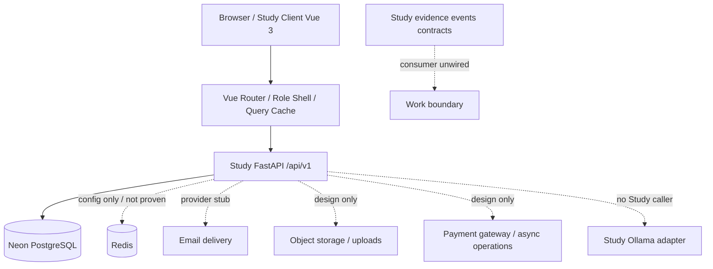
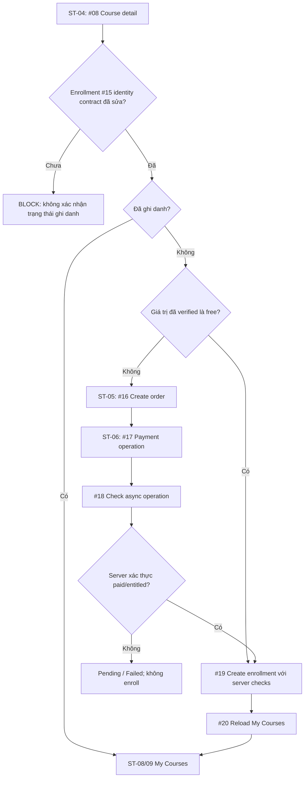

# Study2Work — LIST_SCREEN: Tổng thiết kế màn hình Study LMS V1

> **Loại tài liệu:** Master screen inventory / solution UI architecture / API traceability, là đầu vào để tạo **DD Screen** chi tiết; **không** phải tài liệu xác nhận UI đã implement.  
> **Phạm vi:** **Study** — `apps/study-client/` ↔ `apps/study-server/`, bốn actor Guest, Student, Mentor, Admin. Work/AI/DB Admin được mô tả tại ranh giới tích hợp, **không** nhập màn hình riêng của chúng vào Study.  
> **Nguồn GitHub:** `daovanhung-dev/Study2Work`, `main` HEAD `bb9e2be2e146285f004cdc00e8d632ca8ed1b4a3` (commit nguồn kiểm tra 2026-09-27 UTC), đánh giá tài liệu 2026-10-25 (Asia/Bangkok).  
> **Đường dẫn đề xuất trong repo:** `apps/study-client/docs/design/list_screen.md` (chưa tự ghi vào GitHub).  
> **Trạng thái:** `DESIGN_BASELINE / NEEDS_CONTRACT_REVIEW`, danh mục đủ để lập kế hoạch DD Screen, **chưa đạt gate triển khai toàn hệ thống**.

## 0. Kết quả kiểm kê và định nghĩa phạm vi

| Chỉ số | Giá trị đã đối chiếu | Ý nghĩa |
|---|---|---|
| Actor | 4 | Guest, Student, Mentor, Admin |
| Use Case / Activity | 30/30 | 6 Guest + 10 Student + 6 Mentor + 8 Admin |
| API V1 | 103 API ID; 103/103 được ít nhất một screen tham chiếu | Tính theo `docs/lists/list_api.md` và `AC_UNICA/00_AC_API_INDEX.md`; API #18 dùng chung |
| UI screen/task surface | 83 | Gồm page, tab, panel, dialog và transition; không đồng nghĩa 83 URL độc lập |
| Study DD API | 15 bộ (#01–#15), mỗi bộ gồm Overview/Request/Response/Mapping/Error... | Các API #16–#103 có **contract V1/diagram**, chưa có bộ DD API tương ứng trong thư mục Study DD |
| API backend | Snapshot nguồn ghi #01–#07 và runtime `/auth/refresh` được wire; các phiên trước xác nhận route/module/test source của #58, #68–#73; report 2026-11-01 ghi focused HTTP requests của #73 pass trên schema/fixtures tạm sau SQL fix | #02 là email stub; #58 và #68–#73 có schema/projection/permission semantics còn DERIVED hoặc Draft; report test không chứng minh DB/deploy production; live DB/deploy chưa xác minh |
| Study frontend | Vue 3 + TypeScript + Vite; router hiện chỉ khai báo `/` | Các route ở tài liệu là *đề xuất thiết kế*; không phải source routes |
| Database | ERD drawio 16 bảng; checked-in Study Server `DB.sql` hiện có 29 `CREATE TABLE`, gồm support tables | Migration/live schema/deployment chưa được xác minh; local DDL không chứng minh production state |
| Tích hợp khác | Payment, Object Storage, email, operation jobs chưa được chứng minh đã chạy | Không suy ra service chạy thực tế từ diagram/README |

### 0.1. Thứ bậc chứng cứ & ký hiệu

- **`R` — RUNTIME_SOURCE:** Route/logic có trong `apps/study-server/app/api/v1.py`, source + test; **không** đồng nghĩa đã kiểm chứng live database hay deploy.
- **`S` — STUB:** Có route/hợp đồng response nhưng external side effect không thực thi thật (`#02` email).
- **`D` — DESIGN_ONLY:** Mới có API catalog/AC/DD, chưa route runtime. Mọi UI phụ thuộc D là *target-state UI*, không được gọi API thật trong production khi chưa implement.
- **`M` — MIXED:** Screen tham chiếu cả R và D/S. **`UX`**: screen/state theo nhu cầu điều hướng, không có API nghiệp vụ riêng.
- **`BLOCK` — REQUIREMENT/SECURITY BLOCKER:** Mâu thuẫn khiến không thể khép kín data mapping hay flow an toàn; UI phải disabled/placeholder cho đến khi được giải quyết.
- **`P0`** foundation, **`P1`** luồng chức năng chính, **`P2`** mở rộng/analytics/integration. Priority là **đề xuất** để lập kế hoạch, không phải commitment phát triển.

**Quy tắc ưu tiên cho `CURRENT_BEHAVIOR`:** current source + test > context hiện hành > DD/contract/diagram. **Quy tắc cho `TARGET_BEHAVIOR`:** approved contract + AC/UC > DD assumptions > đề xuất UX; khi xung đột, lập `DISCREPANCY`, không tự đổi API để khớp mockup.

**Nguồn đọc và truy vết chính** (liên kết GitHub):

- [docs/lists/list_api.md](https://github.com/daovanhung-dev/Study2Work/blob/main/docs/lists/list_api.md)
- [apps/study-server/docs/diagrams/AC_UNICA/00_AC_API_INDEX.md](https://github.com/daovanhung-dev/Study2Work/blob/main/apps/study-server/docs/diagrams/AC_UNICA/00_AC_API_INDEX.md)
- [apps/study-server/docs/diagrams/AC_UNICA/AC_01_GUEST_ACCOUNT.drawio](https://github.com/daovanhung-dev/Study2Work/blob/main/apps/study-server/docs/diagrams/AC_UNICA/AC_01_GUEST_ACCOUNT.drawio)
- [apps/study-server/docs/diagrams/AC_UNICA/AC_02_STUDENT_LEARNING.drawio](https://github.com/daovanhung-dev/Study2Work/blob/main/apps/study-server/docs/diagrams/AC_UNICA/AC_02_STUDENT_LEARNING.drawio)
- [apps/study-server/docs/diagrams/AC_UNICA/AC_03_MENTOR_TEACHING.drawio](https://github.com/daovanhung-dev/Study2Work/blob/main/apps/study-server/docs/diagrams/AC_UNICA/AC_03_MENTOR_TEACHING.drawio)
- [apps/study-server/docs/diagrams/AC_UNICA/AC_04_ADMIN_MANAGEMENT.drawio](https://github.com/daovanhung-dev/Study2Work/blob/main/apps/study-server/docs/diagrams/AC_UNICA/AC_04_ADMIN_MANAGEMENT.drawio)
- [apps/study-server/docs/diagrams/UC.drawio](https://github.com/daovanhung-dev/Study2Work/blob/main/apps/study-server/docs/diagrams/UC.drawio)
- [apps/study-server/docs/diagrams/DB_UNICA_ERD.drawio](https://github.com/daovanhung-dev/Study2Work/blob/main/apps/study-server/docs/diagrams/DB_UNICA_ERD.drawio)
- [apps/study-server/docs/diagrams/DB_UNICA_TABLES.md](https://github.com/daovanhung-dev/Study2Work/blob/main/apps/study-server/docs/diagrams/DB_UNICA_TABLES.md)
- [infra/postgres/study-server/DB.sql](https://github.com/daovanhung-dev/Study2Work/blob/main/infra/postgres/study-server/DB.sql)
- [infra/README.md](https://github.com/daovanhung-dev/Study2Work/blob/main/infra/README.md)
- [.agents/project/architecture.md](https://github.com/daovanhung-dev/Study2Work/blob/main/.agents/project/architecture.md)
- [.agents/server-study/apis/declared-routes.md](https://github.com/daovanhung-dev/Study2Work/blob/main/.agents/server-study/apis/declared-routes.md)
- [apps/study-client/src/app/router/index.ts](https://github.com/daovanhung-dev/Study2Work/blob/main/apps/study-client/src/app/router/index.ts)
- [apps/study-server/app/api/v1.py](https://github.com/daovanhung-dev/Study2Work/blob/main/apps/study-server/app/api/v1.py)

**DD API #01–#15:** `apps/study-server/docs/dd/{01_auth_register,02_auth_verify_email_send,03_auth_login,04_users_me,05_categories,06_courses,07_courses_search,08_courses_detail,09_courses_curriculum,10_courses_reviews,11_courses_resources,12_resources_detail,13_users_me_avatar,14_users_me_profile,15_courses_enrollment_status}/`. Ưu tiên trang `02_Overview.md`, `03_Request.md`, `04_Response.md`, `05_Data_Mapping.md`, `06_Error.md` và `OPEN_QUESTIONS.md` (nếu có) trước khi author từng DD Screen. Nguồn DD có chỗ stale so với runtime; **không** mặc định đúng khi mâu thuẫn.

## 1. Kiến trúc màn hình và ranh giới tích hợp

**Deployment reality:** Study Web `127.0.0.2:3002`, Study API `127.0.0.1:3003` là địa chỉ **development theo project architecture**, không phải URL public. Client HTTP hiện đọc `VITE_STUDY_API_URL` hoặc fallback địa chỉ API local. Lịch sử meeting có mô tả Angular/port cũ; current `study-client/package.json` chứng minh frontend hiện là Vue 3. `infra/README.md` mô tả *historical* compose PostgreSQL/Redis/MinIO/Mailhog; tại HEAD đã kiểm kê **không có** root `docker-compose.yml`/`compose.yaml` trong Git tree; không đánh dấu các dịch vụ đó là running.

**Bảo mật hiện hữu:** source có hardcoded Neon credential, signing private key trong `app/core/constants.py` công khai. Trước khi deploy thật phải rotate/thu hồi credential, thay signing key, di chuyển secrets sang cơ chế an toàn; tuyệt đối không chép khóa vào DD Screen, fixture, mock, ảnh hay file này. Không cấp DB credential cho browser; mọi query nghiệp vụ đi qua Study API.

### 1.1. Actor, layout và điều hướng cấp cao

| Role | Shell/navigation đề xuất | Guard/điểm vào | Trạng thái xác thực |
|---|---|---|---|
| Guest | Header công khai: Trang chủ, Khóa học, Tìm kiếm, Đăng nhập/Đăng ký | `/`, `/courses`, `/courses/search`, `/courses/:id` | Public API #05–#07 source-backed; detail #08+ design only |
| Student | Sidebar/Bottom Nav: Tổng quan, Khóa học, Tiến độ, Thảo luận, Thông báo, Hồ sơ | `/student/*`; login #03 → `/users/me` #04 | Student-only #04 source-backed; domain student #13+ design only |
| Mentor | Tổng quan, Khóa học, Nội dung, Chấm bài, Hỗ trợ, Thông báo, Tiến độ | `/mentor/*` | Login hiện cho role trong token nhưng **không có** `/me` dành cho Mentor; guard/identity contract cần chốt |
| Admin | Tổng quan, Users, Courses, Content review, Lessons, Quizzes, Notifications, Moderation, Reports | `/admin/*` | Tương tự: không dùng #04 Student-only để xác minh Admin; backend RBAC còn design only |

`/login`, `/register` là **route đề xuất**, hiện `study-client` mới có route `/`. Đối với page `/:id` cần parse/validate ID, chặn ID rỗng/không hợp lệ trước khi request, route 404 bảo đảm không rò dữ liệu private. Dialog/Tab/Transition trong inventory **có mã DD Screen riêng** nhưng có thể implement bằng component/modal/sub-route, không bắt buộc deploy như URL độc lập.

### 1.2. Data ownership, cache, điều hướng

- **API client:** HTTP `ApiEnvelope<T>` đúng keys `success`, `businessCode`, `message`, `data`, `meta`, `traceId`; giữ response header `X-Trace-Id` để chẩn đoán. JSON contract/response phải validate bằng TypeScript/Zod nếu triển khai Vue; không ép mọi response thành `Page<T>` khi nguồn chỉ là object.
- **Auth:** Access JWT `type=access`, `sub`, `roles`, `jti`, `iat`, `exp`, `iss`, `aud`; refresh **opaque** runtime `/api/v1/auth/refresh` (không nằm trong 103 API V1). 401 → retry refresh tối đa một lần có đồng bộ concurrent requests; 403 → access denied; không lưu token vào URL/query hoặc log. Chiến lược token storage/CSRF cần security review trước DD Screen.
- **Cache keys đề xuất:** `categories(locale)`, `courses(page,size,sort)`, `course-search(q,page,sort)`, `course(id)`, `curriculum(id)`, `reviews(id,page)`, `me`, `my-courses(status,page)`, `progress(courseId)`, `mentor-courses(filters)`, `admin-users(filters)`; đây là **client architecture proposal**, không phải backend cache contract.
- **Mutations:** optimistic UI chỉ khi có rollback và dữ liệu trả về xác thực. Default sau create/update/delete là invalidate query liên quan và re-fetch; không coi `202 Accepted` là completed.
- **Error strategy:** 422 hiển thị per-field; 401 refresh/login; 403 access denied; 404 route resource-not-found; 409 conflict giữ dữ liệu form; 500/503 thông báo ngắn + Retry + trace ID. Các API chưa có 503 trong contract **không tự thêm 503 business code**.
- **Pagination:** lấy `data.pagination` theo response thực, không ước lượng số trang. Bật `category` UI chỉ khi #06/#07 hỗ trợ; tại runtime chúng **trả 422** nếu `category` được cung cấp.
- **Accessibility:** Web keyboard navigation, focus-visible, input/error association, WCAG AA, hit area ≥44px, responsive mobile/tablet/desktop; reduced motion, loading/empty/error độc lập từng data source.

## 2. Danh sách màn hình chuẩn (83 mã)

**Định nghĩa một dòng:** `STT` global ổn định theo tài liệu, `Mã` stable ID dùng để đặt tên DD Screen, `Surface` Page/Tab/Dialog/Panel/Transition, `Route` là thiết kế, `API #` tham chiếu danh mục §5, `Orchestration` ghi call order và quy tắc nối dữ liệu, `Trạng thái UI` là checklist states, `BE` là nguồn hiện hữu (R/S/D/M/UX), `Gate` là blocker cụ thể. Không đổi Screen ID khi thay URL; một bước UX có thể tạo nhiều component trong DD chi tiết.

### 2.1. Shared / Auth / System — 7 surfaces

| STT | Mã · màn hình · surface | Route đề xuất | AC | API # | Mục đích / logic màn hình | Orchestration API / dữ liệu | Điều hướng | UI states | Ưu tiên | BE / Gate |
|---|---|---|---|---|---|---|---|---|---|---|
| 01 | **SH-01** Trang giới thiệu Study (Page) | `/` | AC-03 | #05, #06 | Giới thiệu giá trị học tập, tìm khóa học và CTA đăng nhập/đăng ký. | Có thể nạp một trang khóa học PUBLISHED; không tạo API hero/KPI mới. | GS-01, SH-02, SH-03 | skeleton/list/empty/network-error | P0 | **R** |
| 02 | **SH-02** Đăng nhập (Page) | `/login` | AC-02 | #03, #04 | Email/password, lỗi tại trường, nhớ route đích, tách thông báo 401 và tài khoản bị chặn. | POST #3 → lưu token ở client an toàn → #4 CHỈ cho Student; Mentor/Admin chưa có /me phù hợp. | ST-01 hoặc role-shell chờ xác nhận; SH-03 | idle/validating/submitting/401/403/network-error | P0 | **R**; **BLOCK:** Role bootstrapping Mentor/Admin chưa hoàn chỉnh |
| 03 | **SH-03** Đăng ký học viên (Page) | `/register` | AC-01 | #01 | Nhập tên/email/password và xác nhận điều khoản nếu có contract; không tự thêm CAPTCHA/OTP. | POST #1 → nhận user_id,email → SH-04; 409 email trùng trở lại form. | SH-04, SH-02 | validating/submitting/409/422/201 | P0 | **R** |
| 04 | **SH-04** Handoff xác thực email (Page) | `/register/verification` | AC-01 | #02 | Hiển thị trạng thái yêu cầu gửi email; chưa có API xác nhận OTP/link. | POST #2 với user_id/email sau đăng ký, chỉ xác nhận accepted (stub), không tuyên bố email đã gửi hoặc đã verify. | SH-02 | accepted/stub/no-delivery/error | P1 | **S**; **BLOCK:** Email provider mới là stub, chưa có confirm endpoint |
| 05 | **SH-05** Không đủ quyền / session hết hạn (State view) | `/forbidden` | AC-02,AC-11 | #04 | Phân biệt 401 (hết hạn/thiếu token), 403 (không đủ quyền), bảo toàn redirect an toàn. | Khi 401 có thể thử refresh runtime R-X01 1 lần; 403 KHÔNG refresh vô hạn. | SH-02 hoặc previous-safe-route | 401/403/token-refresh-failed | P0 | **R** |
| 06 | **SH-06** Trang không tồn tại / tài nguyên không còn (State view) | `/not-found` | AC-05 | #08 | Thông báo 404 không tiết lộ draft/private, cung cấp quay về khóa học. | Router 404 hoặc resource 404 chuyển state; không chuyển 500 thành 404. | GS-01, SH-01 | route-404/resource-404 | P0 | **D** |
| 07 | **SH-07** Theo dõi tác vụ bất đồng bộ (Panel) | `/operations/:operationId` | AC-12,AC-25,AC-36,AC-38 | #18 | Dùng lại trạng thái job thanh toán/gửi thông báo/export theo ownership. | Chỉ GET #18 nếu đã có operation_id do BE xác nhận; không tự sinh ID, stop theo terminal state. | ST-07, ME-15, AD-21, AD-25 | queued/running/succeeded/failed/expired | P2 | **D**; **BLOCK:** Operation status enum/ID mapping còn mâu thuẫn |

### 2.2. Guest / Discovery — 7 surfaces

| STT | Mã · màn hình · surface | Route đề xuất | AC | API # | Mục đích / logic màn hình | Orchestration API / dữ liệu | Điều hướng | UI states | Ưu tiên | BE / Gate |
|---|---|---|---|---|---|---|---|---|---|---|
| 08 | **GS-01** Danh sách khóa học (Page) | `/courses` | AC-03 | #05, #06 | Grid/list khóa học public; sort, paging, số kết quả, thao tác xem chi tiết. | GET #5 cache-first locale → GET #6 page=1,size=20; reset page sau sort/filter; không gửi category đến khi BE hỗ trợ. | GS-02,GS-03 | loading/empty/ready/query-error | P0 | **R**; **BLOCK:** Category chỉ hiển thị metadata; filter category chưa hoạt động |
| 09 | **GS-02** Tìm kiếm khóa học (Page) | `/courses/search?q=` | AC-04 | #05, #07 | Tìm theo q, đồng bộ URL, debounce và reset page khi query đổi. | GET #5 cache-first song song #7 nếu độc lập; q được trim phía UI; #7 cố định 20/page; không gửi category. **DISCREPANCY:** AC-04/API #05 DD mô tả #05 → #07; cần chốt thứ tự/cache behavior. | GS-01,GS-03 | typing/loading/no-result/error | P0 | **R**; **BLOCK:** Không khẳng định bộ lọc category đã chạy |
| 10 | **GS-03** Chi tiết khóa học (Page) | `/courses/:courseId` | AC-05 | #08, #09, #10 | Thông tin khóa học, mentor, giá, tab đề cương/đánh giá, CTA ghi danh. | GET #8 để xác định published → lazy GET #9 và #10 theo tab; course ID thống nhất. | GS-04,GS-05,GS-06,ST-04 | loading/course-404/partial-tab-error | P1 | **R (#08/#09), D (#10)**; **BLOCK:** #08 trả singleton Page<Course>, source LEFT JOIN khác API DD INNER JOIN; int64 course_id chưa khớp validator raw-string không có signed int64 range; AC-05 eager khác F02 lazy; #10 thiếu route/title-rating source; G-01 enrollment handoff; Study Web UNWIRED |
| 11 | **GS-04** Đề cương khóa học (Tab) | `/courses/:courseId?tab=curriculum` | AC-05 | #09 | Hiển thị danh sách lesson public theo sort_order; item private không mở bằng guest. | Tái dùng #8 từ cache → GET #9; phân biệt empty curriculum và lỗi. | GS-03,ST-10 | loading/empty/ready/error | P1 | **R (#09 source-backed locally)**; **BLOCK:** `course_id:int64` chưa khớp route string/parser range; visibility `PUBLISHED` chưa được API DD duyệt; response có content/video_url nhưng không preview/access field; legacy vs V1-PILOT schema/live DB chưa xác minh; cache/#08 reuse, AC-05 eager vs F02 lazy/direct-entry chưa chốt; Study Web UNWIRED |
| 12 | **GS-05** Đánh giá và thảo luận công khai (Tab) | `/courses/:courseId?tab=reviews` | AC-05 | #08, #10 | Danh sách review/reply; không hiển thị sao trung bình khi không có rating contract. | Tái dùng #8 → GET #10 phân trang; 404 course riêng với empty reviews. | GS-03 | loading/empty/ready/error | P2 | **D (#10 declared; no current route/module/test)**; **BLOCK:** #08 catalog `course_id:int64` lệch route `str`/parser không giới hạn signed int64; API #10 Draft yêu cầu `Discussion.title` nhưng không có source; không có course-rating/aggregate source, literal rating-filter key/semantics hoặc public root/reply visibility approval; legacy `discussions` thiếu title/rating và V1-PILOT assessment reviews là model khác; AC-05 aggregate/eager #08→#09→#10 lệch F02 lazy tab, inventory yêu cầu #08 cache reuse; loaded review/reply/page/loading/error UI thiếu; live schema và Study Web UNWIRED |
| 13 | **GS-06** Tài nguyên khóa học (Tab) | `/courses/:courseId?tab=resources` | AC-06 | #11, #12 | Tài nguyên public theo khóa học; thể hiện quyền mở/tải theo metadata từ BE. | GET #11 → người dùng chọn id → GET #12 trước khi mở URL; không suy diễn visibility. | GS-07,GS-03 | empty/list/forbidden/expired-link | P2 | **D (#11) / R (#12 source-backed locally; API DD Draft)**; **BLOCK:** #11 chưa có route/module/test và catalog trả `Resource` đơn, thiếu collection/empty/order/pagination contract; thiếu nguồn `visibility`; AC-06 public-or-authorized/403/private signed URL khác catalog và #12 hiện tại public/no-auth/direct URL, chỉ gate parent khi `lesson_id` có giá trị; không có 410/TTL/signer; legacy DDL có `resources` nhưng V1-PILOT không có bảng này; list/loaded/error UI và Study Web route UNWIRED; prototype lệch Study design target, WCAG chưa đo; live schema/deployment chưa xác minh |
| 14 | **GS-07** Xem/tải tài nguyên (Page) | `/resources/:resourceId` | AC-06 | #12 | Preview metadata/media hỗ trợ; fallback download khi URL hợp lệ và được phép. | GET #12 tại thời điểm mở; không cache signed URL vô hạn hoặc lộ internal storage key. | GS-06 | loading/ready/403-unclear/404/link-expired | P2 | **R (#12 source-backed locally; API DD Draft)**; **BLOCK:** current public/no-auth direct URL lacks AC-06 access check/signer; preview/MIME/URL policy, 403/404/expiry mapping, GS-06/ST-12 return context and Study Web route UNWIRED; live schema unknown; prototype differs from Study design guide and WCAG unmeasured |

### 2.3. Student / Learning & Interaction — 26 surfaces

| STT | Mã · màn hình · surface | Route đề xuất | AC | API # | Mục đích / logic màn hình | Orchestration API / dữ liệu | Điều hướng | UI states | Ưu tiên | BE / Gate |
|---|---|---|---|---|---|---|---|---|---|---|
| 15 | **ST-01** Tổng quan học viên (Page) | `/student` | AC-13,AC-18,AC-20 | #20, #21, #38, #43 | Tổng quan khóa đang học, tiến độ, thành tích và thông báo; widget độc lập. | Chỉ sau role STUDENT hợp lệ; load #20/#21; thành tích #38, thông báo #43 lazy/parallel. | ST-08,ST-20,ST-26,ST-02 | partial-widget/empty/loading/403 | P1 | **D; DD BLOCKED; IMPLEMENTATION BLOCKED; RUNTIME NOT VERIFIED:** #20/#21 Draft response UserProfile không biểu diễn Course/progress theo AC-13; nhánh EMPTY/HAS DATA cùng tới node render; #21 query/formula/merge, #38 award/projection/filter/page và #43 recipient/fields/order còn mở; API routes/modules/tests NOT_FOUND; AC-18 order lệch inventory widget độc lập; HTML endpoint paths sai, anchors chỉ là `#`; Study Web UNWIRED và visual target lệch design guide |
| 16 | **ST-02** Hồ sơ cá nhân (Page) | `/student/profile` | AC-11 | #04 | Xem thông tin profile không lộ trường bảo mật; avatar/email/role/status. | GET #4 với Bearer; cache profile; profile có thể thiếu bio. | ST-03 | loading/ready/401/403 | P0 | **R** |
| 17 | **ST-03** Chỉnh sửa hồ sơ/avatar (Page) | `/student/profile/edit` | AC-11 | #04, #13, #14 | Form chỉnh sửa fullname/phone/bio/avatar, theo dõi upload/save riêng. | GET #4 → nếu đổi avatar thì POST #13 → nhận tham chiếu chưa xác định → PUT #14 → GET #4 để đồng bộ; chặn khi mapping chưa chốt. | ST-02 | dirty/uploading/saving/422/error | P1 | **M**; **BLOCK:** API #13/#14 chưa wired; avatar, bio, phone contract xung đột |
| 18 | **ST-04** Kiểm tra ghi danh trước đăng ký (Page) | `/student/enroll/:courseId` | AC-12 | #08, #15 | Xem giá, quyền học hiện có, nhánh khóa miễn phí/trả phí; không tự xác nhận đã ghi danh. | GET #8 trước; #15 chỉ gọi khi BE chốt identity/selection; nếu miễn phí → #19, nếu trả phí → #16. | ST-05,ST-07,ST-08 | loading/not-eligible/already-enrolled/free/paid | P1 | **#08 R; #15 D; DD BLOCKED**; **BLOCK:** #15 Public nhưng không xác định user; auth/free-paid/entitlement flow chưa chốt; Study Web UNWIRED |
| 19 | **ST-05** Kiểm tra đơn hàng / checkout (Page) | `/student/checkout/:courseId` | AC-12 | #08, #16 | Hiển thị khoản tiền, nhà cung cấp, xác nhận mua trước khi tạo Order. | Revalidate #8; POST #16 một lần theo action người dùng; lưu order_id từ response. | ST-06,ST-04 | confirming/order-creating/422/order-error | P2 | **#08 R; #16 D; DD BLOCKED**; **BLOCK:** Order schema, provider/amount/currency policy và idempotency chưa source-backed; inventory revalidation lần hai chưa được AC-12 đặt thứ tự; Study Web UNWIRED; HTML chưa có confirm UI |
| 20 | **ST-06** Thực hiện thanh toán (Page) | `/student/pay/:orderId` | AC-12 | #17, #18 | Theo dõi trạng thái thanh toán và điều hướng ngoài nếu gateway xác nhận; retry chỉ khi có quy tắc an toàn được duyệt. | POST #17 → nhận operation_id → GET #18 theo điều kiện chốt; client callback không phải bằng chứng đã paid. | ST-07,SH-07 | pending/running/failed/cancelled/succeeded | P2 | **#17/#18 D; DD BLOCKED**; **BLOCK:** Order/provider handoff, gateway/payment verification, Operation UUID/int64 + owner policy/lifecycle/polling, retry/idempotency chưa chốt; Study Web và #17/#18 UNWIRED; prototype không có payment action, return link thiếu ID |
| 21 | **ST-07** Kết quả đăng ký khóa học (Page) | `/student/enroll/result/:courseId` | AC-12 | #18, #19, #20 | Hiển thị kết quả chỉ sau backend xác nhận entitlement/enrollment; không suy ra success từ callback hay static copy. | AC-12 #19 Enrollment+Progress transaction → #20 reload; exact #19 trigger/screen owner chưa chốt. #18 chỉ khi có trusted operation_id và contract thống nhất. | ST-08,ST-09 | awaiting-confirmation/enrolled/conflict/failure | P2 | **#18/#19/#20 D; DD BLOCKED**; **BLOCK:** AC-12 không nêu ST-07 riêng/#18 detached; Operation ID/access/lifecycle và ST-06 handoff chưa rõ; #19 identity/eligibility/duplicate/transaction chưa chốt; #20 UserProfile không biểu diễn Course list; Study Web/API UNWIRED; post-#19 reload recovery và destination chưa rõ |
| 22 | **ST-08** Khóa học của tôi (Page) | `/student/courses` | AC-13 | #20, #21 | Danh sách khóa đã ghi danh, filter trạng thái và thanh tiến độ. | GET #20 page/status → GET #21 nếu cần dữ liệu progress không kèm sẵn; merge theo course_id. | ST-09,ST-20 | loading/empty/partial-progress/error | P1 | **D**; **BLOCK:** #20/#21 Draft/NOT_FOUND, response UserProfile không biểu diễn list/progress; query/merge chưa chốt; AC-13 nhánh EMPTY/HAS DATA cùng tới node render; DDL BIGINT/UUID khác model; loaded/filter UI và design guide alignment còn thiếu; Study Web UNWIRED |
| 23 | **ST-09** Tổng quan khóa đang học (Page) | `/student/courses/:courseId` | AC-13,AC-18 | #09, #20, #37 | Đề cương, tiến độ từng bài và CTA tiếp tục học. | Xác nhận course thuộc #20 → GET #37; GET #9 chỉ chứa phần public; lesson access #22 trước khi học. | ST-10,ST-21 | enrolled/not-enrolled/loading/no-lessons | P1 | **D**; #09 local source-backed/public (API DD Draft, int64 range check absent); #20/#37 and #22–#24 not source-backed; **BLOCK:** Chưa có contract course-learning tree đầy đủ |
| 24 | **ST-10** Kiểm tra quyền và bắt đầu học (Transition) | `/student/lessons/:lessonId/start` | AC-14 | #22, #23, #24 | Không phát video hay lộ nội dung khi chưa có entitlement được xác minh phía server. | GET #22 → nếu allowed, POST #23 → GET #24 → ST-11; retry/idempotency và #23 auto-vs-click chưa chốt. | ST-11,ST-09 | checking/denied/started/failure | P1 | **D; DD BLOCKED; IMPLEMENTATION BLOCKED; RUNTIME NOT VERIFIED:** #22–#24 catalog/API-DD Draft, no Student route/module/query/test; AC-14/15 gate and payload gaps; public #09 exposes published `content`/`video_url` without enrollment check; BIGINT vs V1-PILOT UUID progress schema mismatch; ST-09 lessonId handoff absent; ST-10/ST-11 #24 ownership unresolved; Study Web UNWIRED; `423_LOCKED`/Session Token copy is static |
| 25 | **ST-11** Trình học bài/lesson player (Page) | `/student/lessons/:lessonId` | AC-14,AC-15 | #24, #25, #26, #27 | Video/nội dung, mục lục, nút complete, vị trí học, bài tiếp theo. | GET #24; GET #26 lazy; PATCH #25 khi có biến cố progress hợp lệ; GET #27 sau completed. | ST-12,ST-09,ST-13,ST-17 | loading/playing/paused/progress-saving/finished | P1 | **D; DD BLOCKED; IMPLEMENTATION BLOCKED; RUNTIME NOT VERIFIED:** asset hiện là fallback, không có player/progress/resource/next controls; #24–#27 chưa có Student route/module/query/test và API DD còn Draft; ST-10/ST-11 cùng gọi #24, ST-09 thiếu lessonId; #25 position/percent/state/storage/aggregate open; #26 `ApiEnvelope<Lesson>` vs Resource payload/visibility/URL open; #27 order/tie-break/no-next open; legacy BIGINT và V1-PILOT UUID DDL khác nhau; Study Web UNWIRED |
| 26 | **ST-12** Tài liệu kèm bài học (Panel) | `/student/lessons/:lessonId/resources` | AC-15 | #26, #12 | Tài nguyên theo lesson, xem/tải an toàn và quay lại vị trí học. | GET #26; nếu có resource_id hợp lệ GET #12; không tự mở URL ngoài chính sách. | ST-11,GS-07 | empty/loading/available/forbidden | P2 | **D; DD BLOCKED; IMPLEMENTATION BLOCKED; RUNTIME NOT VERIFIED:** #26 chưa có Student route/module/query/test; `ApiEnvelope<Lesson>` chưa định nghĩa Resource collection, cardinality/order/empty/access/visibility/URL còn mở; #12 source-backed locally nhưng public, không auth/visibility/signer và trả stored URL; AC-06 signed-URL branch khác source; ST-12 prototype không có resource item hay valid `resource_id`; return context/Study Web route UNWIRED; legacy BIGINT và V1-PILOT UUID schema khác nhau; live DB chưa xác minh |
| 27 | **ST-13** Giới thiệu bài kiểm tra (Page) | `/student/quizzes/:quizId` | AC-16 | #28 | Tiêu đề, thời hạn và quy định chấm; xác nhận bắt đầu. | GET #28 theo thiết kế; ST-13 row kỳ vọng POST #29 sau explicit Start, nhưng F05/ST-14 row/DD mâu thuẫn về screen owner và GET/POST order; ST-14 path còn yêu cầu `attemptId` trước entry nếu #29 được dời sang đó. Owner phải chốt một call-site/entry route, không gọi lặp. | ST-14 | loading/closed/available/denied | P1 | **D; DD BLOCKED; IMPLEMENTATION BLOCKED; RUNTIME NOT VERIFIED:** #28/#29 Student route/module/test NOT_FOUND; PNG/HTML mismatch; eligibility, answer exposure, timing, attempt limit/resume/idempotency và CTA destinations open; #29 owner/order/entry route conflicts across ST-13/F05/ST-14; legacy BIGINT Quiz/Attempt differs from V1-PILOT UUID Assessment model; sample history/proctoring/scoring/certificate claims unsupported; Study Web UNWIRED |
| 28 | **ST-14** Làm bài kiểm tra (Page) | `/student/quizzes/:quizId/attempts/:attemptId` | AC-16 | #28, #29, #30 | Điều hướng câu hỏi, đồng hồ nếu server cung cấp, lưu đáp án, đánh dấu câu chưa trả lời. | AC-16: GET #28 → đọc Quiz/rules/questions → eligibility → POST #29 tạo attempt → PUT #30 khi đáp án đổi. Screen owner của #29 chưa thống nhất giữa ST-13 Start và ST-14; route ST-14 đã yêu cầu `attemptId`. Chốt handoff duy nhất, không POST lặp. | ST-15 | unsaved/saving/saved/retrying/expired | P1 | **D; DD BLOCKED; IMPLEMENTATION BLOCKED; RUNTIME NOT VERIFIED:** #30 answer representation/storage/upsert/ownership/state/response/retry chưa chốt; không có GET attempt/answers để restore; time/progress source thiếu; legacy BIGINT và V1-PILOT UUID/lifecycle khác nhau; PNG/HTML và WebSocket/idempotency claims chưa được xác nhận; Study Web UNWIRED; Student APIs #28–#32 NOT_FOUND |
| 29 | **ST-15** Xác nhận nộp bài kiểm tra (Dialog) | `/student/attempts/:attemptId/submit` | AC-16 | #30, #31 | Xem số câu chưa làm, xác nhận nộp và khóa chỉnh sửa khi server chấp nhận. | Flush PUT #30 pending trước đúng một POST #31 → ST-16; không gọi #31 sau flush lỗi/không rõ và không retry mù sau 409/timeout; chỉ chuyển tiếp sau accepted response. | ST-16,ST-14 | confirm/submitting/submitted/ambiguous-network | P1 | **D; DD BLOCKED; IMPLEMENTATION BLOCKED; RUNTIME NOT VERIFIED:** #30 body/queue/upsert/order/outcome/retry và #31 ownership/state/repeat/deadline/concurrency/grading/transaction/response còn mở; ST-14 summary/dirty-queue handoff/direct entry chưa có contract; legacy BIGINT và V1-PILOT UUID/payload/lifecycle khác; PNG/HTML, timer/count/saved/attempt/instant-grading claims không thống nhất; Student #30–#32 route/module/test NOT_FOUND; Study Web UNWIRED; live schema chưa xác minh |
| 30 | **ST-16** Kết quả bài kiểm tra (Page) | `/student/attempts/:attemptId/result` | AC-16 | #32 | Điểm/trạng thái chấm và feedback nếu được trả; không lộ đáp án ngoài policy. | GET #32 sau accepted #31; pending hiển thị trạng thái, không suy ra score=0; `GRADED` không tự nghĩa là pass; chỉ render field được phép theo response/disclosure policy. | ST-09,ST-20 | pending/graded/unavailable/error | P1 | **D; DD BLOCKED; IMPLEMENTATION BLOCKED; RUNTIME NOT VERIFIED:** API #32 Draft Q-32-01…06 còn mở về ownership, pending score, answer/feedback disclosure, shape/order và path/error; Student #32 route/module/test NOT_FOUND; Study Web UNWIRED; legacy BIGINT và V1-PILOT UUID attempt/answer models lệch, adapter/live schema chưa xác minh; PNG loaded Student và HTML unavailable Guest khác nhau, cả hai chưa khớp design target; screenshot fields/CTAs thiếu nguồn |
| 31 | **ST-17** Chi tiết bài tập (Page) | `/student/assignments/:assignmentId` | AC-17 | #33 | Đề bài, hạn nộp, điểm tối đa, file liên quan và nút nộp. | GET #33 → server quyết định deadline/permission; không dùng clock UI làm nguồn quyền. CTA chỉ handoff `assignmentId` sang ST-18 khi eligibility contract được duyệt. | ST-18,ST-09 | loading/open/closed/not-found | P1 | **D; DD BLOCKED; IMPLEMENTATION BLOCKED; RUNTIME NOT VERIFIED:** API #33 Draft, Student route/module/test NOT_FOUND; access/deadline/submission-rule/403-vs-409 unresolved; Assignment response thiếu phần lớn loaded-screen fields; legacy BIGINT assignment tables vs V1-PILOT không có business assignment tables, adapter/live schema chưa xác minh; PNG/HTML actor-state mismatch và visual target mismatch; Study Web UNWIRED; #34 chỉ là upload source-backed, #35/#36 Student routes chưa có |
| 32 | **ST-18** Soạn và nộp bài tập (Page) | `/student/assignments/:assignmentId/submit` | AC-17 | #33, #34, #35 | Soạn nội dung, file đính kèm, kiểm tra tiến độ upload/nộp một lần. | GET #33 → POST #34 cho từng file khi cần → thu asset reference → POST #35 → nhận submission_id. Tách trạng thái upload thành công khỏi submission thành công; F06 chưa chốt giữ draft/nội dung qua lỗi. | ST-19,ST-17 | editing/uploading/submitting/failed/submitted | P1 | **D; DD BLOCKED; IMPLEMENTATION BLOCKED; RUNTIME NOT VERIFIED:** #33/#35 Student route/module/test NOT_FOUND; #33 access/deadline/rule và GET ownership trùng ST-17/AC-17 chưa chốt; #34 local route/module/provider/test source-backed nhưng không có application size/MIME cap, course_id optional, URL public-base; API index #034 cập nhật R, live DB/storage chưa verify; #35 file-ref key/encoding/cardinality, text constraints, persistence/idempotency, data.id vs submission_id open; draft/URL/checklist/consent and error-retention rules lack contract; candidate legacy BIGINT uploads/assignments/submissions vs V1-PILOT without business tables; #36 is assigned to ST-19 by inventory but AC-17 places read before submitted state; loaded PNG/Guest fallback HTML/hash route and Study Web design target differ; Study Web UNWIRED |
| 33 | **ST-19** Bài đã nộp và phản hồi (Page) | `/student/submissions/:submissionId` | AC-17 | #36 | Hiển thị timestamp, file, trạng thái chấm, score/feedback khi có. | GET #36 cho Student; inventory yêu cầu kiểm tra ownership nhưng predicate trong API #36 DD còn SOURCE_REQUIRED. Không tự hiển thị GRADED nếu response chỉ là SUBMITTED; score/feedback cần disclosure policy. | ST-17,ST-20 | submitted/pending-review/graded/denied | P1 | **D; DD BLOCKED; IMPLEMENTATION BLOCKED; RUNTIME NOT VERIFIED:** API #36 chỉ có catalog/Draft DD, Student route/module/query/test NOT_FOUND; ownership/access predicate, 403-vs-404, score/feedback release, SubmissionStatus/timezone/path parsing còn mở; logical `files[]` không map được vào legacy scalar `file_url`, assignment/user nullability và live schema chưa xác minh; API #35 `data.id` vs inventory `submission_id` handoff chưa chốt; rubric/cohort/mentor/PR/booking/skill/next-assignment fields thiếu API contract; loaded graded PNG khác Guest fallback HTML (Tailwind CDN/config, remote fonts, max-width 1440px) và Study Web design target; Study Web UNWIRED |
| 34 | **ST-20** Tổng quan tiến độ (Page) | `/student/progress` | AC-18 | #21, #38 | Tổng số bài học, tiến độ theo course và achievements thực tế. | GET #21 và #38 độc lập; render từng widget theo trạng thái API riêng. | ST-21,ST-22 | loading/partial/empty/error | P2 | **D; DD BLOCKED; IMPLEMENTATION BLOCKED; RUNTIME NOT VERIFIED:** #21 catalog trả `UserProfile` nhưng query, progress DTO, aggregate/merge/empty semantics chưa chốt; #38 award policy/source, course filter, pagination/order/empty semantics chưa chốt; inventory độc lập #21/#38 mâu thuẫn AC-18 tuần tự #21→#37→#38; Student routes/modules/queries/tests #21/#38 NOT_FOUND; Study Web UNWIRED; PNG gốc trống phần body, HTML chỉ có static empty state; loaded dashboard chưa có nguồn thiết kế xác nhận; HTML prototype tải remote Tailwind/Plus Jakarta Sans, dùng 1440px và trộn primary token lệch Study Web guide |
| 35 | **ST-21** Tiến độ theo khóa học (Page) | `/student/progress/:courseId` | AC-18 | #37 | Các bài đã/đang/chưa học, tỷ lệ hoàn thành, mốc thời gian có chứng cứ. | GET #37 theo course_id; liên kết lesson_id → ST-10/11 sau gate. | ST-11,ST-20 | loading/empty/in-progress/completed | P2 | **D** |
| 36 | **ST-22** Thành tích và chứng nhận (Page) | `/student/achievements` | AC-18 | #38 | Danh sách achievement theo course; tuyệt đối không tự cấp chứng chỉ. | GET #38 (filter course_id optional); thành tích chỉ hiển thị khi backend xác nhận. | ST-20,ST-09 | loading/empty/earned/error | P2 | **D; DD BLOCKED; IMPLEMENTATION BLOCKED; RUNTIME NOT VERIFIED:** API #38 Draft còn sáu câu hỏi mở về award criteria/projection, filter/access, page/order/empty và query validation; Student route/module/query/test NOT_FOUND; Study Web UNWIRED; populated PNG có certificate/proof/GPA/metrics/competency/readiness không thuộc schema `Achievement`, còn HTML là static empty fallback; ERD/DDL chỉ có khái niệm logical/derived, không có physical registry/award table hoặc live-schema proof; AC-18 tuần tự #21→#37→#38 lệch inventory ST-20 gọi #21/#38 độc lập nên chưa suy luận timing; asset dùng remote CDN/font, 1440px và royal-blue/gradient lệch Study Web target |
| 37 | **ST-23** Danh sách thảo luận (Page) | `/student/discussions` | AC-19 | #39 | Topic theo khóa học, filter/sort, nút tạo thảo luận. | GET #39 theo course_id/page; không tự gộp với public reviews #10 nếu chưa được chốt. | ST-24,ST-25 | loading/empty/ready/error | P2 | **D** |
| 38 | **ST-24** Tạo câu hỏi / chủ đề (Page) | `/student/discussions/new` | AC-19 | #40, #39 | Soạn title/body, chọn course đã ghi danh, lưu và quay về danh sách. | POST #40 sau hợp đồng title/content hợp lệ → refresh #39; không tự tạo content numeric. | ST-23,ST-25 | draft/invalid/submitting/created | P2 | **D**; **BLOCK:** Contract content:int64 mâu thuẫn ngữ nghĩa rich text |
| 39 | **ST-25** Chi tiết thread và phản hồi (Page) | `/student/discussions/:discussionId` | AC-19 | #42, #41 | Danh sách nội dung phản hồi theo thứ tự; composer bình luận và trạng thái gửi. | GET #42 → POST #41 → reload #42; xử lý double-send/ownership. | ST-23 | loading/replying/moderated/closed | P2 | **D**; **BLOCK:** Response thảo luận Page<Discussion> không đồng nhất |
| 40 | **ST-26** Thông báo học viên (Page) | `/student/notifications` | AC-20 | #43, #44, #45 | Lọc chưa đọc, mở deep link an toàn, mark-one/mark-all. | GET #43 → khi user mở POST? Không, PATCH #44; PATCH #45 khi user bấm tất cả → refresh #43. | ST-09,ST-17,ST-25 | unread/read/empty/marking/error | P2 | **D**; **BLOCK:** Payload deep-link thông báo chưa định nghĩa |

### 2.4. Mentor / Teaching & Support — 18 surfaces

| STT | Mã · màn hình · surface | Route đề xuất | AC | API # | Mục đích / logic màn hình | Orchestration API / dữ liệu | Điều hướng | UI states | Ưu tiên | BE / Gate |
|---|---|---|---|---|---|---|---|---|---|---|
| 41 | **ME-01** Dashboard mentor (Page) | `/mentor` | AC-21,AC-23,AC-24 | #46, #54, #58 | Card khóa đang phụ trách, submission chưa chấm, yêu cầu hỗ trợ. | GET #46/#54/#58 theo quyền; mỗi widget có trạng thái lỗi độc lập. | ME-02,ME-09,ME-11 | loading/partial/empty/error | P1 | **D**; **BLOCK:** Role introspection Mentor chưa có |
| 42 | **ME-02** Các khóa học phụ trách (Page) | `/mentor/courses` | AC-21 | #46 | Course list theo ownership/assignment, status/page/size, action manage. | GET #46; mentor chỉ thao tác course hợp quyền từ server, không tự suy ownership ở client. | ME-03,ME-04,ME-16 | loading/empty/ready/denied | P1 | **D** |
| 43 | **ME-03** Workspace khóa học của mentor (Page) | `/mentor/courses/:courseId` | AC-22,AC-26 | #49, #65 | Tổng quan cây nội dung, tiến độ lớp, hành động tạo bài giảng. | GET #49 và #65 sau khi course thuộc #46; render module theo permissions. | ME-04,ME-06,ME-16 | loading/no-content/partial/error | P1 | **D** |
| 44 | **ME-04** Tải lên và tạo bài giảng (Page) | `/mentor/courses/:courseId/lectures/new` | AC-21 | #46, #34, #47 | Form lecture metadata, sắp xếp thứ tự, đính kèm media. | GET #46 xác minh course context → POST #34 cho asset → POST #47; không nhận content:int64 như rich-text nếu chưa chốt. | ME-05,ME-03 | draft/uploading/creating/422/error | P1 | **D**; **BLOCK:** Schema lecture.content và asset refs còn ambiguity |
| 45 | **ME-05** Xem bài giảng mentor (Page) | `/mentor/lectures/:lectureId` | AC-21 | #48 | Thông tin bài giảng vừa tạo, file, trạng thái và link về course. | GET #48; không tự bổ sung edit lecture endpoint nếu không có contract. | ME-03,ME-06 | loading/ready/not-found | P1 | **D** |
| 46 | **ME-06** Cây nội dung khóa học (Page) | `/mentor/courses/:courseId/content` | AC-22 | #49 | Tree sections/contents và thứ tự; mở editor/publish/delete khi được phép. | GET #49; preserve ids/version, tránh render draft như published. | ME-07,ME-08 | loading/empty/ready/error | P1 | **D**; **BLOCK:** Content không nằm trong 18 bảng DB.sql |
| 47 | **ME-07** Tạo/chỉnh sửa nội dung (Page) | `/mentor/courses/:courseId/content/:contentId?` | AC-22 | #49, #50, #51 | Editor theo content_type/payload, xác thực dirty state. | GET #49 tìm content hiện hữu → POST #50 hoặc PUT #51 → refresh #49. | ME-06,ME-08 | draft/dirty/validating/saving/conflict | P1 | **D**; **BLOCK:** PUT #51 chưa mô tả body rõ trong catalog |
| 48 | **ME-08** Xuất bản/xóa nội dung (Dialog) | `/mentor/content/:contentId/actions` | AC-22 | #52, #53, #49 | Review cảnh báo dependency, xác nhận publish/unpublish hoặc xóa. | PATCH #52 hay DELETE #53 theo action → GET #49 refresh; không tự đặt soft-delete policy. | ME-06 | confirm/processing/success/blocked | P2 | **D**; **BLOCK:** Publish state machine và delete dependency cần chốt |
| 49 | **ME-09** Danh sách bài cần chấm (Page) | `/mentor/submissions` | AC-23 | #54 | Lọc course/status, danh sách bài nộp có deadline/owner. | GET #54; click submission_id → ME-10; không khẳng định response Page khi contract chỉ Submission. | ME-10 | loading/empty/ready/error | P1 | **D**; **BLOCK:** Response cardinality #54 sai kiểu |
| 50 | **ME-10** Chấm điểm và phản hồi (Page) | `/mentor/submissions/:submissionId` | AC-23 | #55, #56, #57 | Đọc bài làm + file, form điểm, rubric, nhận xét; tách 2 thao tác nếu API tách. | GET #55 → POST #56 điểm → POST #57 feedback khi người dùng yêu cầu → revalidate #55. | ME-09 | loading/dirty/grading/feedback-sent/conflict | P1 | **D**; **BLOCK:** Rubric fields, score type, atomicity chưa khóa |
| 51 | **ME-11** Hộp thư hỗ trợ học viên (Page) | `/mentor/support` | AC-24 | #58 | Inbox request thuộc course Mentor phụ trách; status/course filters và empty/ready/error states. | GET #58; chuyển `data[].id` sang ME-12; không tự thêm contact fields. | ME-12 | loading/empty/ready/error | P2 | **R**; **BLOCK:** #58 có route/view/query/model/test source và DDL/migration 008 local, nhưng projection/lifecycle là DERIVED, live schema chưa xác minh; loaded-row design, status grouping/counts, course slug→int64 mapping, full-thread không pagination, AC-24 precondition vs empty state, SLA/realtime/Meet claims và Study Web UNWIRED còn chặn |
| 52 | **ME-12** Trao đổi và đóng yêu cầu (Page) | `/mentor/support/:requestId` | AC-24 | #59, #60, #61 | Thread message/attachment, reply composer, resolve sau khi đủ điều kiện. | GET #59 → POST #60 reply → reload #59; PATCH #61 resolve sau xác nhận. | ME-11 | loading/ready-empty/ready-thread/replying/resolving/resolved/error | P2 | **R**; #59–#61 local route/module/query/model/test source-backed, migration 008 local; API DD Draft/DERIVED, live schema chưa verified. **BLOCK:** loaded thread/full-thread scale và attachment UI chưa có thiết kế; counter 2000 khác #60 không max; #61 không enforce tối thiểu một message, AC satisfaction/confirmation chưa chốt; #60 vẫn nhận reply sau RESOLVED/CANCELLED; POST retry không idempotent, GET refresh policy cần thống nhất; Socket/TLS, SLA, auto-settlement/survey là prototype claim; Student producer chưa có; Study Web UNWIRED |
| 53 | **ME-13** Chọn người nhận thông báo (Step) | `/mentor/notifications/new/recipients` | AC-25 | #46, #62 | Chọn course và học viên được phép nhận, không tự lấy toàn bộ users. | GET #46 → GET #62 theo numeric course_id → giữ unique Student IDs int64 cho ME-14; handoff carrier chưa được duyệt. | ME-14 | loading/empty/selected/denied | P2 | **R**; #46/#62 route/module/query/model/test source-backed locally. **BLOCK:** prototype slugs không ánh xạ int64; #46 không có semester/assigned-course; course status eligibility; support_needed thiếu progress/attendance source; loaded roster/selection UI chưa có; #63 CSV recipient mapping vẫn Draft/DERIVED, không có course_id, content:int64 lệch text, privacy/email/WCAG claims chưa được xác nhận; live schema và Study Web UNWIRED |
| 54 | **ME-14** Soạn thông báo mentor (Page) | `/mentor/notifications/new` | AC-25 | #62, #63 | Soạn title/content/channels và preview recipients đã chọn ở ME-13. | ME-13 → giữ course + unique Student int64 IDs (carrier chưa chốt); POST #63 chỉ sau khi chốt scope/body/channel. #62 thuộc roster ME-13, không refetch ở ME-14. #63 trả Operation UUID và `meta.notification_ids[]`; #64 là status theo từng notification ID. Không gọi #18: Study route chưa wired, ID/lifecycle unresolved và AC-25 không có edge #18. | ME-15 | draft/validating/sending/accepted/error | P2 | **R**; #63 route/module/model/query/test có local source; API DD Draft/DERIVED. **DD READY; IMPLEMENTATION BLOCKED:** ME-13 handoff/course binding, `content:int64` vs free text, title 120 vs 200, In-app↔PUSH/email-worker, attachment và draft persistence chưa có contract; Study Web UNWIRED; runtime chưa verified |
| 55 | **ME-15** Theo dõi gửi thông báo (Page) | `/mentor/notifications/:notificationId/status` | AC-25 | #18, #64 | Hiển thị status theo một notification ID do caller xác định; API #64 source-backed trả Operation-shaped status local cho notification đó, không phải tổng hợp cả batch. #63 trả một Operation UUID và nhiều notification IDs int64; selector/route handoff chưa chốt. Inventory `queued/sending/complete/failed` không khớp #64 source `QUEUED/FAILED/SENT`. | Chỉ gọi #64 với một notification_id sau khi producer/caller chọn rõ ID; không gửi UUID `data.id` vào path. Không gọi #18: Study route/module/query/test chưa có, ID int64/UUID còn mâu thuẫn, và AC-25 node #18 không nối flow. Prototype refresh chỉ timer/toast, channel/report/ACK/real-time claims là static; Study Web UNWIRED. | ME-14,SH-07 | queued/sending/complete/failed | P2 | **M**; #64 có local route/module/query/model/test, #18 D/UNWIRED. **DD READY; IMPLEMENTATION BLOCKED:** batch ID selection, status mapping/lifecycle, per-channel/recipient report and realtime contract, destination links, Study Web route/auth/client; live schema/provider/runtime chưa verified |
| 56 | **ME-16** Tiến độ toàn khóa học (Page) | `/mentor/courses/:courseId/progress` | AC-26 | #65 | Bảng roster progress; filter/support categories chưa có contract. | #65 local source trả derived student progress page nhưng catalog còn Page<Course>; numeric course_id cần mapping; chỉ handoff student_id sang ME-17/#67 khi có row; #66 thuộc ME-18, AC-26 ordering khác inventory. | ME-17,ME-18 | loading/empty/ready/denied | P2 | **R**; #65 route/module/query/model/focused tests có local source. **DD READY; IMPLEMENTATION BLOCKED:** API DD Draft/DERIVED, response/catalog mismatch, slug→int64, roster bound, filter/search/reminder data, AC-26 ordering, live schema và Study Web UNWIRED; RUNTIME NOT VERIFIED |
| 57 | **ME-17** Tiến độ từng học viên (Page) | `/mentor/courses/:courseId/students/:studentId/progress` | AC-26 | #67 | Timeline và bài còn thiếu là expected design; current #67 chỉ trả snapshot trạng thái lesson theo curriculum order, không có event history hoặc assignment/quiz activity. | Chỉ gọi #67 với course_id + student_id numeric sau khi ME-16 handoff được chốt; không gộp #65/#66. Catalog ApiEnvelope<Page<Course>> khác local ApiEnvelope<StudentCourseProgress>; AC-26 đặt #66 trước chọn Student/#67, khác inventory; loaded timeline và mockup metrics chưa có field mapping. | ME-16 | loading/ready/denied/not-found | P2 | **R**; #67 route/module/query/model/focused test source có local implementation. **DD BLOCKED; IMPLEMENTATION BLOCKED:** catalog/local response mismatch, AC-26 ordering, selected-row carrier, loaded timeline/metrics, owner/ACTIVE-roster/privacy and live-schema confirmation; Study Web UNWIRED; RUNTIME NOT VERIFIED |
| 58 | **ME-18** Analytics khóa học (Page) | `/mentor/courses/:courseId/analytics` | AC-26 | #66 | Expected KPI/chart cần được định nghĩa. Current #66 local source chỉ trả current-state proxy counts/timestamp, không phải learning-event history. | Chỉ gọi #66 với numeric course_id sau khi carrier và response được duyệt; không có period/query/export. Catalog ApiEnvelope<Page<Course>> khác local summary. AC-26 đặt #66 trước chọn Student/#67; inventory tách ME-18 khỏi ME-17. KPI, ETL state, timeframe và CSV chưa có mapping. | ME-16 | loading/no-data/ready/error | P2 | **R**; #66 route/module/query/model/focused-test source có local implementation. **DD BLOCKED; IMPLEMENTATION BLOCKED:** response mismatch, KPI/period/event semantics, course ID/owner policy, ETL/export, AC-26 ordering; Study Web UNWIRED; RUNTIME NOT VERIFIED |

### 2.5. Admin / Management — 25 surfaces

| STT | Mã · màn hình · surface | Route đề xuất | AC | API # | Mục đích / logic màn hình | Orchestration API / dữ liệu | Điều hướng | UI states | Ưu tiên | BE / Gate |
|---|---|---|---|---|---|---|---|---|---|---|
| 59 | **AD-01** Dashboard quản trị (Page) | `/admin` | AC-38 | #101 | Tổng quan hệ thống theo khoảng ngày: học viên, khóa, tác động và các KPI. | GET #101 với from/to; không tự bịa KPI từ bảng nếu BE chưa trả. | AD-02,AD-06,AD-24 | loading/partial/no-data/error | P1 | **D**; **BLOCK:** #101 chưa có route/module/query/model/test; thiếu Admin self-profile endpoint; KPI/date semantics và status/audit sources chưa xác nhận; Study Web UNWIRED |
| 60 | **AD-02** Danh sách người dùng (Page) | `/admin/users` | AC-31 | #68 | Bảng users, keyword, status, role, pagination; chọn user để mở AD-03/AD-04; API #68 chỉ đọc. | GET #68 với filter/page và giữ query URL; local source chỉ search name/email, exact-match role/status, fixed page 20. Không suy ra search ID hoặc tạo/export user từ mockup. | AD-03,AD-04 | loading/empty/ready/filter-error | P1 | **R**; **DD BLOCKED; functional implementation BLOCKED:** Study Web chỉ có route presentation-only; API #68/auth/data chưa kết nối; role/status options và ID-search mismatch; Add/export/audit/sync unsupported; Admin permission, PII/lifecycle, live schema còn mở; RUNTIME NOT VERIFIED |
| 61 | **AD-03** Chi tiết người dùng (Page) | `/admin/users/:userId` | AC-31 | #69 | Hiển thị profile/status/role theo #69; nhật ký chỉ khi có API audit được duyệt. | Nhận `id` từ AD-02/#68 → GET #69; không đưa PII vào URL. #69 không trả audit/sync; không nhận diện `204/NULL_PAYLOAD` như success. | AD-04,AD-05 | loading/ready/unauthenticated/forbidden/not-found/error | P1 | **R**; **DD BLOCKED; IMPLEMENTATION BLOCKED:** #69 source-backed locally, nhưng ADMIN permission mapping, legacy/live schema, PII/enum/lifecycle và audit/retention policy còn mở; Study Web UNWIRED; prototype 204/audit/sync claims không được API #69 hỗ trợ; RUNTIME NOT VERIFIED |
| 62 | **AD-04** Chỉnh sửa người dùng (Page) | `/admin/users/:userId/edit` | AC-31 | #69, #70 | Chỉnh field/role chỉ sau khi API body, permission và field ownership được duyệt; dirty state + cancel về AD-03. | Numeric ID từ AD-03; GET #69 → PUT #70 → GET #69. Catalog/AC bỏ body; local strict body `full_name, phone, avatar_url, role` là `DERIVED`; không gửi email/status/adminNotes hoặc tự map `lecturer`. | AD-03 | loading/ready/dirty/saving/validation-error/unauthenticated/forbidden/not-found/saved-refresh-error | P1 | **R**; #70 source-backed locally nhưng body/role `DERIVED`; **DD BLOCKED; IMPLEMENTATION BLOCKED:** body approval, role/PII/permission/ID-route/gate policy và Study Web `UNWIRED`; **RUNTIME NOT VERIFIED** |
| 63 | **AD-05** Khóa/mở khóa/xóa tài khoản (Dialog) | `/admin/users/:userId/actions` | AC-31 | #69, #71, #72 | Xem trạng thái user và chỉ cho action theo policy đã duyệt; không mặc định session revoke, audit hoặc hard delete. | GET #69 → PATCH #71 hoặc DELETE #72 → refresh #68/#69 theo AC-31; #71 body/status và #72 delete policy cần duyệt; không tự giả định token effect. | AD-02,AD-03 | no-selection/loading/ready-read-only/mode-selected/submitting/unauthenticated/forbidden/not-found/validation-error/success/error | P2 | **R**; **DD BLOCKED; IMPLEMENTATION BLOCKED:** #71 body/status/session, #72 delete/visibility/retention, Admin permission/audit/safeguards và Study Web UNWIRED còn mở; RUNTIME NOT VERIFIED |
| 64 | **AD-06** Danh sách khóa học quản trị (Page) | `/admin/courses` | AC-32 | #73 | Danh sách course; search tên/mã/mentor và filter/status chỉ bật sau khi contract xác nhận; mở AD-07 bằng numeric `Course.id`. | GET #73 chỉ hỗ trợ raw exact `status`, signed-int64 `mentor`, category bị reject 422, page int32; size=20, `courses.id ASC`; không có search/KPI/course code/lesson count. AC-32 đi qua #74 detail trước #76 status; chưa xác nhận action trực tiếp từ row. #77 đánh dấu `DELETED`, #73 không loại status đó. | AD-07 | initial/loading/ready/empty/out-of-range-empty/unauthorized/forbidden/validation-error/service-error | P1 | **R** source/API #73; test report 2026-11-01 pass trên temporary schema; API DD Draft; **DD BLOCKED; IMPLEMENTATION BLOCKED:** search, status/DELETED visibility, category relation, mentor options, KPI, course code/lesson count, export/create/sync/policy, Admin permission mapping và Study Web UNWIRED còn mở; **RUNTIME NOT VERIFIED** |
| 65 | **AD-07** Chi tiết khóa học quản trị (Page) | `/admin/courses/:courseId` | AC-32 | #74 | Xem Course metadata/owner/status fields returned by #74; do not show counters unless their contract is added. | GET #74 with numeric `Course.id`; do not use public GET #8. AC-32 then branches to #75/#76/#77. API #82 supports `course?:int64`, making `/admin/lessons?course=<Course.id>` a handoff candidate pending route approval and #82 response-contract resolution. | AD-08,AD-09,AD-12 | initial/loading/ready/404/unauthorized/forbidden/service-error | P1 | **R** source/API #74 route/module/test; API DD `Draft — Needs Confirmation`; **DD BLOCKED; IMPLEMENTATION BLOCKED:** counter definition, AC-32 permission mapping, singleton Page/live schema, prototype-only course code/metrics/curriculum/quality claims, AD-12 query-route approval/#82 `Lesson` vs `Lesson[]` response, and Study Web `UNWIRED` remain open; **RUNTIME NOT VERIFIED** |
| 66 | **AD-08** Chỉnh sửa khóa học (Page) | `/admin/courses/:courseId/edit` | AC-32 | #74, #75 | Sửa metadata khóa, ảnh/giá nếu contract xác nhận. | GET #74 → PUT #75 → revalidate #74; không có API create admin course ở V1. #75 locally returns an updated Course projection; whether the UI also re-fetches #74 is open. | AD-07 | loading/ready/dirty/saving/422/unauthorized/forbidden/not-found/service-error | P1 | **R**; #75 route/module/test source exists, API DD remains Draft. **DD BLOCKED; IMPLEMENTATION BLOCKED:** catalog/AC omit PUT body; local four-field full-replacement body and rules are DERIVED; thumbnail upload contract absent; mentor edit mockup conflicts with #75; AC-32 permission vs `ADMIN`, legacy/live schema, response/revalidation and Study Web UNWIRED remain open; Back/Cancel currently point to AD-06; **RUNTIME NOT VERIFIED** |
| 67 | **AD-09** Thay đổi trạng thái/xóa khóa (Dialog) | `/admin/courses/:courseId/actions` | AC-32 | #74, #76, #77 | Confirmation đổi trạng thái và cảnh báo enrollment/content phụ thuộc. | PATCH #76 hoặc DELETE #77 sau khi policy được duyệt → reload #73/#74 theo điều hướng được chốt. | AD-06,AD-07 | confirm/working/conflict/done | P2 | **R** local source #76/#77 route/module/test; API DD Draft. **DD BLOCKED; IMPLEMENTATION BLOCKED:** #76 body/enum/transition còn DERIVED; `archive` không có mapping; #77 local soft-delete trái copy permanent-delete, dependency/repeat/restore/audit policy chưa duyệt; AC-32 permission vs `ADMIN`, live schema và Study Web UNWIRED; back/cancel và reload còn mở. **RUNTIME NOT VERIFIED** |
| 68 | **AD-10** Hàng đợi kiểm duyệt nội dung (Page) | `/admin/content/pending` | AC-33 | #78 | List pending content theo type/course/page; có trạng thái trống. | GET #78 → chọn content_id mở AD-11. | AD-11 | loading/empty/ready/error | P1 | **R** local #78 route/module/query/model/validator/test source; API DD Draft. **DD BLOCKED; IMPLEMENTATION BLOCKED:** catalog/AC singular Content vs local Page; pagination/order/422 và type enum còn DERIVED; thiếu course title, author, submitted time, version; stale/deleted visibility, moderation permission, live schema/deployment chưa chốt; Study Web UNWIRED. **RUNTIME NOT VERIFIED** |
| 69 | **AD-11** Duyệt/từ chối nội dung (Page) | `/admin/content/:contentId/review` | AC-33 | #79, #80, #81 | Preview Content được chọn; metadata chỉ hiển thị field có contract; form reason theo #81 sau khi thống nhất validation. | Candidate `Content.id` từ AD-10 → GET #79 → PATCH #80 hoặc PATCH #81 với `{reason}` → reload #78. #80 local đặt `APPROVED`, không publish; #79 không trả author/version. | AD-10 | loading/ready/approving/rejecting/stale/error | P1 | **R** local route/module/test source #79–#81; API DD Draft. **DD BLOCKED; IMPLEMENTATION BLOCKED:** AC `APPROVED/PUBLISHED` vs #80 `APPROVED`; reason required vs optional/disabled; author/version/media/rubric source thiếu; revision/stale policy, moderation permission, live schema/migration và Study Web `UNWIRED` còn mở; **RUNTIME NOT VERIFIED** |
| 70 | **AD-12** Danh sách bài học quản trị (Page) | `/admin/lessons` | AC-34 | #82 | List lesson; mở AD-13 bằng numeric `Lesson.id`; không bật search/course/type/status/paging/action mapping khi contract chưa chốt. | GET #82; catalog singleton `Lesson` khác local `Lesson[]`; course cần int64 nhưng mockup dùng slug, type trả 422, status exact raw string, không có pagination; CTA Add chưa có API. | AD-13 | loading/empty/ready/error | P1 | **R** local route/module/query/model/test source; API DD Draft. **DD BLOCKED; IMPLEMENTATION BLOCKED:** cardinality, filter mappings, page metadata, row projection/Add API, lesson-management permission, legacy nullability/live schema và Study Web `UNWIRED` còn mở; **RUNTIME NOT VERIFIED** |
| 71 | **AD-13** Chi tiết bài học quản trị (Page) | `/admin/lessons/:lessonId` | AC-34 | #83 | Hiển thị đúng Lesson fields từ #83; linked progress/resources/metrics chỉ sau khi có contract riêng. Mở AD-14 bằng cùng numeric `Lesson.id`. | AD-12 numeric `Lesson.id` → GET #83 `ApiEnvelope<Lesson>`; local #83 trả 7 fields, loại `DELETED`, không đọc dependencies/metrics; API #86 tự kiểm tra progress/resources/uploads khi delete. Không gọi Student #24 thay API Admin. | AD-14 | loading/ready/404/error | P1 | **R** local #83 route/module/query/model/test source; API DD Draft. **DD BLOCKED; IMPLEMENTATION BLOCKED:** AC dependencies chưa có output rule; course title/type/resource/progress/metrics/SSE fields thiếu; ADMIN vs lesson-management permission, legacy/V1-PILOT schema, nullable required fields/status enum và Study Web `UNWIRED` còn mở; **RUNTIME NOT VERIFIED** |
| 72 | **AD-14** Sửa, đổi trạng thái, xóa bài học (Page) | `/admin/lessons/:lessonId/edit` | AC-34 | #83, #84, #85, #86 | Sửa Lesson, đổi status hoặc xóa theo policy; xử lý lỗi dependency ở server. | AD-13 numeric `Lesson.id` → GET #83 → riêng một nhánh PUT #84 / PATCH #85 / DELETE #86 → reload AD-12/#82 theo AC-34. | AD-12,AD-13 | loading/ready/dirty/saving/status-changing/deleting/dependency-blocked/error | P1 | **R** local #83–#86 route/module/query/model/test source; API DDs Draft. #84 full-replacement body `{title,content,video_url,order}` và #85 `{status}`/enum/audit là DERIVED; #86 rechecks `lesson_progress`, `resources`, `lesson_uploads` and returns 422 on any reference. **DD BLOCKED; IMPLEMENTATION BLOCKED:** #84 form/body mismatch (no `video_url`, course/type unmapped), #85 `ARCHIVED` vs local `SUSPENDED`, dependency set/output, `ADMIN` vs lesson-management permission, legacy/V1-PILOT/live schema, Study Web `UNWIRED`; **RUNTIME NOT VERIFIED** |
| 73 | **AD-15** Danh sách bài kiểm tra (Page) | `/admin/quizzes` | AC-35 | #87 | List theo course/status; Create/Update → AD-16, Statistics → AD-17, Delete → AD-18 theo AC-35. | Candidate GET #87; catalog `ApiEnvelope<Quiz>` khác local `ApiEnvelope<Page<Quiz>>`; local fields thiếu code/course title/question count/status, không có search, course cần int64, status exact raw. | AD-16,AD-17,AD-18 | loading/empty/ready/error/unauthorized/forbidden/validation/service-error | P1 | **R** local #87 route/module/query/model/test source; API DD Draft. **DD BLOCKED; IMPLEMENTATION BLOCKED:** response cardinality/projection, search/course/status mapping, AC-35 permission vs `ADMIN`, legacy BIGINT vs V1-PILOT UUID/live schema, Study Web UNWIRED; **RUNTIME NOT VERIFIED** |
| 74 | **AD-16** Tạo/chỉnh sửa quiz (Page) | `/admin/quizzes/new hoặc /admin/quizzes/:quizId/edit` | AC-35 | #88, #89 | Builder create/update với dirty/draft-loss guard cần được chốt; AD-15 là entry, AD-17 là statistics handoff theo AC-35. | POST #88 khi tạo; PUT #89 khi sửa. Không giả định GET admin quiz detail; #87 metadata-only và `questions=[]` local. #89 catalog không khai báo body; local fallback yêu cầu replacement body. Autosave copy trong prototype chưa có persistence source. | AD-15,AD-17 | blank/draft/loading/ready/dirty/invalid/saving/created/updated/not-found/conflict/unauthorized/forbidden/error | P1 | **R** local #88/#89 route/module/query/model/validator/test source; API DDs remain Draft. **DD BLOCKED; IMPLEMENTATION BLOCKED:** thiếu GET detail/question set, #89 body discrepancy, question/choice editor và course option mapping; field/range rules, AC-35 permission vs `ADMIN`, legacy/V1-PILOT/live schema, autosave/navigation và Study Web `UNWIRED`; **RUNTIME NOT VERIFIED** |
| 75 | **AD-17** Thống kê bài kiểm tra (Page) | `/admin/quizzes/:quizId/statistics` (candidate; Study Web route chưa wired) | AC-35 | #91 | Admin xem attempt statistics theo fields trong response được duyệt; không tự dựng score distribution/completion/duration. | GET #91; direct catalog `ApiEnvelope<Quiz>` không có metric fields; local source trả derived `AdminQuizStatistics` (counts/average/pass metrics). Contract/schema mismatch chặn mapping; local DTO chưa được duyệt. | AD-15 | unwired/loading/no-data/ready/unauthorized/forbidden/not-found/error | P2 | **R** local #91 route/module/query/model/validator/test source; API DD Draft. **DD BLOCKED; IMPLEMENTATION BLOCKED:** direct Quiz vs local derived statistics response, metric/NULL/rounding approval, AC-35 quiz-management permission vs shared `ADMIN`, legacy schema/live DB, Study Web UNWIRED; screenshot distribution/completion/duration/background/connectivity claims unsupported; **RUNTIME NOT VERIFIED** |
| 76 | **AD-18** Xác nhận xóa bài kiểm tra (Dialog) | `/admin/quizzes/:quizId/delete` (candidate; Study Web chưa wired) | AC-35 | #90 | Admin xem Quiz/tác động history rồi xác nhận; AD-15 là entry và đường quay lại dự kiến. | Candidate DELETE #90 path-only; on success invalidate/refetch #87 theo inventory. `conflict` không được #90 catalog khai báo (không có 409); 422 local là invalid `quiz_id`, không phải conflict. | AD-15 | confirm/deleting/deleted/unauthorized/forbidden/not-found/validation-error/service-error/unknown-outcome/unwired; `conflict` unsupported | P2 | **R** local #90 route/module/query/model/validator/test source; API DD Draft. **DD BLOCKED; IMPLEMENTATION BLOCKED:** AC-35 chỉ yêu cầu soft-delete khi có attempts, no-attempt branch không xác định; local hard-delete/no-history và soft-delete on linked answer are DERIVED; tombstone/timestamp/repeat, #29 race, permission, #87/#89/#91 visibility, target data/detail API, live schema and Study Web UNWIRED remain open; **RUNTIME NOT VERIFIED** |
| 77 | **AD-19** Danh sách thông báo quản trị (Page) | /admin/notifications (candidate; Study Web route chưa wired) | AC-36 | #92 | Admin xem notification list; inventory mockup search/status/channel và draft/scheduled/sent là expected nhưng cần contract mapping. | Catalog #92 chỉ có status/channel/page và direct ApiEnvelope<Notification>; local #92 trả derived Page<Notification>, delivery-backed rows. No search, recipient/send-time fields or metrics mapping. AD-20 CTA path is /admin/notifications/create in HTML vs inventory /admin/notifications/new; guideline link unresolved. | AD-20,AD-21 | unwired/loading/empty/ready/unauthorized/forbidden/validation-error/dependency-error/server-error | P1 | **R** local #92 route/validator/query/model/view/focused-test source; API DD Draft. **DD BLOCKED; IMPLEMENTATION BLOCKED:** catalog singleton vs local Page; enum/search/metric and recipient/send-time mapping; AC-36 permission vs ADMIN; notification grain/live schema; CTA/guidelines destinations; Study Web UNWIRED; **RUNTIME NOT VERIFIED** |
| 78 | **AD-20** Soạn/gửi thông báo hệ thống (Page) | `/admin/notifications/new` (candidate; Study Web route chưa wired) | AC-36 | #93 | Chọn recipients/segment, channels, preview và xác nhận; accepted không có nghĩa đã delivered. | POST #93; chỉ sang SH-07 nếu operation response field/type và #18 mapping được duyệt. Catalog/AC-36 trả Notification; tracking prose nói Operation; local source trả Notification đầu tiên và derived `meta.operation_id:UUID`. | AD-21,SH-07 | unwired/initial/editing/preview/draft-blocked/send-blocked/accepted/validation-error/unauthorized/forbidden/dependency-error/server-error/operation-unresolved | P1 | **R** local #93 route/module/model/validator/query/view/test source; API DD Draft. **DD BLOCKED; IMPLEMENTATION BLOCKED:** response Notification vs Operation; #18 int64 vs UUID/no Study handler/store; local source requires explicit recipients but UI only supplies unresolved segments; app→PUSH/channel, audience predicate/eligibility/grain, permission vs ADMIN, draft/send/priority, legacy live schema and provider delivery unresolved; Study Web UNWIRED; **RUNTIME NOT VERIFIED** |
| 79 | **AD-21** Sửa/kiểm soát/đo trạng thái thông báo (Page) | `/admin/notifications/:notificationId` (candidate; Study Web route chưa wired) | AC-36 | #18, #94, #95, #96 | Xem notification/status; sửa hoặc delete/cancel chỉ sau khi policy cho phép; SH-07 handoff có điều kiện. | #96 là GET status, không có GET detail riêng và không trả delivery counts/per-channel status; #94 catalog path-only nhưng local body `{title,content}`/QUEUED-only là DERIVED; #95 catalog DELETE trả `deleted`, local source hard-delete row và không dừng provider; chỉ gọi #18 sau khi Operation ID/type/owner/producer mapping được duyệt. | AD-19,SH-07 | expected: draft/scheduled/sending/delivered/failed; local fallback: QUEUED/SENT/FAILED | P1 | **R** local #94/#95/#96 routes/modules/query/validator/model/test source; API DDs Draft. **DD BLOCKED; IMPLEMENTATION BLOCKED:** notification detail/projection, status/lifecycle mapping, AC-36 permission vs `ADMIN`, #94 body/edit gate, #95 cancel/delete/retention/worker coordination, delivery metrics/channel mapping, candidate legacy/live schema, #18 UUID/int64/owner/store, Study Web UNWIRED; **RUNTIME NOT VERIFIED** |
| 80 | **AD-22** Danh sách thảo luận bị báo cáo (Page) | `/admin/discussions/reported` | AC-37 | #97 | Queue theo severity/reason, pagination, ưu tiên pending. | GET #97 → detail AD-23; không tự giả lập endpoint report discussion. | AD-23 | loading/empty/ready/error | P1 | **R** local #97 route/module/query/validator/model source; API DD Draft. **BLOCK:** Chưa tìm thấy report writer hoặc xác minh live schema; #97 không trả count/reason/severity/reporter/time cho cột UI; search/status/pending priority/AC permission vs `ADMIN` chưa chốt; Study Web UNWIRED |
| 81 | **AD-23** Điều tra/kiểm duyệt thảo luận (Page) | `/admin/discussions/:discussionId/moderate` | AC-37 | #98, #99, #100 | Đọc full thread/report, action hide/lock/warn/delete có lý do. | GET #98 → PATCH #99 với action/reason hoặc DELETE #100 → refresh #97. | AD-22 | loading/reviewing/processing/resolved/conflict | P1 | **R #98** local route/module/query/model/validator/view/test source; API DD #98 stale `UNWIRED`; #99/#100 **D** catalog/Draft only, no local route. **DD BLOCKED; IMPLEMENTATION BLOCKED:** #98 report projection, #99 action/audit, #100 soft-delete policy, dismissal branch, target grain, Admin permission mapping and Study Web remain unresolved/unwired |
| 82 | **AD-24** Báo cáo tác động cộng đồng (Page) | `/admin/reports/community-impact` | AC-38 | #101, #102 | Date range, phân khúc, KPI và biểu đồ tác động. | GET #101 tổng quan, GET #102 theo from/to/segment; giữ filter URL cho export. | AD-25 | loading/no-data/partial/ready | P2 | **D**; #101/#102 catalog/Draft-only, không có local route/query/model/test. **DD BLOCKED; IMPLEMENTATION BLOCKED:** KPI formula/population/source; date type/default/validation; segment vocabulary; AC-38 validation order; report permission/live schema; AD-25 filter handoff/#103 response mismatch; Study Web UNWIRED; **RUNTIME NOT VERIFIED** |
| 83 | **AD-25** Xuất báo cáo và theo dõi tiến trình (Trang) | `/admin/reports/export` | AC-38 | #103, #18 | Chọn format/phạm vi/kỳ, theo dõi export và chỉ tải artifact sau khi có kết quả được xác nhận. | #103 optional `filters`/`format` → 202; `ApiEnvelope<Report>` vs `Operation` conflict. Chỉ gọi #18 với ID/type được BE xác nhận; tải xuống chỉ theo approved result URL. | AD-24,SH-07 | expected: queued/processing/ready/failed/expired; current: static/submit-blocked/download-disabled | P2 | **D**; **DD BLOCKED; IMPLEMENTATION BLOCKED; RUNTIME NOT VERIFIED:** #103/#18 catalog/Draft-only, no local route/query/model/test/worker/download source; response, GET retry, filter/format, permission, operation ID/access/status/result, AC-38 poll edge, storage/download and AD-24 filter handoff unresolved; Study Web UNWIRED

## 3. Các luồng nghiệp vụ liên kết API (screen → request → response → điều hướng)

> Các chuỗi dưới đây là **target journey**. Những API đánh dấu `D` là sequence cần implement; không được chạy trên môi trường thật cho đến khi BE có route và contract đã khóa. Trừ khi đặc tả đã chốt, việc retry mutation phải đợi xử lý idempotency ở backend.

### F01 — Đăng ký → email handoff → đăng nhập (AC-01, AC-02)

1. `SH-03` validate form → **#01 POST /auth/register**. Success `201` lấy `data.id`, `data.email`; `409` email trùng dừng flow và giữ form.
2. `SH-04` **#02 POST /auth/verify-email/send** với `user_id`, `email`. Runtime mới là **stub**; HTTP `202` chỉ bảo đảm request được chấp nhận bởi stub, **không** chứng minh đã gửi hoặc đã xác thực.
3. `SH-02` **#03 POST /auth/login** → nhận token/profile runtime → với `STUDENT` mới gọi **#04 GET /users/me**. 401/403 tách trạng thái. `#04` **không** dùng để nạp Mentor/Admin profile.
4. Khi access hết hạn, runtime phụ trợ **R-X01 POST /auth/refresh**; refresh rotation làm token cũ không thể sử dụng lần nữa. No server logout/revoke endpoint được bảo đảm trong contract.

### F02 — Khám phá → tìm kiếm → course detail → tài nguyên (AC-03..AC-06)

1. `GS-01` **#05 categories** (cache-first theo locale) + **#06 courses** (page/size/sort). Category chips hiện chỉ trình bày dữ liệu; #06 gửi `category` sẽ 422.
2. `GS-02` dùng **#07 courses/search**, `q` trimmed/lowercase; `page=1` khi q/sort đổi, size=20 cố định; `category` vẫn không supported. **DISCREPANCY:** F02 cho phép #07 chạy đồng thời với #05 nếu độc lập, trong khi AC-04/API #05 DD thể hiện #05 → #07; thứ tự/cache-hit behavior chưa được xác nhận.
3. Click course `course_id` → `GS-03` **#08 detail**; chỉ khi course `PUBLISHED` mới hiện CTA/đề cương. **#09 curriculum** và **#10 reviews** nạp lazy theo tab. #08 design response singleton `Page<Course>` dù là detail, cần xác nhận.
4. `GS-06` **#11 course resources** (cardinality bất nhất `Resource` vs list) → click resource `GS-07` **#12 resource detail**; URL signed/private **không** được tự mở nếu quyền/expiry chưa giải quyết. Không dựng rating tổng hợp khi DB không có rating.

### F03 — Student ghi danh: miễn phí / có thanh toán (AC-12)

**Critical:** Chỉ #08 course price không đủ xác minh payment. #15 **Public** nhưng response một `Enrollment` có `user_id`, request chỉ có `course_id` → **BLOCK** trước khi triển khai; phải sửa/duyệt identity + selection semantics, bảo đảm backend tạo enrollment chỉ khi user sở hữu entitlement. Payment callback ở client không phải trusted source. Cần chốt bảo vệ chống double order/double enrollment, thời hạn job, 404 của #15 và handling 409.

### F04 — Khóa học của tôi → lesson/access/progress (AC-13..AC-15)

- `ST-08` **#20 my courses** + **#21 aggregate progress** → merge theo `course_id` xác nhận.
- `ST-09` **#37 course progress** + **#09 curriculum** (lưu ý #09 chỉ public published). Không dùng public curriculum thay cho permission-based learning tree.
- `ST-10` **#22 lesson access** → allowed → **#23 lesson start** → **#24 lesson content** → `ST-11`. Nếu denied, không call #24/không phát media.
- `ST-11` **#25 progress** chỉ khi có thay đổi hợp lệ, có pending/save-failed state; lazy **#26 resources**; hoàn thành mới **#27 next**. Không suy ra `completed=true` chỉ từ vị trí video khi chưa có server policy.

### F05 — Quiz (AC-16)

AC-16 thiết kế call order là GET #28 → đọc Quiz/rule/question set → eligibility → POST #29 tạo Attempt `IN_PROGRESS` → Student trả lời → PUT #30 upsert answer → POST #31 submit → GET #32 result. Screen owner của #29 chưa thống nhất: ST-13 row/DD đặt POST sau explicit Start, còn ST-14 row cũng liệt kê #29 dù route ST-14 đã yêu cầu `attemptId`. Owner phải chốt một call-site và route handoff trước implementation; không POST hai lần. Sau handoff hợp lệ, ST-14 dùng #30 lưu answer → ST-15 chờ flush barrier thành công rồi gửi đúng một #31 → ST-16 dùng #32. Không gọi #31 sau #30 lỗi/kết quả không rõ; không retry mù #31 sau 409/timeout; chỉ coi là submitted/chuyển ST-16 sau accepted response. #29 và #31 catalog có 409; #30 không khai báo 409 và chưa định nghĩa retry/idempotency cho timeout. API #31 vẫn Draft, open questions Q-31-01…06; AC-16 lifecycle cũng chưa được ánh xạ sang hai candidate schema (legacy BIGINT và V1-PILOT UUID). API #32 vẫn Draft với Q-32-01…06: ownership/403-vs-404, result availability/pending score, answer/correctness disclosure, feedback source, answer shape/order, path/error mapping. AC-16 names `PENDING_GRADE` and `GRADED` branches, but `GRADED` is not a pass decision; pending must not become score zero, and answer/feedback fields remain policy-gated. The logical `QuizAttempt` response does not supply the screenshot's quiz title, threshold, GPA, skill metrics, question content, feedback, progression or PDF source. Legacy BIGINT and V1-PILOT UUID attempt/answer models differ; no live-schema/API adapter is verified. Time source, tab close, answer recovery, ST-14 summary/dirty-queue handoff and direct-entry behavior remain open. Do not expose correct answers before the approved disclosure point.

### F06 — Assignment (AC-17)

`ST-17 #33 brief/deadline` → `ST-18 #34 upload nếu có` → lấy asset refs → `#35 submit` → nhận submission_id → `ST-19 #36 receipt/grade`. Tách `upload succeeded` khỏi `submission succeeded`. Current source có API #34 `POST /api/v1/uploads` cho multipart `SUBMISSION`, trả `UploadAsset` reference; đây là upload, không tạo submission. Student #33/#35/#36 route/module/test hiện `NOT_FOUND`; #35 file-reference encoding/handoff và #36 submission-ID mapping chưa được chốt. Local #34 storage/metadata code không chứng minh live schema/deployment; giữ orphan reconciliation, retry, size/MIME contract và draft-preservation decisions ở trạng thái cần xác nhận. F06 không tự yêu cầu giữ form qua lỗi; retention phải được chốt riêng.

### F07 — Tiến độ, thành tích, thảo luận và thông báo (AC-18..AC-20)

- `ST-20 #21 + #38` tổng quan; `ST-21 #37` course; `ST-22 #38` achievements (không tự cấp).
- `ST-23 #39 list` → `ST-24 #40 create topic` hoặc `ST-25 #42 thread` → `#41 add comment` → reload #42. Content type/mapping chưa chốt, không dựng autosave mutation.
- `ST-26 #43 notifications` → `#44 mark one` hoặc `#45 mark all` → invalidate #43; deep link an toàn cần schema payload/route mapping.

### F08 — Mentor tạo và quản lý nội dung (AC-21, AC-22)

`ME-02 #46 owned courses` → `ME-04 #34 upload` → `#47 lecture create` → `ME-05 #48 detail`. Song song `ME-06 #49 content tree` → `ME-07 #50 create / #51 update` → `ME-08 #52 publish / #53 delete` → invalidate #49. Chỉ enable action khi server trả ownership/allowed transition. Entity Content và Lecture thiếu mapping đủ trong DDL.

### F09 — Mentor chấm điểm và hỗ trợ (AC-23, AC-24)

`ME-09 #54 submissions` → `ME-10 #55 detail` → `#56 grade`, `#57 feedback` (hai mutation có thể thành công độc lập, trạng thái cần hiển thị riêng) → refetch #55. Hỗ trợ: `ME-11 #58 inbox` → `ME-12 #59 detail` → `#60 reply` → `#61 resolve` chỉ khi được phép. Thiếu API Student tạo support request; không tạo CTA gửi yêu cầu tương ứng trong Student V1.

### F10 — Mentor notifications / cohort analytics (AC-25, AC-26)

`ME-13 #46 → #62 recipients` → handoff course + unique Student int64 IDs sang ME-14 (carrier chưa chốt) → POST #63 chỉ khi body/scope/channel contract được giải quyết. Local #63 trả Operation UUID ở `data.id` và notification IDs int64 ở `meta.notification_ids`. AC-25 nối dispatch status tới #64 theo từng `notification_id`; #18 generic operations không có route Study và không có edge trong flow AC-25, nên không tự poll. Không nhập hai loại ID làm một. Tiến độ analytics: `ME-16 #65` → `ME-17 #67`; `ME-18 #66`. Các response `Page<Course>` cho analytics cần chuẩn hóa trước khi mock chart chi tiết.

### F11 — Admin quản lý user/course/lesson/quiz (AC-31, AC-32, AC-34, AC-35)

- User: `AD-02 #68 list → AD-03 #69 detail → AD-04 #70 update` hoặc `AD-05 #71 status / #72 delete`; refetch #68/#69, xử lý 403/409.
- Course: `AD-06 #73 → AD-07 #74 → AD-08 #75` hoặc `AD-09 #76 status/#77 delete`; không dùng public detail #08 thay admin detail #74.
- Lesson: `AD-12 #82 → AD-13 #83 → AD-14 #84 update / #85 status / #86 delete`.
- Quiz: `AD-15 #87 → AD-16 #88 create/#89 edit → AD-17 #91 statistics`, `AD-18 #90 delete`. Thiếu `GET /admin/quizzes/{quiz_id}` nên edit deep-link không thể tự populate từ ID; yêu cầu thêm contract hoặc dùng list payload đã được backend xác minh đầy đủ.

### F12 — Admin duyệt và moderation (AC-33, AC-37)

`AD-10 #78 pending` → `AD-11 #79 detail` → `#80 approve` hoặc `#81 reject(reason)` → invalidate #78. `AD-22 #97 reported` → `AD-23 #98 thread` → `#99 moderate(action,reason)` hoặc `#100 delete` → invalidate #97. Audit log, report creation và rollback review còn ngoài contract; không tạo UI giả cho action không có API.

### F13 — Admin thông báo / báo cáo / export (AC-36, AC-38)

`AD-19 #92 list` → `AD-20 #93 create/send` (202 chưa đủ chứng minh delivered) → `AD-21 #94 edit / #95 delete / #96 delivery status`; nếu backend trả operation_id dùng thêm #18. `AD-01 #101 overview` → `AD-24 #102 impact(range,segment)` → `AD-25 #103 GET export` trả 202 → `#18 operation` → tải file khi backend trả URL. Không gắn download button hoạt động thật trước khi chốt export result/URL.

## 4. Mô hình dữ liệu và API-to-data dependencies

### 4.1. 18 bảng thực sự có trong `infra/postgres/study-server/DB.sql` (không phải live DB check)

| Entity/nhóm | Truy vết màn hình | Quan hệ/ghi chú |
|---|---|---|
| `users`, `refresh_tokens` | SH-02..04, ST-02/03, AD-02..05 | User identity/role/profile; refresh HMAC token hash; JWT/refresh lifecycle |
| `categories`, `courses` | GS-01..05, ST-04..09, ME-02..04, AD-06..09 | Course mentor_id → users; **thiếu** course-category FK ở DDL |
| `lessons`, `resources` | GS-04/06/07, ST-09..12, ME-04..08, AD-12..14 | lesson.course_id; resource.lesson_id; thiếu resource.visibility |
| `enrollments`, `lesson_progress` | ST-04..12/20/21, ME-16/17 | User/course enrollment; per-lesson progress, identity/duplicate selection của #15 chưa chốt |
| `quizzes`, `quiz_questions`, `quiz_choices`, `quiz_attempts`, `quiz_answers` | ST-13..16, AD-15..18 | Question/attempt/answer lifecycle; rubric, save/submit consistency TBD |
| `assignments`, `assignment_submissions` | ST-17..19, ME-09/10 | Due date/submission/score/feedback |
| `discussions`, `notifications` | GS-05, ST-23..26, ME-13..15, AD-19..23 | Public review currently mapped discussions; no rating field, notification payload differs catalog |
| `payments` | ST-05..07 | DDL has payments but **không có** orders; payment gateway/operation chưa có physical schema chuẩn |

**Không có physical schema được chứng minh cho:** `orders`, generic `content`, `support_requests`, storage `uploads/assets`, `achievements`, `operations`, `reviews/ratings`, moderation reports/audits. Có thể có suy diễn/tính toán trong API design, nhưng không thiết kế stateful UI dựa vào bảng tự tưởng tượng. `DB_UNICA_ERD.drawio` liệt kê 16 bảng; `DB.sql` là nguồn tĩnh đã bổ sung `categories` và `refresh_tokens` (18 bảng). Hai file migration `002_refresh_tokens.sql`, `003_categories.sql` tồn tại, nhưng live apply không xác minh.

### 4.2. Quy tắc join ID qua UI

- `{courseId}` = `courses.id`; `mentor_id` chỉ từ course/ownership response; không dùng mentor full name làm khóa.
- `{lessonId}` = `lessons.id`; lesson phải thuộc course/enrollment đã xác minh.
- `{quizId}`/`{attemptId}`: quiz id khác attempt id, lưu cả hai khi đi từ intro → làm bài → kết quả; không suy ra từ position/ordinal.
- `{assignmentId}`/`{submissionId}`: bài tập khác bài nộp, lấy `submission_id` từ POST #35.
- `{orderId}`/`{operationId}`: order id, payment operation id và notification id là các namespace riêng; **operation_id phải chốt uuid vs int64 trước khi cast**.
- `{userId}` trong admin page không được dùng thay JWT `sub` của Student; server phải kiểm ownership/role.
- `PageMeta` theo contract `{page,size,total,total_pages}`; `decimal-string` cho price/amount không ép IEEE float trong UI trước khi có decimal-safe formatting.

## 5. API dependency index ngược: 103/103 API có screen tham chiếu

Status/API là hiện trạng của `apps/study-server/app/api/v1.py`, **không** phải xác nhận toàn bộ endpoints đã chạy trên live DB. `R-X01` là runtime ngoài bộ catalog V1.

| API # | Method | Endpoint (canonical `/api/v1`) | Source | Screen consumers |
|---|---|---|---|---|
| 001 | POST | `/api/v1/auth/register` | R | SH-03 |
| 002 | POST | `/api/v1/auth/verify-email/send` | S | SH-04 |
| 003 | POST | `/api/v1/auth/login` | R | SH-02 |
| 004 | GET | `/api/v1/users/me` | R | SH-02, SH-05, ST-02, ST-03 |
| 005 | GET | `/api/v1/categories` | R | SH-01, GS-01, GS-02 |
| 006 | GET | `/api/v1/courses` | R | SH-01, GS-01 |
| 007 | GET | `/api/v1/courses/search` | R | GS-02 |
| 008 | GET | `/api/v1/courses/{course_id}` | R | SH-06, GS-03, GS-05, ST-04, ST-05 |
| 009 | GET | `/api/v1/courses/{course_id}/curriculum` | R | GS-03, GS-04, ST-09 |
| 010 | GET | `/api/v1/courses/{course_id}/reviews` | D | GS-03, GS-05 |
| 011 | GET | `/api/v1/courses/{course_id}/resources` | D | GS-06 |
| 012 | GET | `/api/v1/resources/{resource_id}` | R | GS-06, GS-07, ST-12 |
| 013 | POST | `/api/v1/users/me/avatar` | D | ST-03 |
| 014 | PUT | `/api/v1/users/me/profile` | D | ST-03 |
| 015 | GET | `/api/v1/courses/{course_id}/enrollment-status` | D | ST-04 |
| 016 | POST | `/api/v1/orders` | D | ST-05 |
| 017 | POST | `/api/v1/payments` | D | ST-06 |
| 018 | GET | `/api/v1/operations/{operation_id}` | D | SH-07, ST-06, ST-07, ME-15, AD-21, AD-25 — catalog/API DD only; no local route/query/model/test; int64 vs UUID, owner-only vs owner/Admin, lifecycle/status/result/store and producer mapping unresolved
| 019 | POST | `/api/v1/courses/{course_id}/enrollments` | D | ST-07 |
| 020 | GET | `/api/v1/users/me/courses` | D | ST-01, ST-07, ST-08, ST-09 |
| 021 | GET | `/api/v1/users/me/progress` | D | ST-01, ST-08, ST-20 |
| 022 | GET | `/api/v1/lessons/{lesson_id}/access` | D | ST-10 |
| 023 | POST | `/api/v1/lessons/{lesson_id}/start` | D | ST-10 |
| 024 | GET | `/api/v1/lessons/{lesson_id}` | D | ST-10, ST-11 |
| 025 | PATCH | `/api/v1/lessons/{lesson_id}/progress` | D | ST-11 |
| 026 | GET | `/api/v1/lessons/{lesson_id}/resources` | D | ST-11, ST-12 |
| 027 | GET | `/api/v1/lessons/{lesson_id}/next` | D | ST-11 |
| 028 | GET | `/api/v1/quizzes/{quiz_id}` | D | ST-13, ST-14 |
| 029 | POST | `/api/v1/quizzes/{quiz_id}/attempts` | D | ST-14 |
| 030 | PUT | `/api/v1/attempts/{attempt_id}/answers` | D | ST-14, ST-15 |
| 031 | POST | `/api/v1/attempts/{attempt_id}/submit` | D | ST-15 |
| 032 | GET | `/api/v1/attempts/{attempt_id}/result` | D | ST-16 |
| 033 | GET | `/api/v1/assignments/{assignment_id}` | D | ST-17, ST-18 |
| 034 | POST | `/api/v1/uploads` | R | ST-18, ME-04 — local route/module/provider/test source exists; API DD is Draft — Ready for Review; live DB, migration deployment and object storage are not verified |
| 035 | POST | `/api/v1/assignments/{assignment_id}/submissions` | D | ST-18 |
| 036 | GET | `/api/v1/submissions/{submission_id}` | D | ST-19 |
| 037 | GET | `/api/v1/users/me/progress/{course_id}` | D | ST-09, ST-21 |
| 038 | GET | `/api/v1/users/me/achievements` | D | ST-01, ST-20, ST-22 |
| 039 | GET | `/api/v1/discussions` | D | ST-23, ST-24 |
| 040 | POST | `/api/v1/discussions` | D | ST-24 |
| 041 | POST | `/api/v1/discussions/{discussion_id}/comments` | D | ST-25 |
| 042 | GET | `/api/v1/discussions/{discussion_id}` | D | ST-25 |
| 043 | GET | `/api/v1/users/me/notifications` | D | ST-01, ST-26 |
| 044 | PATCH | `/api/v1/notifications/{notification_id}/read` | D | ST-26 |
| 045 | PATCH | `/api/v1/notifications/read-all` | D | ST-26 |
| 046 | GET | `/api/v1/mentor/courses` | R | ME-01, ME-02, ME-04, ME-13 |
| 047 | POST | `/api/v1/mentor/courses/{course_id}/lectures` | D | ME-04 |
| 048 | GET | `/api/v1/mentor/lectures/{lecture_id}` | D | ME-05 |
| 049 | GET | `/api/v1/mentor/courses/{course_id}/content` | D | ME-03, ME-06, ME-07, ME-08 |
| 050 | POST | `/api/v1/mentor/content` | D | ME-07 |
| 051 | PUT | `/api/v1/mentor/content/{content_id}` | D | ME-07 |
| 052 | PATCH | `/api/v1/mentor/content/{content_id}/publish` | D | ME-08 |
| 053 | DELETE | `/api/v1/mentor/content/{content_id}` | D | ME-08 |
| 054 | GET | `/api/v1/mentor/submissions` | D | ME-01, ME-09 |
| 055 | GET | `/api/v1/mentor/submissions/{submission_id}` | D | ME-10 |
| 056 | POST | `/api/v1/mentor/submissions/{submission_id}/grade` | D | ME-10 |
| 057 | POST | `/api/v1/mentor/submissions/{submission_id}/feedback` | D | ME-10 |
| 058 | GET | `/api/v1/mentor/support/requests` | R | ME-01, ME-11 |
| 059 | GET | `/api/v1/mentor/support/{request_id}` | R | ME-12 |
| 060 | POST | `/api/v1/mentor/support/{request_id}/reply` | R | ME-12 |
| 061 | PATCH | `/api/v1/mentor/support/{request_id}/resolve` | R | ME-12 |
| 062 | GET | `/api/v1/mentor/courses/{course_id}/students` | R | ME-13, ME-14 |
| 063 | POST | `/api/v1/mentor/notifications` | R | ME-14 |
| 064 | GET | `/api/v1/mentor/notifications/{notification_id}/status` | R | ME-15 |
| 065 | GET | `/api/v1/mentor/courses/{course_id}/progress` | R | ME-03, ME-16 |
| 066 | GET | `/api/v1/mentor/courses/{course_id}/analytics` | R | ME-18 |
| 067 | GET | `/api/v1/mentor/courses/{course_id}/students/{student_id}/progress` | R | ME-17 |
| 068 | GET | `/api/v1/admin/users` | R | AD-02 |
| 069 | GET | `/api/v1/admin/users/{user_id}` | R | AD-03, AD-04, AD-05 |
| 070 | PUT | `/api/v1/admin/users/{user_id}` | R | AD-04 |
| 071 | PATCH | `/api/v1/admin/users/{user_id}/status` | R | AD-05 |
| 072 | DELETE | `/api/v1/admin/users/{user_id}` | R | AD-05 |
| 073 | GET | `/api/v1/admin/courses` | R | AD-06 |
| 074 | GET | `/api/v1/admin/courses/{course_id}` | R | AD-07, AD-08, AD-09 |
| 075 | PUT | `/api/v1/admin/courses/{course_id}` | R | AD-08 |
| 076 | PATCH | `/api/v1/admin/courses/{course_id}/status` | R | AD-09 |
| 077 | DELETE | `/api/v1/admin/courses/{course_id}` | R | AD-09 |
| 078 | GET | `/api/v1/admin/content/pending` | R | AD-10 |
| 079 | GET | `/api/v1/admin/content/{content_id}` | R | AD-11 |
| 080 | PATCH | `/api/v1/admin/content/{content_id}/approve` | R | AD-11 |
| 081 | PATCH | `/api/v1/admin/content/{content_id}/reject` | R | AD-11 |
| 082 | GET | `/api/v1/admin/lessons` | R | AD-12 |
| 083 | GET | `/api/v1/admin/lessons/{lesson_id}` | R | AD-13, AD-14 |
| 084 | PUT | `/api/v1/admin/lessons/{lesson_id}` | R | AD-14 |
| 085 | PATCH | `/api/v1/admin/lessons/{lesson_id}/status` | R | AD-14 |
| 086 | DELETE | `/api/v1/admin/lessons/{lesson_id}` | R | AD-14 |
| 087 | GET | `/api/v1/admin/quizzes` | R | AD-15 |
| 088 | POST | `/api/v1/admin/quizzes` | R | AD-16 |
| 089 | PUT | `/api/v1/admin/quizzes/{quiz_id}` | R | AD-16 |
| 090 | DELETE | `/api/v1/admin/quizzes/{quiz_id}` | R | AD-18 |
| 091 | GET | `/api/v1/admin/quizzes/{quiz_id}/statistics` | R | AD-17 |
| 092 | GET | /api/v1/admin/notifications | R | AD-19 — local route/module/query/model/validator/test source exists; direct catalog response ApiEnvelope<Notification> differs from local derived Page<Notification>; API DD Draft; unresolved filters/permission/grain/schema |
| 093 | POST | `/api/v1/admin/notifications` | R | AD-20 — local route/module/model/validator/query/view/focused-test source exists; catalog/AC-36 direct Notification differs from tracking prose Operation; source adds derived UUID metadata only; API DD Draft, audience/channel/permission/model/dispatch and #18 bridge unresolved |
| 094 | PUT | `/api/v1/admin/notifications/{notification_id}` | R | AD-21 — local route/module/query/validator/model/test source exists; catalog path-only vs derived `{title,content}` body and QUEUED-only update; API DD Draft |
| 095 | DELETE | `/api/v1/admin/notifications/{notification_id}` | R | AD-21 — local route/module/query/validator/model/test source exists; derived queued-only physical delete vs AC cancel/mark-cancelled and provider coordination; API DD Draft |
| 096 | GET | `/api/v1/admin/notifications/{notification_id}/status` | R | AD-21 — local route/module/query/validator/model/test source exists; limited aggregate Notification projection; API DD Draft |
| 097 | GET | `/api/v1/admin/discussions/reported` | R | AD-22 — local route/module/query/validator/model/view source exists; direct `Page<Discussion>` excludes report fields; local page/filter/order/422 behavior is DERIVED; report writer/live schema, AC permission mapping and Study Web client remain unverified; API DD Draft |
| 098 | GET | `/api/v1/admin/discussions/{discussion_id}` | R | AD-23 — local route/module/query/model/validator/view/test source exists; returns Discussion plus direct comments, no report fields; API DD still says UNWIRED; contract/source projection discrepancy; Study Web remains UNWIRED |
| 099 | PATCH | `/api/v1/admin/discussions/{discussion_id}/moderate` | D | AD-23 |
| 100 | DELETE | `/api/v1/admin/discussions/{discussion_id}` | D | AD-23 |
| 101 | GET | `/api/v1/admin/reports/summary` | D | AD-01, AD-24 — catalog/API DD Draft only; no local route/query/model/test source |
| 102 | GET | `/api/v1/admin/reports/community-impact` | D | AD-24 — catalog/API DD Draft only; no local route/query/model/test source |
| 103 | GET | `/api/v1/admin/reports/community-impact/export` | D | AD-25 — catalog/API DD Draft only; no local route/query/model/test/worker/download source; 202 Report vs Operation, GET retry, filters/format, permission and ExportAsset/storage unresolved

**Runtime support ngoài catalog V1:** `R-X01 POST /api/v1/auth/refresh` (opaque token rotation, được SH-02/SH-05 gọi qua auth interceptor); `GET /`, `GET /health/live`, `GET /health/ready`, `GET /api/v1/hello`, `GET /api/v1/test/db` là system/dev endpoints; không phải màn hình nghiệp vụ. `/health/ready` chỉ báo dependency *configured*, **không** probe DB. Tránh đưa `/api/v1/test/db` ra frontend production.

## 6. Screen states, navigation state machine và presentation rules

### 6.1. Ma trận UI state tối thiểu cho mọi DD Screen

| State | Điều kiện vào | Giao diện | Thoát/điều hướng |
|---|---|---|---|
| `INITIAL` | Router resolve, chưa request | Skeleton đúng layout, không flash dữ liệu giả | LOADING |
| `LOADING` | GET chưa hoàn tất | Skeleton/cards hoặc spinner theo vùng | READY/EMPTY/ERROR |
| `READY` | Success + data đã validate | Nội dung có field từ contract, action theo role/state | DIRTY/MUTATING/NAVIGATE |
| `EMPTY` | 200 với items rỗng/không có record | Empty state thân thiện, CTA chỉ khi API hành động có thật | NAVIGATE/RELOAD |
| `DIRTY` | User chỉnh dữ liệu form | Nhắc unsaved changes, validate local theo contract | MUTATING/CANCEL |
| `MUTATING` | POST/PUT/PATCH/DELETE đang chạy | Disable duplicate submit; không đánh dấu thành công sớm | SUCCESS/ERROR/CONFLICT |
| `ACCEPTED` | 202 async | Processing state + operation id nếu BE cung cấp | POLL/RETRY_POLICY/FAIL |
| `UNAUTHORIZED` | 401 | Refresh tối đa 1 lần hoặc chuyển login + preserve safe return | LOGIN |
| `FORBIDDEN` | 403 | Không đủ quyền, không leak payload | SAFE_BACK |
| `NOT_FOUND` | 404 | Not found, không reveal draft/private | COURSE_LIST/SAFE_BACK |
| `CONFLICT` | 409 | Dữ liệu thay đổi/trùng, giữ form & hướng xử lý | REFRESH/RETRY_USER |
| `VALIDATION_ERROR` | 422 | Field errors từ `meta.fieldErrors`, không đoán rules | DIRTY |
| `SERVICE_ERROR` | 500/503/network | Retry read an toàn, trace ID, không lộ details | RETRY/SAFE_BACK |

### 6.2. Deep link / refresh / quay lại

1. Route params ưu tiên bất biến (`courseId`, `lessonId`, `quizId`, `attemptId`, `submissionId`); filter/sort/page/search vào query URL nếu page cần share/reload; draft form/PII/token **không** nằm trong URL.
2. Khi truy cập deep link sau reload: guard role → fetch dữ liệu chính → render. Nếu là mutation-only screen thiếu GET để nạp hiện trạng, đánh dấu `BLOCK` (ví dụ Admin Quiz edit).
3. Login `returnTo` chỉ nhận relative internal route allowlisted, chống open redirect. Nếu Mentor/Admin token có role nhưng chưa có profile endpoint, không ép gọi Student `/users/me` gây 403 liên tục.
4. Mỗi màn hình với nhiều API phải phân biệt `primary blocking request` và `secondary lazy/independent request`; tab lỗi không làm cả course detail 500.
5. `ErrorDisplay` tối thiểu: message có ngữ cảnh, recovery CTA, trace ID (nếu server trả). Không dùng fake score, fake course status, fake order paid, fake email verified.

### 6.3. Thiết kế hệ thống visual UI (baseline đề xuất)

- **Brand surface:** Study dành cho học tập, có 4 shell; hệ thống component chia AppHeader, Sidebar/BottomNav, Breadcrumb, PageHeader, CourseCard, DataTable, FilterBar, ProgressDisplay, FormField, FileUpload, DocumentPreview, StatusChip, ConfirmDialog, Toast, EmptyState, ErrorState, AsyncOperationPanel.
- **Responsive:** desktop max-width content khoảng 1200px; tablet sidebar collapsible; mobile bottom nav cho Student, nav drawer cho Mentor/Admin; bảng management ưu tiên horizontal scroll có aria-label hoặc chuyển list-row, không ẩn thao tác trọng yếu.
- **Tokens:** 4px spacing scale; radius 8–16px, content spacing 16/24/32px, nút chạm ≥44px; typography rõ title/subtitle/body/metadata; màu success/warning/error theo semantic và luôn kèm chữ/icon. Đây là suggestion theo quy tắc accessibility dự án, cần sign-off brand Study trước DD visual.
- **Lesson/quiz:** ưu tiên đọc chữ, tốc độ tải, giữ vị trí scroll, bàn phím; mọi timer chỉ là client indicator, server quyết định deadline/attempt validity.
- **Admin:** density cao hơn Student nhưng giữ focus/keyboard, audit-friendly confirmations và field-level errors.

## 7. Danh sách xung đột/decision gates phải giải quyết trước DD Screen detailed logic

| Gate | Cấp độ | Nguồn xung đột | Tác động UI | Quyết định bắt buộc / chủ sở hữu đề xuất |
|---|---|---|---|---|
| `G-01` | **BLOCK security** | #15 enrollment-status `Public` chỉ nhận course_id nhưng trả một Enrollment có user_id | ST-04, ST-07 có nguy cơ lộ dữ liệu/chọn sai enrollment | Product + Backend: chốt authenticated current-user identity, anonymous response hoặc public-safe aggregate; khóa unique/selection và 404 |
| `G-02` | **BLOCK role** | #04 `/users/me` chỉ `STUDENT`; login dùng role trong JWT | Mentor/Admin không có bootstrap profile/permissions | Auth backend: chốt role-aware me endpoint hoặc role profile riêng + guard authorization |
| `G-03` | BLOCK profile | #13 `image:string`/UserProfile dù upload-only; #14 có `bio` không tồn tại, `phone` nullable, avatar URL chưa rõ | ST-03 không có asset→profile mapping an toàn | BE+Storage: request encoding, response asset URL, bio policy, replace semantics |
| `G-04` | **BLOCK payment** | Orders/operation/payment gateway chưa implement; #17 returns 202 | ST-05..07 không được hiển thị paid/đăng ký từ callback client | Payment BE: trusted verification, ID mapping, idempotency, server-side enrollment eligibility |
| `G-05` | BLOCK catalog | #06/#07 runtime reject `category` với 422; thiếu join course-category | GS-01/02 filter không hoạt động | BE+DB: relation, migration, pagination/count, UI activation criteria |
| `G-06` | BLOCK content | #08 detail `Page<Course>`; #09 lesson status assumption; #10 rating/title thiếu DDL | GS-03..05 thiếu thống nhất schema và rating | BE+Product: detail payload, curriculum visibility, review model/rating thật hoặc bỏ UI rating |
| `G-07` | **BLOCK resources** | #11 trả `Resource` đơn trong list; #12 public vs private, thiếu visibility/signer | GS-06/07, ST-12 không được mở/tải secure | BE+Storage: list cardinality, auth access, signed URL expiry, 403/404 contract |
| `G-08` | BLOCK async | #18 operation_id UUID ở reusable schema/AC, int64 trong row #18; job result schema chưa rõ | SH-07, thanh toán, notification, export | BE: unified Operation schema/terminal state, owner, polling, expiry, error mapping |
| `G-09` | BLOCK assignment/quiz | #30 body answer(s) string chung chung; #35 file refs; #28 đáp án & duration policy | ST-14..19 có thể mất bài/lộ answer | BE+Product: answer versioning/autosave, submit idempotency, deadline/time policy, upload allowlist |
| `G-10` | BLOCK mentor content | `content`, `support_requests`, `lecture` source tables thiếu; #47 content:int64, #51 missing body | ME-04..12 không có persistence contract hoàn chỉnh | BE+DB: schema/DTO/ownership/status transitions; UI không tạo data giả |
| `G-11` | BLOCK admin quiz | AD-16 thiếu GET admin detail/question set; #88 catalog chỉ có outer strings, nested schema chưa duyệt; #89 catalog thiếu body nhưng local source yêu cầu replacement body; #91 direct catalog `ApiEnvelope<Quiz>` nhưng local source trả derived `AdminQuizStatistics`; #90 AC-35 chỉ nêu soft-delete khi có attempts, trong khi no-history local hard-delete và answer-only soft-delete là DERIVED; #90 catalog không có 409 nhưng inventory nói conflict-stay; no #29 attempt-create route/source được tìm thấy để chứng minh race; fine-grained permission, tombstone/timestamp/repeat và #87/#89/#91 visibility chưa duyệt | AD-16 edit/create/update, AD-17 metrics và AD-18 delete/history/permission/data handoff thiếu contract; prototype AD-17 có metrics unsupported và AD-18 có disabled controls/static security claims | BE+Product: GET/detail/question set và quiz editing schema/body; chốt #90 no-attempt/answer-only/tombstone/repeat/race/visibility, conflict state/API alignment, #91 response/metric semantics, quiz-management permission, active schema and cache/navigation behavior |
| `G-12` | BLOCK notification/moderation | #92 direct catalog singleton vs local delivery-backed Page; local channel/status enums differ from mockup, with no search/metric/recipient/send-time mapping; #93 Operation correlation unresolved; reports/content moderation lack approved persistence and Student has no report API | AD-19..23, ST-25 notification/status and moderation contracts incomplete | BE+Product: approve #92 response/page/enums/search/metrics, Admin permission and notification grain/model; resolve #93 Operation handoff and #94–#96 lifecycle; audit/report lifecycle |
| `G-13` | **SECURITY** | Committed Neon credential + JWT private key trong source | Nguy cơ trước mọi UI deployment | DevOps/BE: rotate/revoke, secure secret manager, audit access, update safe deployment strategy |
| `G-14` | INTEGRATION | Study DD #03 ghi login HTTP 201/UserProfile không tokens; runtime HTTP 200/tokens + refresh hash | SH-02 response parser có thể bị codegen sai | BE+BA: reconcile DD với runtime trước DD Screen API model |
| `G-15` | INTEGRATION | DD/meeting dùng Angular/port cũ; current frontend Vue và port 3002; infra README mô tả compose không còn tracked | Setup/devops, route assumptions | FE+DevOps: chuẩn hóa frontend stack, CORS, Vite proxy và deployment paths |
| `G-16` | DATA | `users/me/courses` #20 và `users/me/progress` #21 trong list API trả `UserProfile` dù thực tế cần collection/progress | ST-01/08/20 không thể map progress DTO | BA+BE: thiết kế schema MyCoursePage/ProgressSummary và relation source |

**Gate priority:** `G-01`, `G-02`, `G-04`, `G-07`, `G-13` là trọng yếu cho quyền truy cập/bảo mật; giải quyết trước khi khẳng định flow production. Các xung đột chỉ liên quan presentation có thể triển khai mock có nhãn `DESIGN_ONLY`, nhưng không giả kết quả remote.

## 8. Kế hoạch tạo DD Screen và tiêu chí sẵn sàng

### 8.1. Đề xuất các wave

| Wave | Màn hình / Mục tiêu | Điều kiện exit |
|---|---|---|
| W0 | SH-01..03, SH-05..06, GS-01..02, ST-02 | Vue shell/router, auth boundary, #01/#03/#04/#05/#06/#07 mock-to-live contract, tests UI chính |
| W1 | GS-03..07, ST-03, ST-08..12 | Khóa schema #08..#14, resource policy, Student enrollment/progress contract |
| W2 | ST-04..07, ST-13..19 | Chốt payment/enrollment identity, quiz state machine, upload/submission, API BE tương ứng |
| W3 | ST-20..26, ME-01..18 | Học tập tương tác, Mentor role-profile, permissions, content/support persistence |
| W4 | AD-01..25, SH-07 | RBAC Admin, approval/audit, notification jobs, analytics/export contracts |

Thứ tự wave thể hiện **độ phụ thuộc**; không tuyên bố W0 frontend đã được implement. `SH-04` email thực tế chỉ có thể trở thành flow xác minh khi provider + verify endpoint được phê duyệt.

### 8.2. Mẫu cấu trúc chuẩn bắt buộc cho **mỗi** `DD_SCREEN_<ID>.md`

1. **Metadata:** Screen ID, UI route, role, permission, type (page/tab/dialog), wave, owner, last source SHA, status R/M/D/UX và `BLOCK`.
2. **Trace matrix:** AC/UC, từng API `method/path/#`, DB entity, diagram page, DD API link, frontend source/component references.
3. **Business intent:** user story, goal, precondition, postcondition, happy path, alternate/error flows, invariants/forbidden behavior.
4. **UI architecture:** layout sketch/sections, component tree, navigation breadcrumbs, actions, tabs/dialogs, responsive variations.
5. **Field contract:** field ID/label/source/nullable/type/format/validation/redaction/display formatter; never fabricate field absent from API/schema.
6. **API choreography:** triggering event, request sample and field source, dependency graph, execution order/parallel/lazy, success data mapping, errors and retry/refresh/cancel, mutation invalidation; `202` job tracking when applicable.
7. **State machine:** states + transitions incl loading/empty/ready/error/401/403/404/409/422/500/503, network loss, duplicate submit, unsaved edits, optimistic update fallback.
8. **Security & privacy:** RBAC/ownership, resource access, PII, token storage, XSS in rich text, file safety, no direct DB/API secret in client.
9. **UX quality:** mobile/tablet/desktop, keyboard/focus, aria semantics, localization, timing, pagination, iconography, design tokens, skeleton.
10. **Test matrix:** API mocked contract tests, component/unit, navigation/permission, e2e happy/alternate, visual regression, a11y, network/signed URL expiry.
11. **Open questions:** discrepancy ID(s), owner, decision deadline/approval, which UI interactions remain disabled pending resolution.
12. **Acceptance / handoff:** cross-review FE+BE+BA+QA; assets/design link if created; release/feature-flag, no hidden assumptions.

### 8.3. Entry/Exit gate cho việc author DD Screen

- Entry: Screen ID trong inventory; AC + API refs tồn tại; route kind/actor xác định; schema nguồn đọc được hoặc đánh dấu `SOURCE_REQUIRED`.
- Exit: đủ tất cả 12 mục trên, không còn API tham chiếu bịa; decision gate có owner và UX fallback; các luồng end-to-end không ngắt khỏi màn hình trước/sau; DD Screen được review theo ảnh/mock nếu có; API version nhất quán.
- Khi blocker chưa được quyết: có thể tạo **DD Screen DRAFT** ghi chỗ chặn, **không** gắn nhãn `IMPLEMENTATION_READY`.
- Thay API/DB/diagram sau này: kiểm cả reverse API→screen trong §5, AC mapping trong §2, flow §3, test impact; không thay Screen ID nếu không phải chức năng khác.

## 9. Kiểm chứng tính đầy đủ và giới hạn bản thiết kế

| Kiểm tra tự động khi tạo file | Kết quả |
|---|---|
| Screen IDs không trùng | PASS — 83 unique |
| API #1–#103 trong catalog | PASS — 103 entries, 103/103 referenced |
| Reverse link API→screen | PASS — không API orphan trong V1 |
| UC/AC coverage | PASS — 30/30 AC covered |
| Các screen có gate mô tả | 63/83 (không đồng nghĩa gate đã resolved) |
| Backend dependency classification | D:69, M:1, R:12, S:1 |
| Runtime behavior smoke test mới trong phiên | NOT RUN — chỉ đối chiếu GitHub source/test/worklog, không có live PostgreSQL |
| Visual UI / Figma / mockups | NOT CREATED — đúng phạm vi inventory, là input để thiết kế DD Screen |

**Không thuộc scope:** Work Web/Mobile, DB Admin dashboard, AI chatbot Study chưa wire, email verification complete flow không có endpoint, quên mật khẩu/reset password, certificate issuance, refund/cancel order, Student tạo support ticket, Student report discussion, report audit trails, realtime/WebSocket. Những chức năng này **không được tự động thêm màn hình** nếu Product/BA chưa phê duyệt API mới.

**Kết luận:** Inventory này định nghĩa đầy đủ **các surface cần thiết để thể hiện 30 AC và 103 API V1**, kèm 83 Screen ID, route proposal, logic UI, API dependencies, data/role/UX state, navigation và blockers. Đây là baseline để author DD Screen **theo từng ID**; chưa phải lời xác nhận toàn bộ contract + database + runtime sẵn sàng triển khai.
