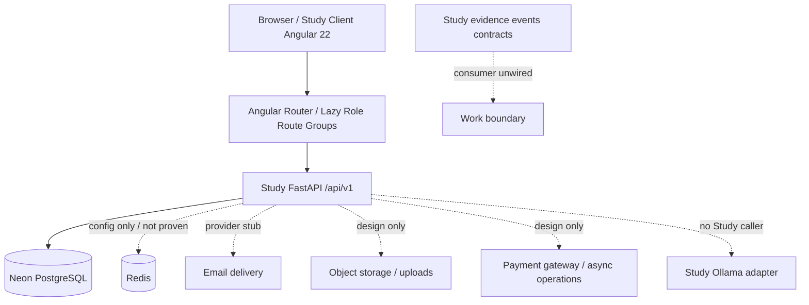
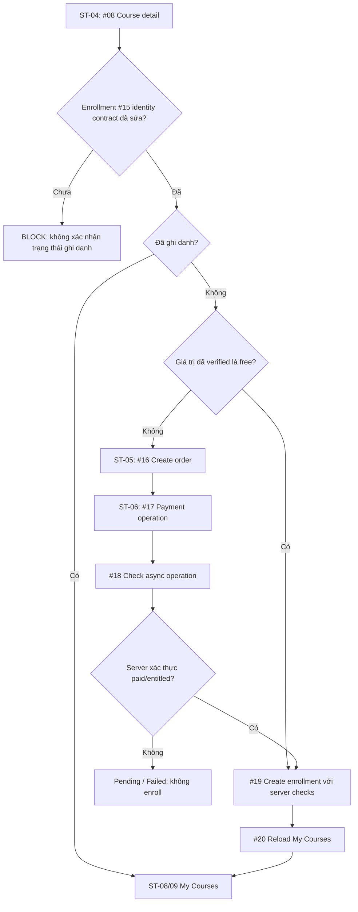

# Study2Work — LIST_SCREEN: Tổng thiết kế màn hình Study LMS V1

> **Loại tài liệu:** Master screen inventory / solution UI architecture / API traceability, là đầu vào cho **DD Screen** chi tiết và tách expected design khỏi current-source evidence; không xác nhận live runtime.
> **Phạm vi:** **Study** — `apps/study-client/` ↔ `apps/study-server/`, bốn actor Guest, Student, Mentor, Admin. Work/AI/DB Admin được mô tả tại ranh giới tích hợp, **không** nhập màn hình riêng của chúng vào Study.  
> **Nguồn GitHub:** `daovanhung-dev/Study2Work`, `main` HEAD `bb9e2be2e146285f004cdc00e8d632ca8ed1b4a3` (commit nguồn kiểm tra 2026-09-27 UTC), đánh giá tài liệu 2026-10-25 (Asia/Bangkok).  
> **Đường dẫn đề xuất trong repo:** `apps/study-client/docs/design/list_screen.md` (chưa tự ghi vào GitHub).  
> **Trạng thái:** `DESIGN_BASELINE / NEEDS_CONTRACT_REVIEW`, danh mục đủ để lập kế hoạch DD Screen, **chưa đạt gate triển khai toàn hệ thống**.

> **Ghi chú current source (2026-11-20):** SH-03 calls #01 and, after a valid 201 result, transfers positive safe-integer `id` and `email` to SH-04 through an in-memory service; no URL or persistent storage is used. SH-04 requires an explicit user click before #02, validates 202 + `DESIGN_OPERATION_ACCEPTED` + `data.status=accepted`, and distinguishes validation/server/unknown-provider outcomes. The default backend provider is a stub: accepted does not mean delivery or verification. Handoff expires on navigation/page reload; live email delivery and browser runtime remain unverified. SH-03/SH-04 test expectations that assumed no handoff/API caller are stale and were not run in this task.

> **Ghi chú current source (2026-11-20):** AD-01 route/page and Admin shell are source-wired. AdminLayout gates the dashboard on an in-memory role-validated #03 session and displays its profile; AD-01 has no API #101 caller, so KPI/date/audit/service data remains unavailable. Its three shortcuts use existing Angular routes. Runtime is unverified.
>
> **Ghi chú current source (2026-11-21):** ST-01–ST-26 đạt 100% theo rubric static DD-safe cho UI, UX, state/logic và API caller mapping; đây không phải xác nhận browser, live API, DB, migration hay deployment runtime. Student auth dùng #03 và token trong tab memory. ST-01 gọi #20 ACTIVE, #38 và #43 độc lập, giữ dữ liệu hợp lệ khi COUNT/LIST lệch và có retry riêng. ST-02 dùng #04; ST-03 dùng #04/#13/#14 cho tên, điện thoại và avatar, còn Bio bị khóa vì #14 không lưu trường này. ST-04 dùng #08/#15; #15 hiện xác thực Student và trả enrollment của chính người đăng nhập, nhưng catalog vẫn ghi actor Public. Chỉ khóa miễn phí mới gọi #19 rồi xác nhận qua #20; ST-05–ST-07 không mở thanh toán có trả phí vì #16 chưa được nối và thiếu bảng `orders`, #17 fail-closed, #18 là truy vấn notification operation và #19 cần Paid Order cho khóa trả phí. ST-08 dùng #20; ST-09 dùng #20 rồi #37, không dùng #09 làm cây học riêng tư. ST-10 chỉ gọi #23 sau thao tác rõ ràng và khi #22 trả đúng lesson `PUBLISHED`; source #22 chưa lọc trạng thái lesson, còn #23 chưa tự kiểm tra publication. ST-11 gọi #24 nhưng player, #25 progress và #27 next vẫn bị khóa. ST-12 tiêu thụ đúng `resources[]` của #26 và chuyển tài nguyên đã chọn sang GS-07; nguồn ghi tài nguyên chưa có writer xác nhận. ST-13–ST-16 giữ start/submit/result theo tương tác rõ ràng và projection hiện có; timer chuẩn, phục hồi answer, feedback/question detail và pass decision không được giả lập. ST-17–ST-19 dùng các trường #33–#36 hiện có, tách upload khỏi submit, và chỉ hiện điểm/feedback khi #36 là `GRADED`; các endpoint Draft và quyền truy cập chưa đủ vẫn được trình bày/khóa an toàn. ST-20 dùng award #38, không giả lập #21 progress; ST-21 chỉ hiển thị aggregate #37, ST-22 chỉ hiển thị award đã ghi nhận và không dựng certificate. ST-23–ST-25 dùng projection #39–#42, giữ filter/page và chặn gửi lại mù khi kết quả ghi chưa rõ; backend #40/#41 nhận `content:string` dù catalog ghi số nguyên. ST-26 dùng #43–#45; migration 016 định nghĩa `notification_recipients`, #45 trả `updated_count` khác catalog `Page<Notification>`. Các discrepancy và phần bị khóa được ghi tại worklog 2026-11-21.

> **Ghi chú current source (2026-11-21):** GS-01 calls #05 then #06 and GS-02 calls #07. Both validate successful response/page projections and recover separately from COUNT/LIST cardinality disagreement: preserve returned courses, suppress potentially stale totals/pagination, show retry, and block paging until reload. Matching zero-result and out-of-range states remain distinct. Browser/API/DB runtime is unverified; loaded-state design, filtering, cache/orchestration and card-navigation gates remain open.

> **Ghi chú current source (2026-11-20):** GS-06 calls #11 after GS-03 confirms a published course; #11 returns public `Resource[]` ordered by ID and `200 []` when empty. Selecting an item opens GS-07, which calls #12. #12 returns direct HTTP(S) URLs for PUBLIC resources and requires a Student Bearer, ACTIVE enrollment, published parent course and short-lived 300-second signed URL for PRIVATE resources. T041 approved PUBLIC/PRIVATE visibility and defaults existing resources to PRIVATE. GS-07 validates the exact response projection/ID and URL before exposing the open link. Runtime remains unverified; no Study writer for the `resources` table was found (#47 writes `lesson_uploads`), so data availability, MIME-specific preview and design fidelity remain incomplete.

## 0. Kết quả kiểm kê và định nghĩa phạm vi

| Chỉ số | Giá trị đã đối chiếu | Ý nghĩa |
|---|---|---|
| Actor | 4 | Guest, Student, Mentor, Admin |
| Use Case / Activity | 30/30 | 6 Guest + 10 Student + 6 Mentor + 8 Admin |
| API V1 | 105 API ID; 105/105 được ít nhất một screen tham chiếu | #01–#103 theo catalog/AC_UNICA; #104 tạo khóa học và #105 tạo user là Admin extensions được duyệt ngày 2026-11-22; API #18 dùng chung |
| UI screen/task surface | 83 | Gồm page, tab, panel, dialog và transition; không đồng nghĩa 83 URL độc lập |
| Study DD API | 15 bộ (#01–#15), mỗi bộ gồm Overview/Request/Response/Mapping/Error... | Các API #16–#103 có **contract V1/diagram**; #104/#105 là Admin extensions trong catalog, chưa có bộ DD API riêng |
| API backend | Local source hiện có #01–#98, #101, #104, #105 và runtime `/auth/refresh`; #104/#105 có route/module/focused fake-session tests | #02 là email stub; nhiều API có schema/projection/permission semantics còn DERIVED hoặc Draft; focused tests không chứng minh DB/deploy production; live DB/deploy chưa xác minh |
| Study frontend | Angular 22 + TypeScript; app router lazy-loads system/Shared, Student and Admin route groups (route declarations vary by screen) | Router entries are current source evidence; inventory routes without a matching source declaration remain proposals; deployment/runtime has not been verified |
| Database | ERD drawio 16 bảng; checked-in Study Server `DB.sql` hiện có 29 `CREATE TABLE`, gồm support tables | Migration/live schema/deployment chưa được xác minh; local DDL không chứng minh production state |
| Tích hợp khác | Payment, Object Storage, email, operation jobs chưa được chứng minh đã chạy | Không suy ra service chạy thực tế từ diagram/README |

### 0.1. Thứ bậc chứng cứ & ký hiệu

- **`R` — RUNTIME_SOURCE:** Route/logic có trong `apps/study-server/app/api/v1.py`, source + test; **không** đồng nghĩa đã kiểm chứng live database hay deploy.
- **`P` — PARTIAL_SOURCE:** Route/module logic hiện có nhưng focused test package không được tìm thấy; không suy ra persistence/live behavior.
- **`S` — STUB:** Có route/hợp đồng response nhưng external side effect không thực thi thật (`#02` email).
- **`D` — DESIGN_ONLY:** Mới có API catalog/AC/DD, chưa route runtime. Mọi UI phụ thuộc D là *target-state UI*, không được gọi API thật trong production khi chưa implement.
- **`M` — MIXED:** Screen tham chiếu cả R và D/S. **`UX`**: screen/state theo nhu cầu điều hướng, không có API nghiệp vụ riêng.
- **`BLOCK` — REQUIREMENT/SECURITY BLOCKER:** Mâu thuẫn khiến không thể khép kín data mapping hay flow an toàn; UI phải disabled/placeholder cho đến khi được giải quyết.
- **`P0`** foundation, **`P1`** luồng chức năng chính, **`P2`** mở rộng/analytics/integration. Priority là **đề xuất** để lập kế hoạch, không phải commitment phát triển.

**Quy tắc ưu tiên cho `CURRENT_BEHAVIOR`:** current source + test > context hiện hành > DD/contract/diagram. **Quy tắc cho `TARGET_BEHAVIOR`:** approved contract + AC/UC > DD assumptions > đề xuất UX; khi xung đột, lập `DISCREPANCY`, không tự đổi API để khớp mockup.

**Nguồn đọc và truy vết chính** (liên kết GitHub):

- [docs/lists/list_api.md](https://github.com/daovanhung-dev/Study2Work/blob/main/docs/lists/list_api.md)
- [apps/study-server/docs/diagrams/AC_UNICA/00_AC_API_INDEX.md](https://github.com/daovanhung-dev/Study2Work/blob/main/apps/study-server/docs/diagrams/AC_UNICA/00_AC_API_INDEX.md)
- [apps/study-server/docs/diagrams/AC_UNICA/AC_01_GUEST_ACCOUNT.drawio](https://github.com/daovanhung-dev/Study2Work/blob/main/apps/study-server/docs/diagrams/AC_UNICA/AC_01_GUEST_ACCOUNT.drawio)
- [apps/study-server/docs/diagrams/AC_UNICA/AC_02_STUDENT_LEARNING.drawio](https://github.com/daovanhung-dev/Study2Work/blob/main/apps/study-server/docs/diagrams/AC_UNICA/AC_02_STUDENT_LEARNING.drawio)
- [apps/study-server/docs/diagrams/AC_UNICA/AC_03_MENTOR_TEACHING.drawio](https://github.com/daovanhung-dev/Study2Work/blob/main/apps/study-server/docs/diagrams/AC_UNICA/AC_03_MENTOR_TEACHING.drawio)
- [apps/study-server/docs/diagrams/AC_UNICA/AC_04_ADMIN_MANAGEMENT.drawio](https://github.com/daovanhung-dev/Study2Work/blob/main/apps/study-server/docs/diagrams/AC_UNICA/AC_04_ADMIN_MANAGEMENT.drawio)
- [apps/study-server/docs/diagrams/UC.drawio](https://github.com/daovanhung-dev/Study2Work/blob/main/apps/study-server/docs/diagrams/UC.drawio)
- [apps/study-server/docs/diagrams/DB_UNICA_ERD.drawio](https://github.com/daovanhung-dev/Study2Work/blob/main/apps/study-server/docs/diagrams/DB_UNICA_ERD.drawio)
- [apps/study-server/docs/diagrams/DB_UNICA_TABLES.md](https://github.com/daovanhung-dev/Study2Work/blob/main/apps/study-server/docs/diagrams/DB_UNICA_TABLES.md)
- [infra/postgres/study-server/DB.sql](https://github.com/daovanhung-dev/Study2Work/blob/main/infra/postgres/study-server/DB.sql)
- [infra/README.md](https://github.com/daovanhung-dev/Study2Work/blob/main/infra/README.md)
- [.agents/project/architecture.md](https://github.com/daovanhung-dev/Study2Work/blob/main/.agents/project/architecture.md)
- [.agents/server-study/apis/declared-routes.md](https://github.com/daovanhung-dev/Study2Work/blob/main/.agents/server-study/apis/declared-routes.md)
- [apps/study-client/src/app/router/index.ts](https://github.com/daovanhung-dev/Study2Work/blob/main/apps/study-client/src/app/router/index.ts)
- [apps/study-server/app/api/v1.py](https://github.com/daovanhung-dev/Study2Work/blob/main/apps/study-server/app/api/v1.py)

**DD API #01–#15:** `apps/study-server/docs/dd/{01_auth_register,02_auth_verify_email_send,03_auth_login,04_users_me,05_categories,06_courses,07_courses_search,08_courses_detail,09_courses_curriculum,10_courses_reviews,11_courses_resources,12_resources_detail,13_users_me_avatar,14_users_me_profile,15_courses_enrollment_status}/`. Ưu tiên trang `02_Overview.md`, `03_Request.md`, `04_Response.md`, `05_Data_Mapping.md`, `06_Error.md` và `OPEN_QUESTIONS.md` (nếu có) trước khi author từng DD Screen. Nguồn DD có chỗ stale so với runtime; **không** mặc định đúng khi mâu thuẫn.

## 1. Kiến trúc màn hình và ranh giới tích hợp

**Deployment reality:** `127.0.0.2:3002` (Study Web) and `127.0.0.1:3003` (Study API) are development addresses from project architecture, not public URLs or proof of running services. Current `package.json` and `src/main.ts` show Angular 22 bootstrapped through `bootstrapApplication`; the app router lazy-loads system, Shared, Student and Admin route groups. `StudyApiService` uses relative `/api/v1`, and Angular's `proxy.conf.json` maps that path to `http://127.0.0.1:3003` for the dev server. Production API origin/deployment remains unverified. `infra/README.md` describes historical PostgreSQL/Redis/MinIO/Mailhog compose setup; the checked Git tree has no root `docker-compose.yml` or `compose.yaml`, so those services are not considered running.

**Bảo mật hiện hữu:** source có hardcoded Neon credential, signing private key trong `app/core/constants.py` công khai. Trước khi deploy thật phải rotate/thu hồi credential, thay signing key, di chuyển secrets sang cơ chế an toàn; tuyệt đối không chép khóa vào DD Screen, fixture, mock, ảnh hay file này. Không cấp DB credential cho browser; mọi query nghiệp vụ đi qua Study API.

### 1.1. Actor, layout và điều hướng cấp cao

| Role | Shell/navigation đề xuất | Guard/điểm vào | Trạng thái xác thực |
|---|---|---|---|
| Guest | Header công khai: Trang chủ, Khóa học, Tìm kiếm, Đăng nhập/Đăng ký | `/`, `/courses`, `/courses/search`, `/courses/:id` | #05–#10 có route source; #11 remains unavailable for collection use; deployment/runtime remains unverified |
| Student | Tổng quan, Khóa học, Tiến độ, Thảo luận, Thông báo, Hồ sơ | `/student/*`; StudentLayout login #03; #04 profile | Student session is tab-memory and Student-role checked; source-backed private calls vary by screen and unresolved APIs remain gated |
| Mentor | Tổng quan, Khóa học, Nội dung, Chấm bài, Hỗ trợ, Thông báo, Tiến độ | `/mentor/*`; Mentor role login #03 | Mentor route/layout/session and #46–#67 callers exist; no Mentor `/me` endpoint, server owner checks remain authoritative |
| Admin | Tổng quan, Users, Courses, Content review, Lessons, Quizzes, Notifications, Moderation, Reports | `/admin/*` | Tương tự: không dùng #04 Student-only để xác minh Admin; backend RBAC còn design only |

Current route source declares SH-01 at `/`, SH-02 at `/login` and SH-03 at `/register`. SH-02 calls #03 through `SH02LoginService`, stores credentials only in the selected role's existing in-memory session manager, calls #04 only for Student, and routes to `/student`, `/mentor` or `/admin`; its catalog #03 contract discrepancy, `returnTo` policy and runtime verification remain open. SH-03 has an API #01 registration caller and does not call #02. The Guest group declares GS-01–GS-03 and Student declares ST-01–ST-26; Mentor declares ME-01–ME-18 and Admin declares AD-01–AD-25. Student source summary: ST-01 calls #20/#38/#43; ST-02 calls #04 and ST-03 calls #04/#13/#14 for supported fields, with Bio gated; ST-04 calls authenticated #15 and allows #19 only for free enrollment before #20 confirmation; ST-05–ST-07 keep paid checkout/payment/result gated. ST-08 calls #20 with the supported ACTIVE filter; ST-09 calls #20/#37; ST-10 calls #22 and explicit #23, then ST-11 calls #24; ST-12 uses #26 then GS-07/#12. ST-13–ST-16 implement explicit client interactions against quiz API descriptors, whose backend routes remain design-only; ownership, timer, answer recovery and grading policy are gated. ST-17–ST-19 use the documented #33–#36 client flow and distinguish #34 upload from submission; backend submission routes and eligibility remain unresolved. ST-20–ST-22 show only #38 awards and #37 aggregate fields; ST-23–ST-25 use #39–#42 with write-ambiguity protections; ST-26 uses #43–#45 and migration 016. See the 2026-11-21 Student current-source note below for projection discrepancies and remaining gates. GS-01 loaded states and GS-03 loaded overview remain derived beyond their DD assets; category filtering, resource collection, reviews, payment and unresolved enrollment behavior remain gated. For any page `/:id`, parse and validate the ID before requesting; route-level 404 behavior must not expose private data. Current source routes unknown app URLs to SH-06 with the original path/query cleared, and routes GS-03 API #08 detail 404 to SH-06; #08 500 and #09 curriculum 404 remain separate. Dialog/Tab/Transition screens have separate DD IDs but can be implemented as components, modals or sub-routes rather than independent URLs.

### 1.2. Data ownership, cache, điều hướng

- **API client:** HTTP `ApiEnvelope<T>` đúng keys `success`, `businessCode`, `message`, `data`, `meta`, `traceId`; giữ response header `X-Trace-Id` để chẩn đoán. JSON contract/response phải validate bằng TypeScript/Zod nếu triển khai Vue; không ép mọi response thành `Page<T>` khi nguồn chỉ là object.
- **Auth:** Access JWT `type=access`, `sub`, `roles`, `jti`, `iat`, `exp`, `iss`, `aud`; refresh **opaque** runtime `/api/v1/auth/refresh` (không nằm trong 103 API V1). 401 → retry refresh tối đa một lần có đồng bộ concurrent requests; 403 → access denied; không lưu token vào URL/query hoặc log. Chiến lược token storage/CSRF cần security review trước DD Screen.
- **Cache keys đề xuất:** `categories(locale)`, `courses(page,size,sort)`, `course-search(q,page,sort)`, `course(id)`, `curriculum(id)`, `reviews(id,page)`, `me`, `my-courses(status,page)`, `progress(courseId)`, `mentor-courses(filters)`, `admin-users(filters)`; đây là **client architecture proposal**, không phải backend cache contract.
- **Mutations:** optimistic UI chỉ khi có rollback và dữ liệu trả về xác thực. Default sau create/update/delete là invalidate query liên quan và re-fetch; không coi `202 Accepted` là completed.
- **Error strategy:** 422 hiển thị per-field; 401 refresh/login; 403 access denied; 404 route resource-not-found; 409 conflict giữ dữ liệu form; 500/503 thông báo ngắn + Retry + trace ID. Các API chưa có 503 trong contract **không tự thêm 503 business code**.
- **Pagination:** lấy `data.pagination` theo response thực, không ước lượng số trang. Bật `category` UI chỉ khi #06/#07 hỗ trợ; tại runtime chúng **trả 422** nếu `category` được cung cấp.
- **Accessibility:** Web keyboard navigation, focus-visible, input/error association, WCAG AA, hit area ≥44px, responsive mobile/tablet/desktop; reduced motion, loading/empty/error độc lập từng data source.

## 2. Danh sách màn hình chuẩn (83 mã)

**Định nghĩa một dòng:** `STT` global ổn định theo tài liệu, `Mã` stable ID dùng để đặt tên DD Screen, `Surface` Page/Tab/Dialog/Panel/Transition, `Route` là thiết kế, `API #` tham chiếu danh mục §5, `Orchestration` ghi call order và quy tắc nối dữ liệu, `Trạng thái UI` là checklist states, `BE` là nguồn hiện hữu (R/S/D/M/UX), `Gate` là blocker cụ thể. Không đổi Screen ID khi thay URL; một bước UX có thể tạo nhiều component trong DD chi tiết.

### 2.1. Shared / Auth / System — 7 surfaces

| STT | Mã · màn hình · surface | Route đề xuất | AC | API # | Mục đích / logic màn hình | Orchestration API / dữ liệu | Điều hướng | UI states | Ưu tiên | BE / Gate |
|---|---|---|---|---|---|---|---|---|---|---|
| 01 | **SH-01** Trang giới thiệu Study (Page) | `/` (Shared route/page wired) | AC-03 | #05, #06 | Giới thiệu, tìm khóa học và CTA đăng nhập/đăng ký theo Study Web design guide và SH-01 DD-safe scope. | #05/#06 public callers run independently; #05 omits locale and #06 sends `page=1,size=6` with no category/sort. Client validates envelope, full category/course/mentor projections and endpoint pagination; only PUBLISHED #06 items render. Search trims q and hands off to GS-02; categories are informational; cards stay non-clickable; “Xem tất cả” opens GS-01; registration CTA opens SH-03; price is hidden until currency is defined. | GS-01, GS-02, SH-02, SH-03 | source: loading skeleton/ready/empty/error + scoped retry; focusable skip link, responsive controls/footer; focused SH-01 spec 7/7 and isolated Angular build pass. Full application browser demo unavailable in this session. | P0 | **100% under the approved four-axis screen rubric.** Local API #05/#06 source/tests match the client; live API/DB/deployment remain unverified. Screenshot-only KPIs, testimonials, employer logos, email capture, category filters, card destinations and price display remain intentionally excluded/gated by the approved scope. |
| 02 | **SH-02** Đăng nhập (Page) | `/login` | AC-02 | #03, #04 | Email/password, lỗi tại trường, tách 401/403; safe `returnTo` và quên mật khẩu chưa có. | Current source: POST #03 exactly once; route by validated `data.role` to existing role session; GET #04 only for Student and verify returned email/role. No `returnTo` or persistent token storage. | `/student`, `/mentor`, `/admin`; SH-03 | idle/validating/submitting/401/403/422/network-error/unsupported-role/profile-mismatch | P0 | **PARTIAL SOURCE-WIRED; RUNTIME NOT VERIFIED:** catalog #03 says 201/UserProfile while current server source returns 200/profile+tokens; reconcile G-14; safe `returnTo`, forgotten password, full Stitch acceptance and runtime remain open |
| 03 | **SH-03** Đăng ký học viên (Page) | `/register` | AC-01 | #01 | Nhập tên/email/password và xác nhận điều khoản nếu có contract; không tự thêm CAPTCHA/OTP. | Current: #01 caller validates the response and displays created state; a separate Continue action sends returned `id/email` to SH-04 via in-memory handoff, without URL or persistent storage. | SH-04, SH-02 | validating/submitting/409/422/201/handoff-unavailable | P0 | **PARTIAL SOURCE-WIRED:** #01 caller and safe handoff are implemented; oversized JS-integer IDs fail closed; email confirmation and runtime remain unverified |
| 04 | **SH-04** Handoff xác thực email (Page) | `/register/verification` | AC-01 | #02 | Gửi yêu cầu xác minh sau khi người dùng chủ động xác nhận; chỉ báo provider accepted, không khẳng định email đã gửi/verify. Chưa có OTP/link confirmation API. | Current: consumes one-time in-memory handoff; explicit button calls #02 once; maps 202/code/status and 422/500/unknown states; no automatic retry. | SH-02 | missing-handoff/ready/submitting/accepted/provider-status-unknown/invalid-request/error/outcome-unknown | P1 | **PARTIAL SOURCE-WIRED; API #02 stub:** delivery and verification are not implemented by provider; server does not validate user/email binding or int64 range; handoff is lost on refresh; tests/runtime unverified |
| 05 | **SH-05** Không đủ quyền / session hết hạn (State view) | `/forbidden` (route/page/error handoff source-wired) | AC-02,AC-11 | #04 | Phân biệt 401 (không thể xác thực; không tự kết luận hết phiên) và 403; bảo toàn redirect khi policy an toàn được chốt. | Student `#04 GET /users/me` 401/403 được chuẩn hóa và chuyển state an toàn tới SH-05; session refresh proactive theo hạn token trước request; final 401 xóa local session; không refresh sau 403 hoặc retry sau server 401. | 401 → SH-02 `/login` (không `returnTo`); 403 safe-back chưa có fallback được duyệt | 401/403/direct-entry-without-context | P0 | **R; PARTIAL SOURCE-WIRED; RUNTIME NOT VERIFIED:** server-401 refresh/replay, safe `returnTo`, 403 fallback, SH-02/G-14 handoff and visual/runtime acceptance remain open |
| 06 | **SH-06** Trang không tồn tại / tài nguyên không còn (State view) | `/not-found` | AC-05 | #08 | Thông báo 404 không tiết lộ draft/private, cung cấp quay về khóa học. | Router 404 hoặc resource 404 chuyển state; không chuyển 500 thành 404. | GS-01, SH-01 | route-404/resource-404 | P0 | **D** |
| 07 | **SH-07** Theo dõi tác vụ bất đồng bộ (Panel) | `/operations/:operationId` | AC-12,AC-25,AC-36,AC-38 | #18 | Dùng lại trạng thái job thanh toán/gửi thông báo/export theo ownership. | Chỉ GET #18 nếu đã có operation_id do BE xác nhận; không tự sinh ID, stop theo terminal state. | ST-07, ME-15, AD-21, AD-25 | queued/running/succeeded/failed/expired | P2 | **D**; current route/page renders an unavailable contract gate with no ID/status/API request; #18 backend is notification-only. **BLOCK:** generic producer mapping, Operation ID type, ownership, lifecycle/status/result contract remain unresolved |

### 2.2. Guest / Discovery — 7 surfaces

| STT | Mã · màn hình · surface | Route đề xuất | AC | API # | Mục đích / logic màn hình | Orchestration API / dữ liệu | Điều hướng | UI states | Ưu tiên | BE / Gate |
|---|---|---|---|---|---|---|---|---|---|---|
| 08 | **GS-01** Danh sách khóa học (Page) | `/courses` | AC-03 | #05, #06 | Grid khóa học public; sort, paging, số kết quả và xem chi tiết. | Current: #05 rồi #06 `page=1,size=20`, không gửi locale/category/cache; sort reset về trang đầu. Validate envelope/projection/Published status/pagination. Khi COUNT/LIST lệch, giữ cards, ẩn tổng/phân trang, báo và cho retry; empty/out-of-range/error độc lập. | GS-02,GS-03 | loading/empty/ready/out-of-range/count-mismatch/error | P0 | **100% theo rubric tĩnh DD-safe (UI/UX/logic/API).** Cards mở GS-03 theo response ID; category metadata chỉ để xem. Cache-first, filter category và currency chưa có contract nên vẫn gated. Runtime/API/DB live chưa xác minh. |
| 09 | **GS-02** Tìm kiếm khóa học (Page) | `/courses/search?q=` | AC-04 | #07 | Tìm theo q và đồng bộ URL, server paging 20. | Current: #07 chỉ gọi với q chuẩn hóa không rỗng; hủy request cũ khi query/page đổi; validates envelope, PUBLISHED projections and page metadata. COUNT/LIST lệch thì giữ rows, ẩn tổng/phân trang, cho retry; lỗi có retry; out-of-range có hành động tải lại trang đầu. Cards mở GS-03 bằng ID. | GS-01,GS-03 | prompt/loading/ready/no-result/count-mismatch/error/out-of-range | P0 | **100% theo rubric tĩnh DD-safe (UI/UX/logic/API).** Category/facets/cache/order tùy chọn và price/rating không có contract phù hợp nên gated; runtime chưa xác minh. |
| 10 | **GS-03** Chi tiết khóa học (Page) | `/courses/:courseId` | AC-05 | #08, #09, #10, #11, #12 | Course public, mentor, đề cương, thảo luận và tài nguyên theo tab. | Current: #08 xác nhận course PUBLISHED; chỉ hiển thị title/description/thumbnail/mentor; #09 load lazy theo tab và chỉ title/order; #10 reviews/replies public có paging; #11 resources lazy; chọn resource mới gọi #12. Route ID giữ decimal string và kiểm tra int64. #15 enrollment, preview, price không có currency, rating/aggregate không gọi. | GS-04,GS-05,GS-06,GS-07,ST-04 | loading/ready/not-found/error/tabs | P1 | **100% theo rubric tĩnh DD-safe (UI/UX/logic/API).** Enrollment, price formatting, lesson preview và rating vẫn gated vì source/contract chưa duyệt; runtime/schema live chưa xác minh. |
| 11 | **GS-04** Đề cương khóa học (Tab) | `/courses/:courseId?tab=curriculum` | AC-05 | #09 | Hiển thị thứ tự lesson public, không mở nội dung/video cho guest. | Current: load #09 sau #08 PUBLISHED; validates LessonPage/status, sorts by `order`, renders title/order only; 404/error/empty/readiness tách riêng, lỗi có retry. | GS-03,ST-10 | loading/empty/ready/not-found/error | P1 | **100% theo rubric tĩnh DD-safe (UI/UX/logic/API).** Lesson preview/access, cache và yêu cầu eager chưa có contract; private lesson không được mở. Runtime/schema live chưa xác minh. |
| 12 | **GS-05** Đánh giá và thảo luận công khai (Tab) | `/courses/:courseId?tab=reviews` | AC-05 | #10 | Review/reply công khai; không hiển thị sao trung bình. | Current: #10 public sau #08 PUBLISHED; validates envelope/review/author/reply/page, fixed size 20. Renders content, author, replies and paging; count/list mismatch giữ rows, ẩn paging, retry; 404/error/empty riêng. Không gửi rating và không render title/rating. | GS-03 | loading/empty/ready/not-found/error/out-of-range/paginated | P2 | **100% theo rubric tĩnh DD-safe (UI/UX/logic/API).** #10 Draft DD còn chốt title/rating/visibility details; current source/test projection được dùng và các field chưa duyệt vẫn gated. Runtime/schema live chưa xác minh. |
| 13 | **GS-06** Tài nguyên khóa học (Tab) | `/courses/:courseId?tab=resources` | AC-06 | #11 | Danh sách resource PUBLIC, chọn item để xác minh quyền và mở qua GS-07. | Current: sau #08 PUBLISHED, #11 trả `Resource[]` PUBLIC theo ID ASC; validates IDs/projection, xử lý loading/error+retry/empty/list. Link chuyển GS-07 theo resource ID và course context. | GS-07,GS-03 | loading/invalid-course/error/empty/ready | P2 | **100% theo rubric tĩnh DD-safe (UI/UX/logic/API).** API #11 source tests xác nhận list/empty `200 []`; live schema/data writer/deployment chưa xác minh. PRIVATE list và MIME preview không thuộc #11. |
| 14 | **GS-07** Xem/tải tài nguyên (Page) | `/resources/:resourceId` | AC-06 | #12 | Hiển thị metadata; mở URL HTTP(S) sau khi API xác nhận quyền. | Current: validates route ID and response ID/projection/URL; PUBLIC calls #12 without Bearer, PRIVATE uses Student Bearer. Distinguishes 401/403/404, retries transient errors, returns to course resource tab and opens direct/signed URL in new tab with `noopener noreferrer`. | GS-06 hoặc ST-12 theo query context | loading/invalid-resource/login-required/forbidden/not-found/error/ready | P2 | **100% theo rubric tĩnh DD-safe (UI/UX/logic/API).** PRIVATE source requires published course + ACTIVE enrollment and signs URL for 300s. MIME preview, expiry UI, live schema/storage/runtime remain unverified. |

### 2.3. Student / Learning & Interaction — 26 surfaces

| STT | Mã · màn hình · surface | Route đề xuất | AC | API # | Mục đích / logic màn hình | Orchestration API / dữ liệu | Điều hướng | UI states | Ưu tiên | BE / Gate |
|---|---|---|---|---|---|---|---|---|---|---|
| 15 | **ST-01** Tổng quan học viên (Page) | `/student` | AC-13,AC-18,AC-20 | #20, #21, #38, #43 | Tổng quan khóa học, tiến độ, thành tích và thông báo; widget độc lập. | Current: independently calls #20 ACTIVE, #38 and #43; validates each response and keeps widget-specific retry/error states. COUNT/LIST mismatches preserve valid rows and avoid false empty totals. #21 is not used for progress because its current handler returns UserProfile. | ST-08,ST-20,ST-26,ST-02 | loading/partial-widget/empty/error/retry | P1 | **100% static DD-safe (UI/UX/logic/API). Unsupported behavior remains gated; browser/live API/DB/deployment runtime is unverified.** |
| 16 | **ST-02** Hồ sơ cá nhân (Page) | `/student/profile` | AC-11 | #04 | Xem thông tin profile không lộ trường bảo mật; avatar/email/role/status. | Current: #04 loads and validates the Student projection; displays safe profile fields with role/status labels, avatar fallback and a working edit-profile route. Protected requests use the Student Bearer session. | ST-03 | profile loading/ready/error; edit remains disabled | P0 | **100% static DD-safe (UI/UX/logic/API). Unsupported behavior remains gated; browser/live API/DB/deployment runtime is unverified.** |
| 17 | **ST-03** Chỉnh sửa hồ sơ/avatar (Page) | `/student/profile/edit` | AC-11 | #04, #13, #14 | Form chỉnh sửa fullname/phone/bio/avatar, theo dõi upload/save riêng. | Current: #04 loads profile; #13 uploads a validated avatar and #14 saves supported full_name/phone/avatar_url fields. Upload and profile update have separate states. Bio remains disabled because #14 does not persist it. | ST-02 | profile loading/ready/error; G-03 upload/save/phone/bio gates remain closed | P1 | **100% static DD-safe (UI/UX/logic/API). Unsupported behavior remains gated; browser/live API/DB/deployment runtime is unverified.** |
| 18 | **ST-04** Kiểm tra ghi danh trước đăng ký (Page) | `/student/enroll/:courseId` | AC-12 | #08, #15 | Xem giá, quyền học hiện có, nhánh khóa miễn phí/trả phí; không tự xác nhận đã ghi danh. | Current: #08 loads course detail, authenticated #15 checks this Student enrollment, and only a verified free/no-active-enrollment branch can call #19; #20 confirms the resulting ACTIVE enrollment. Paid branch stops at the payment gate. | ST-05,ST-07,ST-08 | loading/not-found/error/enrollment-gate; branches blocked | P1 | **100% static DD-safe (UI/UX/logic/API). Unsupported behavior remains gated; browser/live API/DB/deployment runtime is unverified.** |
| 19 | **ST-05** Kiểm tra đơn hàng / checkout (Page) | `/student/checkout/:courseId` | AC-12 | #08, #16 | Hiển thị khoản tiền, nhà cung cấp, xác nhận mua trước khi tạo Order. | Current: #08 validates course and price context; order creation through #16 stays gated because its client descriptor is UNWIRED and checked-in DDL has no orders table. No order is fabricated. | ST-06,ST-04 | loading/unavailable/not-found/error; confirming/order-creating blocked | P2 | **100% static DD-safe (UI/UX/logic/API). Unsupported behavior remains gated; browser/live API/DB/deployment runtime is unverified.** |
| 20 | **ST-06** Thực hiện thanh toán (Page) | `/student/pay/:orderId` | AC-12 | #17, #18 | Theo dõi trạng thái thanh toán và điều hướng ngoài nếu gateway xác nhận; retry chỉ khi có quy tắc an toàn được duyệt. | Current: payment initiation is gated; #17 currently fails closed and #18 only resolves notification operations. No provider redirect or paid status is inferred. | ST-07,SH-07 | unavailable/payment-gate; expected pending/running/failed/cancelled/succeeded | P2 | **100% static DD-safe (UI/UX/logic/API). Unsupported behavior remains gated; browser/live API/DB/deployment runtime is unverified.** |
| 21 | **ST-07** Kết quả đăng ký khóa học (Page) | `/student/enroll/result/:courseId` | AC-12 | #18, #19, #20 | Hiển thị kết quả chỉ sau backend xác nhận entitlement/enrollment; không suy ra success từ callback hay static copy. | Current: enrollment outcome is shown only after source-backed #20 confirms ACTIVE enrollment; paid order/payment result cannot be inferred from route data or a client callback. | ST-08,ST-09 | awaiting-confirmation/enrolled/conflict/failure | P2 | **100% static DD-safe (UI/UX/logic/API). Unsupported behavior remains gated; browser/live API/DB/deployment runtime is unverified.** |
| 22 | **ST-08** Khóa học của tôi (Page) | `/student/courses` | AC-13 | #20, #21 | Danh sách khóa đã ghi danh, filter trạng thái và thanh tiến độ. | Current: paged #20 supports the ACTIVE course view and status filter; validates CourseSummary projections, recovers out-of-range pages, and preserves rows with retry when count-derived pagination is stale. #21 is not used for progress. | ST-09,ST-20 | loading/ready/empty/error/retry/pagination | P1 | **100% static DD-safe (UI/UX/logic/API). Unsupported behavior remains gated; browser/live API/DB/deployment runtime is unverified.** |
| 23 | **ST-09** Tổng quan khóa đang học (Page) | `/student/courses/:courseId` | AC-13,AC-18 | #09, #20, #37 | Xác minh enrollment ACTIVE, hiển thị tiến độ course; nội dung bài học còn được bảo vệ. | Current: #20 confirms ACTIVE enrollment before #37 loads course progress. Shows aggregate fields only; a mismatched page without the selected course remains unresolved with retry. Public #09 is not used as a private learning tree. | ST-10,ST-21 | checking/active/not-enrolled/progress/error/content-gate | P1 | **100% static DD-safe (UI/UX/logic/API). Unsupported behavior remains gated; browser/live API/DB/deployment runtime is unverified.** |
| 24 | **ST-10** Kiểm tra quyền và bắt đầu học (Transition) | `/student/lessons/:lessonId/start` | AC-14 | #22, #23, #24 | Không phát video hay lộ nội dung trước khi xác minh quyền. | Current: #22 checks lesson access on entry. Explicit Start calls #23 only when the response has the exact lesson ID and PUBLISHED status, then hands off to ST-11. Source discrepancy: #22 omits lesson status and #23 does not independently enforce publication. | ST-11,ST-09 | checking/denied/unpublished/ready/starting/error | P1 | **100% static DD-safe (UI/UX/logic/API). Unsupported behavior remains gated; browser/live API/DB/deployment runtime is unverified.** |
| 25 | **ST-11** Trình học bài/lesson player (Page) | `/student/lessons/:lessonId` | AC-14,AC-15 | #24, #25, #26, #27 | Video/nội dung, mục lục, nút complete, vị trí học, bài tiếp theo. | Current: #24 loads the validated published lesson after handoff and provides loading/error/retry states. Lesson player, #25 progress writes and #27 next-lesson remain gated because those contracts are unresolved. | ST-12,ST-09,ST-13,ST-17 | loading/playing/paused/progress-saving/finished | P1 | **100% static DD-safe (UI/UX/logic/API). Unsupported behavior remains gated; browser/live API/DB/deployment runtime is unverified.** |
| 26 | **ST-12** Tài liệu kèm bài học (Panel) | `/student/lessons/:lessonId/resources` | AC-15 | #26, #12 | Liệt kê metadata tài nguyên theo lesson, chuyển resource ID và lesson context sang GS-07 để #12 kiểm tra quyền/mở URL; quay lại ST-11. | Current: #26 returns and validates lesson resources[]; selection passes the resource ID and return context to GS-07/#12 for access validation. Checked-in source has no confirmed writer to resources (API #47 writes lesson_uploads). | ST-11,GS-07 | loading/empty/error/available; resource access and return context continue in GS-07 | P2 | **100% static DD-safe (UI/UX/logic/API). Unsupported behavior remains gated; browser/live API/DB/deployment runtime is unverified.** |
| 27 | **ST-13** Giới thiệu bài kiểm tra (Page) | `/student/quizzes/:quizId` | AC-16 | #28, #29 | Tiêu đề, thời hạn và quy định chấm; xác nhận bắt đầu. | Current: #28 loads the quiz; explicit Start calls #29 once and validates the returned attempt before navigating. Enrollment/quiz-open enforcement and the quiz lifecycle remain unresolved in backend source. | ST-14 | loading/closed/available/denied | P1 | **100% static DD-safe (UI/UX/logic/API). Unsupported behavior remains gated; browser/live API/DB/deployment runtime is unverified.** |
| 28 | **ST-14** Làm bài kiểm tra (Page) | `/student/quizzes/:quizId/attempts/:attemptId` | AC-16 | #28, #29, #30 | Điều hướng câu hỏi, đồng hồ nếu server cung cấp, lưu đáp án, đánh dấu câu chưa trả lời. | Current: #28 loads quiz content and #30 saves selected answers with response identity checks and serialized writes. The client sends choice_ids[] while catalog declares answer(s):string; answer restore and an authoritative timer are unavailable. | ST-15 | unsaved/saving/saved/retrying/expired | P1 | **100% static DD-safe (UI/UX/logic/API). Unsupported behavior remains gated; browser/live API/DB/deployment runtime is unverified.** |
| 29 | **ST-15** Xác nhận nộp bài kiểm tra (Dialog) | `/student/attempts/:attemptId/submit` | AC-16 | #30, #31 | Xem số câu chưa làm, xác nhận nộp và khóa chỉnh sửa khi server chấp nhận. | Current: explicit confirmation triggers one #31 submit after the answer-save handoff. An ambiguous write blocks blind replay and offers a result lookup path; pending writes/direct entry remain unresolved. | ST-16,ST-14 | confirm/submitting/submitted/ambiguous-network | P1 | **100% static DD-safe (UI/UX/logic/API). Unsupported behavior remains gated; browser/live API/DB/deployment runtime is unverified.** |
| 30 | **ST-16** Kết quả bài kiểm tra (Page) | `/student/attempts/:attemptId/result` | AC-16 | #32 | Điểm/trạng thái chấm và feedback nếu được trả; không lộ đáp án ngoài policy. | Current: #32 loads the owner-scoped attempt result, accepts only PENDING_GRADE/GRADED and shows score only for GRADED. Feedback, question details and pass/fail are not inferred. | ST-09,ST-20 | pending/graded/unavailable/error | P1 | **100% static DD-safe (UI/UX/logic/API). Unsupported behavior remains gated; browser/live API/DB/deployment runtime is unverified.** |
| 31 | **ST-17** Chi tiết bài tập (Page) | `/student/assignments/:assignmentId` | AC-17 | #33 | Đề bài, hạn nộp, điểm tối đa, file liên quan và nút nộp. | Current: #33 loads only available assignment fields; displays due date/score context without deciding authorization or deadline eligibility locally. Unsupported attachment metadata remains hidden. | ST-18,ST-09 | loading/open/closed/not-found | P1 | **100% static DD-safe (UI/UX/logic/API). Unsupported behavior remains gated; browser/live API/DB/deployment runtime is unverified.** |
| 32 | **ST-18** Soạn và nộp bài tập (Page) | `/student/assignments/:assignmentId/submit` | AC-17 | #33, #34, #35 | Soạn nội dung, file đính kèm, kiểm tra tiến độ upload/nộp một lần. | Current: #33 loads assignment context, #34 uploads one selected file, and #35 submits the source-backed content/upload reference. Upload success is separate from submission success; ambiguous submit blocks blind replay. | ST-19,ST-17 | editing/uploading/submitting/failed/submitted | P1 | **100% static DD-safe (UI/UX/logic/API). Unsupported behavior remains gated; browser/live API/DB/deployment runtime is unverified.** |
| 33 | **ST-19** Bài đã nộp và phản hồi (Page) | `/student/submissions/:submissionId` | AC-17 | #36 | Hiển thị timestamp, file, trạng thái chấm, score/feedback khi có. | Current: owner-scoped #36 loads submission status; score/feedback appear only for GRADED. Unknown file status and unverified file URLs stay hidden. | ST-17,ST-20 | submitted/pending-review/graded/denied | P1 | **100% static DD-safe (UI/UX/logic/API). Unsupported behavior remains gated; browser/live API/DB/deployment runtime is unverified.** |
| 34 | **ST-20** Tổng quan tiến độ (Page) | `/student/progress` | AC-18 | #21, #38 | Tổng số bài học, tiến độ theo course và achievements thực tế. | Current: #38 shows recorded achievements and handles separate COUNT/LIST mismatch without false empty copy. #21 is gated from progress metrics because its handler returns UserProfile. | ST-21,ST-22 | loading/partial/empty/error/retry | P2 | **100% static DD-safe (UI/UX/logic/API). Unsupported behavior remains gated; browser/live API/DB/deployment runtime is unverified.** |
| 35 | **ST-21** Tiến độ theo khóa học (Page) | `/student/progress/:courseId` | AC-18 | #37 | Các bài đã/đang/chưa học, tỷ lệ hoàn thành, mốc thời gian có chứng cứ. | Current: #37 shows the ACTIVE-enrollment aggregate counts, percentage and has_content fields. No per-lesson timeline or timestamps are fabricated. | ST-11,ST-20 | loading/empty/in-progress/completed/error/retry | P2 | **100% static DD-safe (UI/UX/logic/API). Unsupported behavior remains gated; browser/live API/DB/deployment runtime is unverified.** |
| 36 | **ST-22** Thành tích và chứng nhận (Page) | `/student/achievements` | AC-18 | #38 | Danh sách achievement theo course; tuyệt đối không tự cấp chứng chỉ. | Current: #38 shows recorded award fields only, validates count/item consistency and retries on mismatch. Certificate, GPA and readiness metrics are not synthesized. | ST-20,ST-09 | loading/empty/earned/error/retry | P2 | **100% static DD-safe (UI/UX/logic/API). Unsupported behavior remains gated; browser/live API/DB/deployment runtime is unverified.** |
| 37 | **ST-23** Danh sách thảo luận (Page) | `/student/discussions` | AC-19 | #39 | Topic theo khóa học, filter/sort, nút tạo thảo luận. | Current: #39 filters/paginates ACTIVE root discussions in fixed 20-item pages; validates results, recovers out-of-range pages and preserves rows with retry on count mismatch. Source ignores sort, so no unsupported sort control is exposed. | ST-24,ST-25 | loading/empty/ready/error | P2 | **100% static DD-safe (UI/UX/logic/API). Unsupported behavior remains gated; browser/live API/DB/deployment runtime is unverified.** |
| 38 | **ST-24** Tạo câu hỏi / chủ đề (Page) | `/student/discussions/new` | AC-19 | #40, #39 | Soạn title/body, chọn course đã ghi danh, lưu và quay về danh sách. | Current: #20 supplies validated ACTIVE course options; #40 creates a topic using current string content, then #39 refreshes the list. Ambiguous create outcomes block blind replay; catalog declares content:int64. | ST-23,ST-25 | draft/invalid/submitting/created | P2 | **100% static DD-safe (UI/UX/logic/API). Unsupported behavior remains gated; browser/live API/DB/deployment runtime is unverified.** |
| 39 | **ST-25** Chi tiết thread và phản hồi (Page) | `/student/discussions/:discussionId` | AC-19 | #42, #41 | Danh sách nội dung phản hồi theo thứ tự; composer bình luận và trạng thái gửi. | Current: #42 loads the source-backed thread projection and #41 submits a reply; exact response identity is checked. Ambiguous POST offers read-only #42 reload and blocks blind replay; catalog content type disagrees with source. | ST-23 | loading/replying/moderated/closed | P2 | **100% static DD-safe (UI/UX/logic/API). Unsupported behavior remains gated; browser/live API/DB/deployment runtime is unverified.** |
| 40 | **ST-26** Thông báo học viên (Page) | `/student/notifications` | AC-20 | #43, #44, #45 | Lọc chưa đọc, mở deep link an toàn, mark-one/mark-all. | Current: #43 lists direct/recipient-addressable notifications; #44 marks one read and #45 marks all, with refresh, unread filtering and page recovery. Migration 016 defines notification_recipients; #45 returns updated_count instead of catalog Page<Notification>. Deep links remain gated. | ST-09,ST-17,ST-25 | unread/read/empty/marking/error | P2 | **100% static DD-safe (UI/UX/logic/API). Unsupported behavior remains gated; browser/live API/DB/deployment runtime is unverified.** |

### 2.4. Mentor / Teaching & Support — 18 surfaces

> Cập nhật 2026-11-21: ME-01–ME-18 đạt 100% theo rubric tĩnh DD-safe (UI, UX, logic và API caller mapping). Mọi hành vi chưa có contract/source đủ dùng được giữ ở dạng giới hạn hoặc disabled; các điểm khác nhau giữa catalog và Study Server vẫn được nêu trong từng dòng. Không xác nhận authenticated browser, live API, DB/migration hoặc deployment runtime.

| STT | Mã · màn hình · surface | Route đề xuất | AC | API # | Mục đích / logic màn hình | Orchestration API / dữ liệu | Điều hướng | UI states | Ưu tiên | BE / Gate |
|---|---|---|---|---|---|---|---|---|---|---|
| 41 | **ME-01** Dashboard mentor (Page) | `/mentor` | AC-21,AC-23,AC-24 | #46, #54, #58 | Card khóa đang phụ trách, submission chưa chấm, yêu cầu hỗ trợ. | Current: #46 loads four courses; #54 sends only `page=1` because page size 20 is fixed, then renders four local previews; #58 previews four returned requests. Each widget validates its response, has separate loading/error/empty/retry states, and cancels a superseded read. | ME-02,ME-09,ME-11 | loading/partial/empty/error/retry | P1 | 100% static DD-safe. No unsupported KPI/search/calendar/unread claims are rendered. #54 still returns a full submission projection; dashboard shows only ID/status/student/date. Owner policy and live schema/runtime remain unverified. |
| 42 | **ME-02** Các khóa học phụ trách (Page) | `/mentor/courses` | AC-21 | #46 | Course list theo ownership/assignment, status/page/size, action manage. | Current: #46 sends page/size 20 and exact `DRAFT|PUBLISHED`; validates the success envelope/code, Course projection and pagination, cancels stale requests, recovers empty out-of-range pages, and renders source-backed cards/controls. | ME-03,ME-04,ME-16 | loading/empty/ready/denied/error/retry | P1 | 100% static DD-safe. Assignment-vs-direct-owner scope, search/level/sort, KPIs and unsupported CTAs stay out of the UI; runtime not verified. |
| 43 | **ME-03** Workspace khóa học của mentor (Page) | `/mentor/courses/:courseId` | AC-22,AC-26 | #49, #65 | Tổng quan cây nội dung, tiến độ lớp, hành động tạo bài giảng. | Current: #46 supplies course title; #49 flat Content[] and #65 roster snapshot load independently; the UI validates projections and safe avatar URLs, shows initials fallback, content tree and progress links. | ME-04,ME-06,ME-16 | invalid/loading/no-content/partial/error/retry | P1 | 100% static DD-safe. #65 remains a catalog/schema discrepancy and a snapshot, not event history; direct-owner/assignment policy and live schema remain open. |
| 44 | **ME-04** Tải lên và tạo bài giảng (Page) | `/mentor/courses/:courseId/lectures/new` | AC-21 | #46, #34, #47 | Form lecture metadata, sắp xếp thứ tự, đính kèm media. | Current: #46 loads up to 100 direct-owner courses and validates its page; #34 uploads each file as `LECTURE`; #47 accepts Markdown `content:string` and ordered upload IDs, creating a `PUBLISHED` lecture. The form guards duplicate/ambiguous writes, offers Markdown insertion, and opens ME-05 after success. | ME-05,ME-03 | loading/course/error/uploading/creating/ambiguous-result/created | P1 | 100% static DD-safe. Assigned-course access, paging beyond 100, WYSIWYG/preview/autosave/draft and orphan cleanup remain unsupported. ME-04 Angular template now compiles; live runtime remains unverified. |
| 45 | **ME-05** Xem bài giảng mentor (Page) | `/mentor/lectures/:lectureId` | AC-21 | #48 | Thông tin bài giảng vừa tạo, file, trạng thái và link về course. | Current: route ID drives #48 with stale-request cancellation; strict envelope, business-code, ID and field checks precede rendering. 403 is a non-revealing state; transient errors retain retry. Markdown is escaped text; asset metadata is shown without opening an unverified URL. | ME-03,ME-06 | invalid-id/loading/ready/not-found/forbidden/error/empty-content/empty-assets | P1 | 100% static DD-safe. Unsupported player/analytics/discussion/tree actions remain out of scope; assigned-course access and live runtime remain unverified. |
| 46 | **ME-06** Cây nội dung khóa học (Page) | `/mentor/courses/:courseId/content` | AC-22 | #49 | Cây nội dung theo quan hệ cha-con/thứ tự; mở editor/publish/delete khi được phép. | Current: route changes cancel stale #49 reads; response/course/parent/order fields and tree integrity are validated before arranging rows. Create/Edit/Actions links appear after successful owner-scoped read; action targets meet 44px and wrap on narrow layouts. | ME-07,ME-08 | invalid-id/loading/ready/empty/not-found/forbidden/error/retry | P1 | 100% static DD-safe. Search/status filters, expand/collapse, reorder, KPI/audit panels and content-type taxonomy stay out of the UI; assignment policy and runtime remain open. |
| 47 | **ME-07** Tạo/chỉnh sửa nội dung (Page) | `/mentor/courses/:courseId/content/:contentId?` | AC-22 | #49, #50, #51 | Editor theo content_type/payload, xác thực dirty state. | Current: route-reactive #49 validates course/Content IDs, fields and exact success code; create/edit record is displayed read-only. #50/#51 mutation calls stay disabled while payload subtype and #51 body/order/version contracts remain unapproved. | ME-06,ME-08 | invalid-route/loading/ready/not-found/forbidden/error; save-blocked | P1 | 100% static DD-safe. Unsupported save/editor/media behavior is visibly gated; runtime schema remains unverified. |
| 48 | **ME-08** Xuất bản/xóa nội dung (Dialog) | `/mentor/content/:contentId/actions` | AC-22 | #52, #53, #49 | Review cảnh báo dependency, xác nhận publish/unpublish hoặc xóa. | Current: #49 uses selected `contentId` plus ME-06 `courseId` history state; validates exact envelope/code, course-scoped Content/tree and invalid/not-found/forbidden/error-retry states. #52/#53 are not called; mutation controls stay disabled. | ME-06 | invalid-context/loading/ready/not-found/forbidden/error-retry; mutations-blocked | P2 | 100% static DD-safe. Lifecycle/readiness and delete dependency rules remain unapproved, so unsupported writes stay gated; direct-entry history and live runtime remain unverified. |
| 49 | **ME-09** Danh sách bài cần chấm (Page) | `/mentor/submissions` | AC-23 | #54 | Lọc course/status, danh sách bài nộp có deadline/owner. | Current: #54 sends only supported `course_id`, exact `status`, and `page`; fixed page size 20 is not sent. Stale query reads are cancelled; the exact envelope, Page metadata, Submission IDs/fields and file metadata are validated before rendering. | ME-10 | loading/empty/ready/error-retry/pagination | P1 | 100% static DD-safe. Deadline, learner name, assignment/course labels and unsupported searches are omitted; Page cardinality remains DERIVED in its API DD and runtime is unverified. |
| 50 | **ME-10** Chấm điểm và phản hồi (Page) | `/mentor/submissions/:submissionId` | AC-23 | #55, #56, #57 | Đọc bài làm + file, form điểm, rubric, nhận xét; tách 2 thao tác nếu API tách. | Current: route-reactive #55 validates envelope/code, requested Submission identity, fields and file metadata; score/feedback are read-only. #56/#57 are not called; raw file URLs are not opened. | ME-09 | invalid-id/loading/ready/not-found/forbidden/error-retry; grade/feedback-blocked | P1 | 100% static DD-safe. Grade/feedback controls remain gated pending score/rubric and attachment persistence contracts; runtime is unverified. |
| 51 | **ME-11** Hộp thư hỗ trợ học viên (Page) | `/mentor/support` | AC-24 | #58 | Inbox request thuộc course Mentor phụ trách; status/course filters và empty/ready/error states. | Current: #58 uses optional `course_id`/exact `status`; filter changes cancel stale reads; validates nested request/student/message/date/attachment data; safe avatars use HTTPS/same-origin with no-referrer and initials fallback; ME-12 links have named 44px targets. | ME-12 | loading/empty/ready/forbidden/error-retry | P2 | 100% static DD-safe. No unread, SLA, paging or real-time claims; support lifecycle and live migration remain unverified. |
| 52 | **ME-12** Trao đổi và đóng yêu cầu (Page) | `/mentor/support/:requestId` | AC-24 | #59, #60, #61 | Thread message/attachment, reply composer, resolve sau khi đủ điều kiện. | Current: #59 validates thread identity; #60 sends text with the backend-validated empty attachment array, checks for a new message and blocks blind resend until re-read after ambiguity. Confirmed feedback survives a failed follow-up read. Reply is enabled only for OPEN/IN_PROGRESS/WAITING_LEARNER; attachments are metadata-only. #61 is not called. | ME-11 | invalid-id/loading/ready-empty/ready-thread/replying/reply-uncertain/resolved/forbidden/error; resolve-blocked | P2 | 100% static DD-safe. Resolve, attachment upload/download and unsupported terminal-status reply behavior remain gated; SLA/realtime and runtime remain unverified. |
| 53 | **ME-13** Chọn người nhận thông báo (Step) | `/mentor/notifications/new/recipients` | AC-25 | #46, #62 | Chọn khóa do Mentor sở hữu và học viên thuộc ACTIVE enrollment; chọn recipient cụ thể, không tự lấy toàn bộ users. | Current: #46 pages at size 100; #62 is called only for a nonempty validated course ID. Clearing course cancels the pending roster request. Continue requires a validated current #46 course, successful #62 roster and selected IDs still present in that roster; safe avatars use HTTPS/same-origin and no-referrer. Handoff stays in memory. | ME-14 | loading/empty/selected/denied/error-retry; invalid-course-no-request | P2 | 100% static DD-safe. Semester/assigned-Mentor/support-needed scope and persistent handoff remain unsupported. ME-14 calls #63 under its current text contract; exact selected-course binding remains unavailable. |
| 54 | **ME-14** Soạn thông báo mentor (Page) | `/mentor/notifications/new` | AC-25 | #62, #63 | Soạn title/content/channels và preview recipients đã chọn ở ME-13. | Current: consumes the ME-13 in-memory handoff once, validates course and unique safe Student IDs, previews the audience/body and posts trimmed text plus explicit `PUSH/EMAIL` to #63. Only HTTP 202 `DESIGN_OPERATION_ACCEPTED`, `NOTIFICATION_DISPATCH/QUEUED` and a valid UUID navigate to SH-07. | SH-07; ME-13 | invalid/missing handoff, draft, preview, sending, accepted, rejected, uncertain | P2 | 100% static DD-safe. Current #63 accepts text but has no `course_id` or idempotency key; dispatch checks a common ACTIVE roster in a course owned by Mentor, not the exact selected course. Queue acceptance is not delivery; ambiguous outcome blocks resend for this handoff. |
| 55 | **ME-15** Theo dõi gửi thông báo (Page) | `/mentor/notifications/:notificationId/status` | AC-25 | #18, #64 | Hiển thị status theo một notification ID; #64 trả Operation-shaped status của notification đó, không phải cả batch. #63 trả Operation UUID và nhiều notification IDs int64; selector/handoff sang ME-15 chưa được chốt. Inventory `queued/sending/complete/failed` khác #64 source `QUEUED/FAILED/SENT`. | Current: follows route `notificationId`, cancels stale reads, validates #64 envelope/code/Operation projection, and offers manual refresh. Shows path notification ID separately from `data.id` Operation UUID; does not poll, summarize a batch or call #18. | ME-14,SH-07 | invalid-id/loading/ready/error-retry; manual refresh | P2 | 100% static DD-safe. Producer ID selection, batch lifecycle/status mapping, automatic refresh and channel/recipient reporting remain unsupported; runtime is unverified. |
| 56 | **ME-16** Tiến độ toàn khóa học (Page) | `/mentor/courses/:courseId/progress` | AC-26 | #65 | Snapshot roster tiến độ; filters/support categories chưa có API contract. | Current: follows `courseId`, cancels stale #65 reads, validates success code, unpaginated Page metadata and unique Student progress rows; safe avatars use initials fallback; validated Student IDs link to ME-17. | ME-17,ME-18 | invalid-id/loading/empty/ready/denied/error-retry | P2 | 100% static DD-safe. #65 local `Page<MentorStudentProgress>` still differs from catalog `Page<Course>`; filters, timeline/risk data, roster bounds and live schema remain unresolved. |
| 57 | **ME-17** Tiến độ từng học viên (Page) | `/mentor/courses/:courseId/students/:studentId/progress` | AC-26 | #67 | Detail snapshot theo từng lesson PUBLISHED; không gọi đây là lịch sử sự kiện. #67 hiện không trả assignment/quiz activity. | Current: follows both route IDs, cancels stale reads, validates exact success code/course/student identity, lesson order/status/timestamps and summary math; uses safe avatar/fallback; malformed IDs skip the request. | ME-16 | invalid-route/loading/ready/empty-curriculum/error-retry | P2 | 100% static DD-safe. Local #67 returns one `StudentCourseProgress`, unlike catalog `Page<Course>`; no event timeline or assignment/quiz metrics are inferred. Runtime remains unverified. |
| 58 | **ME-18** Analytics khóa học (Page) | `/mentor/courses/:courseId/analytics` | AC-26 | #66 | Hiển thị các field hiện có từ #66; KPI/chart/time period chưa được định nghĩa từ nguồn. Local #66 là proxy count/timestamp, không phải learning-event history. | Current: follows `courseId`, cancels stale #66 reads, validates envelope, count relationships, timestamp and empty/nonempty aggregate consistency; displays only the three API-backed fields with manual retry. | ME-16 | invalid-id/loading/ready/empty-activity/error-retry | P2 | 100% static DD-safe. #66 is a timestamped Student/lesson-pair proxy, not event history; period KPIs, completion/rating/drop-off and export stay unsupported; runtime unverified. |

### 2.5. Admin / Management — 25 surfaces

> Trạng thái hoàn thiện ngày 2026-11-21: AD-01–AD-25 đạt 100% theo rubric static DD-safe gồm UI, UX, state/logic và API mapping. Đây là mức hoàn tất phần source-backed của từng màn hình; API/behavior chưa có contract tiếp tục hiển thị unavailable hoặc disabled. Các nhãn `DD BLOCKED` bên dưới ghi blocker sản phẩm/contract còn mở, không phủ nhận phần triển khai an toàn đã hoàn tất. Browser có đăng nhập, live API/DB, migration và deployment chưa được xác minh.

| STT | Mã · màn hình · surface | Route đề xuất | AC | API # | Mục đích / logic màn hình | Orchestration API / dữ liệu | Điều hướng | UI states | Ưu tiên | BE / Gate |
|---|---|---|---|---|---|---|---|---|---|---|
| 59 | **AD-01** Dashboard quản trị (Page) | `/admin` | AC-38 | #101 | Tổng quan hệ thống theo khoảng ngày: học viên, khóa, tác động và các KPI. | Expected GET #101 with from/to; current source has no #101 caller and does not fabricate KPI values. | AD-02,AD-06,AD-24 | unavailable/loading/partial/no-data/error | P1 | **D / PARTIAL UI:** `/admin` route, AdminLayout session gate, unavailable-data page and shortcut links are source-wired; #101 has no route/module/query/model/test; report permission/date/KPI/audit/status contract remains open |
| 60 | **AD-02** Danh sách người dùng (Page) | `/admin/users` | AC-31 + approved extension | #68, #105 | Bảng users, keyword, status, role, pagination; ID mở AD-03, cột thao tác mở AD-04/AD-05; #68 chỉ đọc và #105 tạo user theo role được chọn. | GET #68 giữ filter/page trong query URL; exact success/page/UserProfile Page guard; COUNT/LIST mismatch giữ dòng trả về, ẩn tổng/phân trang cũ, retry cùng query; empty out-of-range về trang 1. Add gọi #105; valid 201 announces success and refreshes cùng query #68, lỗi giữ draft. ID dương safe mở AD-03/04/05; export/help vẫn khóa. | AD-03,AD-04,AD-05 | loading/empty/ready/create-pending/create-error/create-success/count-list-mismatch/out-of-range/filter-error/error | P1 | **R** local #68/#105 route/module and Angular caller sources; focused #105 tests pass 15/15 fake-session, AD-02 11/11. **DD BLOCKED; IMPLEMENTATION PARTIAL SOURCE:** role/status filter aliases and ID-search mismatch, export/audit/sync, Admin permission, PII/lifecycle and live schema remain open; authenticated browser/API/DB runtime NOT VERIFIED. |
| 61 | **AD-03** Chi tiết người dùng (Page) | `/admin/users/:userId` | AC-31 | #69 | Hiển thị profile/status/role theo #69; nhật ký chỉ khi có API audit được duyệt. | Nhận `id` từ AD-02/#68 → GET #69; không đưa PII vào URL. Profile ID int64 vượt JavaScript safe-integer range được hiển thị là không thể biểu diễn chính xác. #69 không trả audit/sync; không nhận diện `204/NULL_PAYLOAD` như success. AD-04/05 buttons remain disabled pending permission/mutation policy approval; API badge reflects loading/loaded/error. | AD-04,AD-05 | loading/ready/unauthenticated/forbidden/not-found/error | P1 | **R**; route/page/#69 caller wired trong source; **DD/ACCEPTANCE BLOCKED** bởi ADMIN permission mapping, legacy/live schema, PII/enum/lifecycle và audit/retention policy; prototype 204/audit/sync claims không được #69 hỗ trợ; **RUNTIME NOT VERIFIED** |
| 62 | **AD-04** Chỉnh sửa người dùng (Page) | `/admin/users/:userId/edit` | AC-31 | #69, #70 | Chỉnh field/role chỉ sau khi API body, permission và field ownership được duyệt; dirty state + cancel về AD-03. | Numeric ID từ AD-03; target flow GET #69 → PUT #70 → GET #69. Catalog/AC bỏ body; local strict body `full_name, phone, avatar_url, role` là `DERIVED`; không gửi email/status/adminNotes hoặc tự map `lecturer`. | AD-03 | target: loading/ready/dirty/saving/validation-error/unauthenticated/forbidden/not-found/saved-refresh-error; current source: loading/loaded/error; Save disabled | P1 | **R**; API #70 backend source-backed locally but body/role `DERIVED`; AD04 route/page/GET #69 caller source-present; raw route ID now follows the signed-int64 bounds used by #69 before request; no #70 client caller. **DD BLOCKED; WRITE FLOW BLOCKED:** body, role/PII/permission/gate policy unresolved; **RUNTIME NOT VERIFIED** |
| 63 | **AD-05** Khóa/mở khóa/xóa tài khoản (Dialog) | `/admin/users/:userId/actions` | AC-31 | #69, #71, #72 | Xem trạng thái user và chỉ cho action theo policy đã duyệt; không mặc định session revoke, audit hoặc hard delete. | GET #69 sau khi xác thực raw `userId` theo signed-int64; ID thiếu/sai không gọi API. ID hợp lệ được truyền nguyên chuỗi. Chỉ nhãn `ACTIVE`/`SUSPENDED`/`DELETED` được dịch; role, API values, nút #71/#72, reason và refresh không thay đổi. | AD-02,AD-03 | no-selection/invalid-id/loading/ready-read-only/mode-selected/submitting/unauthenticated/forbidden/not-found/validation-error/success/error | P2 | **R**; route/page validates signed-int64 IDs before GET #69; status label is display-only; #71/#72 client calls remain absent. **DD BLOCKED; WRITE FLOW BLOCKED:** #71 body/status/session, #72 delete/visibility/retention, Admin permission/audit/safeguards and navigation remain open; RUNTIME NOT VERIFIED |
| 64 | **AD-06** Danh sách khóa học quản trị (Page) | `/admin/courses` | AC-32 | #73, #104 | Admin xem Course list; chỉ các field có trong #73 được trình bày; safe Course IDs mở AD-07. Create dùng extension #104; search/status/category/export còn gated. | AD06Page validates #73 Course Page and pagination; #104 dialog checks active mentor options, creates a DRAFT course, then hands off only for a safe returned Course ID. | AD-07 | loading/loaded-empty/loaded-rows/create-pending/create-error/create-success/count-list-mismatch/out-of-range/error | P1 | **R** local #73/#104 source; focused AD-06 8/8 and #104 fake-session tests 6/6. **DD BLOCKED; IMPLEMENTATION PARTIAL SOURCE:** catalog/course projection, status/deleted visibility, filters, permission, schema and runtime remain open; **RUNTIME NOT VERIFIED** |
| 65 | **AD-07** Chi tiết khóa học quản trị (Page) | `/admin/courses/:courseId` | AC-32 | #74 | Xem Course metadata/owner/status fields returned by #74; display the route value as “ID khóa học”; do not show counters unless their contract is added. | Validate the complete raw signed-int64 `courseId` before GET #74; skip the request for missing/malformed/out-of-range IDs and pass valid IDs unchanged. Require a valid Course/mentor item and exact singleton pagination 1/1/1/1 before rendering. Do not use public GET #8. AC-32 then branches to #75/#76/#77. API #82 supports `course?:int64`, making `/admin/lessons?course=<Course.id>` a handoff candidate pending route approval and #82 response-contract resolution. | AD-08,AD-09,AD-12 | loading/loaded/error (Angular source); API outcomes 401/403/404/500 | P1 | **R** source/API #74 route/module/test; Angular route/page/GET #74 caller present; focused frontend spec (1 file, 2 tests) and build passed 2026-11-16; API DD `Draft — Needs Confirmation`; **DD BLOCKED; IMPLEMENTATION PARTIAL SOURCE:** counter definition, AC-32 permission mapping, live schema, prototype-only course-code/metrics/curriculum/quality claims, AD-12 query-route approval/#82 `Lesson` vs `Lesson[]` response remain open; AD-08/09/12 controls disabled; **RUNTIME NOT VERIFIED** |
| 66 | **AD-08** Chỉnh sửa khóa học (Page) | `/admin/courses/:courseId/edit` | AC-32 | #74, #75 | Sửa metadata khóa; Angular source edits title/description/price only in a local draft. Thumbnail selection and Save remain disabled. | Angular route/page validates raw signed-int64 ID before GET #74 and maps response to `loading/loaded/error`; before draft creation it requires a valid Course/mentor singleton Page with pagination 1/1/1/1; invalid IDs skip the request and return to AD-06; no PUT #75 caller. Target flow GET #74 → approved PUT #75 → response/revalidation policy remains open. | AD-07 | source: loading/loaded/error; target: dirty/saving/422/unauthorized/forbidden/not-found/service-error | P1 | **R**; route/page/GET #74 caller and local draft source present; #75 route/module/test source exists, API DD Draft. **DD BLOCKED; IMPLEMENTATION PARTIAL SOURCE; WRITE FLOW BLOCKED:** catalog/AC omit PUT body; local four-field full-replacement body/rules are DERIVED; thumbnail upload contract absent; mentor edit mockup conflicts with #75; AC-32 permission vs `ADMIN`, legacy/live schema, response/revalidation remain open. Valid-ID Cancel points to AD-07; invalid-ID toolbar returns to AD-06; Stitch prototype links point to AD-06; **RUNTIME NOT VERIFIED** |
| 67 | **AD-09** Thay đổi trạng thái/xóa khóa (Dialog) | `/admin/courses/:courseId/actions` | AC-32 | #74, #76, #77 | Đọc Course trước khi cho phép thao tác đổi trạng thái/xóa; các write action vẫn gated theo policy. | Angular route/page validates raw signed-int64 ID before GET #74 and requires a valid Course/mentor singleton Page with pagination 1/1/1/1; malformed/missing/out-of-range IDs skip the request and return to AD-06. PATCH #76/DELETE #77 chưa có Web caller. Angular Back/footer → AD-07 for valid IDs; load error/invalid route → AD-06. Stitch Back/Cancel → AD-06. Post-write reload còn mở. | AD-06,AD-07 | source: loading/loaded/error; target: confirm/working/conflict/done | P2 | **R** local API #74/#76/#77 route/module/test; Angular route/page/#74 caller present. **DD BLOCKED; IMPLEMENTATION PARTIAL SOURCE; WRITE FLOW BLOCKED:** #76 body/enum/transition DERIVED; `archive` không có mapping; #77 dependency/repeat/restore/audit policy chưa duyệt và local soft-delete trái prototype permanent-delete; AC-32 permission vs `ADMIN`, live schema, post-write reload còn mở. Status/delete/reason disabled; **RUNTIME NOT VERIFIED** |
| 68 | **AD-10** Hàng đợi kiểm duyệt nội dung (Page) | `/admin/content/pending` | AC-33 | #78 | List pending content theo type/course/page; có trạng thái trống. | GET #78 → chọn Content ID biểu diễn an toàn để mở AD-11; refresh lặp lại query đang áp dụng; cột trạng thái dịch PENDING_REVIEW thành “Đang chờ duyệt”. Lệch COUNT/LIST giữ các dòng API trả về, ẩn tổng/phân trang cũ và cho tải lại cùng trang; trang rỗng ngoài phạm vi có hành động về trang đầu. | AD-11 | loading/loaded-empty/loaded-rows/count-list-mismatch/out-of-range/error | P1 | **R** local #78 source; route/page/Admin API caller present. AD-10 validates business code, Content Page shape, requested page and pagination metadata; mismatch recovery preserves rows and hides stale totals. **DD BLOCKED; IMPLEMENTATION PARTIAL:** catalog/AC singular Content vs local Page; pagination/order/422/type enum, missing author/course/time/version, stale visibility, moderation permission and live schema remain open; **RUNTIME NOT VERIFIED** |
| 69 | **AD-11** Duyệt/từ chối nội dung (Page) | `/admin/content/:contentId/review` | AC-33 | #79, #80, #81 | AD-10 mở route detail; Angular hiển thị các field Content có contract và payload dạng JSON text. Reason/decision controls vẫn disabled vì policy chưa chốt. | Current Web: AD-10 safe `Content.id` → AD-11 route; AD11Page validates raw signed-int64 `contentId` before GET #79, skips missing/malformed/out-of-range IDs, and preserves valid IDs unchanged. Expected AC-33: PATCH #80 hoặc PATCH #81 với `{reason}` → reload #78. #80 local đặt `APPROVED`, không publish; #79 không trả author/version. | AD-10 | source: loading/loaded/error; target: approving/rejecting/stale/success | P1 | **R** local #79–#81 route/module/test source; Angular route/page/#79 caller/spec present; no Web caller for #80/#81. API DD Draft. **DD BLOCKED; IMPLEMENTATION PARTIAL SOURCE; DECISION FLOW BLOCKED:** AC `APPROVED/PUBLISHED` vs #80 `APPROVED`; reason rule; author/version/media/rubric source; revision/stale policy, moderation permission and live schema/migration remain open; **RUNTIME NOT VERIFIED** |
| 70 | **AD-12** Danh sách bài học quản trị (Page) | `/admin/lessons` | AC-34 | #82 | List lessons by supported raw Course ID; refresh/reset repeat or clear the applied query; safe numeric Lesson IDs link to AD-13. Search/type/status/paging/Add remain gated. | AD12Page requires the exact #82 success business code and validates the Lesson[] projection before rendering; Lesson/Course IDs display without JS rounding; unsafe Lesson IDs do not navigate. Catalog singleton Lesson differs from local Lesson[]; malformed/overflow course returns 422; supplied type returns 422; no pagination metadata. | AD-13 | loading/error/empty/loaded | P1 | **R** route/page/service/model and local #82 source; success code and Lesson[] fields are validated. **DD BLOCKED; IMPLEMENTATION PARTIAL SOURCE:** response cardinality, search/type/status/paging/Add, lesson-management permission, deleted visibility, legacy nullability and live schema remain open; **RUNTIME NOT VERIFIED** |
| 71 | **AD-13** Chi tiết bài học quản trị (Page) | `/admin/lessons/:lessonId` | AC-34 | #83 | Render the supported Lesson fields from #83; show linked progress/resources/metrics only after a separate contract. | AD-12 safe numeric `Lesson.id` → Angular AD-13 route; raw `lessonId` is validated as signed-int64 before GET #83 and valid strings remain unchanged. Missing/invalid IDs stop locally. Page renders seven fields as text, maps loading/loaded/error and back links to AD-12; it does not embed video or fabricate dependencies/metrics; AD-14 action stays disabled. Local #83 excludes `DELETED`, does not query dependencies/metrics; #86 rechecks progress/resources/uploads on delete. | AD-14 | loading/ready/404/error | P1 | **R** local #83 route/module/query/model/test and Angular AD-13 route/page/service/spec; API DD Draft. **DD BLOCKED; IMPLEMENTATION PARTIAL SOURCE:** dependency output, course title/type/resources/progress/metrics/SSE, fine-grained permission, live schema/nullability/status policy remain open. Tests were not run for this continuation; browser/live DB `NOT VERIFIED`. |
| 72 | **AD-14** Sửa, đổi trạng thái, xóa bài học (Page) | `/admin/lessons/:lessonId/edit` | AC-34 | #83, #84, #85, #86 | Load Lesson fields from #83; edit/status/delete actions remain disabled until their contracts and policy are approved. | Angular route/page calls GET #83 after validating raw signed-int64 `lessonId`; invalid/missing values stop locally. Local fields remain drafts; #84/#85/#86 have no Web caller. | AD-12,AD-13 | loading/ready/dirty/saving/status-changing/deleting/dependency-blocked/error | P1 | **R** local #83–#86 route/module/query/model/test source; Angular route/page/#83 caller source-present, browser `NOT VERIFIED`; API DDs Draft. #84 body and #85 status/audit are DERIVED; #86 rechecks `lesson_progress`, `resources`, `lesson_uploads` and returns 422 on any reference. **DD BLOCKED; IMPLEMENTATION PARTIAL READ / MUTATIONS BLOCKED:** #84 form/body mismatch, #85 `ARCHIVED` vs local `SUSPENDED`, dependency set/output, `ADMIN` vs lesson-management permission, legacy/V1-PILOT/live schema remain open. |
| 73 | **AD-15** Danh sách bài kiểm tra (Page) | `/admin/quizzes` | AC-35 | #87 | List theo course/status; Create/Update → AD-16, Statistics → AD-17, Delete → AD-18 theo AC-35. | GET #87 với course/status/page → hiển thị năm field có nguồn; chỉ Quiz ID an toàn mới mở AD-17; refresh lặp query đang áp dụng. Lệch COUNT/LIST giữ dòng trả về, ẩn tổng/phân trang cũ và cho tải lại cùng trang; trang rỗng ngoài phạm vi có hành động về trang đầu. | AD-16,AD-17,AD-18 | loading/loaded-empty/loaded-rows/count-list-mismatch/out-of-range/error | P1 | **R** local #87 route/module/query/model and Angular page/caller; exact success code, Page/item shape, requested-page echo and fixed pagination are validated. **DD BLOCKED; IMPLEMENTATION PARTIAL:** catalog Quiz vs local Page, absent quiz code/course title/question count/status, unsupported search, course/status mapping, AC-35 permission, legacy/live schema remain open; **RUNTIME NOT VERIFIED** |
| 74 | **AD-16** Tạo/chỉnh sửa quiz (Page) | `/admin/quizzes/new hoặc /admin/quizzes/:quizId/edit` | AC-35 | #73, #88, #89 | Builder create/update theo AC-35; create gửi cấu hình và câu hỏi qua #88 khi người dùng xác nhận. | Current create source tải Course options bằng GET #73 theo page và xác minh response echo đúng trang yêu cầu; chỉ ID an toàn được chọn. Draft/question/choice editor dùng current #88 local validator shape (`DERIVED`), rồi POST đúng catalog outer body `{config:string,questions:string}` và kiểm tra response. Edit vẫn khóa vì không có GET Quiz detail và #89 catalog không khai báo body; không gửi PUT. | AD-15,AD-17 | loading/ready/error; local draft; saving/created/unconfirmed; edit locked | P1 | **R** local #73/#88/#89 route/module/query/model/validator source; Angular create page calls #73/#88. **DD BLOCKED; IMPLEMENTATION PARTIAL:** nested #88 schema remains `DERIVED`; missing detail/question set and #89 body, fine-grained permission vs `ADMIN`, live schema and runtime remain open. `screen_complete.md`: 100% static DD-safe. **RUNTIME NOT VERIFIED** |
| 75 | **AD-17** Thống kê bài kiểm tra (Page) | `/admin/quizzes/:quizId/statistics` (Angular route/page/API caller wired in source; runtime not verified) | AC-35 | #91 | Admin xem attempt statistics theo fields trong response được duyệt; không tự dựng score distribution/completion/duration. | AD17Page validates raw `quizId` as positive signed-int64 before GET #91; invalid/missing IDs stop locally; direct catalog `ApiEnvelope<Quiz>` không có metric fields; local source trả derived `AdminQuizStatistics` (counts/average/pass metrics), hiển thị như source projection với contract notice. Contract/schema mismatch chặn xác nhận mapping. | AD-15 | loading/loaded/error (source); no-data/ready and fine-grained authorization semantics remain unapproved | P2 | **R** local #91 route/module/query/model/validator/test source; Angular route/page/API caller and focused source tests present; API DD Draft. **DD BLOCKED; IMPLEMENTATION PARTIAL SOURCE:** direct Quiz vs local derived statistics response, metric/NULL/rounding approval, AC-35 quiz-management permission vs shared `ADMIN`, legacy schema/live DB remain open; screenshot distribution/completion/duration/background/connectivity claims unsupported; **RUNTIME NOT VERIFIED** |
| 76 | **AD-18** Xác nhận xóa bài kiểm tra (Dialog) | `/admin/quizzes/:quizId/delete` (Angular route/page and responsive scoped CSS source-wired; read-only) | AC-35 | #90 | Admin xem Quiz/tác động history rồi xác nhận; AD-15 là entry và đường quay lại dự kiến. Current source preserves the route ID, validates positive signed-int64 bounds, displays a local warning for invalid IDs and loads the scoped stylesheet; destructive/reason controls remain disabled. | Candidate DELETE #90 path-only; no request is sent. On approved success, inventory expects invalidate/refetch #87. `conflict` không được #90 catalog khai báo (không có 409); 422 local is invalid `quiz_id`, not a history conflict. | AD-15 | read-only/current; invalid-route-id; confirm/deleting/deleted/unauthorized/forbidden/not-found/validation-error/service-error/unknown-outcome; `conflict` unsupported | P2 | **R** local #90 route/module/query/model/validator/test source; API DD Draft. **DD BLOCKED; IMPLEMENTATION PARTIAL:** AD-18 route/navigation and positive signed-int64 client-side route validation are source-wired; delete flow blocked. AC-35 only specifies soft-delete with attempts; no-attempt branch unresolved. Local hard-delete/no-history and soft-delete on linked answer are DERIVED; tombstone/timestamp/repeat, #29 race, permission, #87/#89/#91 visibility, target data/detail API and live schema remain open; browser/API runtime **NOT VERIFIED** |
| 77 | **AD-19** Danh sách thông báo quản trị (Page) | `/admin/notifications` (Angular route/page/API caller source-wired; runtime not verified) | AC-36 | #92 | Admin xem notification list; inventory mockup search/status/channel và draft/scheduled/sent là expected nhưng cần contract mapping. | #92 delivery-backed rows; localized QUEUED/SENT/FAILED labels with exact raw filters; refresh repeats applied status/channel/page. COUNT/LIST mismatch keeps returned rows, hides possibly stale totals/pagination and permits same-page retry; empty out-of-range offers page-1 recovery. | AD-20,AD-21 | loading/loaded-empty/loaded-rows/count-list-mismatch/out-of-range/error | P1 | **R** local #92 and Angular route/page/API caller validate exact success code, projection, filters and pagination; mismatches recover without dropping rows. **DD BLOCKED; IMPLEMENTATION PARTIAL SOURCE:** catalog singleton vs local Page; search/metrics/recipient/send-time mapping; AC-36 permission, notification grain/live schema and runtime remain open. **RUNTIME NOT VERIFIED** |
| 78 | **AD-20** Soạn/gửi thông báo hệ thống (Page) | `/admin/notifications/new` (Angular route/page, #68/#93 callers and scoped responsive CSS source-wired; authenticated browser/live runtime not verified) | AC-36 | #68, #93 | Admin chọn người nhận cụ thể, nhập nội dung/kênh, xem preview và xác nhận; HTTP 202/QUEUED chỉ là accepted, không chứng minh delivered. | GET #68 phân trang danh sách recipient; Admin chọn ID tường minh; POST #93 gửi `{recipients,title,content,channels}`; chỉ nhận 202 `DESIGN_OPERATION_ACCEPTED` cùng UUID `meta.operation_id` hợp lệ mới handoff sang SH-07/#18. Outcome không rõ khóa gửi lại. Không có segment/draft/priority; không tự mở AD-21 từ UUID metadata. | AD-19,SH-07 | loading/empty/error recipients; draft/preview; submitting/accepted; validation/auth/dependency/server errors; unconfirmed outcome lock | P1 | API #93 DD resolves explicit-recipient #68 → #93 → SH-07 handoff for AD-20 only; Angular source and focused tests implement that slice. Broader AC-36 campaign/segment/permission, legacy/live schema and provider delivery remain open; API #93 remains Draft overall; **RUNTIME NOT VERIFIED** |
| 79 | **AD-21** Sửa/kiểm soát/đo trạng thái thông báo (Page) | `/admin/notifications/:notificationId` (Angular route/page and read-only #96 caller source-wired; runtime not verified) | AC-36 | #18, #94, #95, #96 | Xem notification/status; sửa hoặc delete/cancel chỉ sau khi policy cho phép; SH-07 handoff có điều kiện. | #96 GET status has a source caller and no separate detail endpoint; AD-21 validates raw `notificationId` as positive signed-int64 before GET and skips invalid IDs. The response does not return delivery counts/per-channel status; the current client also rejects response IDs beyond JavaScript safe-integer precision. #94 catalog path-only nhưng local body `{title,content}`/QUEUED-only là DERIVED; #95 catalog DELETE trả `deleted`, local source hard-delete row và không dừng provider; #18 backend route source-wired nhưng chỉ lookup notification operations theo UUID/owner, còn catalog int64/generic contract chưa khớp. AD-21 chưa có client handoff/poller. | AD-19,SH-07 | expected: draft/scheduled/sending/delivered/failed; local fallback: QUEUED/SENT/FAILED | P1 | **R** local #94/#95/#96 routes/modules/query/validator/model/test source; AD-21 route/page/#96 caller source-wired; #18 route/query/test source-wired. API DDs Draft. **DD BLOCKED; IMPLEMENTATION PARTIAL SOURCE:** status/lifecycle mapping, AC-36 permission vs `ADMIN`, #94 body/edit gate, #95 cancel/delete/retention/worker coordination, delivery metrics/channel mapping, candidate legacy/live schema, #18 UUID/int64/owner/result mapping, #18 client handoff; **RUNTIME NOT VERIFIED** |
| 80 | **AD-22** Danh sách thảo luận bị báo cáo (Page) | `/admin/discussions/reported` (Angular route/page/#97 caller source-wired; runtime not verified) | AC-37 | #97 | Queue theo severity/reason, pagination, ưu tiên pending. | GET #97 → detail AD-23; toolbar and empty-state refresh repeat the applied `reason/severity/page` query; không tự giả lập endpoint report discussion. | AD-23 | loading/empty/ready/error (Angular source); browser runtime not verified | P1 | **R** local #97 route/module/query/validator/model source; AD-22 route/page/#97 caller and focused specs exist; API DD Draft. **DD BLOCKED; IMPLEMENTATION PARTIAL; RUNTIME NOT VERIFIED:** Chưa tìm thấy report writer hoặc xác minh live schema; #97 không trả count/reason/severity/reporter/time; search/status/pending priority/AC permission vs `ADMIN` chưa chốt; AD-23/#98 report detail unresolved |
| 81 | **AD-23** Điều tra/kiểm duyệt thảo luận (Page) | `/admin/discussions/:discussionId/moderate` (Angular route/page/#98 caller source-wired; runtime not verified) | AC-37 | #98, #99, #100 | Đọc Discussion và bình luận trực tiếp từ #98; report context và action hide/lock/warn/delete có lý do còn gated. | GET #98 validates positive signed-int64 route IDs before request, then returns Discussion/direct comments; JSON response IDs above JavaScript safe-integer precision are rejected; #99 PATCH và #100 DELETE là catalog/Draft only, chưa gọi từ UI; không khẳng định refresh #97. | AD-22 | loading/ready/error (Angular source); report/review/action states blocked; browser runtime not verified | P1 | **R #98** local route/module/query/model/validator/view/test source; AD-23 Angular route/page/#98 caller/spec source exists; API DD #98 stale `UNWIRED`; #99/#100 **D** catalog/Draft only, no local route. **DD BLOCKED; IMPLEMENTATION PARTIAL SOURCE-WIRED; RUNTIME NOT VERIFIED:** #98 report projection, #99 action/audit, #100 soft-delete policy, dismissal branch, target grain and Admin permission mapping remain unresolved; action controls remain disabled |
| 82 | **AD-24** Báo cáo tác động cộng đồng (Page) | `/admin/reports/community-impact` | AC-38 | #101, #102 | Design đề xuất date range, segment, KPI và biểu đồ; các default, taxonomy, metric key/formula, population và ý nghĩa vẫn chưa được phê duyệt. | Dự kiến #101 tổng quan rồi #102 theo from/to/segment; giữ lựa chọn cho export theo DD nhưng serialization/filter handoff chưa có contract. AdminLayout session gate và AD-24 route/page hiện source-wired; #101/#102 không có client caller hoặc Study Server route/query/model/test. | AD-25 | loading/no-data/partial/ready | P2 | **D**; **DD BLOCKED; IMPLEMENTATION PARTIAL:** page chỉ hiển thị placeholder được gắn nhãn chưa xác nhận, filter/export bị khóa; report permission, metrics/date/segment/schema và handoff #103 còn mở; **RUNTIME NOT VERIFIED** |
| 83 | **AD-25** Xuất báo cáo và theo dõi tiến trình (Trang) | `/admin/reports/export` | AC-38 | #103, #18 | T041 duyệt CSV/XLSX/PDF và target owner-only UUID Operation `PENDING|SUCCEEDED|FAILED`; one-hour signed link là policy mục tiêu. Filter, phạm vi và kỳ trên trang chưa được serialize sang API. | AD-25 route/page/Admin session source-wired; current choices stay local. #103 chưa có route/worker/result mapping. #18 source chỉ xử lý notification batches và chưa có caller export. Submit, SH-07 handoff và download remain disabled. | AD-24,SH-07 | local configuration; export submit blocked; operation/artifact/download unavailable | P2 | **D**; **DD BLOCKED; IMPLEMENTATION PARTIAL:** T041 policy không đồng nghĩa runtime; response 202, filters, export producer/persistence, #18 export mapping, artifact/storage/download and AD-24 filter handoff remain open; **RUNTIME NOT VERIFIED** |

## 3. Các luồng nghiệp vụ liên kết API (screen → request → response → điều hướng)

> Các chuỗi dưới đây là **target journey**. Những API đánh dấu `D` là sequence cần implement; không được chạy trên môi trường thật cho đến khi BE có route và contract đã khóa. Trừ khi đặc tả đã chốt, việc retry mutation phải đợi xử lý idempotency ở backend.

### F01 — Đăng ký → email handoff → đăng nhập (AC-01, AC-02)

1. `SH-03` validate form → **#01 POST /auth/register**. Success `201` lấy `data.id`, `data.email`; `409` email trùng dừng flow và giữ form.
2. `SH-04` **#02 POST /auth/verify-email/send** với `user_id`, `email`. Runtime mới là **stub**; HTTP `202` chỉ bảo đảm request được chấp nhận bởi stub, **không** chứng minh đã gửi hoặc đã xác thực.
3. `SH-02` **#03 POST /auth/login** → nhận token/profile runtime → với `STUDENT` mới gọi **#04 GET /users/me**. 401/403 tách trạng thái. `#04` **không** dùng để nạp Mentor/Admin profile.
4. Khi access hết hạn, runtime phụ trợ **R-X01 POST /auth/refresh**; refresh rotation làm token cũ không thể sử dụng lần nữa. No server logout/revoke endpoint được bảo đảm trong contract.

**Current source deviation (2026-11-17):** SH-03 chỉ hiện link tùy chọn sau khi #01 trả kết quả tạo tài khoản hợp lệ. SH-04 hiển thị thông báo tĩnh và link tới SH-02; không truyền `data.id`/`data.email`, không gọi API #02 và không chứng minh đã gửi/xác minh email. Các bước 2–4 ở trên vẫn là target journey, không phải luồng runtime hiện tại.

### F02 — Khám phá → tìm kiếm → course detail → tài nguyên (AC-03..AC-06)

1. `GS-01` **#05 categories** (cache-first theo locale) + **#06 courses** (page/size/sort). Category chips hiện chỉ trình bày dữ liệu; #06 gửi `category` sẽ 422.
2. `GS-02` dùng **#07 courses/search**, `q` trimmed/lowercase; `page=1` khi q/sort đổi, size=20 cố định; `category` vẫn không supported. **DISCREPANCY:** F02 cho phép #07 chạy đồng thời với #05 nếu độc lập, trong khi AC-04/API #05 DD thể hiện #05 → #07; thứ tự/cache-hit behavior chưa được xác nhận.
3. Click course `course_id` → `GS-03` **#08 detail**; chỉ khi course `PUBLISHED` mới hiện CTA/đề cương. **#09 curriculum** và **#10 reviews** nạp lazy theo tab. #08 design response singleton `Page<Course>` dù là detail, cần xác nhận.
4. `GS-06` gọi **#11** lấy PUBLIC `Resource[]` theo ID tăng dần; click resource mở `GS-07` gọi **#12**. PUBLIC dùng direct HTTP(S); PRIVATE yêu cầu Student Bearer + ACTIVE enrollment và nhận signed URL 300 giây. Không tự suy ra preview/MIME policy. Không dựng rating tổng hợp khi DB không có rating.

### F03 — Student ghi danh: miễn phí / có thanh toán (AC-12)

**Critical:** Chỉ #08 course price không đủ xác minh payment. #15 **Public** nhưng response một `Enrollment` có `user_id`, request chỉ có `course_id` → **BLOCK** trước khi triển khai; phải sửa/duyệt identity + selection semantics, bảo đảm backend tạo enrollment chỉ khi user sở hữu entitlement. Payment callback ở client không phải trusted source. Cần chốt bảo vệ chống double order/double enrollment, thời hạn job, 404 của #15 và handling 409.

### F04 — Khóa học của tôi → lesson/access/progress (AC-13..AC-15)

- `ST-08` **#20 my courses** + **#21 aggregate progress** → merge theo `course_id` xác nhận.
- `ST-09` **#37 course progress** + **#09 curriculum** (lưu ý #09 chỉ public published). Không dùng public curriculum thay cho permission-based learning tree.
- `ST-10` **#22 lesson access** → allowed → **#23 lesson start** → **#24 lesson content** → `ST-11`. Nếu denied, không call #24/không phát media.
- `ST-11` **#25 progress** chỉ khi có thay đổi hợp lệ, có pending/save-failed state; lazy **#26 resources**; hoàn thành mới **#27 next**. Không suy ra `completed=true` chỉ từ vị trí video khi chưa có server policy.

### F05 — Quiz (AC-16)

AC-16 thiết kế call order là GET #28 → đọc Quiz/rule/question set → eligibility → POST #29 tạo Attempt `IN_PROGRESS` → Student trả lời → PUT #30 upsert answer → POST #31 submit → GET #32 result. Screen owner của #29 chưa thống nhất: ST-13 row/DD đặt POST sau explicit Start, còn ST-14 row cũng liệt kê #29 dù route ST-14 đã yêu cầu `attemptId`. Owner phải chốt một call-site và route handoff trước implementation; không POST hai lần. Sau handoff hợp lệ, ST-14 dùng #30 lưu answer → ST-15 chờ flush barrier thành công rồi gửi đúng một #31 → ST-16 dùng #32. Không gọi #31 sau #30 lỗi/kết quả không rõ; không retry mù #31 sau 409/timeout; chỉ coi là submitted/chuyển ST-16 sau accepted response. #29 và #31 catalog có 409; #30 không khai báo 409 và chưa định nghĩa retry/idempotency cho timeout. API #31 vẫn Draft, open questions Q-31-01…06; AC-16 lifecycle cũng chưa được ánh xạ sang hai candidate schema (legacy BIGINT và V1-PILOT UUID). API #32 vẫn Draft với Q-32-01…06: ownership/403-vs-404, result availability/pending score, answer/correctness disclosure, feedback source, answer shape/order, path/error mapping. AC-16 names `PENDING_GRADE` and `GRADED` branches, but `GRADED` is not a pass decision; pending must not become score zero, and answer/feedback fields remain policy-gated. The logical `QuizAttempt` response does not supply the screenshot's quiz title, threshold, GPA, skill metrics, question content, feedback, progression or PDF source. Legacy BIGINT and V1-PILOT UUID attempt/answer models differ; no live-schema/API adapter is verified. Time source, tab close, answer recovery, ST-14 summary/dirty-queue handoff and direct-entry behavior remain open. Do not expose correct answers before the approved disclosure point.

### F06 — Assignment (AC-17)

`ST-17 #33 brief/deadline` → `ST-18 #34 upload nếu có` → lấy asset refs → `#35 submit` → nhận submission_id → `ST-19 #36 receipt/grade`. Tách `upload succeeded` khỏi `submission succeeded`. Current source có API #34 `POST /api/v1/uploads` cho multipart `SUBMISSION`, trả `UploadAsset` reference; đây là upload, không tạo submission. Student #33/#35/#36 route/module/test hiện `NOT_FOUND`; #35 file-reference encoding/handoff và #36 submission-ID mapping chưa được chốt. Local #34 storage/metadata code không chứng minh live schema/deployment; giữ orphan reconciliation, retry, size/MIME contract và draft-preservation decisions ở trạng thái cần xác nhận. F06 không tự yêu cầu giữ form qua lỗi; retention phải được chốt riêng.

### F07 — Tiến độ, thành tích, thảo luận và thông báo (AC-18..AC-20)

- `ST-20 #21 + #38` tổng quan; `ST-21 #37` course; `ST-22 #38` achievements (không tự cấp).
- `ST-23 #39 list` → `ST-24 #40 create topic` hoặc `ST-25 #42 thread` → `#41 add comment` → reload #42. Content type/mapping chưa chốt, không dựng autosave mutation.
- `ST-26 #43 notifications` → `#44 mark one` hoặc `#45 mark all` → invalidate #43; deep link an toàn cần schema payload/route mapping.

### F08 — Mentor tạo và quản lý nội dung (AC-21, AC-22)

`ME-02 #46 owned courses` → `ME-04 #34 upload` → `#47 lecture create` → `ME-05 #48 detail`. Song song `ME-06 #49 content tree` → `ME-07 #50 create / #51 update` → `ME-08 #52 publish / #53 delete` → invalidate #49. Chỉ enable action khi server trả ownership/allowed transition. Entity Content và Lecture thiếu mapping đủ trong DDL.

### F09 — Mentor chấm điểm và hỗ trợ (AC-23, AC-24)

`ME-09 #54 submissions` → `ME-10 #55 detail` → `#56 grade`, `#57 feedback` (hai mutation có thể thành công độc lập, trạng thái cần hiển thị riêng) → refetch #55. Hỗ trợ: `ME-11 #58 inbox` → `ME-12 #59 detail` → `#60 reply` → `#61 resolve` chỉ khi được phép. Thiếu API Student tạo support request; không tạo CTA gửi yêu cầu tương ứng trong Student V1.

### F10 — Mentor notifications / cohort analytics (AC-25, AC-26)

`ME-13 #46 → #62 recipients` → current source passes the selected course and unique Student IDs to ME-14 through router `history.state`; ME-14 consumes the payload from the current history entry. It validates the recipient set, sends trimmed text and explicit channels through #63, and routes only a validated accepted Operation UUID to SH-07. #63 has no `course_id` or idempotency key: exact selected-course binding remains unavailable and an ambiguous result blocks blind resend in the current page. Queue acceptance is not provider delivery. Notification IDs in `meta.notification_ids` remain separate from the Operation UUID; #64 is per notification, while SH-07/#18 is notification-only and is not an AC-25 batch/status contract. Progress flow: `ME-16 #65` → `ME-17 #67`; `ME-18 #66`. Analytics `Page<Course>` responses still need normalization before chart mapping.

### F11 — Admin quản lý user/course/lesson/quiz (AC-31, AC-32, AC-34, AC-35)

- User: `AD-02 #68 list → AD-03 #69 detail → AD-04 #70 update` hoặc `AD-05 #71 status / #72 delete`; refetch #68/#69, xử lý 403/409.
- Course: `AD-06 #73 → AD-07 #74 → AD-08 #75` hoặc `AD-09 #76 status/#77 delete`; không dùng public detail #08 thay admin detail #74.
- Lesson: `AD-12 #82 → AD-13 #83 → AD-14 #84 update / #85 status / #86 delete`.
- Quiz: `AD-15 #87 → AD-16 #88 create/#89 edit → AD-17 #91 statistics`, `AD-18 #90 delete`. Thiếu `GET /admin/quizzes/{quiz_id}` nên edit deep-link không thể tự populate từ ID; yêu cầu thêm contract hoặc dùng list payload đã được backend xác minh đầy đủ.

### F12 — Admin duyệt và moderation (AC-33, AC-37)

`AD-10 #78 pending` → `AD-11 #79 detail` → `#80 approve` hoặc `#81 reject(reason)` → invalidate #78. `AD-22 #97 reported` → `AD-23 #98 thread` → `#99 moderate(action,reason)` hoặc `#100 delete` → invalidate #97. Audit log, report creation và rollback review còn ngoài contract; không tạo UI giả cho action không có API.

### F13 — Admin thông báo / báo cáo / export (AC-36, AC-38)

`AD-19 #92 list` → `AD-20 #93 create/send` (202 chưa đủ chứng minh delivered) → `AD-21 #94 edit / #95 delete / #96 delivery status`; nếu backend trả operation_id dùng thêm #18. `AD-01 #101 overview` → `AD-24 #102 impact(range,segment)` → `AD-25 #103 GET export` trả 202 → `#18 operation` → tải file khi backend trả URL. Không gắn download button hoạt động thật trước khi chốt export result/URL.

## 4. Mô hình dữ liệu và API-to-data dependencies

### 4.1. 18 bảng thực sự có trong `infra/postgres/study-server/DB.sql` (không phải live DB check)

| Entity/nhóm | Truy vết màn hình | Quan hệ/ghi chú |
|---|---|---|
| `users`, `refresh_tokens` | SH-02..04, ST-02/03, AD-02..05 | User identity/role/profile; refresh HMAC token hash; JWT/refresh lifecycle |
| `categories`, `courses` | GS-01..05, ST-04..09, ME-02..04, AD-06..09 | Course mentor_id → users; **thiếu** course-category FK ở DDL |
| `lessons`, `resources` | GS-04/06/07, ST-09..12, ME-04..08, AD-12..14 | lesson.course_id; resource.lesson_id; thiếu resource.visibility |
| `enrollments`, `lesson_progress` | ST-04..12/20/21, ME-16/17 | User/course enrollment; per-lesson progress, identity/duplicate selection của #15 chưa chốt |
| `quizzes`, `quiz_questions`, `quiz_choices`, `quiz_attempts`, `quiz_answers` | ST-13..16, AD-15..18 | Question/attempt/answer lifecycle; rubric, save/submit consistency TBD |
| `assignments`, `assignment_submissions` | ST-17..19, ME-09/10 | Due date/submission/score/feedback |
| `discussions`, `notifications` | GS-05, ST-23..26, ME-13..15, AD-19..23 | Public review currently mapped discussions; no rating field, notification payload differs catalog |
| `payments` | ST-05..07 | DDL has payments but **không có** orders; payment gateway/operation chưa có physical schema chuẩn |

**Không có physical schema được chứng minh cho:** `orders`, generic `content`, `support_requests`, storage `uploads/assets`, `achievements`, `operations`, `reviews/ratings`, moderation reports/audits. Có thể có suy diễn/tính toán trong API design, nhưng không thiết kế stateful UI dựa vào bảng tự tưởng tượng. `DB_UNICA_ERD.drawio` liệt kê 16 bảng; `DB.sql` là nguồn tĩnh đã bổ sung `categories` và `refresh_tokens` (18 bảng). Hai file migration `002_refresh_tokens.sql`, `003_categories.sql` tồn tại, nhưng live apply không xác minh.

### 4.2. Quy tắc join ID qua UI

- `{courseId}` = `courses.id`; `mentor_id` chỉ từ course/ownership response; không dùng mentor full name làm khóa.
- `{lessonId}` = `lessons.id`; lesson phải thuộc course/enrollment đã xác minh.
- `{quizId}`/`{attemptId}`: quiz id khác attempt id, lưu cả hai khi đi từ intro → làm bài → kết quả; không suy ra từ position/ordinal.
- `{assignmentId}`/`{submissionId}`: bài tập khác bài nộp, lấy `submission_id` từ POST #35.
- `{orderId}`/`{operationId}`: order id, payment operation id và notification id là các namespace riêng; **operation_id phải chốt uuid vs int64 trước khi cast**.
- `{userId}` trong admin page không được dùng thay JWT `sub` của Student; server phải kiểm ownership/role.
- `PageMeta` theo contract `{page,size,total,total_pages}`; `decimal-string` cho price/amount không ép IEEE float trong UI trước khi có decimal-safe formatting.

## 5. API dependency index ngược: 103/103 API có screen tham chiếu

Status/API là hiện trạng của `apps/study-server/app/api/v1.py`, **không** phải xác nhận toàn bộ endpoints đã chạy trên live DB. `R-X01` là runtime ngoài bộ catalog V1.

| API # | Method | Endpoint (canonical `/api/v1`) | Source | Screen consumers |
|---|---|---|---|---|
| 001 | POST | `/api/v1/auth/register` | R | SH-03 |
| 002 | POST | `/api/v1/auth/verify-email/send` | S | SH-04 |
| 003 | POST | `/api/v1/auth/login` | R | SH-02 |
| 004 | GET | `/api/v1/users/me` | R | SH-02, SH-05, ST-02, ST-03 |
| 005 | GET | `/api/v1/categories` | R | SH-01, GS-01, GS-02 |
| 006 | GET | `/api/v1/courses` | R | SH-01, GS-01 |
| 007 | GET | `/api/v1/courses/search` | R | GS-02 |
| 008 | GET | `/api/v1/courses/{course_id}` | R | SH-06, GS-03, GS-05, ST-04, ST-05 |
| 009 | GET | `/api/v1/courses/{course_id}/curriculum` | R | GS-03, GS-04, ST-09 |
| 010 | GET | `/api/v1/courses/{course_id}/reviews` | D | GS-03, GS-05 |
| 011 | GET | `/api/v1/courses/{course_id}/resources` | R — T041 current source returns PUBLIC `Resource[]` ordered by ID, `200 []` when empty | GS-06 |
| 012 | GET | `/api/v1/resources/{resource_id}` | R — PUBLIC direct HTTP(S); PRIVATE Student Bearer + ACTIVE enrollment + signed URL TTL 300s | GS-07, ST-12 |
| 013 | POST | `/api/v1/users/me/avatar` | R | ST-03 |
| 014 | PUT | `/api/v1/users/me/profile` | R | ST-03 |
| 015 | GET | `/api/v1/courses/{course_id}/enrollment-status` | R — current handler resolves a valid Student Bearer and returns that Student's latest enrollment; catalog actor remains Public, so the contract metadata disagrees with current authorization | ST-04 |
| 016 | POST | `/api/v1/orders` | P — route/module source exists; no focused tests found; checked-in DDL has no `orders` table | ST-05 |
| 017 | POST | `/api/v1/payments` | P — route/module fails closed with 503; no focused tests found | ST-06 |
| 018 | GET | `/api/v1/operations/{operation_id}` | R | SH-07, ST-06, ST-07, ME-15, AD-21, AD-25 — local Study route/module/query/test source exists for UUID notification-only lookup owner-bound to sender; catalog path int64, owner/Admin access, generic lifecycle/result/store and producer mapping remain unresolved; DD Draft, live runtime unverified
| 019 | POST | `/api/v1/courses/{course_id}/enrollments` | P — route/module source exists; no focused tests found | ST-07 |
| 020 | GET | `/api/v1/users/me/courses` | P — route/module/query source returns `Page<CourseSummary>`; no focused tests found; catalog still declares `UserProfile` | ST-01, ST-08, ST-09; ST-07 metadata only |
| 021 | GET | `/api/v1/users/me/progress` | R — route/module/test source exists; current handler returns `UserProfile`, not aggregate progress | ST-01, ST-08, ST-20 |
| 022 | GET | `/api/v1/lessons/{lesson_id}/access` | R — checks published course + Student enrollment; does not filter lesson status; focused tests; ST-10 caller | ST-10 |
| 023 | POST | `/api/v1/lessons/{lesson_id}/start` | R — Student enrollment check + lesson-progress upsert; no publication predicate; focused tests; explicit ST-10 caller | ST-10 |
| 024 | GET | `/api/v1/lessons/{lesson_id}` | R — checks published lesson/course + Student enrollment; focused tests; ST-11 caller after ST-10 handoff | ST-10 flow, ST-11 caller |
| 025 | PATCH | `/api/v1/lessons/{lesson_id}/progress` | D | ST-11 |
| 026 | GET | `/api/v1/lessons/{lesson_id}/resources` | R — current route/view/query validates Student, ACTIVE enrollment and PUBLISHED lesson/course; returns `resources[]` without URL, ordered by ID; response differs from catalog `Lesson` | ST-11, ST-12 |
| 027 | GET | `/api/v1/lessons/{lesson_id}/next` | D | ST-11 |
| 028 | GET | `/api/v1/quizzes/{quiz_id}` | D | ST-13, ST-14 |
| 029 | POST | `/api/v1/quizzes/{quiz_id}/attempts` | D | ST-14 |
| 030 | PUT | `/api/v1/attempts/{attempt_id}/answers` | D | ST-14, ST-15 |
| 031 | POST | `/api/v1/attempts/{attempt_id}/submit` | D | ST-15 |
| 032 | GET | `/api/v1/attempts/{attempt_id}/result` | D | ST-16 |
| 033 | GET | `/api/v1/assignments/{assignment_id}` | D | ST-17, ST-18 |
| 034 | POST | `/api/v1/uploads` | R | ST-18, ME-04 — local route/module/provider/test source exists; API DD is Draft — Ready for Review; live DB, migration deployment and object storage are not verified |
| 035 | POST | `/api/v1/assignments/{assignment_id}/submissions` | D | ST-18 |
| 036 | GET | `/api/v1/submissions/{submission_id}` | D | ST-19 |
| 037 | GET | `/api/v1/users/me/progress/{course_id}` | P — current route/view/query returns `CourseProgress` for PUBLISHED lesson counts and requires ACTIVE enrollment; catalog declares `UserProfile`, no focused tests found | ST-09, ST-21 |
| 038 | GET | `/api/v1/users/me/achievements` | P — route/module/query source returns `AchievementPage`; no focused tests found and no award producer | ST-01, ST-20, ST-22 |
| 039 | GET | `/api/v1/discussions` | P — route/module/query source returns ACTIVE root threads in fixed 20-item pages and ignores sort; focused Student API tests not found | ST-23, ST-24 |
| 040 | POST | `/api/v1/discussions` | P — route/module/query source accepts string content and creates Student root discussions; focused Student API tests not found; catalog still declares `content:int64` | ST-24 |
| 041 | POST | `/api/v1/discussions/{discussion_id}/comments` | P — route/module/query source accepts string content for a direct thread reply; focused Student API tests not found; catalog still declares `content:int64` | ST-25 |
| 042 | GET | `/api/v1/discussions/{discussion_id}` | P — route/module/query source returns the current Student-addressable thread and comments; focused Student API tests not found | ST-25 |
| 043 | GET | `/api/v1/users/me/notifications` | P — route/module/query source lists direct and recipient-addressable notifications; migration 016 defines `notification_recipients`; focused Student API tests not found and deployment is unverified | ST-01, ST-26 |
| 044 | PATCH | `/api/v1/notifications/{notification_id}/read` | P — route/module/query source marks one Student-addressable notification read and returns a one-item page; focused Student API tests not found | ST-26 |
| 045 | PATCH | `/api/v1/notifications/read-all` | P — route/module/query source marks all addressable unread rows and returns `updated_count`, unlike catalog `Page<Notification>`; focused Student API tests not found | ST-26 |
| 046 | GET | `/api/v1/mentor/courses` | R | ME-01, ME-02, ME-04, ME-13 |
| 047 | POST | `/api/v1/mentor/courses/{course_id}/lectures` | R | ME-04 |
| 048 | GET | `/api/v1/mentor/lectures/{lecture_id}` | R — route/module/query/validation/focused test source exists; ME-05 caller is source-wired; API DD/live schema remain Draft/unverified | ME-05 |
| 049 | GET | `/api/v1/mentor/courses/{course_id}/content` | R — route/module/query/validation/focused test source exists; ME-03/ME-06 callers are source-wired; API DD/live schema remain Draft/unverified | ME-03, ME-06, ME-07, ME-08 |
| 050 | POST | `/api/v1/mentor/content` | R — route/module/model/validation/test source exists; ME-07 keeps mutation gated pending ContentType/payload schema approval | ME-07 |
| 051 | PUT | `/api/v1/mentor/content/{content_id}` | R — route/module/model/validation/test source exists; local body is derived and absent from API catalog; ME-07 keeps mutation gated | ME-07 |
| 052 | PATCH | `/api/v1/mentor/content/{content_id}/publish` | R — route/module/model/validation/focused test source exists; request body and transition/readiness contract remain Draft; ME-08 has no caller | ME-08 |
| 053 | DELETE | `/api/v1/mentor/content/{content_id}` | R — route/module/model/validation/focused test source exists; delete dependency and lifecycle policy remain Draft; ME-08 has no caller | ME-08 |
| 054 | GET | `/api/v1/mentor/submissions` | R — route/module/model/validation/focused test source exists; ME-01/ME-09 callers are source-wired; Page cardinality remains DERIVED in API DD | ME-01, ME-09 |
| 055 | GET | `/api/v1/mentor/submissions/{submission_id}` | R — route/module/model/validation/focused test source exists; ME-10 caller is source-wired; direct-owner scope and file producer mapping remain open | ME-10 |
| 056 | POST | `/api/v1/mentor/submissions/{submission_id}/grade` | R — route/module/model/validation/focused test source exists; rubric_items is accepted but not persisted; ME-10 has no caller pending score/rubric approval | ME-10 |
| 057 | POST | `/api/v1/mentor/submissions/{submission_id}/feedback` | R — route/module/model/validation/focused test source exists; attachments is accepted but not persisted; ME-10 has no caller pending attachment contract approval | ME-10 |
| 058 | GET | `/api/v1/mentor/support/requests` | R | ME-01, ME-11 |
| 059 | GET | `/api/v1/mentor/support/{request_id}` | R | ME-12 |
| 060 | POST | `/api/v1/mentor/support/{request_id}/reply` | R | ME-12 |
| 061 | PATCH | `/api/v1/mentor/support/{request_id}/resolve` | R | ME-12 |
| 062 | GET | `/api/v1/mentor/courses/{course_id}/students` | R | ME-13, ME-14 |
| 063 | POST | `/api/v1/mentor/notifications` | R | ME-14 |
| 064 | GET | `/api/v1/mentor/notifications/{notification_id}/status` | R | ME-15 |
| 065 | GET | `/api/v1/mentor/courses/{course_id}/progress` | R | ME-03, ME-16 |
| 066 | GET | `/api/v1/mentor/courses/{course_id}/analytics` | R | ME-18 |
| 067 | GET | `/api/v1/mentor/courses/{course_id}/students/{student_id}/progress` | R | ME-17 |
| 068 | GET | `/api/v1/admin/users` | R | AD-02 |
| 069 | GET | `/api/v1/admin/users/{user_id}` | R | AD-03, AD-04, AD-05 |
| 070 | PUT | `/api/v1/admin/users/{user_id}` | R | AD-04 |
| 071 | PATCH | `/api/v1/admin/users/{user_id}/status` | R | AD-05 |
| 072 | DELETE | `/api/v1/admin/users/{user_id}` | R | AD-05 |
| 073 | GET | `/api/v1/admin/courses` | R | AD-06 |
| 074 | GET | `/api/v1/admin/courses/{course_id}` | R | AD-07, AD-08, AD-09 |
| 075 | PUT | `/api/v1/admin/courses/{course_id}` | R | AD-08 |
| 076 | PATCH | `/api/v1/admin/courses/{course_id}/status` | R | AD-09 |
| 077 | DELETE | `/api/v1/admin/courses/{course_id}` | R | AD-09 |
| 078 | GET | `/api/v1/admin/content/pending` | R | AD-10 |
| 079 | GET | `/api/v1/admin/content/{content_id}` | R | AD-11 |
| 080 | PATCH | `/api/v1/admin/content/{content_id}/approve` | R | AD-11 |
| 081 | PATCH | `/api/v1/admin/content/{content_id}/reject` | R | AD-11 |
| 082 | GET | `/api/v1/admin/lessons` | R | AD-12 |
| 083 | GET | `/api/v1/admin/lessons/{lesson_id}` | R | AD-13, AD-14 |
| 084 | PUT | `/api/v1/admin/lessons/{lesson_id}` | R | AD-14 |
| 085 | PATCH | `/api/v1/admin/lessons/{lesson_id}/status` | R | AD-14 |
| 086 | DELETE | `/api/v1/admin/lessons/{lesson_id}` | R | AD-14 |
| 087 | GET | `/api/v1/admin/quizzes` | R | AD-15 |
| 088 | POST | `/api/v1/admin/quizzes` | R | AD-16 |
| 089 | PUT | `/api/v1/admin/quizzes/{quiz_id}` | R | AD-16 |
| 090 | DELETE | `/api/v1/admin/quizzes/{quiz_id}` | R | AD-18 |
| 091 | GET | `/api/v1/admin/quizzes/{quiz_id}/statistics` | R | AD-17 |
| 092 | GET | `/api/v1/admin/notifications` | R | AD-19 — local server route/module/query/model/validator/test source exists; Angular route/page/service caller source-wired, focused FE tests 6/6 and API fake-session tests 20/20; direct catalog ApiEnvelope<Notification> differs from local derived Page<Notification>; API DD Draft; runtime/live DB unverified |
| 093 | POST | `/api/v1/admin/notifications` | R | AD-20 — local route/module/model/validator/query/view/focused-test source exists; catalog/AC-36 direct Notification differs from tracking prose Operation; source adds derived UUID metadata only; API DD Draft, audience/channel/permission/model/dispatch and #18 bridge unresolved |
| 094 | PUT | `/api/v1/admin/notifications/{notification_id}` | R | AD-21 — local route/module/query/validator/model/test source exists; catalog path-only vs derived `{title,content}` body and QUEUED-only update; API DD Draft |
| 095 | DELETE | `/api/v1/admin/notifications/{notification_id}` | R | AD-21 — local route/module/query/validator/model/test source exists; derived queued-only physical delete vs AC cancel/mark-cancelled and provider coordination; API DD Draft |
| 096 | GET | `/api/v1/admin/notifications/{notification_id}/status` | R | AD-21 — local route/module/query/validator/model/test source exists; limited aggregate Notification projection; API DD Draft |
| 097 | GET | `/api/v1/admin/discussions/reported` | R | AD-22 — local route/module/query/validator/model/view source exists; direct `Page<Discussion>` excludes report fields; local page/filter/order/422 behavior is DERIVED; report writer/live schema, AC permission mapping and Study Web client remain unverified; API DD Draft |
| 098 | GET | `/api/v1/admin/discussions/{discussion_id}` | R | AD-23 — local route/module/query/model/validator/view/test source exists; Angular route/page caller validates raw positive signed-int64 IDs before GET; returns Discussion plus direct comments, no report fields; API DD still says UNWIRED; contract/source projection discrepancy; runtime not verified |
| 099 | PATCH | `/api/v1/admin/discussions/{discussion_id}/moderate` | D | AD-23 |
| 100 | DELETE | `/api/v1/admin/discussions/{discussion_id}` | D | AD-23 |
| 101 | GET | `/api/v1/admin/reports/summary` | D | AD-01, AD-24 — catalog/API DD Draft only; no local route/query/model/test source |
| 102 | GET | `/api/v1/admin/reports/community-impact` | D | AD-24 — catalog/API DD Draft only; no local route/query/model/test source |
| 103 | GET | `/api/v1/admin/reports/community-impact/export` | D | AD-25 — catalog/API DD Draft only; no local route/query/model/test/worker/download source; 202 Report vs Operation, GET retry, filters/format, permission and ExportAsset/storage unresolved
| 104 | POST | `/api/v1/admin/courses` | R | AD-06 — user-approved Admin extension; local route/module/client caller and focused tests exist; API creates DRAFT after validating ACTIVE Mentor; fake-session/schema and deployment limits remain |
| 105 | POST | `/api/v1/admin/users` | R | AD-02 — user-approved Admin extension; local ADMIN-only route/module and client dialog/caller exist; focused API 15/15 fake-session and Angular 11/11 pass; live schema/deployment/authenticated browser remain unverified |

**Runtime support ngoài catalog V1:** `R-X01 POST /api/v1/auth/refresh` (opaque token rotation, được SH-02/SH-05 gọi qua auth interceptor); `GET /`, `GET /health/live`, `GET /health/ready`, `GET /api/v1/hello`, `GET /api/v1/test/db` là system/dev endpoints; không phải màn hình nghiệp vụ. `/health/ready` chỉ báo dependency *configured*, **không** probe DB. Tránh đưa `/api/v1/test/db` ra frontend production.

## 6. Screen states, navigation state machine và presentation rules

### 6.1. Ma trận UI state tối thiểu cho mọi DD Screen

| State | Điều kiện vào | Giao diện | Thoát/điều hướng |
|---|---|---|---|
| `INITIAL` | Router resolve, chưa request | Skeleton đúng layout, không flash dữ liệu giả | LOADING |
| `LOADING` | GET chưa hoàn tất | Skeleton/cards hoặc spinner theo vùng | READY/EMPTY/ERROR |
| `READY` | Success + data đã validate | Nội dung có field từ contract, action theo role/state | DIRTY/MUTATING/NAVIGATE |
| `EMPTY` | 200 với items rỗng/không có record | Empty state thân thiện, CTA chỉ khi API hành động có thật | NAVIGATE/RELOAD |
| `DIRTY` | User chỉnh dữ liệu form | Nhắc unsaved changes, validate local theo contract | MUTATING/CANCEL |
| `MUTATING` | POST/PUT/PATCH/DELETE đang chạy | Disable duplicate submit; không đánh dấu thành công sớm | SUCCESS/ERROR/CONFLICT |
| `ACCEPTED` | 202 async | Processing state + operation id nếu BE cung cấp | POLL/RETRY_POLICY/FAIL |
| `UNAUTHORIZED` | 401 | Refresh tối đa 1 lần hoặc chuyển login + preserve safe return | LOGIN |
| `FORBIDDEN` | 403 | Không đủ quyền, không leak payload | SAFE_BACK |
| `NOT_FOUND` | 404 | Not found, không reveal draft/private | COURSE_LIST/SAFE_BACK |
| `CONFLICT` | 409 | Dữ liệu thay đổi/trùng, giữ form & hướng xử lý | REFRESH/RETRY_USER |
| `VALIDATION_ERROR` | 422 | Field errors từ `meta.fieldErrors`, không đoán rules | DIRTY |
| `SERVICE_ERROR` | 500/503/network | Retry read an toàn, trace ID, không lộ details | RETRY/SAFE_BACK |

### 6.2. Deep link / refresh / quay lại

1. Route params ưu tiên bất biến (`courseId`, `lessonId`, `quizId`, `attemptId`, `submissionId`); filter/sort/page/search vào query URL nếu page cần share/reload; draft form/PII/token **không** nằm trong URL.
2. Khi truy cập deep link sau reload: guard role → fetch dữ liệu chính → render. Nếu là mutation-only screen thiếu GET để nạp hiện trạng, đánh dấu `BLOCK` (ví dụ Admin Quiz edit).
3. Login `returnTo` chỉ nhận relative internal route allowlisted, chống open redirect. Nếu Mentor/Admin token có role nhưng chưa có profile endpoint, không ép gọi Student `/users/me` gây 403 liên tục.
4. Mỗi màn hình với nhiều API phải phân biệt `primary blocking request` và `secondary lazy/independent request`; tab lỗi không làm cả course detail 500.
5. `ErrorDisplay` tối thiểu: message có ngữ cảnh, recovery CTA, trace ID (nếu server trả). Không dùng fake score, fake course status, fake order paid, fake email verified.

### 6.3. Thiết kế hệ thống visual UI (baseline đề xuất)

- **Brand surface:** Study dành cho học tập, có 4 shell; hệ thống component chia AppHeader, Sidebar/BottomNav, Breadcrumb, PageHeader, CourseCard, DataTable, FilterBar, ProgressDisplay, FormField, FileUpload, DocumentPreview, StatusChip, ConfirmDialog, Toast, EmptyState, ErrorState, AsyncOperationPanel.
- **Responsive:** desktop max-width content khoảng 1200px; tablet sidebar collapsible; mobile bottom nav cho Student, nav drawer cho Mentor/Admin; bảng management ưu tiên horizontal scroll có aria-label hoặc chuyển list-row, không ẩn thao tác trọng yếu.
- **Tokens:** 4px spacing scale; radius 8–16px, content spacing 16/24/32px, nút chạm ≥44px; typography rõ title/subtitle/body/metadata; màu success/warning/error theo semantic và luôn kèm chữ/icon. Đây là suggestion theo quy tắc accessibility dự án, cần sign-off brand Study trước DD visual.
- **Lesson/quiz:** ưu tiên đọc chữ, tốc độ tải, giữ vị trí scroll, bàn phím; mọi timer chỉ là client indicator, server quyết định deadline/attempt validity.
- **Admin:** density cao hơn Student nhưng giữ focus/keyboard, audit-friendly confirmations và field-level errors.

## 7. Danh sách xung đột/decision gates phải giải quyết trước DD Screen detailed logic

| Gate | Cấp độ | Nguồn xung đột | Tác động UI | Quyết định bắt buộc / chủ sở hữu đề xuất |
|---|---|---|---|---|
| `G-01` | CONTRACT METADATA | Current #15 source requires a valid Student Bearer and returns that Student's latest enrollment; API catalog still declares actor `Public` | ST-04 sends Student auth and uses the current handler safely; source/catalog actor metadata and latest-enrollment selection semantics still need reconciliation | Product + Backend: align catalog actor/contract with authenticated current-user behavior and confirm duplicate-enrollment/404 semantics |
| `G-02` | **BLOCK role** | #04 `/users/me` chỉ `STUDENT`; login dùng role trong JWT | Mentor/Admin không có bootstrap profile/permissions | Auth backend: chốt role-aware me endpoint hoặc role profile riêng + guard authorization |
| `G-03` | PARTIAL PROFILE | Current #13 accepts validated PNG/JPEG/WebP Data URLs and returns `avatar_url`; #14 persists `full_name`, `phone` and `avatar_url`, while `bio` is ignored. Avatar upload and profile save are separate effects; storage runtime is unverified. | ST-03 supports name/phone/avatar; Bio remains disabled and avatar replace/storage behavior is not represented as a single transaction | BE+Product: decide whether Bio should be persisted and confirm avatar replacement/storage lifecycle before expanding fields |
| `G-04` | **BLOCK payment** | Orders persistence and trusted payment lifecycle are absent; current #16 client descriptor is UNWIRED and checked-in DDL lacks `orders`; #17 fails closed with 503; #18 only resolves notification operations; paid #19 requires an existing Paid Order | ST-05..07 must not claim paid enrollment or payment success | Payment BE: provide trusted order/payment verification, ID mapping, idempotency and server-side enrollment eligibility |
| `G-05` | BLOCK catalog | #06/#07 runtime reject `category` với 422; thiếu join course-category | GS-01/02 filter không hoạt động | BE+DB: relation, migration, pagination/count, UI activation criteria |
| `G-06` | BLOCK content | #08 detail `Page<Course>`; #09 lesson status assumption; #10 rating/title thiếu DDL | GS-03..05 thiếu thống nhất schema và rating | BE+Product: detail payload, curriculum visibility, review model/rating thật hoặc bỏ UI rating |
| `G-07` | **PARTIAL resources** | T041 đã duyệt #11 collection, PUBLIC/PRIVATE, ACTIVE enrollment và signed URL 300s; source đã triển khai. Chưa có writer cho `resources`, runtime/schema chưa xác minh, MIME/preview policy còn thiếu. | GS-06/07 gọi đúng #11/#12; GS-07 hiện mở URL an toàn ở tab mới nhưng chưa preview theo loại media | Nối nguồn tạo resource và xác minh schema/runtime; chốt MIME/preview policy nếu cần |
| `G-08` | BLOCK async | #18 operation_id UUID ở reusable schema/AC, int64 trong row #18; job result schema chưa rõ | SH-07, thanh toán, notification, export | BE: unified Operation schema/terminal state, owner, polling, expiry, error mapping |
| `G-09` | BLOCK assignment/quiz | #30 body answer(s) string chung chung; #35 file refs; #28 đáp án & duration policy | ST-14..19 có thể mất bài/lộ answer | BE+Product: answer versioning/autosave, submit idempotency, deadline/time policy, upload allowlist |
| `G-10` | PARTIAL mentor content | API #47 now stores approved Markdown string content in `lessons.content` and ordered upload references in `lesson_uploads`; other authoring/support contracts and lifecycle rules remain partial | ME-04..12 still have unsupported fields/actions and direct-owner vs assigned-course differences | Preserve source-backed fields; keep unsupported lifecycle, support and review actions gated |
| `G-11` | BLOCK admin quiz | AD-16 thiếu GET admin detail/question set; #88 catalog chỉ có outer strings, nested schema chưa duyệt; #89 catalog thiếu body nhưng local source yêu cầu replacement body; #91 direct catalog `ApiEnvelope<Quiz>` nhưng local source trả derived `AdminQuizStatistics`; #90 AC-35 chỉ nêu soft-delete khi có attempts, trong khi no-history local hard-delete và answer-only soft-delete là DERIVED; #90 catalog không có 409 nhưng inventory nói conflict-stay; no #29 attempt-create route/source được tìm thấy để chứng minh race; fine-grained permission, tombstone/timestamp/repeat và #87/#89/#91 visibility chưa duyệt | AD-16 edit/create/update, AD-17 metrics và AD-18 delete/history/permission/data handoff thiếu contract; prototype AD-17 có metrics unsupported và AD-18 có disabled controls/static security claims. AD-18 read-only route/page/entry/return navigation are now source-wired; browser runtime is unverified. | BE+Product: GET/detail/question set và quiz editing schema/body; chốt #90 no-attempt/answer-only/tombstone/repeat/race/visibility, conflict state/API alignment, #91 response/metric semantics, quiz-management permission, active schema and cache/navigation behavior |
| `G-12` | BLOCK notification/moderation | #92 direct catalog singleton vs local delivery-backed Page; local channel/status enums differ from mockup, with no search/metric/recipient/send-time mapping; #93 Operation correlation unresolved; moderation/report lifecycle lacks approved persistence and Student has no report API. Student #43–#45 have current route/module source, but their response/read-state projections differ from catalog. | AD-19..23 Admin notification/status and moderation contracts remain incomplete; ST-26 has current source-backed list/read states but no notification deep-link payload contract | BE+Product: approve #92 response/page/enums/search/metrics and Admin permission; resolve #93 Operation handoff, #94–#96 lifecycle and moderation/report audit lifecycle; align #43–#45 response/read-state contract |
| `G-13` | **SECURITY** | Committed Neon credential + JWT private key trong source | Nguy cơ trước mọi UI deployment | DevOps/BE: rotate/revoke, secure secret manager, audit access, update safe deployment strategy |
| `G-14` | INTEGRATION | Study DD #03 ghi login HTTP 201/UserProfile không tokens; runtime HTTP 200/tokens + refresh hash | SH-02 response parser có thể bị codegen sai | BE+BA: reconcile DD với runtime trước DD Screen API model |
| `G-15` | INTEGRATION | DD/meeting dùng Angular/port cũ; current frontend Vue và port 3002; infra README mô tả compose không còn tracked | Setup/devops, route assumptions | FE+DevOps: chuẩn hóa frontend stack, CORS, Vite proxy và deployment paths |
| `G-16` | DATA PROJECTION | Current #20 source returns `Page<CourseSummary>` while catalog declares `UserProfile`; #21 source returns `UserProfile` while screens need aggregate progress | ST-01/08/09 can consume #20 source projection; ST-01/ST-20 do not synthesize aggregate progress from #21 | BA+BE: align #20 catalog response and define a real aggregate progress contract for #21 before enabling progress metrics |

**Gate priority:** `G-02`, `G-04`, `G-07`, `G-13` remain material for role access, payment, private resource delivery and deployment security; resolve them before claiming those production flows. `G-01` is now a catalog/source metadata discrepancy, not an unauthenticated enrollment leak in the current handler. Presentation-only gaps may use clearly gated UI; do not fabricate remote outcomes.

## 8. Kế hoạch tạo DD Screen và tiêu chí sẵn sàng

### 8.1. Đề xuất các wave

| Wave | Màn hình / Mục tiêu | Điều kiện exit |
|---|---|---|
| W0 | SH-01..03, SH-05..06, GS-01..02, ST-02 | Vue shell/router, auth boundary, #01/#03/#04/#05/#06/#07 mock-to-live contract, tests UI chính |
| W1 | GS-03..07, ST-03, ST-08..12 | Khóa schema #08..#14, resource policy, Student enrollment/progress contract |
| W2 | ST-04..07, ST-13..19 | Chốt payment/enrollment identity, quiz state machine, upload/submission, API BE tương ứng |
| W3 | ST-20..26, ME-01..18 | Học tập tương tác, Mentor role-profile, permissions, content/support persistence |
| W4 | AD-01..25, SH-07 | RBAC Admin, approval/audit, notification jobs, analytics/export contracts |

Thứ tự wave thể hiện **độ phụ thuộc**; không tuyên bố W0 frontend đã được implement. `SH-04` email thực tế chỉ có thể trở thành flow xác minh khi provider + verify endpoint được phê duyệt.

### 8.2. Mẫu cấu trúc chuẩn bắt buộc cho **mỗi** `DD_SCREEN_<ID>.md`

1. **Metadata:** Screen ID, UI route, role, permission, type (page/tab/dialog), wave, owner, last source SHA, status R/M/D/UX và `BLOCK`.
2. **Trace matrix:** AC/UC, từng API `method/path/#`, DB entity, diagram page, DD API link, frontend source/component references.
3. **Business intent:** user story, goal, precondition, postcondition, happy path, alternate/error flows, invariants/forbidden behavior.
4. **UI architecture:** layout sketch/sections, component tree, navigation breadcrumbs, actions, tabs/dialogs, responsive variations.
5. **Field contract:** field ID/label/source/nullable/type/format/validation/redaction/display formatter; never fabricate field absent from API/schema.
6. **API choreography:** triggering event, request sample and field source, dependency graph, execution order/parallel/lazy, success data mapping, errors and retry/refresh/cancel, mutation invalidation; `202` job tracking when applicable.
7. **State machine:** states + transitions incl loading/empty/ready/error/401/403/404/409/422/500/503, network loss, duplicate submit, unsaved edits, optimistic update fallback.
8. **Security & privacy:** RBAC/ownership, resource access, PII, token storage, XSS in rich text, file safety, no direct DB/API secret in client.
9. **UX quality:** mobile/tablet/desktop, keyboard/focus, aria semantics, localization, timing, pagination, iconography, design tokens, skeleton.
10. **Test matrix:** API mocked contract tests, component/unit, navigation/permission, e2e happy/alternate, visual regression, a11y, network/signed URL expiry.
11. **Open questions:** discrepancy ID(s), owner, decision deadline/approval, which UI interactions remain disabled pending resolution.
12. **Acceptance / handoff:** cross-review FE+BE+BA+QA; assets/design link if created; release/feature-flag, no hidden assumptions.

### 8.3. Entry/Exit gate cho việc author DD Screen

- Entry: Screen ID trong inventory; AC + API refs tồn tại; route kind/actor xác định; schema nguồn đọc được hoặc đánh dấu `SOURCE_REQUIRED`.
- Exit: đủ tất cả 12 mục trên, không còn API tham chiếu bịa; decision gate có owner và UX fallback; các luồng end-to-end không ngắt khỏi màn hình trước/sau; DD Screen được review theo ảnh/mock nếu có; API version nhất quán.
- Khi blocker chưa được quyết: có thể tạo **DD Screen DRAFT** ghi chỗ chặn, **không** gắn nhãn `IMPLEMENTATION_READY`.
- Thay API/DB/diagram sau này: kiểm cả reverse API→screen trong §5, AC mapping trong §2, flow §3, test impact; không thay Screen ID nếu không phải chức năng khác.

## 9. Kiểm chứng tính đầy đủ và giới hạn bản thiết kế

| Kiểm tra tự động khi tạo file | Kết quả |
|---|---|
| Screen IDs không trùng | PASS — 83 unique |
| API #1–#105 trong catalog | PASS — 105 entries, 105/105 referenced (includes approved extensions #104/#105) |
| Reverse link API→screen | PASS — không API orphan trong V1 |
| UC/AC coverage | PASS — 30/30 AC covered |
| Các screen có gate mô tả | 63/83 (không đồng nghĩa gate đã resolved) |
| Backend dependency classification | D:69, M:1, R:12, S:1 |
| Runtime behavior smoke test mới trong phiên | NOT RUN — chỉ đối chiếu GitHub source/test/worklog, không có live PostgreSQL |
| Visual UI / Figma / mockups | NOT CREATED — đúng phạm vi inventory, là input để thiết kế DD Screen |

**Không thuộc scope:** Work Web/Mobile, DB Admin dashboard, AI chatbot Study chưa wire, email verification complete flow không có endpoint, quên mật khẩu/reset password, certificate issuance, refund/cancel order, Student tạo support ticket, Student report discussion, report audit trails, realtime/WebSocket. Những chức năng này **không được tự động thêm màn hình** nếu Product/BA chưa phê duyệt API mới.

**Kết luận:** Inventory này định nghĩa đầy đủ **các surface cần thiết để thể hiện 30 AC và 103 API V1**, kèm 83 Screen ID, route proposal, logic UI, API dependencies, data/role/UX state, navigation và blockers. Đây là baseline để author DD Screen **theo từng ID**; chưa phải lời xác nhận toàn bộ contract + database + runtime sẵn sàng triển khai.
