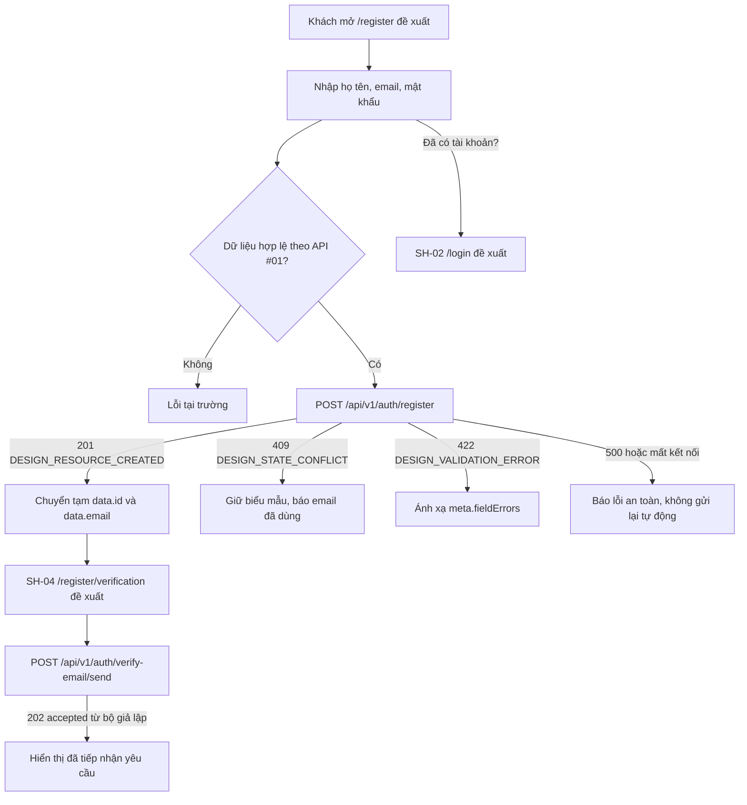

# Tài liệu thiết kế chi tiết màn hình — SH-03 Đăng ký học viên

> **Trạng thái tài liệu:** BẢN_NHÁP / API #01 CÓ MÃ NGUỒN / GIAO_DIỆN CHƯA NỐI / CÓ ĐIỂM SAI KHÁC · **Mã màn hình:** SH-03 · **Bề mặt:** Trang · **Tác nhân:** Khách · **Đường dẫn đề xuất:** `/register` · **Tiêu chí:** AC-01 · **Ưu tiên:** P0.

## 1. Tổng quan

SH-03 thu thập họ tên, email và mật khẩu để tạo tài khoản học viên. Theo luồng F01 trong [danh mục màn hình](../../../list_screen.md), màn hình gửi API #01; khi tạo tài khoản thành công, chuyển sang SH-04 để xử lý bước yêu cầu gửi email. Liên kết cuối thẻ mở SH-02 cho người đã có tài khoản.

Tài liệu tách riêng thiết kế đích và hiện trạng mã nguồn:

1. `list_screen.md` xác định màn hình, đường dẫn đề xuất, tiêu chí AC-01, thứ tự SH-03 → SH-04 và các trạng thái cần thể hiện.
2. Mã nguồn Study Server xác nhận đường dẫn đăng ký và hành vi API #01. API #02 là đường dẫn riêng, dùng bộ gửi thư giả lập mặc định; API #01 không gọi API #02.
3. `screen.png` và `code.html` là tài sản thiết kế. Bản làm việc không có mã Study Web/bộ định tuyến để xác nhận trang `/register` hay thao tác gửi biểu mẫu khi chạy.

### 1.1. Bằng chứng và trạng thái

| Bằng chứng | Phát hiện | Trạng thái |
|---|---|---|
| Mã giao diện Study Web và bộ định tuyến | Không có `apps/study-client/src`; trang ngữ cảnh con `.agents/web-work/study/` cũng không có trong bản làm việc. | `NOT_FOUND` / `SOURCE_REQUIRED` |
| Ảnh mẫu | [Ảnh gốc](./screen.png), 1280×1056, hiển thị thương hiệu, tiêu đề, ba trường, nút tạo tài khoản và liên kết đăng nhập. | `PRESENT` / CHỈ LÀ THIẾT KẾ |
| Mã HTML mẫu | [HTML gốc](./code.html) dựng được nội dung tiếng Việt; `onsubmit` chỉ gọi `event.preventDefault()`. | `DESIGN_SOURCE_ONLY` |
| API #01 | Có đường dẫn, mô hình dữ liệu, bộ kiểm tra, lớp điều phối, câu truy vấn và mã kiểm thử trong Study Server. | `SOURCE_BACKED`; không xác nhận môi trường triển khai hoặc cơ sở dữ liệu đang chạy thực tế |
| API #02 | Có đường dẫn và bộ gửi thư mặc định `StubVerificationEmailProvider`, chỉ trả `accepted`. | `STUB`; không gửi thư thật, không xác minh địa chỉ |
| Sai khác mật khẩu | Trợ giúp ẩn trong HTML mẫu yêu cầu tối thiểu 8 ký tự; API #01 không thực thi mức tối thiểu đó. | `DISCREPANCY` |
| Trạng thái người dùng | Lệnh chèn API #01 không gán `status`; tệp DDL `DB.sql` khai báo mặc định `ACTIVE`; API #03 cho đăng nhập khi `status == "ACTIVE"`. Chưa có xác nhận lược đồ đang chạy thực tế. | `SOURCE_BACKED` / `DISCREPANCY` |

### 1.2. Tài sản ảnh và quy tắc thị giác

- [Ảnh có đánh số](./screen_annotated.png) được tạo từ chính ảnh gốc, ở kích thước gấp đôi. Số trên ảnh khớp bảng phần tử tại §4 và [bản đồ marker](./SH-03_markers.json).
- Ảnh gốc và HTML gốc được giữ nguyên. Vì ảnh gốc đã hiển thị đầy đủ giao diện, không tạo ảnh dựng thay thế.
- Ảnh/HTML sử dụng nền `#F6FAFC`, điểm nhấn xanh biển `#0B5F8A`, thẻ trắng và Plus Jakarta Sans. Đây là mô tả tài sản hiện có, không phải bằng chứng về giao diện khi chạy.
- [Hướng dẫn Study Web](../../../../../../.agents/web-study/design.md) là đích giao diện chuẩn: ưu tiên `Inter` có sẵn hoặc sans-serif hệ thống, không thêm phông chữ tải từ xa, lề và điều khiển phải thích ứng, chiều cao điều khiển tối thiểu 44px. `DESIGN.md` tham khảo có các giá trị màu khác nhau giữa phần YAML, văn xuôi và HTML; không sao chép nguyên các giá trị mâu thuẫn đó.

### 1.3. Tác nhân, quyền và đường dẫn

- SH-03 là trang công khai dành cho Khách; API #01 không yêu cầu `Authorization`.
- `/register` là đường dẫn đề xuất của tài liệu. Chưa có mã bộ định tuyến Study Web để xác nhận đường dẫn này hoạt động.
- Vai trò `STUDENT` do SQL API #01 gán ở phía máy chủ. Phía giao diện không gửi `role` hoặc `status`.
- Không thêm lựa chọn điều khoản, CAPTCHA, OTP, đăng nhập mạng xã hội hoặc trường khác: chưa có hợp đồng cho chúng.

## 2. Sơ đồ luồng màn hình



Đường nối từ SH-03 sang SH-04 là luồng đích trong danh mục, không phải hành vi đã được nối ở phía giao diện. API #02 thuộc SH-04; không gọi API này trực tiếp từ SH-03 và không coi `accepted` là email đã gửi hoặc đã xác minh.

## 3. Truy vết API và dữ liệu

### 3.1. API #01 — Tạo tài khoản

| Thuộc tính | Giá trị theo mã nguồn hiện tại |
|---|---|
| Phương thức và đường dẫn | `POST /api/v1/auth/register` |
| Xác thực | Công khai; không cần `Authorization` |
| JSON bắt buộc | `email: string`, `password: string`, `full_name: string` |
| Phản hồi tạo thành công | HTTP `201`, `businessCode="DESIGN_RESOURCE_CREATED"` |
| Nhánh lỗi đã có nguồn | `409 DESIGN_STATE_CONFLICT`, `422 DESIGN_VALIDATION_ERROR`, `500 DESIGN_INTERNAL_ERROR` |
| Tác động dữ liệu | Tìm email trùng, băm mật khẩu Argon2id, chèn tài khoản vai trò `STUDENT`, rồi gọi `commit`. Giao dịch do lớp điều phối API #01 sở hữu. |
| Gửi email | Không gọi API #02; view chỉ ghi log rằng bước gửi xác minh bị trì hoãn. |

Dữ liệu JSON gửi đi chỉ có ba trường. `fullname` từ điều khiển HTML phải được đổi tên thành `full_name` khi dựng JSON:

```json
{
  "email": "<email người dùng>",
  "password": "<mật khẩu người dùng>",
  "full_name": "<họ và tên người dùng>"
}
```

Quy tắc theo bộ kiểm tra hiện tại:

- `email`: cắt khoảng trắng hai đầu, kiểm tra định dạng và giới hạn độ dài chuẩn hóa tối đa 255 ký tự. Không áp quy tắc miền email riêng hoặc tự đổi chữ hoa/thường.
- `full_name`: cắt khoảng trắng hai đầu; sau cắt phải dài 1–150 ký tự.
- `password`: chuỗi chỉ gồm khoảng trắng bị từ chối; khi hợp lệ, mật khẩu gốc được đưa đi băm Argon2id. API không đặt giới hạn tối thiểu 8 ký tự như thông báo ẩn trong HTML.
- Các trường thiếu hoặc sai kiểu được FastAPI ánh xạ thành HTTP 422 `DESIGN_VALIDATION_ERROR`; validator nghiệp vụ cũng trả HTTP 422 với `meta.fieldErrors`.

### 3.2. Phản hồi API #01

Khung phản hồi thành công theo `success_response` có `success`, `businessCode`, `message`, `data`, `meta` và `traceId`. `data` được trả từ hàng `RETURNING` của câu chèn và có các trường công khai sau:

```text
id, full_name, email, role, avatar_url, phone, status, created_at, updated_at
```

Mật khẩu và `password_hash` không được đưa vào phản hồi. API không trả access token hoặc refresh token. SQL hiện gán `role='STUDENT'`, nhưng bỏ cột `status`; giá trị `status` phụ thuộc lược đồ thực tế. `DB.sql` có giá trị mặc định `ACTIVE`, song tệp này không xác nhận lược đồ cơ sở dữ liệu đang chạy.

Để mở SH-04, luồng đích cần lấy `data.id` làm `user_id` và dùng `data.email`. Danh mục yêu cầu hai giá trị này nhưng chưa khóa cơ chế truyền phía giao diện. Khuyến nghị giữ trong trạng thái điều hướng tạm của ứng dụng, không đưa email/ID vào query string hoặc lưu trữ bền vững; chi tiết cấu trúc Vue chưa xác minh được vì mã giao diện vắng mặt.

### 3.3. Lỗi API #01 và xử lý trên SH-03

| HTTP | Mã nghiệp vụ | Phản hồi/ý nghĩa theo mã nguồn | Cách xử lý đích |
|---:|---|---|---|
| 201 | `DESIGN_RESOURCE_CREATED` | Tài khoản đã được chèn và giao dịch đã gọi `commit`; `data` chứa hồ sơ công khai. | Chuyển sang SH-04 với `data.id` và `data.email`; không hiển thị trạng thái xác minh email. |
| 409 | `DESIGN_STATE_CONFLICT` | Email đã tồn tại; trường hợp vi phạm ràng buộc duy nhất trong lúc chèn cũng được ánh xạ thành mã này. | Giữ nội dung biểu mẫu, đánh dấu trường email và cung cấp liên kết SH-02. Thông báo hiện tại trong mã nguồn: “Email đã tồn tại.” |
| 422 | `DESIGN_VALIDATION_ERROR` | JSON/trường không hợp lệ; lỗi trường được đưa vào `meta.fieldErrors`. | Giữ dữ liệu, gắn lỗi với trường theo `field`; không hiện lời khuyên 8 ký tự nếu máy chủ chưa có quy tắc đó. |
| 500 | `DESIGN_INTERNAL_ERROR` | Lỗi cơ sở dữ liệu hoặc lỗi nội bộ; chi tiết nhạy cảm không được trả về phía giao diện. | Hiển thị thông báo chung, giữ dữ liệu và không đưa chi tiết lỗi máy chủ lên giao diện. |
| Không có phản hồi | Không có mã HTTP | Không biết yêu cầu đã tạo tài khoản hay chưa. API không khai báo khóa chống gửi lặp. | Thông báo kết quả chưa xác định; không tự gửi lại POST. Cho người dùng chọn bước tiếp theo có kiểm soát. |

Khung lỗi gồm `success=false`, `businessCode`, `message`, `data=null`, `meta` và `traceId`; lớp trung gian gắn `X-Trace-Id`. Không hiển thị thông tin cơ sở dữ liệu, dấu vết ngăn xếp hoặc nội dung mật khẩu.

### 3.4. API #02 — Ranh giới tại SH-04

SH-03 không gọi API này. Theo luồng F01, SH-04 mới gửi:

```http
POST /api/v1/auth/verify-email/send
Content-Type: application/json

{"user_id": <data.id>, "email": "<data.email>"}
```

API #02 hiện công khai, không phụ thuộc cơ sở dữ liệu và không kiểm tra sự tồn tại/sở hữu cặp `user_id`/`email`. Bộ gửi thư mặc định là `StubVerificationEmailProvider`, trả HTTP `202` với `businessCode="DESIGN_OPERATION_ACCEPTED"` và `data={"status":"accepted"}`. Điều này chỉ xác nhận bộ giả lập đã nhận yêu cầu; không có email thật, mã/liên kết xác minh, thời hạn, lần thử lại, thay đổi `users.status` hay đường dẫn hoàn tất xác minh. Nếu bộ gửi thư lỗi, API trả HTTP `500 DESIGN_INTERNAL_ERROR` an toàn.

## 4. Thuộc tính phần tử được đánh số

Số marker khớp [ảnh chú thích](./screen_annotated.png) và [bản đồ marker](./SH-03_markers.json). Kích thước ảnh nguồn là 1280×1056. Marker xác định vùng thiết kế, không khẳng định phần tử đã có xử lý khi chạy.

| # | Thành phần | Thuộc tính thể hiện trong HTML/ảnh | Hành vi và dữ liệu đích |
|---:|---|---|---|
| 1 | Logo S2W và chữ Study2Work | Biểu tượng chữ `S2W` trong ô xanh, tên Study2Work; căn giữa phía trên thẻ. | Nội dung tĩnh. HTML không gắn liên kết cho logo; không tự điều hướng khi bấm. |
| 2 | Tiêu đề và câu giới thiệu | Tiêu đề “Đăng ký tài khoản học viên”; câu “Nhập thông tin để tạo tài khoản mới trên hệ thống Study2Work”. | Nội dung tĩnh; dùng một tiêu đề cấp trang có thứ tự ngữ nghĩa. |
| 3 | Trường họ và tên | `label for="fullname"`; `input type="text"`, `id="fullname"`, `name="fullname"`; gợi ý “Nhập họ và tên”. Đoạn lỗi rỗng đang ẩn. HTML chưa khai báo `required`, `maxlength` hoặc `autocomplete`. | Gửi tới `full_name`; API cắt khoảng trắng và giới hạn 1–150 ký tự. Bản triển khai nên liên kết lỗi trường bằng thuộc tính trợ năng và phản ánh giới hạn từ API. |
| 4 | Trường địa chỉ email | `label for="email"`; `input type="email"`, `id="email"`, `name="email"`; gợi ý `example@domain.com`. Đoạn lỗi định dạng đang ẩn. HTML chưa khai báo `required`, `maxlength` hoặc `autocomplete`. | Gửi tới `email`; API cắt khoảng trắng, kiểm tra định dạng và giới hạn 255 ký tự. Lỗi trùng HTTP 409 cần gắn riêng với trường email. |
| 5 | Trường mật khẩu | `label for="password"`; `input type="password"`, `id="password"`, `name="password"`; gợi ý “Nhập mật khẩu”. Đoạn lỗi ẩn ghi tối thiểu 8 ký tự. Không có nút hiện/ẩn mật khẩu. | Gửi nguyên giá trị tới `password`; chỉ áp dụng quy tắc đang có ở API (không rỗng/toàn khoảng trắng). Câu lỗi 8 ký tự chưa được máy chủ hỗ trợ. |
| 6 | Nút tạo tài khoản | Nút chính toàn chiều rộng, `type="submit"`, nhãn “Tạo tài khoản”, nền xanh biển. | Khi triển khai, gửi API #01 đúng một lần cho mỗi lần gửi chủ ý; hiện HTML chặn gửi và chưa có trạng thái đang xử lý/vô hiệu hóa. |
| 7 | Liên kết đăng nhập | Dải cuối thẻ “Đã có tài khoản? Đăng nhập”; liên kết `href="/login"`. | Điều hướng mục tiêu tới SH-02. Không gửi API #01. Đường dẫn `/login` cũng là đề xuất trong danh mục. |

Thẻ trắng bo góc và nền trang là vùng trình bày, không được đánh số riêng vì không có sự kiện. HTML mẫu còn chứa đoạn mô phỏng lỗi dùng cho kiểm tra chất lượng nhưng đang rỗng; hàm `setFormState` tham chiếu `alert-409` và các nút trạng thái nhưng các phần tử đó không tồn tại trong tài liệu. Không coi bộ mô phỏng này là bộ xử lý lỗi thực.

## 5. Sự kiện và xử lý dữ liệu

### E-01 — Mở trang đăng ký

1. Khách mở đường dẫn đề xuất `/register` từ SH-01, SH-02 hoặc liên kết được duyệt.
2. Giao diện hiển thị các phần tử #1–#7 ở trạng thái ban đầu; không yêu cầu token và không nạp dữ liệu ban đầu.
3. Đây là hành vi thiết kế. Hiện không có bộ định tuyến hoặc thành phần Study Web để xác nhận trang mở được.

### E-02 — Nhập họ tên, email và mật khẩu

1. Nhập liệu được giữ trong trạng thái cục bộ của biểu mẫu cho tới khi gửi.
2. Kiểm tra phía giao diện để báo sớm trường trống/sai định dạng email và giới hạn họ tên theo mã nguồn API. API vẫn là thẩm quyền cuối cùng.
3. Không áp quy tắc email theo miền, mật khẩu 8 ký tự, CAPTCHA, OTP hoặc điều khoản khi chưa có hợp đồng.
4. Không ghi các giá trị vào log, URL, sự kiện phân tích hoặc thông báo lỗi. Đặc biệt không lưu mật khẩu vào trạng thái điều hướng sang SH-04.

### E-03 — Gửi yêu cầu tạo tài khoản

1. Kích hoạt nút #6 hoặc gửi biểu mẫu bằng bàn phím.
2. Chặn thao tác lặp; cắt khoảng trắng hai đầu họ tên, kiểm tra email và tạo JSON `{email, password, full_name}`. Giữ nguyên chuỗi mật khẩu.
3. Gửi `POST /api/v1/auth/register` tới địa chỉ gốc Study API được cấu hình ở phía giao diện. Không có địa chỉ gốc trong bản làm việc; không tự điền giá trị mẫu vào tài liệu.
4. Không thêm Bearer token, cookie/phiên, query string hoặc trường `role` vào yêu cầu.
5. Trong mã nguồn hiện tại, bộ định tuyến tạo `RegisterRequest` rồi gọi `create_user`; lớp điều phối kiểm tra dữ liệu trước truy vấn, tìm email trùng, băm mật khẩu Argon2id, gọi `INSERT_USER`, `commit` và dựng khung phản hồi. Nếu có lỗi, lớp này gọi `rollback` và trả lỗi an toàn.
6. Giao diện chuyển theo §3.3. HTML gốc hiện chỉ gọi `preventDefault()` nên không có yêu cầu mạng nào được gửi từ bản mẫu.

### E-04 — Tạo thành công và chuyển sang SH-04

1. Chỉ HTTP 201 cùng `DESIGN_RESOURCE_CREATED` được coi là tạo tài khoản thành công.
2. Lấy `data.id` và `data.email`; không dùng ID từ dữ liệu nhập hoặc URL.
3. Chuyển sang đường dẫn đề xuất `/register/verification` với trạng thái điều hướng tạm chỉ gồm `user_id` và `email`. Cơ chế lưu/khôi phục trạng thái khi tải lại hoặc mở liên kết trực tiếp cần được chốt; không lưu vào URL.
4. SH-04 gọi API #02. SH-03 không tự gửi yêu cầu thứ hai và không hiển thị “đã gửi email” hay “đã xác minh”.
5. Nếu thiếu `data.id`/`data.email` trong phản hồi dù mã trạng thái báo thành công, không dựng `user_id` thay thế; dừng chuyển tiếp an toàn và ghi mã truy vết để hỗ trợ.

### E-05 — Email đã tồn tại

1. Với HTTP 409 `DESIGN_STATE_CONFLICT`, giữ dữ liệu đang có và đánh dấu email.
2. Hiển thị thông báo chung từ API “Email đã tồn tại.”; không xóa mật khẩu tự động nếu chính sách xóa dữ liệu chưa chốt, nhưng không hiển thị lại giá trị mật khẩu ngoài điều khiển nhập.
3. Cho phép sửa email hoặc mở SH-02 bằng liên kết #7. Không tự chuyển người dùng khỏi biểu mẫu.

### E-06 — Dữ liệu bị từ chối

1. Với HTTP 422 `DESIGN_VALIDATION_ERROR`, đọc danh sách `meta.fieldErrors`.
2. Ánh xạ `full_name`, `email`, `password` vào đúng điều khiển; hiển thị lỗi bằng chữ, biểu tượng chỉ bổ trợ và đặt liên kết trợ năng giữa lỗi với trường.
3. Giữ các giá trị có thể giữ an toàn. Không dùng thông báo HTML “tối thiểu 8 ký tự” cho tới khi yêu cầu và máy chủ cùng xác nhận quy tắc đó.

### E-07 — Lỗi máy chủ hoặc kết nối

1. HTTP 500 `DESIGN_INTERNAL_ERROR`: hiển thị thông báo an toàn, không phơi bày lỗi cơ sở dữ liệu, chi tiết bộ gửi thư hoặc dấu vết ngăn xếp.
2. Mất kết nối/timeout sau khi gửi: giữ biểu mẫu và thể hiện rằng kết quả chưa xác định. Không gửi lại tự động; một lần thử lại mù có thể gặp 409 dù lần gửi trước đã tạo tài khoản.
3. Dùng `traceId`/`X-Trace-Id` khi hỗ trợ xử lý lỗi; không đưa thông tin nhạy cảm vào thông báo người dùng.

### E-08 — Mở SH-02

1. Khi kích hoạt liên kết #7, điều hướng tới `/login` theo thiết kế.
2. Không gửi API và không đưa nội dung biểu mẫu vào URL, trạng thái điều hướng hoặc dữ liệu đăng nhập.
3. Đích `/login` chưa được xác nhận trong mã bộ định tuyến Study Web hiện có.

## 6. Ma trận trạng thái giao diện

| Trạng thái | Điều kiện vào | Nội dung và hành động |
|---|---|---|
| Ban đầu | Mở trang | Ba trường trống, nút tạo tài khoản khả dụng; như ảnh mẫu. |
| Đang kiểm tra | Người dùng gửi | Kiểm tra họ tên/email và sự hiện diện mật khẩu; đưa tiêu điểm tới trường lỗi đầu tiên. |
| Đang gửi | JSON hợp lệ, API #01 đang chờ | Hiển thị tiến trình gần nút; khóa gửi lặp; giữ trường nhập ổn định. |
| Lỗi dữ liệu `422` | API từ chối dữ liệu/trường | Cảnh báo chung và lỗi theo trường; giữ dữ liệu nhập để sửa. |
| Email trùng `409` | API tìm thấy email hoặc ràng buộc duy nhất báo trùng | Cảnh báo cạnh email; giữ các trường và cung cấp SH-02. |
| Lỗi máy chủ `500` | API trả `DESIGN_INTERNAL_ERROR` | Thông báo an toàn; không hiển thị lỗi nội bộ; không gửi lại tự động. |
| Kết quả mạng chưa rõ | Không nhận được phản hồi sau khi gửi | Báo chưa xác định, giữ dữ liệu và chờ lựa chọn tiếp theo của Khách. |
| Đã tạo `201` | API trả `DESIGN_RESOURCE_CREATED` | Chuyển sang SH-04 với `data.id` và `data.email`; không tuyên bố xác minh email. |

## 7. Bảo mật, quyền riêng tư và vòng đời tài khoản

- Giao diện công khai không đồng nghĩa với việc tin dữ liệu phía trình duyệt; API #01 xác thực kiểu/định dạng và tự đặt vai trò `STUDENT`.
- Mật khẩu chỉ truyền trong phần thân HTTPS khi cấu hình môi trường thật, không ghi vào log, URL, dữ liệu phân tích, mã truy vết, thông báo lỗi hoặc trạng thái điều hướng.
- Không lưu token vì API #01 không cấp token. Không gửi `role`, `status`, `password_hash` hoặc trường không có trong hợp đồng yêu cầu.
- API #01 kiểm tra email trùng rồi dựa thêm vào ràng buộc duy nhất; tranh chấp lúc ghi được trả thành HTTP 409. Lớp điều phối sở hữu `commit`/`rollback`.
- API #02 không xác thực quyền sở hữu email và bộ gửi thư mặc định không gửi thư. Tệp `DB.sql` gợi ý trạng thái mặc định `ACTIVE`, còn API #03 cho phép đăng nhập tài khoản `ACTIVE`. Trước khi coi luồng email là biện pháp xác minh, nhóm Sản phẩm/Bảo mật/Máy chủ cần quyết định cách tạo tài khoản chưa xác minh và xác nhận trạng thái lược đồ thực tế.
- Không đưa `user_id` hoặc email vào URL. Nếu cần đưa sang SH-04, dùng dữ liệu tạm trong ứng dụng; thời hạn giữ sau khi điều hướng hoặc tải lại cần được chốt.

## 8. Bố cục thích ứng và khả năng tiếp cận

- Giữ một cột và chiều rộng thẻ tối đa như mẫu `max-w-md`; trên màn hình hẹp dùng lề ngang 16px, cuộn dọc và giữ nguyên thứ tự ba trường → nút → liên kết.
- Nút và ô nhập trong ảnh đều cao khoảng 44px, phù hợp mức tối thiểu trong hướng dẫn Study. Không thu nhỏ vùng nhấn khi đổi bố cục.
- Mỗi ô nhập có nhãn hiển thị gắn với `for`/`id`. Khi thêm lỗi, nối nội dung trợ giúp với ô nhập bằng cơ chế trợ năng tương ứng; dùng vùng `role="alert"` cho lỗi 409/lỗi chung nếu được thêm vào bản triển khai.
- Bảo đảm tiêu điểm bàn phím luôn nhìn thấy, thứ tự tab đi theo thứ tự thao tác, trạng thái bận/lỗi không chỉ biểu đạt bằng màu, và bố cục vẫn dùng được ở chiều rộng 320 CSS px cùng mức phóng to trình duyệt.
- Theo hướng dẫn Study, không dùng phông chữ tải từ xa; giảm chuyển động theo `prefers-reduced-motion`. Đây là tiêu chí cho mã giao diện tương lai, không phải khả năng đã kiểm chứng của ảnh.

## 9. Ma trận kiểm tra cần có khi triển khai giao diện

Các mục dưới đây là tiêu chí kiểm thử trong tương lai. Trong phiên soạn tài liệu này chỉ đọc mã kiểm thử, không chạy kiểm thử.

| Nhóm | Trường hợp cần kiểm tra | Bằng chứng hiện có |
|---|---|---|
| Thành công API | JSON hợp lệ, HTTP 201, dữ liệu chỉ có hồ sơ công khai, giao dịch được xác nhận một lần. | Có trong `test_register.py`; chưa chạy kiểm thử trong phiên này. |
| Chuẩn hóa/kiểm tra API | Cắt khoảng trắng email và `full_name`; email lỗi; họ tên rỗng/quá 150; mật khẩu rỗng/toàn khoảng trắng; HTTP 422. | Có trong `test_register.py`; chưa chạy kiểm thử trong phiên này. |
| Trùng email API | Email tồn tại trước khi chèn và tranh chấp ràng buộc duy nhất đều thành HTTP 409; có gọi `rollback`. | Có trong `test_register.py`; chưa chạy kiểm thử trong phiên này. |
| Lỗi API | Lỗi cơ sở dữ liệu/lỗi ngoài dự kiến trả 500 an toàn, không lộ chi tiết ngoại lệ. | Có trong `test_register.py`; chưa chạy kiểm thử trong phiên này. |
| Giao diện gửi | JSON chỉ có `email`, `password`, `full_name`; không có Bearer; khóa gửi lặp; ánh xạ `fullname` đúng. | Chưa có mã giao diện hoặc kiểm tra giao diện trong bản làm việc. |
| Giao diện lỗi | `meta.fieldErrors` nối đúng trường; 409 giữ biểu mẫu; 500/mạng không để lộ chi tiết và không tự gửi lại. | Chưa có mã giao diện hoặc kiểm tra giao diện trong bản làm việc. |
| Chuyển tiếp | HTTP 201 đưa `data.id`/`data.email` tới SH-04; API #02 không bị gọi từ SH-03. | Luồng hiện chỉ có trong danh mục; phía giao diện chưa có. |
| Trợ năng/thích ứng | Bàn phím, tiêu điểm, vùng thông báo, chiều rộng 320px, phóng to, giảm chuyển động. | Chưa được kiểm tra bằng mã giao diện. |

## 10. Điểm cần quyết định trước khi phát hành

1. Có cần mật khẩu tối thiểu 8 ký tự không? Nếu có, cập nhật hợp đồng/API trước khi dùng lỗi trong HTML; hiện API #01 chưa kiểm tra mức đó.
2. Tài khoản mới có được đăng nhập trước xác minh email không? SQL API #01 không gán `status`, tệp DDL chỉ là tài liệu tham khảo và API #02 chưa có tác động xác minh.
3. Cơ chế điều hướng nào giữ `data.id`/`data.email` tạm tới SH-04, kể cả trường hợp tải lại trực tiếp trang SH-04?
4. Đội sản phẩm chấp nhận thông báo “đã tiếp nhận yêu cầu” từ bộ giả lập ở SH-04 hay cần chặn/ẩn thao tác gửi email cho tới khi bộ gửi thư thật sẵn sàng?
5. Có cần sửa HTML mẫu để bỏ trình mô phỏng lỗi không hoạt động, câu mật khẩu 8 ký tự và các tham chiếu phần tử kiểm tra chất lượng không tồn tại?
6. Cần xác nhận phông chữ triển khai theo hướng dẫn Study (Inter/phông chữ hệ thống), không theo liên kết Google Fonts trong HTML mẫu.

## 11. Tiêu chí nghiệm thu tài liệu SH-03

- Kế hoạch, DD, nhãn marker và nội dung chú thích được viết bằng tiếng Việt; tên API/trường/mã nguồn giữ nguyên chính tả để đối chiếu.
- Có đủ bảy số marker trên ảnh; từng số ánh xạ một-một tới bảy hàng tại §4.
- Tài sản gốc giữ nguyên giá trị SHA-256; ảnh chú thích giữ đúng tỷ lệ 2×.
- Mọi yêu cầu API khớp mã nguồn hiện tại hoặc được gắn sai khác/điều kiện chặn; không mô tả API #02 là gửi email thật.
- Các liên kết cục bộ mở được; bảng theo dõi và nhật ký công việc ghi trạng thái SH-03 là bản nháp đã xong.
- Không chạy kiểm thử dự án trong phiên này; trạng thái kiểm thử được nêu đúng là chưa chạy.
