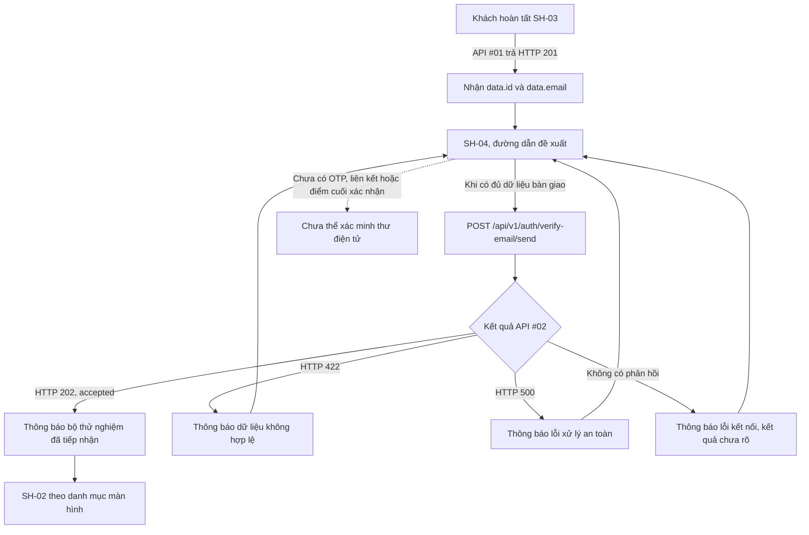
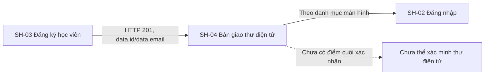

# Tài liệu thiết kế chi tiết màn hình — SH-04 Bàn giao xác thực thư điện tử

> **Trạng thái tài liệu:** BẢN_NHÁP / API #02 CÓ MÃ NGUỒN, BỘ GỬI THƯ GIẢ LẬP / GIAO DIỆN CHƯA NỐI · **Mã màn hình:** SH-04 · **Đường dẫn đề xuất:** `/register/verification` · **Tác nhân:** Khách · **Quyền gọi API:** Công khai, không cần `Authorization` · **Loại:** Trang · **Tiêu chí:** AC-01 · **Đợt:** W0 · **Ưu tiên:** P1 · **Tình trạng danh mục màn hình:** `S` · **Điều kiện chặn:** chưa có dịch vụ gửi thư thật hoặc điểm cuối xác nhận · **Mã commit được rà soát:** `ceeb15778b19b621e64dfde1707e7163ad859b91`.

## 1. Tổng quan

SH-04 là bước tiếp nhận yêu cầu gửi thư điện tử sau khi Khách đăng ký ở SH-03. Theo danh mục màn hình, màn hình gọi API #02 rồi cho người dùng quay lại SH-02. API hiện tại chỉ xác nhận bộ gửi thư giả lập đã tiếp nhận yêu cầu; nó không gửi thư, không tạo OTP hoặc liên kết và không xác minh địa chỉ thư điện tử. Vì vậy, mọi thông báo phải diễn đạt “đã được bộ thử nghiệm tiếp nhận”, không được nói thư đã được gửi hoặc tài khoản đã xác minh.

Tài liệu phân biệt ba loại căn cứ:

1. `list_screen.md` là thiết kế đích: SH-04, đường dẫn đề xuất, AC-01, API #02, trình tự SH-03 → SH-04 → SH-02 và điều kiện chặn về thư điện tử.
2. Mã nguồn Study Server hiện có khai báo API #02 cùng bộ gửi thư mặc định giả lập. Đây là bằng chứng hành vi mã nguồn, không chứng minh giao diện, dịch vụ gửi thư thật, cơ sở dữ liệu thật hoặc triển khai môi trường chính thức.
3. `screen.png` và `code.html` là tài sản thiết kế. Bản làm việc không có mã nguồn Study Web để xác nhận đường dẫn trang, lời gọi API, điều hướng hay trạng thái trình duyệt.

### 1.1. Bằng chứng và tình trạng

| Hạng mục | Phát hiện | Tình trạng |
|---|---|---|
| Mã nguồn Study Web và bộ định tuyến | `apps/study-client/` hiện chỉ có tài liệu; không có `src`, bộ định tuyến, gói cấu hình hoặc kiểm thử giao diện. `.agents/web-work/study/` cũng không có trong bản làm việc. | `NOT_FOUND` / `UNWIRED` |
| Đường dẫn trang | `/register/verification` có trong danh mục màn hình và ảnh mẫu; chưa có bộ định tuyến để xác nhận hoạt động. | ĐƯỜNG_DẪN_ĐỀ_XUẤT |
| Ảnh mẫu | [Ảnh gốc](./screen.png), 1600×1280, đang thể hiện nhánh mặc định `accepted`. | CHỈ_LÀ_THIẾT_KẾ |
| HTML mẫu | [HTML gốc](./code.html), gồm các nút đổi trạng thái cục bộ và nút sao chép lệnh. Không có `fetch` hay lời gọi API. | CHỈ_LÀ_THIẾT_KẾ |
| API #02 | `POST /api/v1/auth/verify-email/send` được khai báo trong Study Server; có mô hình, bộ kiểm tra dữ liệu, lớp điều phối, bộ gửi thư và mã kiểm thử. | CÓ_MÃ_NGUỒN / BỘ_GỬI_THƯ_GIẢ_LẬP |
| Bộ gửi thư mặc định | Bỏ qua `user_id`, `email`, `trace_id`; trả `status="accepted"`; không gửi thư, không xếp hàng và không tạo token. | ĐÃ_XÁC_MINH_TỪ_MÃ_NGUỒN |
| Xác nhận thư điện tử | Không thấy điểm cuối API xác nhận OTP/liên kết trong danh mục API hiện tại; API #02 chỉ nhận yêu cầu gửi. | `NOT_FOUND` |
| Mã kiểm thử | Đã đọc mã kiểm thử API #02, không chạy kiểm thử trong phiên này. Mã kiểm tra đường dẫn API công khai, không cần cơ sở dữ liệu, 202 khi bộ gửi thư chấp nhận, 422 khi phần thân yêu cầu thiếu và 500 khi bộ gửi thư lỗi. | CHỈ_ĐỌC_MÃ_KIỂM_THỬ |

### 1.2. Tài sản ảnh và quy tắc thị giác

- [Ảnh gốc](./screen.png) và [ảnh có đánh số](./screen_annotated.png) được giữ tách biệt. Ảnh chú thích có kích thước 3200×2560, gấp đôi mỗi chiều so với ảnh nguồn.
- Mười hai số chú thích khớp [bản đồ số](./SH-04_markers.json) và bảng phần tử ở §4. Ảnh gốc/HTML gốc không bị sửa.
- Tệp tham khảo [DESIGN.md](../../90_reference/study2work-lms-design-system/DESIGN.md) có mâu thuẫn nội bộ: YAML khai báo `primary: #004ac6`, còn phần văn xuôi gọi `#2563EB` là màu chính. HTML mẫu dùng cả `#004ac6` và `#2563eb` ở các token khác nhau.
- Hướng dẫn [Study Web](../../../../../../.agents/web-study/design.md) là đích giao diện Study: `ocean-primary: #0B5F8A`, ưu tiên Inter có sẵn hoặc phông chữ hệ thống, không tải phông từ xa, điều khiển tối thiểu 44px, có chỉ báo tiêu điểm bàn phím rõ, hỗ trợ bàn phím và giảm chuyển động. Không sao chép nguyên mã màu mâu thuẫn từ tài liệu tham khảo.
- HTML mẫu nạp Tailwind và Plus Jakarta Sans từ CDN. Đây là cách dựng của tài sản mẫu, không phải phụ thuộc đã được chấp thuận cho Study Web.
- Nhãn kiểm định WCAG AA ở ảnh là nội dung đồ họa; phiên này chưa đo tương phản hoặc kiểm tra khả năng tiếp cận.

### 1.3. Tác nhân, quyền và đường dẫn

- danh mục màn hình xếp SH-04 vào Shared/Auth/System, dành cho Khách, AC-01, loại Trang, ưu tiên P1, tình trạng `S`.
- API #02 được gọi công khai, không bắt buộc Bearer token. Mã kiểm thử còn xác nhận yêu cầu vẫn được chấp nhận khi gửi `Authorization: Bearer malformed-token`; màn hình không cần token cho bước này.
- `/register/verification` là đường dẫn đề xuất, chưa phải đường dẫn API đã cài đặt. Không mô tả trang này như đang chạy.
- SH-02 là màn hình tiếp theo theo danh mục màn hình. Nút quay lại chỉ thể hiện điều hướng; không cam kết đăng nhập thành công hoặc tài khoản đã được xác minh.

## 2. Sơ đồ luồng màn hình và API



Việc gọi API sau đăng ký là đích F01. Thời điểm kích hoạt cụ thể — tự gọi khi mở SH-04 hay chờ thao tác riêng — chưa được chốt bằng mã giao diện hoặc hợp đồng tương tác. Bản mẫu hiển thị trạng thái `accepted` ngay khi tải và không có lời gọi API; không được coi đó là hành vi đã nối.

## 3. Luồng tổng quát

1. SH-03 nhận HTTP 201 từ API #01. Mã nguồn API #01 trả hồ sơ có `data.id` và `data.email` sau khi xác nhận giao dịch.
2. SH-04 cần nhận hai giá trị từ trạng thái bàn giao của SH-03; cơ chế truyền chưa được hiện thực hóa. Không đặt `user_id` hoặc `email` vào URL. Nếu thiếu một trong hai giá trị, không gọi API #02; phương án hiển thị/điều hướng dự phòng còn phải được duyệt.
3. Khi được kích hoạt theo quyết định sản phẩm, gửi một yêu cầu công khai tới API #02 với đúng hai trường `user_id` và `email`.
4. API #02 kiểm tra dữ liệu, chuẩn hóa địa chỉ thư điện tử rồi gọi `VerificationEmailProvider`. API không mở phiên cơ sở dữ liệu và không xác minh `user_id` có tồn tại hoặc thuộc địa chỉ thư điện tử đã gửi.
5. Bộ gửi thư mặc định trả `accepted`. API trả HTTP 202 và `data.status="accepted"`; đây chỉ là xác nhận tiếp nhận của bộ gửi thư giả lập.
6. Giao diện hiển thị lời giải thích trung thực về việc chưa gửi thư thật. Không mở ô OTP, không tạo liên kết giả, không đếm lùi và không chuyển trạng thái sang “đã xác minh”.
7. Khách có thể chọn quay lại SH-02 theo danh mục màn hình. Việc đăng nhập trước khi xác minh thư điện tử là quy tắc riêng chưa được xác nhận trong phạm vi này.

## 4. Bản đồ phần tử và dữ liệu trên màn hình

Ảnh nguồn có hai cột trên màn hình rộng: thẻ thông báo chính bên trái; thẻ thông tin API bên phải; ghi chú thiết kế ở dưới cột phải; chân trang chạy hết chiều ngang. HTML dùng một cột dưới mốc Tailwind `lg` và bố cục 7/12 + 5/12 từ mốc này trở lên. Giữ thứ tự đọc: ngữ cảnh trang → thông báo → giới hạn xác minh → điều hướng → chi tiết kỹ thuật.

| # | Phần tử / vùng | Nội dung hoặc dữ liệu | Hành vi đích | Căn cứ và giới hạn |
|---:|---|---|---|---|
| 1 | Nhãn SH-04 và đường dẫn | Mã `SH-04`, đường dẫn đề xuất `/register/verification`. | Nội dung định danh; không tự biến thành liên kết hoặc báo đường dẫn trang đang hoạt động. | Danh mục màn hình và ảnh; bộ định tuyến không có trong bản làm việc. |
| 2 | Cụm trạng thái mô phỏng | Các lựa chọn chuyển trạng thái của HTML mẫu. | Không đưa vào giao diện người dùng cuối; nếu chỉ giữ ở bản trình diễn, phải đánh dấu rõ là điều khiển giả lập. | JavaScript chỉ thay DOM và JSON tại chỗ. |
| 3 | Biểu tượng và nhãn phản hồi | Trạng thái mặc định trong ảnh là `202 Accepted (Stub)`. | Thể hiện trạng thái API thật từ phản hồi; cách đọc dễ hiểu là “Đã được bộ thử nghiệm tiếp nhận”. | API mặc định trả 202/`accepted`; ảnh không chứng minh trình duyệt đã nhận phản hồi. |
| 4 | Tiêu đề và phần giải thích | Thông báo kết quả cho Khách. | Nêu rõ yêu cầu được bộ thử nghiệm tiếp nhận, thư chưa được gửi thật. Không nói đã vào hàng đợi. | Mã bộ gửi thư bỏ toàn bộ dữ liệu đầu vào, không có hàng đợi. |
| 5 | Khung giới hạn xác minh | Chưa có mã OTP, liên kết xác nhận hoặc điểm cuối API xử lý xác nhận. | Giữ lời giải thích ngắn, tiếng Việt, không chỉ dựa vào màu biểu tượng. | Danh mục màn hình SH-04 và API #02; không thấy API xác nhận. |
| 6 | Nút quay lại SH-02 | Đường dẫn đích đề xuất `/login`. | Điều hướng tới SH-02; không gửi lại API #02. | Liên kết màn hình trong danh mục màn hình; chưa có bộ định tuyến. |
| 7 | Nút sao chép lệnh mẫu | HTML tạo lệnh tới miền ngoài, thiếu `/api/v1` và thiếu `user_id`. | Không cung cấp cho Khách trong bản triển khai. Nếu còn nhu cầu kỹ thuật, phải có hợp đồng và lệnh mẫu được duyệt riêng. | Không tương thích yêu cầu API #02 hiện tại. |
| 8 | Thẻ tham chiếu API #02 | Tên thao tác gửi yêu cầu và mã API. | Có thể giữ bản rút gọn để hỗ trợ minh bạch; không gắn nhãn “đang kiểm tra trực tiếp” nếu không có dữ liệu phản hồi. | Study Server có mã nguồn API; phía giao diện chưa nối. |
| 9 | Các hàng trạng thái | HTTP, tình trạng giao thư, khả năng xác minh. | Tách bạch HTTP 202 với việc chưa giao thư và chưa xác minh. Không hiển thị phản hồi 200/503 tự dựng. | HTTP 202/500 từ API hiện tại; chưa có kết quả giao thư thật. |
| 10 | Khung JSON | HTML mẫu tự tạo các trường `contract`, `delivery`, `artifacts`, `otp_generated`, `confirm_url`. | Không trình bày dữ liệu này là phản hồi thật. Nên ẩn khỏi màn hình người dùng; nếu giữ ở tài liệu kỹ thuật, thay bằng cấu trúc phản hồi tại §6. | Các trường này không có trong phản hồi hiện tại. |
| 11 | Thẻ quy tắc thiết kế | Nhắc không giả lập bộ đếm lùi hoặc ô nhập mã. | Có thể dùng như ghi chú nội bộ thiết kế; bỏ nhãn đạt WCAG chưa được kiểm định khỏi tuyên bố sản phẩm. | Nội dung ảnh; chưa có báo cáo kiểm tra tiếp cận. |
| 12 | Chân trang | Mã màn hình và đường dẫn. | Giữ thông tin cần thiết; không hiển thị phiên bản giao thức/nhãn kiểm định như chứng cứ triển khai nếu chưa được xác nhận. | Nội dung tĩnh từ HTML mẫu. |

Không có trường nhập liệu nào trên SH-04. Tên trường `user_id` và `email` chỉ là dữ liệu yêu cầu API, không phải ô để Khách tự sửa trên trang này.

## 5. Hợp đồng trường và ánh xạ dữ liệu

| Trường nguồn | Trường API #02 | Kiểu / kiểm tra theo mã nguồn | Quy tắc hiển thị và riêng tư |
|---|---|---|---|
| API #01 `data.id` | `user_id` | `int`; bộ kiểm tra dữ liệu yêu cầu kiểu số nguyên nghiêm ngặt trên JSON thô. Mã hiện tại không kiểm tra `> 0`. | Chỉ dùng trong yêu cầu nội bộ của ứng dụng; không đưa lên URL, nhật ký giao diện hoặc khung mẫu công khai. |
| API #01 `data.email` | `email` | `str`; địa chỉ được chuẩn hóa bởi `normalize_email`. Sai định dạng trả 422. | Chỉ hiển thị địa chỉ nếu nhóm sản phẩm duyệt nội dung này; ảnh mẫu hiện không nêu người nhận. Không ghi cố định địa chỉ minh họa vào giao diện. |
| Header `Authorization` | Không gửi | API #02 được gọi công khai; đường dẫn API không khai báo yêu cầu đăng nhập. | Không cần token; không lưu hoặc làm mới token vì thao tác này. |
| `traceId` | Tiêu đề HTTP/siêu dữ liệu phản hồi | Lớp trung gian tạo và chuyển mã truy vết tới hàm xử lý; lỗi chuẩn trả tiêu đề `X-Trace-Id`. | Chỉ dùng hỗ trợ chẩn đoán theo chính sách; không coi là mã xác minh hoặc bí mật để mở liên kết. |

API #02 không xác nhận danh tính, quyền sở hữu địa chỉ thư điện tử, sự tồn tại của `user_id`, trạng thái tài khoản hoặc tính duy nhất của yêu cầu. Phía giao diện không được suy ra các điều này từ HTTP 202.

## 6. Chuỗi sự kiện và ánh xạ phản hồi API

### 6.1. Gửi yêu cầu

| Thuộc tính | Đặc tả |
|---|---|
| Tác nhân kích hoạt | Theo F01, bước gửi xảy ra sau đăng ký thành công; thao tác cụ thể chưa được chốt. |
| Phương thức / đường dẫn | `POST /api/v1/auth/verify-email/send` (API #02). |
| Yêu cầu | `Content-Type: application/json`; phần thân gồm `user_id` lấy từ `data.id` và `email` lấy từ `data.email`. Không kèm `Authorization`. |
| Ví dụ phần thân | `{"user_id":1001,"email":"student@example.com"}`; giá trị chỉ để minh họa cấu trúc. |
| Thứ tự xử lý phía máy chủ | FastAPI đọc `VerifyEmailSendRequest` → bộ kiểm tra dữ liệu kiểm tra `user_id` nguyên nghiêm ngặt và chuẩn hóa địa chỉ → `VerificationEmailProvider.dispatch(user_id, email, trace_id)` → dựng cấu trúc phản hồi thành công/lỗi. |
| Cơ sở dữ liệu / tác động phụ | Không mở phiên cơ sở dữ liệu. Bộ gửi thư mặc định bỏ `user_id`, `email`, `trace_id`; không gửi thư, ghi hàng đợi, tạo OTP/liên kết hoặc cập nhật tài khoản. |
| Chống gửi lặp | Chưa có khóa chống yêu cầu trùng hoặc chính sách thử lại trong hợp đồng API. Giao diện không tự gửi lại khi chờ lâu hay khi kết quả mạng chưa rõ. |

### 6.2. Phản hồi thành công hiện tại

HTTP `202 Accepted` với cấu trúc phản hồi chuẩn:

```json
{
  "success": true,
  "businessCode": "DESIGN_OPERATION_ACCEPTED",
  "message": "Yêu cầu gửi email xác thực đã được chấp nhận.",
  "data": {
    "status": "accepted"
  },
  "meta": {},
  "traceId": "<mã do máy chủ cấp>"
}
```

Bộ gửi thư mặc định không trả `reason`, vì vậy `data` chỉ có `status`. Không thêm `delivery`, `provider`, `dispatched`, `otp_generated` hoặc `confirm_url` vào hợp đồng giao diện khi API chưa trả các trường này. 202 chỉ xác nhận bộ gửi thư đã tiếp nhận lời gọi.

### 6.3. Phản hồi lỗi

| HTTP | Mã nghiệp vụ | Nguồn | Xử lý trên giao diện đích |
|---:|---|---|---|
| 422 | `DESIGN_VALIDATION_ERROR` | Phần thân yêu cầu thiếu/sai kiểu hoặc địa chỉ thư điện tử không hợp lệ; lỗi chuẩn có `meta.fieldErrors` khi bộ kiểm tra dữ liệu tạo danh sách lỗi. | Hiển thị thông báo phù hợp; không ghi nhận là đã tiếp nhận. Vì không có ô nhập trên màn hình, cần rà soát lỗi bàn giao từ SH-03 thay vì tự tạo biểu mẫu OTP hoặc thư điện tử. |
| 500 | `DESIGN_INTERNAL_ERROR` | Bộ gửi thư phát sinh ngoại lệ; chi tiết từ dịch vụ bên ngoài được ẩn. | Hiển thị lỗi chung và cho phép điều hướng an toàn; không hiển thị 503, `SERVICE_OFFLINE` hoặc thông tin nội bộ từ HTML mẫu. |
| Không có HTTP phản hồi | Lỗi kết nối phía trình duyệt, nếu triển khai. | Nêu kết quả chưa xác định; không tự gửi lại. Hành vi này chưa có mã giao diện để xác minh. |

Không có bằng chứng API #02 trả HTTP 503 khi bộ gửi thư lỗi. Trạng thái “cổng xác nhận từ chối/lỗi bắt tay” trong HTML là mô phỏng cục bộ.

## 7. Máy trạng thái giao diện đích

| Trạng thái | Vào trạng thái khi | Hiển thị / hành động | Căn cứ |
|---|---|---|---|
| Chờ gửi | Trang được mở với dữ liệu bàn giao hợp lệ, trước khi có kết quả yêu cầu. | Chỉ là trạng thái giao diện dự kiến; không báo đã gửi. | Chưa có mã giao diện. |
| Đang gửi | Yêu cầu API #02 đã bắt đầu. | Hiển thị trạng thái đang xử lý; khóa thao tác gửi trùng trong cùng lượt. | Đề xuất trải nghiệm người dùng; thời điểm kích hoạt cần quyết định. |
| Đã tiếp nhận bởi bộ thử nghiệm | API trả HTTP 202 và `data.status="accepted"`. | Nêu thư chưa được gửi thật, không có xác minh; cho phép đi tới SH-02 theo danh mục màn hình. | Được mã nguồn và mã kiểm thử API hỗ trợ ở mức đường dẫn/bộ gửi thư. |
| Dữ liệu không hợp lệ | API trả HTTP 422. | Không hiện trạng thái chấp nhận; làm rõ cần khởi tạo lại bàn giao hợp lệ. | Mã nguồn có bộ kiểm tra dữ liệu và mã lỗi 422. |
| Lỗi bộ gửi thư | API trả HTTP 500 `DESIGN_INTERNAL_ERROR`. | Hiển thị thông báo chung; không lộ chi tiết từ dịch vụ bên ngoài. | Mã nguồn và mã kiểm thử xác nhận ánh xạ lỗi. |
| Lỗi kết nối | Không nhận được phản hồi. | Nêu kết quả chưa rõ; không tự gửi lại. | Trạng thái phía trình duyệt dự kiến, chưa có mã giao diện. |
| Thiếu dữ liệu bàn giao | Trang được mở trực tiếp hoặc thiếu `data.id`/`data.email`. | Không gọi API #02; cần quyết định thông báo và đích điều hướng dự phòng trước phát hành. | Cơ chế bàn giao giữa màn hình chưa được hiện thực hóa. |
| Đã xác minh | Không có điều kiện vào trạng thái này trong API #02. | Không hiển thị ở SH-04. | Chưa có OTP, liên kết hoặc điểm cuối xác nhận. |

Các nút chuyển `stub`, `no-delivery` và `error` của HTML không phải máy trạng thái máy chủ: JavaScript tự đổi tiêu đề, mã HTTP và JSON mà không gọi API. Chúng phải được loại khỏi luồng người dùng hoặc chỉ giữ trong bản trình diễn với nhãn giả lập rõ ràng.

## 8. Sơ đồ màn hình liên kết



| Màn hình | Quan hệ | Dữ liệu / hành vi |
|---|---|---|
| SH-03 | Màn hình trước | API #01 trả `data.id`, `data.email`; cơ chế giữ hai giá trị tới SH-04 cần được chốt. API #01 không gọi API #02. |
| SH-02 | Màn hình tiếp theo | Nút quay lại theo danh mục màn hình. Không suy ra trạng thái tài khoản hoặc kết quả đăng nhập từ API #02. |

## 9. Bảo mật, riêng tư và điều kiện tích hợp

- API #02 được gọi công khai và không dùng phiên cơ sở dữ liệu; không cần gửi Bearer token.
- Địa chỉ thư điện tử và `user_id` được gửi qua phần thân JSON theo hợp đồng; không đưa vào URL hoặc lệnh cURL gắn cứng trong tài liệu công khai.
- Bộ gửi thư hiện tại bỏ dữ liệu đầu vào. Không ghi nội dung rằng thông tin đã được xếp hàng, gửi ra dịch vụ ngoài hay lưu lại.
- Không tạo/lưu token xác minh phía trình duyệt; API hiện tại không tạo token hoặc `confirm_url`.
- Không đặt `user_id`, địa chỉ thư điện tử hoặc `traceId` trong nhật ký hiển thị cho người dùng. Nếu nhóm sản phẩm cần che một phần địa chỉ, phải duyệt định dạng trước khi triển khai.
- Mẫu lệnh sao chép trong HTML đang sai điểm cuối API và thiếu trường bắt buộc; bỏ khỏi giao diện người dùng hoặc sửa theo hợp đồng được duyệt trước khi sử dụng.
- API #02 không kiểm tra `user_id` có khớp địa chỉ thư điện tử. Không dùng phản hồi 202 để kết luận người dùng đã chứng minh quyền sở hữu địa chỉ.

## 10. Bố cục thích ứng và khả năng tiếp cận

- Ở màn hình rộng, có thể dùng hai cột như ảnh tham khảo, nhưng thông báo người dùng phải được đọc trước thẻ kỹ thuật. Ở màn hình hẹp, xếp dọc theo thứ tự thông báo → giới hạn hiện tại → điều hướng; phần dữ liệu kỹ thuật không được đẩy nút chính khỏi tầm đọc.
- Theo hướng dẫn Study, hỗ trợ các mốc `<768px`, `768–1023px`, `>=1024px`; không cắt nội dung ở 320 CSS px và phải hoạt động khi phóng to trình duyệt.
- Nút điều hướng có vùng chạm tối thiểu 44×44 CSS px. Nút sao chép lệnh không nên xuất hiện với người dùng cuối theo các sai khác đã ghi.
- Dùng tiêu đề trang có thứ bậc, vùng thông báo trạng thái có tên dễ hiểu; sau khi nhận phản hồi, công bố thay đổi bằng `role="status"`/`aria-live="polite"` khi phù hợp. Lỗi cần được công bố bằng vùng lỗi có ngữ nghĩa.
- Thứ tự bàn phím đi theo thứ tự đọc. Chỉ báo `:focus-visible` phải rõ; trạng thái không chỉ dựa vào màu hoặc biểu tượng. Không tự chạy chuyển động lặp hoặc bộ đếm lùi; tôn trọng `prefers-reduced-motion`.
- Chọn mã màu ngữ nghĩa theo `.agents/web-study/design.md` khi triển khai. Chưa kiểm tra tương phản hoặc thao tác bàn phím trên HTML mẫu; nhãn WCAG AA trên ảnh không thay cho kiểm định.

## 11. Ma trận kiểm tra cho lần triển khai giao diện

Các mục sau là tiêu chí tương lai. Trong phiên soạn DD này chỉ đọc mã kiểm thử API #02; không chạy kiểm thử dự án.

| Nhóm | Trường hợp cần kiểm tra | Bằng chứng hiện có |
|---|---|---|
| Tích hợp API | Phần thân yêu cầu có `user_id` và `email`; không kèm Bearer; hiển thị HTTP 202 là “đã được bộ thử nghiệm tiếp nhận”. | Có đường dẫn API và mã kiểm thử cho API #02; chưa có mã giao diện, chưa chạy kiểm thử. |
| Ánh xạ bàn giao | `data.id` → `user_id`, `data.email` → `email`; không gọi khi thiếu dữ liệu. | Mã nguồn/mã kiểm thử API #01 xác nhận `id`, `email`; chưa có cơ chế giữa hai màn hình. |
| Chuẩn hóa/lỗi dữ liệu | Địa chỉ thư điện tử lỗi hoặc phần thân yêu cầu thiếu/sai kiểu trả 422; không hiện nội dung `accepted`. | Có bộ kiểm tra dữ liệu và mã kiểm thử API #02; chưa chạy kiểm thử. |
| Lỗi bộ gửi thư | Lỗi bộ gửi thư ánh xạ 500 `DESIGN_INTERNAL_ERROR`; không lộ ngoại lệ. | Có lớp điều phối và mã kiểm thử API #02; chưa chạy kiểm thử. |
| Giao thư/xác minh | Không nói đã gửi, không tạo OTP/liên kết và không hiện “đã xác minh”. | Mã nguồn bộ gửi thư không gửi thư/tạo token; chưa có điểm cuối xác nhận trong danh mục API. |
| Giả lập trong HTML | Các nút tự đổi JSON cục bộ; mẫu cURL thiếu `user_id` và sai đường dẫn. | Đã đọc HTML tĩnh; không thực thi JavaScript. |
| Điều hướng | Nút quay lại mở SH-02; truy cập trực tiếp khi thiếu dữ liệu không tự gửi yêu cầu. | Danh mục màn hình chỉ định SH-02; chưa có bộ định tuyến để kiểm tra. |
| Gửi lặp/mạng | Không tự gửi lặp khi chờ lâu hoặc không nhận phản hồi; kết quả chưa rõ. | Chưa có mã giao diện hoặc chính sách chống yêu cầu trùng. |
| Tiếp cận/thích ứng | Bàn phím, tiêu điểm, thông báo trạng thái, chiều rộng 320px, phóng to, giảm chuyển động. | Chưa được kiểm tra trên mã giao diện vì môi trường chạy vắng mặt. |

## 12. Điểm cần quyết định trước khi triển khai

1. API #02 được gọi tự động khi mở SH-04 hay sau một thao tác rõ ràng? Danh mục màn hình quy định trình tự sau đăng ký nhưng chưa nêu cách kích hoạt.
2. Cơ chế nào chuyển `data.id`/`data.email` từ SH-03 sang SH-04 mà không đưa thông tin cá nhân vào URL? Cách xử lý tải lại hoặc mở đường dẫn trực tiếp là gì?
3. Nhóm sản phẩm có chấp nhận màn hình chỉ thông báo bộ gửi thư giả lập đã tiếp nhận, hay cần ẩn thao tác gọi API tới khi dịch vụ gửi thư thật sẵn sàng?
4. Cần triển khai dịch vụ gửi thư thật và điểm cuối xác nhận OTP/liên kết nào trước khi gọi đây là luồng xác minh thư điện tử hoàn chỉnh?
5. Có nên loại thẻ trạng thái kỹ thuật, bộ chọn giả lập và nút sao chép lệnh khỏi giao diện Khách? Bản mẫu hiện trình bày dữ liệu nội bộ không khớp phản hồi thật.
6. Cần thống nhất token của `DESIGN.md` với hướng dẫn Study trước khi tái sử dụng màu/phông chữ trong giao diện triển khai.
7. Chính sách đăng nhập của tài khoản chưa xác minh được quyết định ở đâu? SH-04 chỉ điều hướng tới SH-02, không tự đặt quy tắc cho API #03.

## 13. Tài liệu và mã nguồn tham chiếu

- [Danh mục màn hình và luồng F01](../../../list_screen.md)
- [Hướng dẫn thiết kế Study Web](../../../../../../.agents/web-study/design.md)
- [Tài liệu hệ thống thiết kế tham khảo](../../90_reference/study2work-lms-design-system/DESIGN.md)
- [Kế hoạch riêng SH-04](./SH-04_PLAN.md)
- [Ảnh gốc](./screen.png) · [Ảnh có đánh số](./screen_annotated.png) · [HTML mẫu](./code.html)
- [Khai báo API Study](../../../../../study-server/app/api/v1.py) · [Lớp điều phối API #02](../../../../../study-server/app/modules/guest/api_02_auth_verify_email_send/view.py) · [Bộ gửi thư](../../../../../study-server/app/service/email/provider.py)
- [Mã kiểm thử API #02 đã đọc](../../../../../study-server/tests/modules/guest/api_02_auth_verify_email_send/test_verify_email_send.py) · [Nhật ký phiên](../../../../../../.agents/worklog/2026-11-05/study-screen-dd-sh-04.md)

## 14. Tiêu chí nghiệm thu tài liệu SH-04

- DD, kế hoạch, worklog và nhãn số chú thích do phiên này tạo được viết bằng tiếng Việt; tên API, trường JSON, giá trị/mã phản hồi và đường dẫn giữ nguyên để có thể đối chiếu.
- Có đủ 12 số trên ảnh; từng số ánh xạ một-một tới bảng phần tử ở §4 và JSON marker.
- Ảnh `screen.png` và HTML `code.html` giữ nguyên hash nguồn; ảnh chú thích giữ đúng tỷ lệ 2×.
- DD nêu đúng API #02: yêu cầu `user_id`/`email`, HTTP 202 `DESIGN_OPERATION_ACCEPTED`, mặc định `status="accepted"`, không gửi thật; lỗi bộ gửi thư trả 500 `DESIGN_INTERNAL_ERROR`; dữ liệu lỗi trả 422.
- Các dữ liệu/mã 200/503, thông tin hàng đợi, OTP/liên kết và lệnh cURL sai trong HTML được đánh dấu là mô phỏng hoặc sai khác, không dùng như hợp đồng.
- Mọi đường dẫn tương đối trong DD mở được trong cây tài liệu hiện tại; bảng tổng ghi SH-04 là bản nháp đã xong.
- Chỉ kiểm tra tĩnh; không tuyên bố giao diện chạy, API được gọi từ trình duyệt, thư điện tử được gửi, địa chỉ thư điện tử được xác minh hoặc môi trường đã triển khai.
