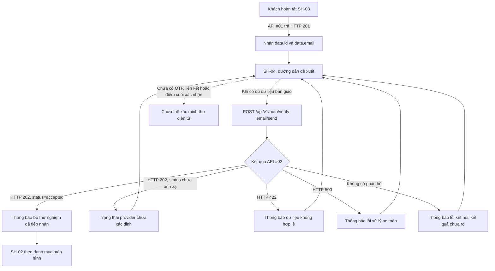
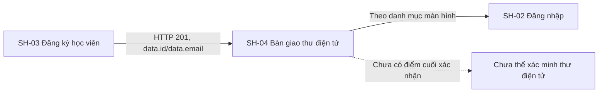

# Tài liệu thiết kế chi tiết màn hình — SH-04 Bàn giao xác thực thư điện tử

> **Trạng thái DD:** DD BLOCKED · **Trạng thái triển khai:** IMPLEMENTATION BLOCKED · **Runtime:** RUNTIME NOT VERIFIED · **Mã màn hình:** SH-04 · **Đường dẫn đề xuất:** `/register/verification` · **Tác nhân:** Khách · **Quyền gọi API:** Công khai, không cần `Authorization` · **Loại:** Trang · **Tiêu chí:** AC-01 · **Đợt:** W0 · **Ưu tiên:** P1 · **Tình trạng danh mục màn hình:** `S`.

## 1. Tổng quan

SH-04 là bước tiếp nhận yêu cầu gửi thư điện tử sau khi Khách đăng ký ở SH-03. Theo danh mục màn hình, màn hình gọi API #02 rồi cho người dùng quay lại SH-02. API hiện tại chỉ xác nhận bộ gửi thư giả lập đã tiếp nhận yêu cầu; nó không gửi thư, không tạo OTP hoặc liên kết và không xác minh địa chỉ thư điện tử. Vì vậy, mọi thông báo phải diễn đạt “đã được bộ thử nghiệm tiếp nhận”, không được nói thư đã được gửi hoặc tài khoản đã xác minh.

Tài liệu phân biệt ba loại căn cứ:

1. `list_screen.md` là thiết kế đích: SH-04, đường dẫn đề xuất, AC-01, API #02, trình tự SH-03 → SH-04 → SH-02 và điều kiện chặn về thư điện tử.
2. Mã nguồn Study Server hiện có khai báo API #02 cùng bộ gửi thư mặc định giả lập. Đây là bằng chứng hành vi mã nguồn, không chứng minh giao diện, dịch vụ gửi thư thật, cơ sở dữ liệu thật hoặc triển khai môi trường chính thức.
3. `screen.png` và `code.html` là tài sản thiết kế. Bản làm việc không có mã nguồn Study Web để xác nhận đường dẫn trang, lời gọi API, điều hướng hay trạng thái trình duyệt.

**Lý do DD BLOCKED:** F01 đặt API #02 sau đăng ký, nhưng catalog chỉ mô tả gửi khi verification được bật và API DD chưa chốt feature gate, component sở hữu dispatch, trigger tự động hay thao tác rõ ràng, hoặc kênh chuyển `data.id`/`data.email` từ SH-03. API contract cũng để mở semantics của `ActionResult.status`/`reason` và miền `user_id:int64` chưa khớp validator. Nhánh kế tiếp SH-02 kiểm tra `status=ACTIVE`, trong khi API #01 bỏ qua `status`, DDL không xác nhận live schema và chưa có endpoint xác nhận email cập nhật trạng thái. Các điểm này ảnh hưởng flow và mapping nên không tự chọn trong DD. Luồng dự kiến và các response hiện có vẫn được ghi đầy đủ dưới đây.

### 1.1. Bằng chứng và tình trạng

| Hạng mục | Phát hiện | Tình trạng |
|---|---|---|
| Mã nguồn Study Web và bộ định tuyến | `.agents/web-work/study/AGENTS.md` và `INDEX.md` hiện tồn tại, được khai báo trong manifest; nhưng không có `apps/study-client/src`, router, `package.json` hoặc kiểm thử giao diện. `dist`/`node_modules` không xác nhận source/runtime cho màn hình này. | Context `VERIFIED`; app `UNWIRED` |
| Đường dẫn trang | `/register/verification` có trong danh mục màn hình và ảnh mẫu; chưa có bộ định tuyến để xác nhận hoạt động. | ĐƯỜNG_DẪN_ĐỀ_XUẤT |
| Ảnh mẫu | [Ảnh gốc](./screen.png), 1600×1280, đang thể hiện nhánh mặc định `accepted`. | CHỈ_LÀ_THIẾT_KẾ |
| HTML mẫu | [HTML gốc](./code.html), gồm các nút đổi trạng thái cục bộ và nút sao chép lệnh. Không có `fetch` hay lời gọi API. | CHỈ_LÀ_THIẾT_KẾ |
| API #02 | `POST /api/v1/auth/verify-email/send` có route/model/validator/view/provider/test. Public, không mở DB; validator yêu cầu raw JSON integer, chuẩn hóa email; view map `status` và `reason` tùy chọn. Catalog yêu cầu `user_id:int64`, nhưng source không kiểm tra miền int64. | SOURCE-BACKED LOCALLY; CONTRACT DISCREPANCY |
| Bộ gửi thư mặc định | Bỏ qua `user_id`, `email`, `trace_id`; trả `status="accepted"` không kèm `reason`; không gửi thư, không xếp hàng và không tạo token. Các provider khác có thể trả status/reason tùy ý theo interface hiện tại; enum/semantics chưa được duyệt. | STUB SOURCE-VERIFIED; STATUS/REASON OPEN |
| Chủ sở hữu/trigger API #02 | F01 đặt POST #02 tại SH-04 sau đăng ký, nhưng API DD Q-02-01 để mở dispatch owner/feature gate; design không chốt tự gọi khi vào trang hay thao tác riêng. | `DISCREPANCY` / `DD BLOCKED` |
| Handoff SH-03 → SH-04 | API #01 source trả `data.id`/`data.email`; không có route-state/channel trong Study Web source. | `NOT_FOUND` / `IMPLEMENTATION BLOCKED` |
| Xác nhận thư điện tử | Không thấy điểm cuối API xác nhận OTP/liên kết trong danh mục API hiện tại; API #02 chỉ nhận yêu cầu gửi. | `NOT_FOUND` |
| Tài khoản và đăng nhập SH-02 | API #01 INSERT không gán `status`; checked-in DDL có default `ACTIVE`; API #03 từ chối login nếu `status != ACTIVE`. DDL không xác nhận live schema, và không có endpoint hiện tại nối verification với status. | `DISCREPANCY` / `POLICY OPEN` |
| Mã kiểm thử | Đã đọc mã kiểm thử API #02, không chạy kiểm thử trong phiên này. Mã kiểm tra endpoint công khai, không resolve cơ sở dữ liệu, 202 khi provider chấp nhận, 422 khi request sai và 500 khi provider lỗi. | CHỈ_ĐỌC_MÃ_KIỂM_THỬ |

### 1.2. Tài sản ảnh và quy tắc thị giác

- [Ảnh gốc](./screen.png) và [ảnh có đánh số](./screen_annotated.png) được giữ tách biệt. Ảnh chú thích có kích thước 3200×2560, gấp đôi mỗi chiều so với ảnh nguồn.
- Mười hai số chú thích khớp [bản đồ số](./SH-04_markers.json) và bảng phần tử ở §4. Ảnh gốc/HTML gốc không bị sửa.
- Tệp tham khảo [DESIGN.md](../../90_reference/study2work-lms-design-system/DESIGN.md) có mâu thuẫn nội bộ: YAML khai báo `primary: #004ac6`, còn phần văn xuôi gọi `#2563EB` là màu chính. HTML mẫu dùng cả `#004ac6` và `#2563eb` ở các token khác nhau.
- Hướng dẫn [Study Web](../../../../../../.agents/web-study/design.md) là đích giao diện Study: `ocean-primary: #0B5F8A`, ưu tiên Inter có sẵn hoặc phông chữ hệ thống, không tải phông từ xa, điều khiển tối thiểu 44px, có chỉ báo tiêu điểm bàn phím rõ, hỗ trợ bàn phím và giảm chuyển động. Không sao chép nguyên mã màu mâu thuẫn từ tài liệu tham khảo.
- HTML mẫu nạp Tailwind và Plus Jakarta Sans từ CDN. Đây là cách dựng của tài sản mẫu, không phải phụ thuộc đã được chấp thuận cho Study Web.
- Nhãn kiểm định WCAG AA ở ảnh là nội dung đồ họa; phiên này chưa đo tương phản hoặc kiểm tra khả năng tiếp cận.

### 1.3. Tác nhân, quyền và đường dẫn

- danh mục màn hình xếp SH-04 vào Shared/Auth/System, dành cho Khách, AC-01, loại Trang, ưu tiên P1, tình trạng `S`.
- API #02 được gọi công khai, không bắt buộc Bearer token. Mã kiểm thử còn xác nhận yêu cầu vẫn được chấp nhận khi gửi `Authorization: Bearer malformed-token`; màn hình không cần token cho bước này.
- `/register/verification` là đường dẫn đề xuất, chưa phải đường dẫn API đã cài đặt. Không mô tả trang này như đang chạy.
- SH-02 là màn hình tiếp theo theo danh mục màn hình. Nút quay lại chỉ thể hiện điều hướng; không cam kết đăng nhập thành công hoặc tài khoản đã được xác minh.

**Điều kiện trước:** theo F01, API #01 phải trả HTTP 201 và SH-04 cần nhận `data.id`/`data.email`; hiện chưa có client route/state hoặc kênh handoff để chuyển hai giá trị đó. Mở đường dẫn trực tiếp có thể thiếu handoff.

**Điều kiện sau:** HTTP 202 cùng `data.status="accepted"` chỉ cho phép báo provider stub đã tiếp nhận lời gọi; không chứng minh email được giao, tài khoản kích hoạt hay email được xác minh. API #02 không cập nhật tài khoản. Theo danh mục, Khách có thể quay lại SH-02. API #03 hiện từ chối user có status khác ACTIVE, nhưng API #01 không đặt status và checked-in DDL không xác nhận live schema; vì vậy chưa thể kết luận tài khoản chưa xác minh được phép hay bị chặn đăng nhập.

### 1.4. Đối chiếu cấu trúc A–F

| Mục | Nội dung bắt buộc | Vị trí trong DD |
|---|---|---|
| A | Tổng quan, actor/quyền, điều kiện trước/sau, route/liên kết, element/event/API, quy tắc và blocker | §1, §1.3, §2–§9, §12 |
| B | Luồng từ mở màn hình tới điều hướng, dữ liệu, API và lỗi | §2–§3, §6 |
| C | Mô tả 12 element, nguồn, hiển thị, trạng thái và event liên kết | §4 |
| D | Trigger/type, precondition, input, xử lý tuần tự, API, output và ngoại lệ cho từng event | §5–§6.4 |
| E | Trạng thái, điều kiện chuyển, SH-03/SH-02 handoff, quyền và route | §7–§9 |
| F | Tiêu chí nghiệm thu và kiểm tra evidence | §14 |

## 2. Sơ đồ luồng màn hình và API



Việc gọi API sau đăng ký là đích F01. Thời điểm kích hoạt cụ thể — tự gọi khi mở SH-04 hay chờ thao tác riêng — chưa được chốt bằng mã giao diện hoặc hợp đồng tương tác. Bản mẫu hiển thị trạng thái `accepted` ngay khi tải và không có lời gọi API; không được coi đó là hành vi đã nối.

## 3. Luồng tổng quát

1. SH-03 nhận HTTP 201 từ API #01. Mã nguồn API #01 trả hồ sơ có `data.id` và `data.email` sau khi xác nhận giao dịch.
2. SH-04 cần nhận hai giá trị từ trạng thái bàn giao của SH-03; cơ chế truyền chưa được hiện thực hóa. Không đặt `user_id` hoặc `email` vào URL. Nếu thiếu một trong hai giá trị, không gọi API #02; phương án hiển thị/điều hướng dự phòng còn phải được duyệt.
3. Khi được kích hoạt theo quyết định sản phẩm, gửi một yêu cầu công khai tới API #02 với đúng hai trường `user_id` và `email`.
4. API #02 kiểm tra dữ liệu, chuẩn hóa địa chỉ thư điện tử rồi gọi `VerificationEmailProvider`. API không mở phiên cơ sở dữ liệu và không xác minh `user_id` có tồn tại hoặc thuộc địa chỉ thư điện tử đã gửi.
5. View gọi provider đồng bộ; factory hiện trả `StubVerificationEmailProvider`, provider mặc định trả `status="accepted"` không có `reason`. View trả HTTP 202 và map `status` cùng `reason` tùy chọn từ provider vào `data`.
6. Chỉ `data.status="accepted"` được map thành provider đã tiếp nhận; status khác chưa có semantics và phải vào trạng thái chưa ánh xạ. Không hiển thị `reason` tùy ý như nội dung người dùng nếu chưa duyệt.
7. Giao diện không được suy ra email đã gửi thật. Không mở ô OTP, không tạo liên kết giả, không đếm lùi và không chuyển trạng thái sang “đã xác minh”.
8. Khách có thể chọn quay lại SH-02 theo danh mục màn hình. Việc đăng nhập trước khi xác minh thư điện tử là quy tắc riêng chưa được xác nhận trong phạm vi này.

## 4. Bản đồ phần tử và dữ liệu trên màn hình

Ảnh nguồn có hai cột trên màn hình rộng: thẻ thông báo chính bên trái; thẻ thông tin API bên phải; ghi chú thiết kế ở dưới cột phải; chân trang chạy hết chiều ngang. HTML dùng một cột dưới mốc Tailwind `lg` và bố cục 7/12 + 5/12 từ mốc này trở lên. Giữ thứ tự đọc: ngữ cảnh trang → thông báo → giới hạn xác minh → điều hướng → chi tiết kỹ thuật.

| # / Element ID | Tên, loại và nội dung | Nguồn/điều kiện hiển thị | Trạng thái | Event / kết quả |
|---|---|---|---|---|
| 1 / `SH04-EL-01` | Mã SH-04 và route đề xuất · nhãn tĩnh. | Nội dung thiết kế; `/register/verification` chưa có router; hiển thị trang. | Default. | `SH04-EV-01`; không tự tạo link/API. |
| 2 / `SH04-EL-02` | Bộ chọn `Accepted / Stub Spec / No-Delivery / Error Handshake` · QA controls trong mock. | HTML/JavaScript cục bộ; không phải trạng thái API. Loại khỏi giao diện Khách. | Chỉ tồn tại trong mock; không có product state. | `SH04-EV-08`; không gọi API. |
| 3 / `SH04-EL-03` | Biểu tượng thư và nhãn phản hồi · trạng thái. | Dữ liệu state từ response; chỉ render `accepted` khi HTTP 202, business code đúng và `data.status="accepted"`. | Pending, accepted, validation error, provider error, unmapped, network unknown. | `SH04-EV-03..06, SH04-EV-09`; 202 không chứng minh delivery/verification. |
| 4 / `SH04-EL-04` | Tiêu đề và giải thích kết quả · heading/status text. | Nội dung đích theo API response; không hiển thị “đã vào hàng đợi”. Không hiển thị `reason` provider cho người dùng trước khi semantics được duyệt. | Pending, accepted, error, unmapped. | `SH04-EV-03..06, SH04-EV-09`; nói rõ email chưa gửi thật. |
| 5 / `SH04-EL-05` | Khung giới hạn xác minh · informational notice. | Nội dung tĩnh theo catalog/source: chưa có OTP, link hoặc confirm endpoint. | Visible; không điều khiển. | `SH04-EV-01`; không tạo OTP/input/countdown. |
| 6 / `SH04-EL-06` | Quay lại đăng nhập · anchor. | `href="/login"` trong HTML; SH-02 route đề xuất, runtime chưa xác nhận. | Default/focus. | `SH04-EV-07`; điều hướng, không gọi API. |
| 7 / `SH04-EL-07` | Copy Test cURL · button trong mock. | JavaScript dựng URL ngoài thiếu `/api/v1` và body thiếu `user_id`; không đưa vào product UI. | Chỉ mock; không dùng được. | `SH04-EV-08`; không copy/gửi lệnh. |
| 8 / `SH04-EL-08` | Thẻ tham chiếu hợp đồng API #02 · heading/card. | Nhãn tĩnh; không khẳng định telemetry live. | Visible. | `SH04-EV-01`; không có API riêng. |
| 9 / `SH04-EL-09` | Các hàng HTTP/delivery/auth/confirmation · status summary. | HTTP/body đã parse; delivery/verify chưa có nguồn phản hồi riêng; provider status ngoài `accepted` chưa có semantics. | Pending/accepted/error/unmapped/network unknown. | `SH04-EV-03..06, SH04-EV-09`; không hiển thị mock 200/503 như server response. |
| 10 / `SH04-EL-10` | JSON block · preformatted mock payload. | HTML hard-code `contract`, `delivery`, `artifacts`, `otp_generated`, `confirm_url`; các field này không có trong API response. Ẩn khỏi product UI. | Chỉ mock; không trình bày như response. | `SH04-EV-08`; ví dụ contract thực ở §6.2. |
| 11 / `SH04-EL-11` | Design rule card và nhãn `PASS WCAG AA`. | Ghi chú tĩnh; nhãn không có báo cáo kiểm định hỗ trợ. Bỏ tuyên bố đạt chuẩn khi triển khai. | Visible trong mẫu; chưa xác minh. | `SH04-EV-01`; không tương tác. |
| 12 / `SH04-EL-12` | Chân trang mã màn hình/route/protocol/auth label. | Nội dung HTML tĩnh; `Engineering Verification Protocol v2.4`/`Stub S-02` không phải trạng thái runtime đã xác nhận. | Default. | `SH04-EV-01`; không điều hướng/xác thực. |

Không có trường nhập liệu nào trên SH-04. Tên trường `user_id` và `email` chỉ là dữ liệu yêu cầu API, không phải ô để Khách tự sửa trên trang này. Marker JSON ghi tọa độ theo ảnh gốc 1600×1280 với gốc trên-trái và pixel; Element ID `SH04-EL-01..12` ánh xạ một-một tới số 1–12.

## 5. Hợp đồng trường và ánh xạ dữ liệu

| Trường nguồn | Trường API #02 | Kiểu / kiểm tra theo mã nguồn | Quy tắc hiển thị và riêng tư |
|---|---|---|---|
| API #01 `data.id` | `user_id` | Catalog yêu cầu `int64`. Source model dùng Python `int`; validator đòi JSON thô có kiểu integer, nhưng không kiểm tra miền int64 hoặc `> 0`. Đây là discrepancy; không tự thêm ràng buộc client. | Chỉ dùng trong request nội bộ; không đưa lên URL, nhật ký giao diện hoặc khung mẫu công khai. |
| API #01 `data.email` | `email` | `str`; địa chỉ được chuẩn hóa bởi `normalize_email`. Sai định dạng trả 422. | Chỉ hiển thị địa chỉ nếu nhóm sản phẩm duyệt nội dung này; ảnh mẫu hiện không nêu người nhận. Không ghi cố định địa chỉ minh họa vào giao diện. |
| Header `Authorization` | Không gửi | API #02 được gọi công khai; đường dẫn API không khai báo yêu cầu đăng nhập. | Không cần token; không lưu hoặc làm mới token vì thao tác này. |
| `traceId` | Tiêu đề HTTP/siêu dữ liệu phản hồi | Lớp trung gian tạo và chuyển mã truy vết tới hàm xử lý; lỗi chuẩn trả tiêu đề `X-Trace-Id`. | Chỉ dùng hỗ trợ chẩn đoán theo chính sách; không coi là mã xác minh hoặc bí mật để mở liên kết. |

API #02 không xác nhận danh tính, quyền sở hữu địa chỉ thư điện tử, sự tồn tại của `user_id`, trạng thái tài khoản hoặc tính duy nhất của yêu cầu. Phía giao diện không được suy ra các điều này từ HTTP 202.

Catalog/API DD quy định `ActionResult.status:string` và `reason?:string`; source map các giá trị provider này trực tiếp vào response. Default provider hiện chỉ trả `accepted`, nhưng status/reason khác chưa có allowlist hoặc semantics được duyệt. UI chỉ map `accepted`; giá trị khác thuộc `SH04-EV-09`.

## 6. Chuỗi sự kiện và ánh xạ phản hồi API

### 6.1. Gửi yêu cầu

| Thuộc tính | Đặc tả |
|---|---|
| Tác nhân kích hoạt | Theo F01, bước gửi xảy ra sau đăng ký thành công; thao tác cụ thể chưa được chốt. |
| Phương thức / đường dẫn | `POST /api/v1/auth/verify-email/send` (API #02). |
| Yêu cầu | `Content-Type: application/json`; phần thân gồm `user_id` lấy từ `data.id` và `email` lấy từ `data.email`. Không kèm `Authorization`. |
| Ví dụ phần thân | `{"user_id":1001,"email":"student@example.com"}`; giá trị chỉ để minh họa cấu trúc. |
| Thứ tự xử lý phía máy chủ | FastAPI đọc `VerifyEmailSendRequest` → bộ kiểm tra dữ liệu kiểm tra `user_id` nguyên nghiêm ngặt và chuẩn hóa địa chỉ → `VerificationEmailProvider.dispatch(user_id, email, trace_id)` → dựng cấu trúc phản hồi thành công/lỗi. |
| Cơ sở dữ liệu / tác động phụ | Không mở phiên cơ sở dữ liệu. Bộ gửi thư mặc định bỏ `user_id`, `email`, `trace_id`; không gửi thư, ghi hàng đợi, tạo OTP/liên kết hoặc cập nhật tài khoản. |
| Chống gửi lặp | Chưa có khóa chống yêu cầu trùng hoặc chính sách thử lại trong hợp đồng API. Giao diện không tự gửi lại khi chờ lâu hay khi kết quả mạng chưa rõ. |

### 6.2. Phản hồi thành công hiện tại

HTTP `202 Accepted` với cấu trúc phản hồi chuẩn:

```json
{
  "success": true,
  "businessCode": "DESIGN_OPERATION_ACCEPTED",
  "message": "Yêu cầu gửi email xác thực đã được chấp nhận.",
  "data": {
    "status": "accepted"
  },
  "meta": {},
  "traceId": "<mã do máy chủ cấp>"
}
```

Bộ gửi thư mặc định không trả `reason`, vì vậy `data` chỉ có `status`. Không thêm `delivery`, `provider`, `dispatched`, `otp_generated` hoặc `confirm_url` vào hợp đồng giao diện khi API chưa trả các trường này. 202 chỉ xác nhận bộ gửi thư đã tiếp nhận lời gọi.

View cũng thêm `data.reason` khi một provider trả giá trị này. Contract chưa định nghĩa enum hoặc cách hiển thị `reason`; ví dụ response ở trên là đúng với provider mặc định. Không render `reason` chưa được duyệt như một thông báo gửi thư.

### 6.3. Phản hồi lỗi

| HTTP | Mã nghiệp vụ | Nguồn | Xử lý trên giao diện đích |
|---:|---|---|---|
| 422 | `DESIGN_VALIDATION_ERROR` | Phần thân yêu cầu thiếu/sai kiểu hoặc địa chỉ thư điện tử không hợp lệ; lỗi chuẩn có `meta.fieldErrors` khi bộ kiểm tra dữ liệu tạo danh sách lỗi. | Hiển thị thông báo phù hợp; không ghi nhận là đã tiếp nhận. Vì không có ô nhập trên màn hình, cần rà soát lỗi bàn giao từ SH-03 thay vì tự tạo biểu mẫu OTP hoặc thư điện tử. |
| 500 | `DESIGN_INTERNAL_ERROR` | Bộ gửi thư phát sinh ngoại lệ; chi tiết từ dịch vụ bên ngoài được ẩn. | Hiển thị lỗi chung và cho phép điều hướng an toàn; không hiển thị 503, `SERVICE_OFFLINE` hoặc thông tin nội bộ từ HTML mẫu. |
| Không có HTTP phản hồi | Lỗi kết nối phía trình duyệt, nếu triển khai. | Nêu kết quả chưa xác định; không tự gửi lại. Hành vi này chưa có mã giao diện để xác minh. |

Không có bằng chứng API #02 trả HTTP 503 khi bộ gửi thư lỗi. Trạng thái “cổng xác nhận từ chối/lỗi bắt tay” trong HTML là mô phỏng cục bộ.

### 6.4. Đặc tả sự kiện ổn định

#### `SH04-EV-01` — Mở route và đọc handoff

- **Element / loại:** `SH04-EL-01`, `SH04-EL-03..05`, `SH04-EL-08..12` · route load.
- **Điều kiện tiên quyết:** Khách mở route đề xuất `/register/verification`. Route chưa được đăng ký trong Study Web source.
- **Đầu vào:** path và dữ liệu handoff dự kiến từ SH-03 gồm `data.id` và `data.email`; không nhận hai giá trị qua URL. Kênh truyền chưa được quyết định.
- **Xử lý:** 1) Nhận route và state chỉ từ kênh handoff được duyệt. 2) Kiểm tra đủ data.id/data.email và kiểu tương thích trước khi bật dispatch. 3) Không đọc/cất dữ liệu từ URL, local storage hoặc session storage theo giả định.
- **Đầu ra:** màn hình ở trạng thái chờ dispatch khi handoff đủ; nếu thiếu dữ liệu, không gọi API #02 và dùng fallback route/message sau khi sản phẩm chốt. Không có trạng thái runtime hiện tại.
- **Kết quả / ngoại lệ:** thiếu route hoặc handoff không hợp lệ → không dispatch; fallback chưa được duyệt. Event này không có API response.

#### `SH04-EV-02` — Dispatch API #02 với handoff hợp lệ

- **Element / loại:** transition vào SH-04, kết quả được trình bày ở `SH04-EL-03..04`, `SH04-EL-09` · API request.
- **Điều kiện tiên quyết:** API #01 trước đó trả HTTP 201 `DESIGN_RESOURCE_CREATED`; handoff gồm `data.id` và `data.email`; component sở hữu và thời điểm trigger được BA/BE/FE xác nhận. F01 giao dispatch cho SH-04 nhưng API DD Q-02-01 còn mở.
- **Đầu vào:** `user_id: int` lấy từ `data.id`, `email: string` lấy từ `data.email`; không lấy từ người dùng và không gửi `Authorization`.
- **Xử lý:** 1) Gửi một lần POST /api/v1/auth/verify-email/send với Content-Type application/json và body {user_id: data.id, email: data.email}, không kèm Authorization. 2) Route parse request; validator đòi user_id là JSON integer thô, trim/kiểm tra email, nhưng không áp miền int64 của catalog. 3) Với input hợp lệ, view gọi provider đồng bộ, không mở DB và không kiểm tra user/email binding. 4) View map provider status và reason tùy chọn vào data; provider mặc định trả accepted, không có reason. 5) Không có idempotency key, queue hoặc retry worker.
- **Đầu ra:** chuyển tới event response tương ứng theo HTTP/body. Không retry tự động khi timeout vì acceptance có thể không xác định. Dispatch trigger vẫn là blocker; không coi mock HTML là proof đã gọi API.
- **Kết quả / ngoại lệ:** HTTP 202 với status đã ánh xạ → response mapping; 422 → EV-04; provider exception → HTTP 500/EV-05; timeout/body không đọc được → EV-06; provider status chưa biết → EV-09. Không tuyên bố email đã gửi hoặc xác minh.

#### `SH04-EV-03` — API trả accepted

- **Element / loại:** response hiển thị ở `SH04-EL-03`, `SH04-EL-04`, `SH04-EL-09` · API response mapping.
- **Điều kiện tiên quyết:** HTTP 202, `success=true`, `businessCode="DESIGN_OPERATION_ACCEPTED"`, `data.status="accepted"`.
- **Đầu vào:** envelope API #02; `meta` mặc định rỗng, `traceId` do server cấp.
- **Xử lý:** 1) Kiểm tra HTTP 202, success, businessCode và data.status. 2) Chỉ khi status là accepted, đặt UI state accepted. 3) Hiển thị câu giải thích provider stub đã nhận lời gọi; bỏ qua reason chưa được duyệt. 4) Không suy ra delivery, queue, OTP/link, ownership hoặc email verification.
- **Đầu ra:** trạng thái “được bộ thử nghiệm tiếp nhận; thư chưa được gửi thật”; nút quay lại SH-02 vẫn khả dụng theo route được duyệt.
- **Kết quả / ngoại lệ:** body khớp → accepted; body thiếu/sai shape → EV-06; data.status khác accepted → EV-09. Không ghi trạng thái vào account hoặc xác minh email.

#### `SH04-EV-04` — API trả lỗi dữ liệu 422

- **Element / loại:** `SH04-EL-03..04`, `SH04-EL-09` · API error mapping.
- **Điều kiện tiên quyết:** HTTP 422 `DESIGN_VALIDATION_ERROR` do trường thiếu/sai kiểu hoặc email không hợp lệ.
- **Đầu vào:** error envelope và `meta.fieldErrors` nếu được tạo.
- **Xử lý:** 1) Phân loại HTTP 422 và DESIGN_VALIDATION_ERROR. 2) Đọc meta.fieldErrors nếu có để chẩn đoán handoff; không có ô chỉnh email/ID trên màn hình. 3) Xóa trạng thái pending; không retry request sai. 4) Không tự điều hướng tới SH-03 vì fallback route chưa được duyệt.
- **Đầu ra:** trạng thái dữ liệu handoff/request không hợp lệ; không gửi request tiếp theo.
- **Kết quả / ngoại lệ:** hiện lỗi an toàn và giữ outcome là thất bại validation; không hiển thị accepted. Nếu envelope không đọc được thì dùng EV-06.

#### `SH04-EV-05` — Provider/API trả lỗi 500

- **Element / loại:** `SH04-EL-03..04`, `SH04-EL-09` · API error mapping.
- **Điều kiện tiên quyết:** HTTP 500 `DESIGN_INTERNAL_ERROR`; provider `dispatch` ném exception.
- **Đầu vào:** safe error envelope, trace ID/header nếu có.
- **Xử lý:** 1) Phân loại HTTP 500/DESIGN_INTERNAL_ERROR. 2) Hiển thị lỗi chung, không render exception, provider detail, mock 503 hoặc SERVICE_OFFLINE. 3) Không tự gọi lại vì không có retry/idempotency contract.
- **Đầu ra:** trạng thái xử lý thất bại; điều hướng quay lại SH-02 vẫn là lựa chọn riêng, không biểu thị email đã gửi.
- **Kết quả / ngoại lệ:** lỗi provider được chuyển thành HTTP 500 an toàn; nếu không nhận được response thì dùng EV-06. Không ghi delivery hoặc verification success.

#### `SH04-EV-06` — Timeout, lỗi mạng hoặc body không hợp lệ

- **Element / loại:** `SH04-EL-03..04`, `SH04-EL-09` · transport/parser failure.
- **Điều kiện tiên quyết:** không nhận được response đáng tin cậy, hoặc 202/body thiếu `businessCode`/`data.status` cần thiết.
- **Đầu vào:** transport failure hoặc envelope không đúng shape; có thể không có `traceId`.
- **Xử lý:** 1) Phân biệt transport failure với response hợp lệ; body thiếu businessCode/data.status không được coi là success. 2) Giữ state kết quả chưa rõ. 3) Không tự retry vì API hiện không khai báo idempotency.
- **Đầu ra:** trạng thái kết quả chưa xác định; hành động retry/khôi phục cần quyết định sản phẩm.
- **Kết quả / ngoại lệ:** timeout, mất mạng hoặc body lỗi → unknown; không chuyển sang accepted khi body không parse được. Hướng xử lý lại cần được duyệt.

#### `SH04-EV-07` — Quay lại SH-02

- **Element / loại:** `SH04-EL-06` · click/navigation.
- **Điều kiện tiên quyết:** link quay lại hiển thị và router tương lai đăng ký `/login`.
- **Đầu vào:** không truyền `user_id`, email, password hoặc API response vào URL.
- **Xử lý:** 1) Nhận click trên link. 2) Điều hướng tới route /login của SH-02 nếu route được đăng ký. 3) Không gửi user_id, email hoặc response trong URL; không gọi API #02 và không thay đổi account state.
- **Đầu ra:** SH-02 theo route đề xuất. API #03 hiện từ chối user có `status != ACTIVE`; API #01 không đặt status, DDL mặc định ACTIVE chỉ là artifact checked-in và chưa có endpoint xác minh cập nhật status. Không khẳng định tài khoản chưa xác minh được phép hoặc bị chặn đăng nhập.
- **Kết quả / ngoại lệ:** route tồn tại → mở SH-02; route chưa có → runtime chưa thực hiện được và cần router/fallback được duyệt. Không coi điều hướng là login success.

#### `SH04-EV-08` — Điều khiển mock/copy cURL trong HTML nguồn

- **Element / loại:** `SH04-EL-02`, `SH04-EL-07`, `SH04-EL-10` · click mock-only.
- **Điều kiện tiên quyết:** chỉ trong HTML mẫu đang có; đây không phải hành vi product.
- **Đầu vào:** lựa chọn trạng thái giả hoặc lệnh cURL hard-coded.
- **Xử lý:** 1) Click mock control làm JavaScript đổi DOM/JSON cục bộ hoặc copy snippet. 2) Không phát network request. 3) Snippet có URL/body sai contract, nên loại khỏi product UI.
- **Đầu ra:** loại các controls khỏi giao diện khách; không coi mock 200/503/delivery/artifact fields là API response.
- **Kết quả / ngoại lệ:** chỉ thay đổi bản trình diễn tĩnh; không có server result. Không duy trì các nút QA này như hành vi người dùng.

#### `SH04-EV-09` — Provider trả status/reason chưa được ánh xạ

- **Element / loại:** SH04-EL-03, SH04-EL-04, SH04-EL-09 · API response mapping.
- **Điều kiện tiên quyết:** API trả envelope HTTP 202 hợp lệ nhưng data.status khác accepted. Nếu response có data.reason thì không hiển thị giá trị đó vì semantics chưa được duyệt. Contract khai báo status là string và reason tùy chọn; enum chưa có.
- **Đầu vào:** data.status:string, data.reason tùy chọn, businessCode DESIGN_OPERATION_ACCEPTED, traceId.
- **Xử lý:** 1) Không gán status ngoài allowlist hiện chưa tồn tại sang “đã gửi”, “đã xếp hàng” hoặc “đã xác minh”. 2) Không hiển thị reason thô cho Khách. 3) Đặt trạng thái nội bộ unmapped; lưu trace theo chính sách đã duyệt nếu cần chẩn đoán. 4) Không retry tự động.
- **Đầu ra:** trạng thái provider chưa ánh xạ; câu chữ người dùng và mapping cụ thể cần product/API owner duyệt trước khi triển khai.
- **Kết quả / ngoại lệ:** giữ outcome không xác định, không claim delivery/verification. Default stub không đi vào nhánh này; nhánh tồn tại do contract hiện cho phép chuỗi tự do.

## 7. Máy trạng thái giao diện đích

| Trạng thái | Vào trạng thái khi | Hiển thị / hành động | Event ID | Căn cứ |
|---|---|---|---|---|
| Chờ dispatch | Route mở và handoff đủ, trước khi dispatch được chấp thuận. | Trạng thái đích; không báo đã gửi. | `SH04-EV-01..02` | UI source chưa có; dispatch trigger/owner mở. |
| Đang gửi | API #02 đã bắt đầu. | Hiển thị tiến trình; ngăn gửi trùng trong cùng lượt. | `SH04-EV-02` | Target UI; chưa có runtime. |
| Đã tiếp nhận bởi bộ thử nghiệm | HTTP 202, `DESIGN_OPERATION_ACCEPTED`, `data.status="accepted"`. | Nêu thư chưa được gửi thật, không có xác minh; điều hướng SH-02 theo lựa chọn Khách. | `SH04-EV-03` | API source/provider stub và test source. |
| Dữ liệu không hợp lệ | HTTP 422 `DESIGN_VALIDATION_ERROR`. | Không hiện accepted; không tạo input; cần quyết định cách sửa handoff hoặc quay lại SH-03. | `SH04-EV-04` | API source/test; fallback chưa được duyệt. |
| Lỗi provider | HTTP 500 `DESIGN_INTERNAL_ERROR`. | Hiển thị lỗi chung; không lộ upstream detail. | `SH04-EV-05` | API source/test. |
| Kết quả chưa rõ | Timeout/mất mạng/body không đọc được. | Nêu kết quả không xác định; không tự gửi lại. | `SH04-EV-06` | Target transport handling; chưa có UI source/idempotency. |
| Thiếu dữ liệu bàn giao | Route mở trực tiếp hoặc thiếu `data.id`/`data.email`. | Không gọi API; fallback message/route chờ quyết định. | `SH04-EV-01` | Handoff channel chưa được hiện thực hóa. |
| Provider status chưa ánh xạ | HTTP 202 hợp lệ nhưng `data.status` khác `accepted`; nếu có `reason` thì không hiển thị giá trị chưa được duyệt. | Không claim email đã gửi/xác minh; giữ trạng thái nội bộ chưa ánh xạ; không retry. | `SH04-EV-09` | `ActionResult.status` là string, `reason` optional; enum còn mở. |
| Đã xác minh | Không có điều kiện vào trạng thái này ở API #02. | Không hiển thị ở SH-04. | — | Chưa có OTP, link hoặc endpoint xác nhận. |

Các nút chuyển `stub`, `no-delivery` và `error` của HTML không phải máy trạng thái máy chủ: JavaScript tự đổi tiêu đề, mã HTTP và JSON mà không gọi API. Chúng phải được loại khỏi luồng người dùng hoặc chỉ giữ trong bản trình diễn với nhãn giả lập rõ ràng.

## 8. Sơ đồ màn hình liên kết



| Màn hình | Quan hệ | Dữ liệu / hành vi |
|---|---|---|
| SH-03 | Màn hình trước | API #01 trả `data.id`, `data.email`; cơ chế giữ hai giá trị tới SH-04 cần được chốt. API #01 không gọi API #02. |
| SH-02 | Màn hình tiếp theo | Nút quay lại theo danh mục màn hình. Không suy ra trạng thái tài khoản hoặc kết quả đăng nhập từ API #02. |

## 9. Bảo mật, riêng tư và điều kiện tích hợp

- API #02 được gọi công khai và không dùng phiên cơ sở dữ liệu; không cần gửi Bearer token.
- Địa chỉ thư điện tử và `user_id` được gửi qua phần thân JSON theo hợp đồng; không đưa vào URL hoặc lệnh cURL gắn cứng trong tài liệu công khai.
- API #02 là public và không có DB ownership check; abuse control/rate limit còn mở trong API DD. Không tự thêm auth, rate limit hoặc chống lạm dụng khác vào hành vi hiện tại.
- Bộ gửi thư hiện tại bỏ dữ liệu đầu vào. Không ghi nội dung rằng thông tin đã được xếp hàng, gửi ra dịch vụ ngoài hay lưu lại.
- Không tạo/lưu token xác minh phía trình duyệt; API hiện tại không tạo token hoặc `confirm_url`.
- Không đặt `user_id`, địa chỉ thư điện tử hoặc `traceId` trong nhật ký hiển thị cho người dùng. Nếu nhóm sản phẩm cần che một phần địa chỉ, phải duyệt định dạng trước khi triển khai.
- Mẫu lệnh sao chép trong HTML đang sai điểm cuối API và thiếu trường bắt buộc; bỏ khỏi giao diện người dùng hoặc sửa theo hợp đồng được duyệt trước khi sử dụng.
- API #02 không kiểm tra `user_id` có khớp địa chỉ thư điện tử. Không dùng phản hồi 202 để kết luận người dùng đã chứng minh quyền sở hữu địa chỉ.

## 10. Bố cục thích ứng và khả năng tiếp cận

- Ở màn hình rộng, có thể dùng hai cột như ảnh tham khảo, nhưng thông báo người dùng phải được đọc trước thẻ kỹ thuật. Ở màn hình hẹp, xếp dọc theo thứ tự thông báo → giới hạn hiện tại → điều hướng; phần dữ liệu kỹ thuật không được đẩy nút chính khỏi tầm đọc.
- Theo hướng dẫn Study, hỗ trợ các mốc `<768px`, `768–1023px`, `>=1024px`; không cắt nội dung ở 320 CSS px và phải hoạt động khi phóng to trình duyệt.
- Nút điều hướng có vùng chạm tối thiểu 44×44 CSS px. Nút sao chép lệnh không nên xuất hiện với người dùng cuối theo các sai khác đã ghi.
- Dùng tiêu đề trang có thứ bậc, vùng thông báo trạng thái có tên dễ hiểu; sau khi nhận phản hồi, công bố thay đổi bằng `role="status"`/`aria-live="polite"` khi phù hợp. Lỗi cần được công bố bằng vùng lỗi có ngữ nghĩa.
- Thứ tự bàn phím đi theo thứ tự đọc. Chỉ báo `:focus-visible` phải rõ; trạng thái không chỉ dựa vào màu hoặc biểu tượng. Không tự chạy chuyển động lặp hoặc bộ đếm lùi; tôn trọng `prefers-reduced-motion`.
- Chọn mã màu ngữ nghĩa theo `.agents/web-study/design.md` khi triển khai. Chưa kiểm tra tương phản hoặc thao tác bàn phím trên HTML mẫu; nhãn WCAG AA trên ảnh không thay cho kiểm định.

## 11. Ma trận kiểm tra cho lần triển khai giao diện

Các mục sau là tiêu chí tương lai. Trong phiên soạn DD này chỉ đọc mã kiểm thử API #02; không chạy kiểm thử dự án.

| Nhóm | Trường hợp cần kiểm tra | Bằng chứng hiện có |
|---|---|---|
| Tích hợp API | Phần thân yêu cầu có `user_id` và `email`; không kèm Bearer; hiển thị HTTP 202 là “đã được bộ thử nghiệm tiếp nhận”. | Có đường dẫn API và mã kiểm thử cho API #02; chưa có mã giao diện, chưa chạy kiểm thử. |
| Ánh xạ bàn giao | `data.id` → `user_id`, `data.email` → `email`; không gọi khi thiếu dữ liệu. | Mã nguồn/mã kiểm thử API #01 xác nhận `id`, `email`; chưa có cơ chế giữa hai màn hình. |
| Chuẩn hóa/lỗi dữ liệu | Địa chỉ thư điện tử lỗi hoặc phần thân yêu cầu thiếu/sai kiểu trả 422; không hiện nội dung `accepted`. | Có bộ kiểm tra dữ liệu và mã kiểm thử API #02; chưa chạy kiểm thử. |
| Lỗi bộ gửi thư | Lỗi bộ gửi thư ánh xạ 500 `DESIGN_INTERNAL_ERROR`; không lộ ngoại lệ. | Có lớp điều phối và mã kiểm thử API #02; chưa chạy kiểm thử. |
| Giao thư/xác minh | Không nói đã gửi, không tạo OTP/liên kết và không hiện “đã xác minh”. | Mã nguồn bộ gửi thư không gửi thư/tạo token; chưa có điểm cuối xác nhận trong danh mục API. |
| Giả lập trong HTML | Các nút tự đổi JSON cục bộ; mẫu cURL thiếu `user_id` và sai đường dẫn. | Đã đọc HTML tĩnh; không thực thi JavaScript. |
| Điều hướng | Nút quay lại mở SH-02; truy cập trực tiếp khi thiếu dữ liệu không tự gửi yêu cầu. | Danh mục màn hình chỉ định SH-02; chưa có bộ định tuyến để kiểm tra. |
| Gửi lặp/mạng | Không tự gửi lặp khi chờ lâu hoặc không nhận phản hồi; kết quả chưa rõ. | Chưa có mã giao diện hoặc chính sách chống yêu cầu trùng. |
| Provider status/reason chưa biết | Không ánh xạ status ngoài accepted; không hiển thị reason chưa được duyệt. | Contract status là string, reason tùy chọn; API DD Q-02-05 còn mở. |
| Account/login gate | Không kết luận trạng thái đăng nhập sau SH-04 từ phản hồi API #02. | API #03 yêu cầu ACTIVE; API #01 bỏ qua status; DDL default ACTIVE chỉ là artifact, chưa có live-schema/verification-to-status evidence. |
| Tiếp cận/thích ứng | Bàn phím, tiêu điểm, thông báo trạng thái, chiều rộng 320px, phóng to, giảm chuyển động. | Chưa được kiểm tra trên mã giao diện vì môi trường chạy vắng mặt. |

## 12. Điểm cần quyết định trước khi triển khai

1. API #02 được gọi tự động khi mở SH-04 hay sau một thao tác rõ ràng? Danh mục màn hình quy định trình tự sau đăng ký nhưng chưa nêu cách kích hoạt.
2. Cơ chế nào chuyển `data.id`/`data.email` từ SH-03 sang SH-04 mà không đưa thông tin cá nhân vào URL? Cách xử lý tải lại hoặc mở đường dẫn trực tiếp là gì?
3. Nhóm sản phẩm có chấp nhận màn hình chỉ thông báo bộ gửi thư giả lập đã tiếp nhận, hay cần ẩn thao tác gọi API tới khi dịch vụ gửi thư thật sẵn sàng?
4. Cần triển khai dịch vụ gửi thư thật và điểm cuối xác nhận OTP/liên kết nào trước khi gọi đây là luồng xác minh thư điện tử hoàn chỉnh?
5. Có nên loại thẻ trạng thái kỹ thuật, bộ chọn giả lập và nút sao chép lệnh khỏi giao diện Khách? Bản mẫu hiện trình bày dữ liệu nội bộ không khớp phản hồi thật.
6. Cần thống nhất token của `DESIGN.md` với hướng dẫn Study trước khi tái sử dụng màu/phông chữ trong giao diện triển khai.
7. Chốt miền int64 của user_id và semantics/allowlist cho ActionResult.status, reason trước khi client map response.
8. Chốt điều kiện bật verification, public abuse control và cách xử lý khi provider nhận status chưa biết.
9. API #01 bỏ qua status, checked-in DDL default ACTIVE, API #03 đòi ACTIVE: cần chốt live schema và quy tắc nào gắn email verification với trạng thái tài khoản; không kết luận người chưa xác minh được login hay không.

## 13. Tài liệu và mã nguồn tham chiếu

- [Danh mục màn hình và luồng F01](../../../list_screen.md)
- [API catalog](../../../../../../docs/lists/list_api.md) · [AC-01 Guest Account](../../../../../study-server/docs/diagrams/AC_UNICA/AC_01_GUEST_ACCOUNT.drawio)
- [Hướng dẫn thiết kế Study Web](../../../../../../.agents/web-study/design.md)
- [Tài liệu hệ thống thiết kế tham khảo](../../90_reference/study2work-lms-design-system/DESIGN.md)
- [Kế hoạch riêng SH-04](./SH-04_PLAN.md)
- [Ảnh gốc](./screen.png) · [Ảnh có đánh số](./screen_annotated.png) · [HTML mẫu](./code.html)
- [Khai báo API Study](../../../../../study-server/app/api/v1.py) · [Request model](../../../../../study-server/app/modules/guest/api_02_auth_verify_email_send/models.py) · [Validator](../../../../../study-server/app/modules/guest/api_02_auth_verify_email_send/validate.py) · [Lớp điều phối API #02](../../../../../study-server/app/modules/guest/api_02_auth_verify_email_send/view.py) · [Provider](../../../../../study-server/app/service/email/provider.py)
- [Mã kiểm thử API #02 đã đọc](../../../../../study-server/tests/modules/guest/api_02_auth_verify_email_send/test_verify_email_send.py) · [API #02 open questions](../../../../../study-server/docs/dd/02_auth_verify_email_send/OPEN_QUESTIONS.md) · [SH-03 DD](../SH-03_dang-ky-hoc-vien/SH-03.md) · [Worklog phiên này](../../../../../../.agents/worklog/2026-11-07/design-study-screen-sh04-reaudit.md)
- [API #03 login view](../../../../../study-server/app/modules/guest/api_03_auth_login/view.py) · [Checked-in users DDL](../../../../../../infra/postgres/study-server/DB.sql) — schema artifact only; not live-schema evidence.

## 14. Tiêu chí nghiệm thu tài liệu SH-04

- DD, kế hoạch, worklog và nhãn số chú thích do phiên này tạo được viết bằng tiếng Việt; tên API, trường JSON, giá trị/mã phản hồi và đường dẫn giữ nguyên để có thể đối chiếu.
- Có đủ 12 số trên ảnh; từng số ánh xạ một-một tới `SH04-EL-01..12` ở §4 và JSON marker; chín event `SH04-EV-01..09` có trigger/type, precondition, input, processing, output và kết quả/ngoại lệ riêng.
- Crosswalk A–F có đủ sáu mục; tổng quan có điều kiện trước/sau; ma trận trạng thái, route SH-03/SH-02 và blocker không mâu thuẫn.
- Ảnh `screen.png` và HTML `code.html` giữ nguyên hash nguồn; ảnh chú thích giữ đúng tỷ lệ 2×.
- DD nêu đúng API #02: yêu cầu `user_id`/`email`, HTTP 202 `DESIGN_OPERATION_ACCEPTED`, mặc định `status="accepted"`, `reason` tùy chọn, không gửi thật; lỗi bộ gửi thư trả 500 `DESIGN_INTERNAL_ERROR`; dữ liệu lỗi trả 422; discrepancy int64 được đánh dấu.
- Các dữ liệu/mã 200/503, thông tin hàng đợi, OTP/liên kết và lệnh cURL sai trong HTML được đánh dấu là mô phỏng hoặc sai khác, không dùng như hợp đồng.
- Mọi đường dẫn tương đối trong DD mở được trong cây tài liệu hiện tại; bảng tổng ghi riêng DD, implementation và runtime status.
- Chỉ kiểm tra tĩnh; không tuyên bố giao diện chạy, API được gọi từ trình duyệt, thư điện tử được gửi, địa chỉ thư điện tử được xác minh hoặc môi trường đã triển khai.
