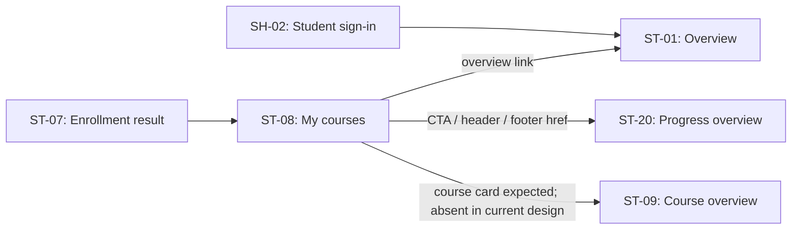

# ST-08 — Khóa học của tôi

> **DD status:** `BLOCKED` · **Implementation:** `BLOCKED` · **Runtime:** `NOT VERIFIED`
> **Phạm vi phiên:** chỉ ST-08. Tài liệu mô tả thiết kế và bằng chứng hiện có; đây không phải xác nhận UI hoặc API đang chạy.

## A. Tổng quan

| Thuộc tính | Đặc tả |
|---|---|
| Screen ID / tên | ST-08 — Khóa học của tôi (Page) |
| Mục tiêu | Cho Student xem các khóa đã ghi danh, lọc theo trạng thái và xem tiến độ từng khóa theo inventory/AC-13. |
| Actor | Student đã đăng nhập theo tiền điều kiện AC-13 và API catalog. |
| Route | `/student/courses` là route đề xuất trong inventory; Study Web hiện không có app source, router hoặc entrypoint để xác minh route khi chạy. |
| API thiết kế | #20 `GET /api/v1/users/me/courses`; #21 `GET /api/v1/users/me/progress`. Hai API mới được khai báo trong catalog/DD Draft; không tìm thấy route, module, query hoặc test tương ứng trong Study Server hiện tại. |
| Thiết kế UI có sẵn | `code.html` là HTML tĩnh với trạng thái empty; `screen.png` không hiển thị header và có dải đen dưới footer. `screen_rendered.png` là ảnh render tĩnh từ HTML dùng làm nền chú thích; không phải runtime capture. |
| Điều hướng liên quan | ST-07 → ST-08 sau kết quả ghi danh được xác minh; ST-08 → ST-09 theo course card (card hiện chưa có); ST-08 → ST-20 qua CTA/header/footer. Header/footer cũng có liên kết về ST-01. |
| Trạng thái tổng | DD bị chặn bởi response #20/#21 không thể hiện course/progress payload, semantics query/merge chưa chốt và loaded/filter state chưa được thiết kế. Implementation bị chặn thêm bởi Study Web chưa có trong checkout. |

### Nguồn và mức độ bằng chứng

| Nguồn | Điều dùng làm bằng chứng | Trạng thái |
|---|---|---|
| [Screen inventory](../../../../docs/list_screen.md) và [global screen plan](../../dd_screens/PLAN.md) | Tên/route dự kiến, actor, AC-13, API IDs, quan hệ ST-09/ST-20, các state mong đợi. | Expected design; không phải runtime. |
| [AC API index](../../../../../../apps/study-server/docs/diagrams/AC_UNICA/00_AC_API_INDEX.md) và [AC-02 Student Learning diagram](../../../../../../apps/study-server/docs/diagrams/AC_UNICA/AC_02_STUDENT_LEARNING.drawio) | Student đã đăng nhập; hậu điều kiện hiển thị danh sách khóa kèm progress; AC-13 liệt kê #20 và #21. | Business design; một số chi tiết orchestration không khớp inventory. |
| [API catalog](../../../../../../docs/lists/list_api.md), [API #20 DD](../../../../../../apps/study-server/docs/dd/20_users_me_courses/00_Cover.md), [#20 open questions](../../../../../../apps/study-server/docs/dd/20_users_me_courses/OPEN_QUESTIONS.md), [API #21 DD](../../../../../../apps/study-server/docs/dd/21_users_me_progress/00_Cover.md), [#21 open questions](../../../../../../apps/study-server/docs/dd/21_users_me_progress/OPEN_QUESTIONS.md) | Endpoint, role, tham số và business codes đang được khai báo; các DD API đều Draft — Needs Confirmation. | Declared design only; không chứng minh route hoạt động. |
| Study Server source/tests | Tìm chuỗi endpoint và tên module #20/#21 trong `apps/study-server/app` và `apps/study-server/tests`. | `NOT_FOUND` cho cả hai endpoint trong checkout đã rà soát. Không có test runnable xác minh các hợp đồng này. |
| [Study UI design guide](../../../../../../.agents/web-study/design.md) | Hướng dẫn giao diện đích cho Study. | Design guidance; không phải bằng chứng UI đã wired. |
| [Nguồn HTML tĩnh](code.html), [PNG gốc](screen.png), [ảnh render sạch](screen_rendered.png), [ảnh chú thích](screen_annotated.png) | Bố cục và nội dung nhìn thấy trong asset ST-08. | HTML/ảnh mẫu; không có fetch, session, state store hoặc router runtime. |
| [DDL legacy](../../../../../../infra/postgres/study-server/DB.sql) và [V1-PILOT DDL](../../../../../../infra/postgres/02_study_db.sql) | Hai artifact mô tả các mô hình enrollment/course/progress khác nhau. | Design artifacts only; không API #20/#21 query nào chọn mô hình, và không xác nhận live schema. |

### Sai khác cần giữ nguyên

1. Inventory mô tả filter status, course list và progress bar; HTML/PNG chỉ có empty state. Không có element để chú thích cho loaded state.
2. Inventory nói gọi #21 khi #20 chưa kèm progress; AC-13 mô tả gọi cả #20 và #21. Response #20 hiện chỉ khai báo `ApiEnvelope<UserProfile>`, vì vậy chưa thể biết #20 có progress để điều kiện hóa request #21.
3. AC-13 cần ghép courses và progress theo `course_id`; catalog khai báo cả #20 lẫn #21 trả `ApiEnvelope<UserProfile>`, còn node API trong diagram chỉ ghi `ApiEnvelope`. Các response declaration không mô tả collection khóa học hoặc tiến độ.
4. AC-13 decision node ghi `NO → empty state; YES → render`, nhưng cả cạnh `EMPTY` lẫn `HAS DATA` đều trỏ tới cùng node “Hiển thị khóa học + % hoàn thành”. Destination của nhánh empty chưa rõ.
5. Legacy DDL dùng `BIGSERIAL`/BIGINT với `enrollments` và `lesson_progress`; V1-PILOT DDL dùng UUID course/enrollment model với `course_enrollments`, `lesson_progress_facts` và `progress_snapshots`. Không có API #20/#21 query source để chọn model; không suy luận ID type, join hay progress source.
6. HTML imports Google Fonts và Tailwind CDN, dùng Plus Jakarta Sans và `max-w-[1440px]`; Study Web guide chỉ định Inter/system, không thêm remote imports và content width khoảng 1120px. Chưa có approved exception.
7. Các anchor HTML có `href`, nhưng Study Web router/source không có trong checkout; điều hướng chỉ là ý đồ trong asset.

## B. Luồng hoạt động tổng thể

### Tiền điều kiện và nguồn dữ liệu

- AC-13 yêu cầu Student đã đăng nhập; API catalog cũng khai báo Bearer JWT và role Student cho #20/#21.
- API dùng path `/users/me`; catalog không chỉ định user ID trong query/body. Cách backend liên kết JWT với `enrollments.user_id`/progress ownership vẫn là câu hỏi mở trong API DD. Không suy ra claim cụ thể hoặc cách xử lý user/profile không tồn tại.
- Route `/student/courses` là đề xuất. Không có bằng chứng về client session guard, redirect, route history hoặc dữ liệu được cache.
- Dữ liệu dự kiến là course/enrollment list từ #20 và tiến độ aggregate từ #21; khóa ghép dự kiến theo `course_id`. Trường, kiểu, ordering, paging tổng thể, quy tắc progress và empty representation chưa được xác nhận.

### Trình tự thiết kế và giới hạn hiện tại

1. Khi Student đi vào route dự kiến `/student/courses`, thiết kế yêu cầu có session Student hợp lệ. UI runtime/guard chưa tồn tại trong checkout nên bước auth hiện không được thực thi ở client.
2. Thiết kế gọi #20 để lấy khóa đã đăng ký, với query tùy chọn `status` và `page`. `page` có kiểu `int32`; catalog không định nghĩa default, base index, page size, maximum, sort hoặc total metadata.
3. AC-13 gọi thêm #21 và yêu cầu ghép theo `course_id`; inventory cho phép bỏ qua #21 nếu response #20 đã chứa progress. Điều kiện bỏ qua, query #21 và response schemas chưa chốt, nên request order/parallelism chưa thể được triển khai xác định.
4. AC-13 ghi nhánh `NO → empty state; YES → render`, nhưng hai cạnh `EMPTY` và `HAS DATA` của decision node cùng đi tới node “Hiển thị khóa học + % hoàn thành”. Cần làm rõ diagram destination trước khi chốt transition. Asset hiện có minh họa empty state tĩnh, nhưng không có wire response nào ánh xạ vào trạng thái đó.
5. Nếu có course, inventory mong đợi list/filter/progress bar và điều hướng chọn khóa sang ST-09. HTML không có list/card/filter/progress bar; không thể xác định vị trí, label, data fields hoặc card interaction từ asset hiện tại.
6. CTA “Xem tiến độ học tập” và nav links có `href` tới `/student/progress` (ST-20), còn brand/nav overview trỏ `/student` (ST-01). Router/runtime destination và back behavior chưa được xác minh.
7. Khi #20/#21 trả lỗi, catalog liệt kê các mã bên dưới; màn hình hiện tại không có error/loading/partial state UI hoặc retry logic. Không tự đặt retry, timeout hay cache policy.

ST-07 → ST-08 is appropriate only after the enrollment outcome is confirmed by the enrollment/payment flow; a client return or payment callback alone is not proof of enrollment. The ST-08 list API is intended to reload current enrollment data, but that API is not currently source-backed. ST-09 expects a `courseId` path segment (`/student/courses/:courseId`); ST-08 has no course-card payload or verified identifier to pass. ST-20 is a proposed destination and does not receive an identifier in the shown href.

## C. Element chi tiết

Các số dưới đây khớp với `screen_annotated.png` và `ST-08_markers.json`. Giá trị nhìn thấy đều đến từ HTML viết tĩnh, không phải API.

| # / Element ID | Tên, loại, vị trí | Thuộc tính, dữ liệu và điều kiện | Trạng thái / sự kiện |
|---|---|---|---|
| **#1 — ST08-EL-01** | Brand link “Study2Work”, anchor ở đầu header. | `href="/student"`; nhãn tĩnh. Không có field nhập hoặc validation. Hiển thị trong ảnh 1280×1024. | HTML không khai báo state động; anchor mặc định có thể focus bằng keyboard của trình duyệt, nhưng focus style/app routing chưa verify. `ST08-EV-05`. |
| **#2 — ST08-EL-02** | Nhóm primary navigation trong header: “Tổng quan”, “Khóa học của tôi” (active), “Tiến độ”. | Các href lần lượt `/student`, `/student/courses`, `/student/progress`; active style được gán tĩnh cho “Khóa học của tôi”. Không có permission rule hoặc route registry trong app source. | Bản HTML tĩnh có utility hover cho các link chưa active; không có trạng thái loading/error. `ST08-EV-05`. |
| **#3 — ST08-EL-03** | Page title `h1` “Khóa học của tôi”, đầu vùng nội dung. | Văn bản cố định trong HTML; không lấy từ API, không có giới hạn dữ liệu. | Static/default only; không có event. |
| **#4 — ST08-EL-04** | Empty-state card và icon `local_library`, giữa vùng nội dung. | Surface trắng có nền viền/shadow; icon là Material Symbol. Không có identifier, count hoặc binding dữ liệu. Chỉ là trạng thái minh họa. | Không chứng minh rằng enrollment collection rỗng; không có click handler. |
| **#5 — ST08-EL-05** | Empty-state heading `h2`: “Chưa có khóa học để hiển thị.” | Copy cố định; không có source field/API mapping. | Chỉ xuất hiện trong HTML tĩnh; không có event. |
| **#6 — ST08-EL-06** | Empty-state explanatory copy. | Copy cố định: “Bạn chưa có khóa học nào trong danh sách hoặc dữ liệu chưa được cập nhật.” Hai nguyên nhân được gộp trong copy, nhưng API chưa phân biệt empty với stale/missing data. | Static/default only. Không được dùng để suy ra nguyên nhân thực tế. |
| **#7 — ST08-EL-07** | CTA anchor “Xem tiến độ học tập” với icon `trending_up`. | `href="/student/progress"`; label và icon cố định; nút cao 48px trong HTML. Không truyền course ID hoặc query. | HTML có hover utility; route/runtime/auth guard chưa verify. `ST08-EV-04`. |
| **#8 — ST08-EL-08** | Footer brand “Study2Work”, text/span. | Chữ tĩnh, không phải anchor trong HTML. Không có destination. | Không có event. |
| **#9 — ST08-EL-09** | Nhóm footer navigation: “Tổng quan”, “Khóa học của tôi”, “Tiến độ”. | Href `/student`, `/student/courses`, `/student/progress`. Nội dung và route lặp lại header; không có active state được khai báo ở footer. | HTML có hover utility; runtime routes chưa verify. `ST08-EV-06`. |

### Phần inventory chưa có element trong asset

Status filter/select, course card/list, progress bar, pagination, partial-progress indicator và error/loading display được kỳ vọng hoặc suy ra từ state inventory nhưng không xuất hiện trong source PNG/HTML. Vì không có vị trí, nhãn, field, default, option set hay disabled behavior được duyệt, các phần này không được gán marker/EL ID và không thể coi là UI đã thiết kế. Sự kiện dự kiến tương ứng được ghi ở §4 dưới dạng blocker, không giả lập một control.

### Responsive, accessibility và design system

HTML imports Google Fonts and Tailwind CDN, uses Plus Jakarta Sans and `max-w-[1440px]`; its active nav uses the configured cobalt `#004AC6` while its CTA uses `#0B5F8A`, and the header uses a translucent backdrop blur. Study Web guide instead targets Inter/system typography, no remote font/package import, ocean primary `#0B5F8A`, avoids glass effects and sets a content width up to about 1120px. This is a `DESIGN DISCREPANCY`; no exception is approved. The file also has responsive Tailwind classes and a 48px CTA, but there is no narrow-width capture or app runtime to verify reflow. Confirm focus-visible, contrast, keyboard order, current-page semantics, and wrapping at narrow viewports against the guide when Study Web exists.

## D. Đặc tả sự kiện

### ST08-EV-01 — Vào trang và nạp enrollment list

| Thuộc tính | Mô tả |
|---|---|
| Trigger / loại | Route entry hoặc page load; loại `Load`. |
| Element | Page-level event; không có control/EL ID. |
| Điều kiện | Route dự kiến `/student/courses`; AC-13 yêu cầu Student đã đăng nhập. Client guard/session chưa có source. |
| Input | URL path; session/token và role theo auth context nếu được triển khai. API #20 nhận query tùy chọn `status?: string`, `page?: int32`; giá trị mặc định/enum/page base/page size chưa định nghĩa. Không có path param hoặc body. |
| API thiết kế | `GET /api/v1/users/me/courses`; `Authorization: Bearer <JWT>`; role `Student` theo catalog. Catalog khai báo response `ApiEnvelope<UserProfile>`. Các field bên trong envelope không được schema hóa tại catalog row. |

**Trình tự thiết kế:** (1) nhận route và query state nếu có; (2) yêu cầu danh tính Student theo AC/catalog, nhưng chưa có guard hiện hành; (3) tạo GET #20, không gửi user ID riêng theo endpoint `/me`; (4) đọc HTTP/business result; với `200 DESIGN_RESOURCE_RETRIEVED`, contract hiện chỉ cho phép kỳ vọng `ApiEnvelope<UserProfile>` nên không có mapping đã xác nhận từ payload sang course rows; (5) không suy ra collection rỗng hoặc thành công render list từ `UserProfile`; (6) cập nhật screen state chỉ sau khi API schema, pagination và enrollment projection được chốt. Hiện tại toàn bộ request/UI flow này là chưa wired.

**Kết quả/lỗi theo catalog:** `200 DESIGN_RESOURCE_RETRIEVED`; `401 DESIGN_AUTHENTICATION_REQUIRED`; `403 DESIGN_ACCESS_DENIED`; `422 DESIGN_VALIDATION_ERROR`; `500 DESIGN_INTERNAL_ERROR`. Catalog không chỉ rõ body lỗi hoặc UI mapping. Network failure, timeout, retry, duplicate load, cache, cancellation và stale response policy chưa có contract; không tự đặt quy tắc. #20 không có route/module/query/test source trong checkout.

### ST08-EV-02 — Nạp progress và ghép với course

| Thuộc tính | Mô tả |
|---|---|
| Trigger / loại | Sau khi #20 được thiết kế để trả danh sách cần ghép, hoặc theo AC-13 orchestration; loại `Load/API`. |
| Element | Page-level event; không có control/EL ID. |
| Điều kiện | Chỉ sau khi API #20/#21 schema và thứ tự request được xác nhận. Inventory cho gọi #21 nếu #20 không kèm progress; AC-13 yêu cầu cả #20 và #21. |
| Input | Catalog ghi nguyên văn query `course_id list hoặc aggregate?:string`; chưa xác định tên/kiểu query thực tế, nhiều giá trị truyền thế nào, hay `aggregate` là filter, mode hay flag. Không có body/path param. |
| API thiết kế | `GET /api/v1/users/me/progress`; `Authorization: Bearer <JWT>`; role `Student`; response catalog `ApiEnvelope<UserProfile>`. |

**Trình tự thiết kế:** (1) nhận course identifiers từ response #20 chỉ khi contract xác nhận field/kiểu; (2) xác minh Student/session như API design yêu cầu; (3) gọi #21 theo query grammar đã duyệt; (4) với `200 DESIGN_RESOURCE_RETRIEVED`, kiểm tra schema đã chốt; (5) ghép record theo `course_id` như AC-13/inventory nhưng không tự chọn duplicate policy, missing-progress default hoặc formula; (6) chỉ render percent khi progress numerator/denominator, completed rule và rounding đã được xác nhận. Hiện không thể thực hiện các bước mapping vì cả hai response đều khai báo `UserProfile` và không có endpoint source.

**Thứ tự và lỗi:** AC-13 flow mô tả #20 → lấy progress → merge; inventory mô tả #20 rồi #21 “nếu cần”. Chưa thể quyết định sequential/parallel/conditional. Catalog status: `200 DESIGN_RESOURCE_RETRIEVED`, `401 DESIGN_AUTHENTICATION_REQUIRED`, `403 DESIGN_ACCESS_DENIED`, `500 DESIGN_INTERNAL_ERROR`; không liệt kê 422 cho #21. Không có timeout/retry/partial-failure/cache contract. Inventory có `partial-progress` state nhưng chưa định nghĩa khi nào thiếu progress là partial thay vì error/zero; không hiển thị 0% theo suy đoán.

### ST08-EV-03 — Thay đổi filter trạng thái (expected, element chưa được thiết kế)

| Thuộc tính | Mô tả |
|---|---|
| Trigger / loại | User đổi status filter; loại dự kiến `Change`. |
| Element | **Chưa tồn tại** trong HTML/PNG; không có Element ID hoặc marker. |
| Điều kiện | Chỉ có thể triển khai khi control, option values, default và status semantics được duyệt. |
| Input | Inventory/API #20 chỉ cho biết query `status?: string`. Chưa rõ lọc `enrollments.status` hay `courses.status`, enum, case sensitivity, empty/all semantics hoặc giá trị mặc định. |
| API / xử lý | Ý định inventory là truyền status vào #20; catalog liệt kê #20 `422 DESIGN_VALIDATION_ERROR`. Do chưa có contract enum và UI element, không chuẩn hóa, không tạo request, không giữ/cập nhật filter state ở bản hiện tại. |
| Kết quả / ngoại lệ | Sau khi được xác nhận: response phải được ánh xạ theo schema/paging đã chốt; hiện không thể định nghĩa empty/partial/error output. #20 runtime route chưa có. |

**Blocker:** API DD #20 Q-20-02 cần quyết định status áp dụng cho Enrollment hay Course và tập giá trị/default/case semantics; Q-20-03 cần chốt paging/order. Thiết kế loaded state/filter control cũng chưa có.

### ST08-EV-04 — Mở tổng quan tiến độ

| Thuộc tính | Mô tả |
|---|---|
| Trigger / loại | Click `ST08-EL-07`, CTA “Xem tiến độ học tập”; `Click/navigation`. |
| Điều kiện | Link tồn tại trong HTML tĩnh; route `/student/progress` là route đề xuất của ST-20. Destination/runtime auth guard chưa verify. |
| Input | Không có user input hoặc course ID; anchor href không mang query. Current student context được thiết kế bởi `/me` API family, nhưng handoff/session store chưa được xác nhận. |
| Xử lý | Trình duyệt theo href trong mockup; không có client router source để xác nhận SPA navigation, history hoặc route protection. Không gọi API ở click theo HTML hiện tại. |
| Kết quả / lỗi | Expected destination ST-20. Destination file [ST-20 source HTML](../ST-20_tong-quan-tien-do/code.html) là asset thiết kế; router, screen state, lỗi auth và back behavior chưa được xác minh. |

### ST08-EV-05 — Điều hướng từ header

| Thuộc tính | Mô tả |
|---|---|
| Trigger / loại | Click brand hoặc một link trong `ST08-EL-02`; `Click/navigation`. |
| Điều kiện | Anchor tương ứng được render. Role guard/runtime route chưa có source. |
| Input | Chọn một trong các href tĩnh: `/student` (brand hoặc Tổng quan), `/student/courses` (Khóa học của tôi), `/student/progress` (Tiến độ). |
| Xử lý | Mockup dùng native anchors; không truyền course data, filter hoặc progress state. Không gọi API tại event này trong HTML. |
| Kết quả / lỗi | `/student` là ST-01; `/student/courses` là ST-08; `/student/progress` là ST-20 theo inventory. Các route là expected destinations; runtime, active-nav state sau navigation, redirect 401/403 và history chưa verify. |

### ST08-EV-06 — Điều hướng từ footer

| Thuộc tính | Mô tả |
|---|---|
| Trigger / loại | Click một link trong `ST08-EL-09`; `Click/navigation`. |
| Điều kiện | Footer anchor được render. |
| Input | Href tĩnh `/student`, `/student/courses` hoặc `/student/progress`; không có query/body. |
| Xử lý | Native anchor trong HTML; không có client router source, data handoff hoặc API call. |
| Kết quả / lỗi | Expected destinations ST-01, ST-08, ST-20 tương ứng. Browser/app navigation failure, session expiry và return path chưa có behavior source-backed. |

### ST08-EV-07 — Chọn khóa học để mở ST-09 (expected, card chưa tồn tại)

| Thuộc tính | Mô tả |
|---|---|
| Trigger / loại | Click course card/row; loại dự kiến `Click/navigation`, liên kết được inventory khai báo tới ST-09. |
| Element | **Chưa tồn tại** trong HTML/PNG; không có Element ID, marker, card fields hoặc click target để mô tả current behavior. |
| Điều kiện | Chỉ khả dụng sau khi API #20 trả course identifier đã xác nhận và screen design cho loaded-state/card được duyệt. Cần đảm bảo khóa thuộc enrollment hiện tại; contract kiểm tra ownership chưa có source. |
| Input | Ý định route của ST-09 là `/student/courses/:courseId`; giá trị `courseId` phải đến từ #20 khi field/schema được chốt. Không suy ra ID từ DDL hoặc tạo route param từ tên khóa. |
| Xử lý | Không có card nên event không thể phát sinh trong current UI. Không thể xác định click target, keyboard semantics, selected/loading state hay prefetch. ST-09 inventory còn yêu cầu xác nhận course thuộc danh sách #20 trước khi tải #37. |
| Kết quả / lỗi | Expected destination ST-09 với path `courseId`; [ST-09 source HTML](../ST-09_tong-quan-khoa-dang-hoc/code.html) chỉ là asset thiết kế. Chưa có quy tắc xử lý ID thiếu, enrollment revoked, 404/403 hoặc back-to-list filter restoration tại ST-08. |

### API contract, dữ liệu và bảo mật

### API #20 — Lấy khóa đã đăng ký

| Thuộc tính | Contract đang khai báo |
|---|---|
| Method / endpoint | `GET /api/v1/users/me/courses` |
| Authentication / authorization | `Bearer JWT`; role `Student` trong catalog. Runtime endpoint không tìm thấy. Cách bind principal tới enrollment owner là open question. |
| Path / query / body | Không có path param; `status?: string`, `page?: int32`; không khai báo body. Enum/default/validation chi tiết và page metadata chưa được chốt. |
| Response | `ApiEnvelope<UserProfile>` theo catalog; không đủ biểu diễn course collection theo AC-13. Không đổi sang `Page<Course>` hoặc tự thêm field. |
| HTTP/business codes | `200 DESIGN_RESOURCE_RETRIEVED`; `401 DESIGN_AUTHENTICATION_REQUIRED`; `403 DESIGN_ACCESS_DENIED`; `422 DESIGN_VALIDATION_ERROR`; `500 DESIGN_INTERNAL_ERROR`. Error body chưa được đối chiếu source. |
| Runtime/source status | `NOT_FOUND` trong source/tests hiện đã rà soát; API DD là Draft — Needs Confirmation. Không có test xác minh. |

### API #21 — Lấy progress tổng hợp

| Thuộc tính | Contract đang khai báo |
|---|---|
| Method / endpoint | `GET /api/v1/users/me/progress` |
| Authentication / authorization | `Bearer JWT`; role `Student` trong catalog. Runtime endpoint không tìm thấy. User scoping chưa được xác minh. |
| Path / query / body | Không có path param; catalog ghi `course_id list hoặc aggregate?:string` (cú pháp/kiểu không rõ); không khai báo body. |
| Response | `ApiEnvelope<UserProfile>` theo catalog; không xác định tiến độ/course ID, aggregation, nullability hoặc empty shape. |
| HTTP/business codes | `200 DESIGN_RESOURCE_RETRIEVED`; `401 DESIGN_AUTHENTICATION_REQUIRED`; `403 DESIGN_ACCESS_DENIED`; `500 DESIGN_INTERNAL_ERROR`. Catalog không khai báo 422 cho #21. |
| Runtime/source status | `NOT_FOUND` trong source/tests hiện đã rà soát; API DD là Draft — Needs Confirmation. Không có test xác minh. |

### Data mapping và tính tiến độ

- AC-13 yêu cầu ghép khóa và progress theo `course_id`, nhưng API contract chưa khai báo course/progress DTO hoặc merge-key type.
- Legacy DDL `infra/postgres/study-server/DB.sql` có BIGSERIAL `courses`/`enrollments` và `lesson_progress(user_id, lesson_id, status, progress_percent, last_accessed_at, completed_at)`. Đây là candidate DDL, chưa xác nhận live schema hoặc query được dùng bởi API #20/#21.
- V1-PILOT DDL `infra/postgres/02_study_db.sql` dùng course-version/enrollment model với UUID (`course_enrollments.id`, `learner_id`, `course_version_id`) và progress facts/snapshots (`lesson_progress_facts`, `progress_snapshots`). Đây là artifact thiết kế khác, không interchangeable với legacy BIGINT tables; không xác định được từ source hiện tại mô hình nào sẽ phục vụ #20/#21.
- Hai DDL artifact không xác nhận live schema, query hoặc API projection. Không suy luận `courseId` type từ `ST-09` route, API #20 query, hay legacy columns.
- DDL chưa định nghĩa ở đây cách tính aggregate theo số lesson, quiz/assignment, trạng thái hoàn tất, bài bị ẩn/đã xóa, rounding hoặc progress cho course không có lesson. Không dùng `lesson_progress.progress_percent` trực tiếp làm tổng tiến độ khóa học nếu chưa có quy tắc.
- `enrollments.status` và `courses.status` cùng tồn tại; DDL không cho biết query `status` của #20 lọc trường nào. DDL cũng không chứng minh page order, enrollment uniqueness hay missing-user behavior.
- API #37 là course progress chi tiết cho ST-09/ST-20 theo inventory; không thay #21 hoặc tự dùng làm aggregate cho ST-08 khi chưa được xác nhận.

### Bảo mật và quyền riêng tư

- Catalog giới hạn #20/#21 cho role Student và Bearer JWT. Không gửi user ID do client tự nhập; đường dẫn `/me` hàm ý principal context nhưng quy tắc bind/ownership phải được API owner xác nhận.
- Không hiển thị enrollment/progress của người khác; hiện không có endpoint implementation để xác minh scoping hoặc authorization. Không coi việc ẩn UI nav là kiểm soát truy cập.
- 401/403 được liệt kê trong catalog nhưng chưa có contract UI: refresh/reauth, redirect, giữ return path và nội dung lỗi đều chưa quyết định. Không tự chọn hành vi.
- Nếu Study Web được triển khai, cần xác minh session không bị lộ qua URL/log và dữ liệu private không hiển thị trước authorization; chưa có client source để xác nhận các biện pháp này.

## E. Ma trận trạng thái và điều hướng

| State | Điều kiện thiết kế | UI/transition hiện có | Gap |
|---|---|---|---|
| Initial / route entry | Student mở route đề xuất `/student/courses`. | HTML được render thẳng thành empty mock; không có app initialization. | Route, session guard và navigation history chưa wired. |
| Loading | Request #20/#21 đang xử lý. | Không có loading indicator trong asset. | Request lifecycle, ordering, cancellation, timeout chưa có source/contract. |
| Empty | AC-13 decision label says `NO → empty state`. | Empty card/copy có sẵn như nội dung tĩnh. | AC-13's `EMPTY` and `HAS DATA` edges both target the same course-render node; destination is ambiguous. #20/#21 empty wire shape and distinction between “no course” and “data not updated” are unresolved. |
| Loaded | #20 trả enrollment/course data hợp lệ. | Chưa có list/card trong HTML/PNG. | Course schema, ordering, paging, card contents và selection chưa được thiết kế. |
| Partial progress | Có courses nhưng một phần progress thiếu/không tải được, theo nhãn inventory. | Không có phần tử tương ứng. | Không rõ thiếu progress là 0, unknown, retry hay lỗi; merge/partial failure policy chưa chốt. |
| Filtered | User áp status filter. | Không có filter control. | Option/default/field semantics và query behavior #20 chưa chốt. |
| API/auth/validation error | API trả một status code đã khai báo hoặc xảy ra lỗi mạng. | Không có error state, copy hoặc recovery action trong asset. | Response error schema, retry, reauth và UI mapping chưa có contract. |

Các state `loading/empty/partial-progress/error` là inventory expectations. Chúng không phải state machine đã được triển khai. Không có transition nào được xác minh khi chạy.

## F. Tiêu chí nghiệm thu và blockers

### Blockers / quyết định cần đóng

1. **BLOCKER — API #20 response:** catalog `ApiEnvelope<UserProfile>` không biểu diễn course list; API owner cần chốt payload, fields, identifier, enrollment/course projection, empty response và cập nhật nguồn canonical. Xem Q-20-01/Q-20-04.
2. **BLOCKER — #20 filter/paging:** chốt `status` semantics, values/default/case, page indexing/size/max/order/metadata; xem Q-20-02/Q-20-03.
3. **BLOCKER — API #21 query/response:** grammar `course_id list hoặc aggregate?:string`, progress DTO, merge key, scope/formula, empty behavior và identity binding cần quyết định; xem Q-21-01…Q-21-05.
4. **BLOCKER — AC/inventory orchestration:** xác nhận #21 luôn được gọi hay chỉ khi #20 thiếu progress, thứ tự/parallelism và partial-failure behavior.
5. **BLOCKER — loaded UI:** cần thiết kế/duyệt filter, course list/card, progress display, pagination, loading/partial/error/access-denied states; current asset chỉ có empty state.
6. **BLOCKER — navigation contract:** card → ST-09 cần course identifier và behavior khi enrollment không còn hợp lệ; ST-20/session handoff/back behavior chưa có runtime route.
7. **BLOCKER — Study Web:** checkout không có app source/router/entrypoint nên không thể xác minh hoặc implement route, auth guard, API calls, responsive/accessibility behavior.
8. **BLOCKER — AC-13 empty branch:** decision node labels `NO → empty state`, but both `EMPTY` and `HAS DATA` edges target the same course/progress render node. Clarify the target/transition before finalizing the empty-state flow.
9. **BLOCKER — database model:** checked-in legacy BIGINT and V1-PILOT UUID DDL use different course, enrollment and progress relations; API #20/#21 have no query source selecting either. Live schema remains unverified.
10. **BLOCKER — Study Web design alignment:** source HTML's remote font/CDN, Plus Jakarta Sans and 1440px width diverge from the intended guide; no approved exception or implementation is present.
11. **BLOCKER — runtime:** API #20/#21 have no route/module/query/test source, Study Web has no editable source/router, and the database/runtime were not verified.

### Checklist nghiệm thu

- [x] Kế hoạch riêng được ghi trước DD/annotation; scope chỉ ST-08.
- [x] Giữ nguyên `screen.png` và `code.html`; hashes gốc được ghi trong `ST-08_PLAN.md`/`ST-08_markers.json`.
- [x] Vì `screen.png` không thể hiện header và có band đen, tạo `screen_rendered.png` từ HTML tĩnh, ghi rõ provenance; không gọi là runtime capture.
- [x] `screen_annotated.png` có 9 marker; mỗi marker ánh xạ tới đúng một element row bên dưới và trong marker JSON.
- [x] Ghi rõ mỗi element/event có bằng chứng static, expected design hay missing source; API status không bị mô tả thành runtime.
- [x] Ghi luồng ST-07 → ST-08, ST-08 → ST-09/ST-20 và liên kết ST-01/SH-02 có điều kiện.
- [x] Ghi các HTTP/business codes hiện có trong catalog cùng response type và các khác biệt AC/inventory.
- [x] Ghi loading, empty, loaded, partial-progress, filtered và error state expectations; phân biệt với UI hiện hữu.
- [x] Rà soát lại AC-13 decision edges, hai thế hệ checked-in Study DDL và Study Web design guide; các nhánh/projection/design khác biệt được giữ là blocker.
- [ ] DD READY: chờ chốt API #20/#21 payload/query/mapping, loaded-state design, navigation/auth/error behavior và hoàn tất traceability không còn quyết định nghiệp vụ mở.
- [ ] IMPLEMENTATION READY: chờ Study Web source/router/session và API #20/#21 được nối theo contract đã duyệt.
- [ ] RUNTIME VERIFIED: chưa chạy app/API, chưa xác minh database live.

## G. Asset và nguồn tham chiếu

| Asset | Vai trò |
|---|---|
| `screen.png` | PNG nguồn nguyên trạng; giữ nguyên để lưu bằng chứng asset không đầy đủ. |
| `screen_rendered.png` | Render Firefox tĩnh từ `code.html` ở viewport 1280×1024; bản đầy đủ để chú thích. |
| `screen_annotated.png` | Render tĩnh có marker 1–9; không phải ảnh UI chạy thật. |
| `code.html` | HTML mẫu gốc; giữ nguyên. |
| `ST-08_PLAN.md` | Plan, hash/provenance, evidence separation và blocker ban đầu. |
| `ST-08_markers.json` / `ST-08_markers_overlay.svg` | Marker map và overlay gốc dùng dựng ảnh chú thích. |

Chi tiết câu hỏi API cần được quyết định trong DD API tương ứng. Sau khi hợp đồng và loaded-state design được cập nhật, rà soát lại ST-08 trong một phiên riêng; màn hình tiếp theo theo thứ tự W1 là ST-09.
